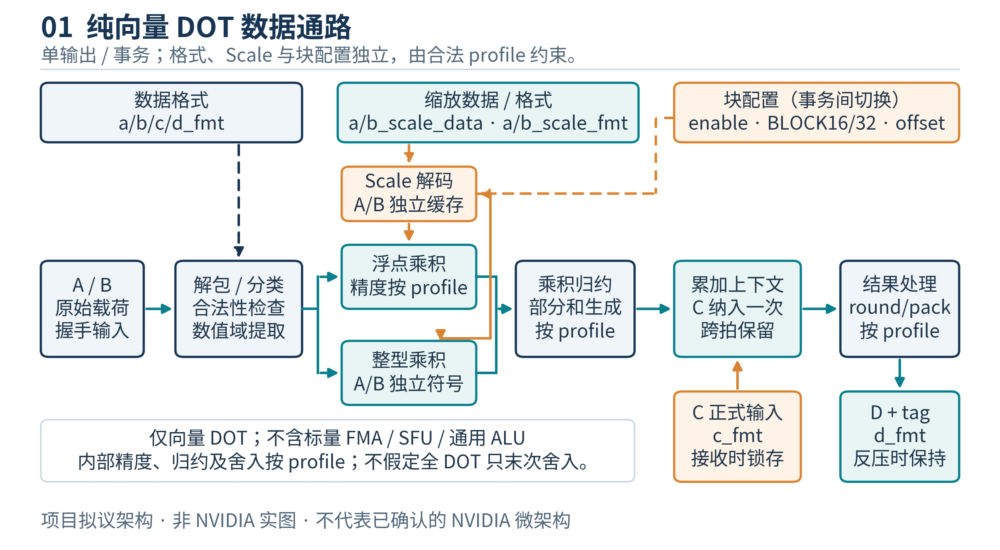
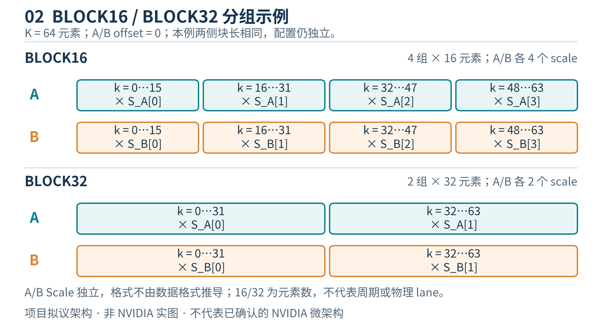
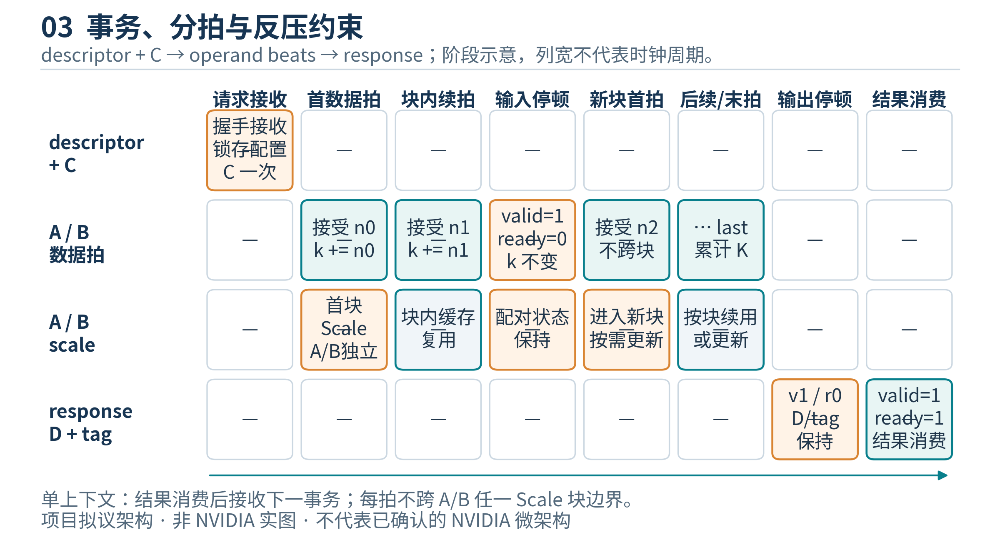
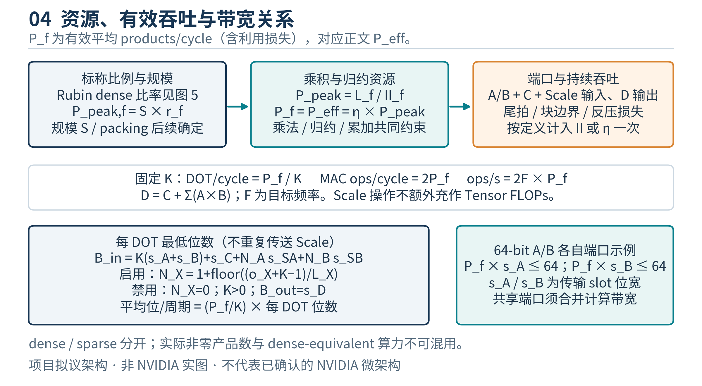
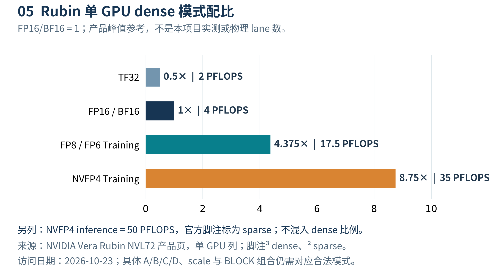
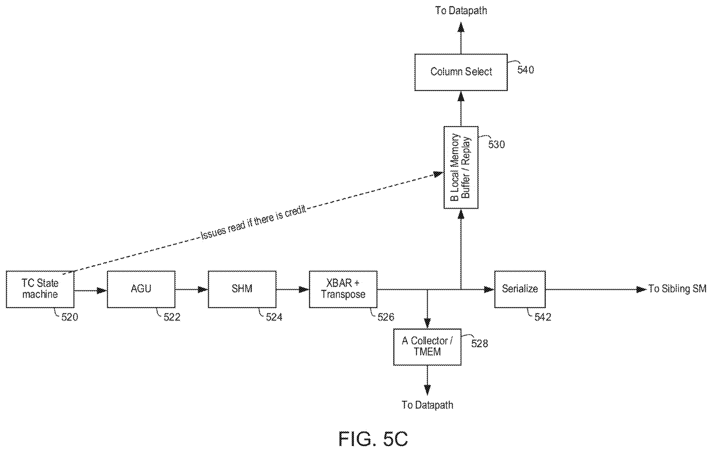
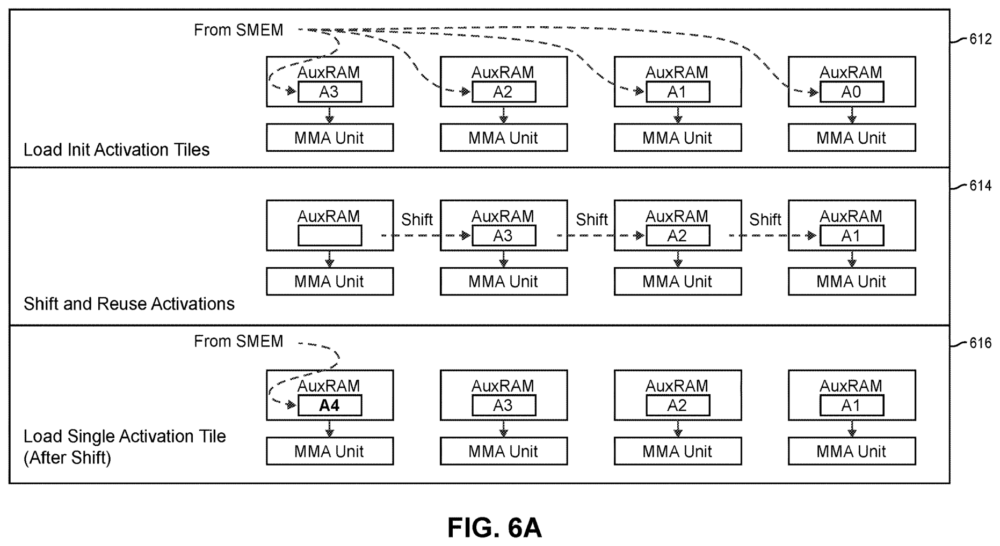

# MALU 向量点积单元详细设计说明书

版本：v1.1／设计评审稿，尚未开展 RTL 编码
日期：2026 年 10 月 23 日
交付形式：带图 Word 文档
设计语言：SystemVerilog
当前阶段：设计评审文档与工程骨架发布；本阶段不开展 MALU RTL 编码。

## 文档状态与阅读约定

本设计服务于 Matrix ALU，简称 MALU。MALU 的外部运算只有带正式 C 输入的向量点积：D = C + Σᵢ AᵢBᵢ。矩阵乘法的每个输出元素由上层矩阵调度器映射为一个或多个点积事务；MALU 不提供独立标量加法、乘法、FMA、通用转换或 SFU 指令。

本文以用户提供的 PTX ISA 9.4、Tensor Core 数值建模论文和两件专利为主要技术资料。引用格式为“[资料编号，PDF 物理页码]”；PDF 物理页码指阅读器从第一页开始的顺序页码，与 PTX 页脚印刷页码不同。PTX 本文所用页码关系为物理页码等于印刷页码加 12。对 PTX 文档已经直接核验的内容标为“规范事实”；对论文所测 GPU 的现象标为“实验结论”；对专利结构标为“专利实施例”；本项目自行选择的实现标为“项目设计”。

本稿是可用于开始详细设计评审的文件。它不宣称已经复现 NVIDIA 的物理 Tensor Core，也不把尚未实施的模块、仿真、综合或时序检查报告为已完成。资料没有定义的细节在决策表中显式保留，不能用默认猜测代替规格。PTX 原件封面为 NVIDIA Corporation，Release 9.4，2026 年 7 月 17 日，共 1002 个物理页；论文已读取全文，两件扫描专利已核验首页、关键实施例及权利要求，未声称逐字读取全部专利页面。

## 1. 已冻结需求

### 1.1 功能与边界

每笔普通数值点积的数学关系为：

D = C + Σᵢ₌₀ᴷ⁻¹ Aᵢ × Bᵢ。

启用块缩放时，其理想数值表达式为：

D = C + Σᵢ [(SᴬgA(i) × Aᵢ) × (SᴮgB(i) × Bᵢ)]。

以上公式定义数值关系，不规定硬件必须按表达式书写顺序计算，也不意味着整个点积只进行一次舍入。实际乘积精度、scale 应用位置、归约顺序、中间截断和最终编码由具体 numeric profile 决定。

需求已经确定如下：

| 项目 | 要求 |
|---|---|
| 运算对象 | Matrix ALU，只处理向量点积 |
| 正式输入 | A、B 向量与 C 累加输入；D 为输出 |
| 数据格式 | A/B/C/D 格式分别描述，合法组合由 profile 校验 |
| 缩放数据 | A/B 各自有 scale payload |
| 缩放格式 | A_scale_fmt 与 B_scale_fmt 独立描述，不与 A/B 数据格式混合 |
| 块缩放 | 运行时 enable、BLOCK16/BLOCK32；随请求锁存 |
| 覆盖边界 | PTX 矩阵／点积相关浮点、整数及其缩放格式 |
| Ti16 | 纳入需求；真实 PTX 名称和编码约束见第 4 节 |
| 算力参照 | Rubin，默认单 GPU、dense Tensor 点积口径 |
| 稀疏模式 | 与 dense 分栏；不能用稀疏峰值替代 dense 配比 |
| 实现语言 | 可综合 RTL、接口及验证组件使用 SystemVerilog |
| 交付次序 | 先提供详细设计文档，再开展 RTL 工作 |

“所有格式”要求落实到合法的点积输入、累加、结果及 scale 角色，不是将 PTX 中每一个标量类型与每一个算术指令做笛卡尔积。例如，位容器不自动成为算术类型，scale 类型不自动成为普通 A/B 类型，矩阵指令的 INT32 累加也不等于需要实现独立 INT32 标量 ALU。

### 1.2 本设计不承担的上层功能

TMEM 分配／释放、shared-memory 描述符解析、矩阵布局和 swizzle、CTA 协同、warp 参与约束、异步完成与 mbarrier、稀疏元数据展开和完整指令发射均属于 Tensor 执行外壳。MALU 接收上层已经解析并验证的数值事务，不直接实现整个 tcgen05 ISA。

这一区分不删除相关规范约束。上层必须把矩阵元素顺序、scale 对应关系和 C 累加语义正确映射到 MALU，MALU 则必须保持数值与事务语义。

## 2. 证据与设计信息的使用原则

### 2.1 PTX 能说明什么

PTX 是虚拟 ISA。它规定合法指令、操作数类型、目标架构、可观察数值行为和线程协同要求。它不是 GPU 版图或门级架构说明。由一个矩阵形状不能直接推导物理乘法器数量、内部 lane 数、流水线级数或每周期发射数。

本文从 PTX 提取“软件可见的执行架构与数值约束”，再提出本项目可实现的微架构。所有内部并行度、队列深度、模块边界和寄存器划分均单独标为项目设计。

### 2.2 证据层次

| 层次 | 约束用途 | 必须保留的限制 |
|---|---|---|
| PTX ISA 9.4 | 组合合法性、数值最低要求、target 要求 | 不补出原文未定义的硬件细节 |
| 论文实测 | 指定 GPU、指定指令和输入类型的数值 profile | 不直接推广到 Rubin 或未测格式 |
| NVIDIA 官方 Rubin 资料 | 产品层面吞吐和统计口径 | 不把系统值当单芯片值，不混淆 sparse/dense |
| 专利 | 可选的数据通路与复用方案 | 实施例不等于量产产品已经采用 |
| 知乎等解释文章 | 研究线索和背景理解 | 重要结论回到一手资料验证 |
| 本项目设计 | 接口、控制、流水与可实现方案 | 不冠以 NVIDIA 真实内部实现之名 |

每个设计决策应记录来源、适用条件、是否强制、采用理由和对应验证项。来源冲突时，先检查版本、GPU 代际、矩阵指令族及 dense/sparse 差异，不能简单拼接结论。

## 3. PTX 矩阵／点积语义与覆盖组织

### 3.1 矩阵指令到点积事务的映射

矩阵运算 D = A × B + C 中，每个输出元素 D[m,n] 对应沿 K 维的点积。上层负责取出 A[m,k]、B[k,n]、C[m,n] 并建立逻辑顺序。MALU 的 K_total 表示本事务参与运算的逻辑元素数，与总线 beat 数、矩阵指令名称中的向量长度及物理乘积 lane 数不同。

tcgen05 原文使用 D = A×B + D，输入累加使能为假时为 D = A×B；本项目通过适配器将原输入 D 映射成正式 C，而不是删除累加操作数。[P1，PDF 755、827]原生 tcgen05 没有通用独立 C-format 字段；用户要求的 C_fmt/D_fmt 在本项目中独立描述。当组合无法直接对应原生同格式 D 时，必须规定内部转换并标为项目能力，不能倒写成 PTX 原生承诺。

对分块 K，必须明确子事务是否发生架构可见写回。若分块只是同一逻辑点积的传输切片，不能在 beat 边界增加未规定的舍入；若分块对应独立矩阵指令并产生 C/D 形式的写回，则按该指令 profile 执行可见的格式化及后续 C 装载。

### 3.2 组合矩阵

合法性表的最小键值如下：

| 字段 | 作用 |
|---|---|
| instruction_family | mma／tcgen05 等数值语义来源 |
| target_arch | 原文要求的具体架构或 family |
| dot_kind | FP_DOT、INT_DOT；BINARY_DOT 需对应 ISA 核验 |
| A_fmt、B_fmt | 各自输入编码及允许的组合 |
| C_fmt、D_fmt | 累加输入和结果编码 |
| A_scale_fmt、B_scale_fmt | scale 自身的编码 |
| blk_scale_cfg | enable、BLOCK16/BLOCK32、分组映射 |
| packing | 寄存器、字节槽或紧密打包的逻辑元素映射 |
| precision_profile | 乘积、归约、累加精度与数值次序 |
| postprocess | 仅该组合规定的饱和或结果变换 |
| implementation / verification | 实现状态与验证闭合状态 |

外部格式字段互相独立，并不意味着任意组合都合法。译码检查器从用户请求构造完整 tuple，再查询合法组合。非法组合产生明确拒绝状态，不静默替换格式、不自动转成另一个合法指令。

### 3.3 类型族与角色

| 类型族 | 在本项目中的角色 | 重要限制 |
|---|---|---|
| F16、BF16 | 矩阵输入；部分指令允许 F16/F32 结果 | C/D 组合必须逐指令核验 |
| TF32 | 矩阵乘法输入 | 不是随意截断 F32 尾数；存储与有效精度分开 |
| E4M3、E5M2 | 低精度矩阵输入 | 特殊值与舍入按格式分别定义 |
| E2M3、E3M2 | FP6 矩阵输入 | 逻辑 6 位与物理存储槽宽分开 |
| E2M1 | FP4 矩阵输入 | 普通和块缩放指令具有不同合法条件 |
| F32 | 主要作为累加与结果格式 | 不能从结果格式推导普通 F32 A/B 支持 |
| F64 | PTX 矩阵指令相关格式清单的一部分 | 与 tcgen05 支持集合及 Rubin 配比区别登记 |
| S8、U8 | 整数矩阵输入 | 混合符号、饱和支持按具体组合 |
| S4、U4、B1 | 其他 PTX 矩阵／点积指令的候选覆盖行 | 不宣称 tcgen05 支持；按对应指令族登记 |
| Ti16／S1Z4M11 | tcgen05 整数矩阵输入 | 16 位存储，数值范围不是普通 S16 |
| S32 | 整数 C/D | 回绕、饱和与中间精度分别定义 |
| UE8M0、UE4M3、UE5M3 | scale 类型 | 不开放为普通 A/B 数据类型 |

完整清单以 [P1] 的矩阵／点积章节逐行展开。当前设计不能将上述类型族表本身作为“所有组合均已实现”的证明。tcgen05 表 50 没有 F64、S4/U4 或 B1 行；它们属于较早矩阵指令覆盖项。较早 dp4a/dp2a 可登记为独立 dot profile：dp4a 是四个 8 位乘积加 C，dp2a 是两个 16 位 A 与两个 8 位 B 的点积加 C；不能用它们推导 Rubin Tensor 峰值。[P1，PDF 171—173、586—589、700—704]

### 3.4 已核验 tcgen05 原生格式概览

| kind | A/B | 原生 D 累加／输出 | block scale |
|---|---|---|---|
| f16 | F16 | F16 或 F32 | 无 |
| f16 | BF16 | F32 | 无 |
| tf32 | TF32 | F32 | 无 |
| f8f6f4 | E4M3/E5M2/E2M3/E3M2/E2M1 | F16 或 F32 | 无 |
| mxf8f6f4 | 同上 | F32 | UE8M0 |
| i8 | S8/U8 | S32 | 无 |
| mxf4 | E2M1 | F32 | UE8M0 |
| mxf4nvf4 | E2M1 | F32 | UE8M0/UE4M3/UE5M3 |
| ti16 | S1Z4M11 | S32 | 无 |

来源为 [P1，PDF 700—704、724—726]。该表概括类型角色，不替代 shape、target 和输入混合格式的逐行合法性检查。f8f6f4 明确支持 FP8/FP6/FP4 输入组合，但其扩展 K 又有类型与架构条件。矩阵 tile 维度不能作为物理 MALU lane 数。

## 4. Ti16 的核验与输入处理

### 4.1 名称纠正

用户此前提供的线索为“Ti16，e1z4m11”。实际读取 PTX ISA 9.4 后，Table 53 和紧接正文写的是 .s1z4m11，不是 .e1z4m11。[P1，PDF 724—725；印刷页 712—713]

规范明确说明：在 .kind::ti16 下，A/B 元素为 .s1z4m11，属于 16-bit signed integer，数值范围为 [−2¹¹+1, 2¹¹−1]，即 [−2047, 2047]。Table 53 中 A/B 类型编码为 3，D 类型为 S32。Ti16 行的饱和字段为 0（NA），不能沿用 I8 的 saturation 选择。[P1，PDF 724—725]

### 4.2 不能由名称自行补出的内容

上述条文足以确定名称、存储宽度、数值范围及 D 类型，但不能仅凭“s1z4m11”字样就画出完整负数编码、断言其是 sign-magnitude 或对 16 位位模式直接做普通 two's-complement 乘法。

因此，Ti16 解码必须在编码细节获得明确来源后冻结。设计数据表包含“原始 16 位模式 → 有符号数学整数”的独立转换；其输出可进入通用整数乘积通路。若存在保留位、非法编码或多重零编码，应记录合法性与处理规则，不能默认按普通 INT16 处理。

在编码细节尚未闭合时，Ti16 对外保留为必需覆盖项，但不得在验收表中标为实现完成。本限制属于数值解码细节待核验，不是重新讨论 MALU 的功能范围。

### 4.3 确定范围带来的宽度预算

由范围可直接计算：最大单项绝对乘积为 2047² = 4,190,209，数学乘积可容纳在 23 位 signed 中。C=0 时，K16 的极值为 67,043,344，可由 27 位 signed 容纳；K32 为 134,086,688，可由 28 位 signed 容纳。这些是数学推导，不是专利披露的物理位宽。加入任意 S32 C 后仍可能超出 S32，因此不能删除溢出处理。

Table 53 的 Ti16 transpose 栏仅列 No Transpose=0，而 Table 64 将 Ti16 transpose support 写为 Yes。[P1，PDF 724、757]本稿保留该原文差异，不在无解释时挑一项当成无歧义结论。上层以供数顺序实现转置可以保持 MALU 点积接口稳定，但不能据此宣称已经解决原生 descriptor 编码冲突。

## 5. 独立 scale 格式与运行时块缩放

### 5.1 五类信息分开描述

接口分开携带：A/B/C 数据；A/B/C/D 格式；A/B scale 数据；A/B scale 格式；块缩放配置。不能将“FP4 + scale”合并成一个模糊格式 ID，以至于无法确定 payload 编码或 BLOCK 长度。

| 信息 | 主要内容 |
|---|---|
| data | A 元素、B 元素、正式 C 输入 |
| fmt | A_fmt、B_fmt、C_fmt、D_fmt |
| scale_data | A_scale_payload、B_scale_payload |
| scale_fmt | A_scale_fmt、B_scale_fmt |
| blk_scale_cfg | enable、BLOCK16/BLOCK32、A/B 首元素块内 offset、索引映射 |

### 5.2 已核验的 tcgen05 scale 组合

[P1，Table 70/71，PDF 781—782；印刷页 769—770]给出的约束整理如下：

| MMA kind | A/B 元素类型 | scale 编码 | 合法块长度 |
|---|---|---|---|
| mxf8f6f4 | E4M3/E5M2/E2M3/E3M2/E2M1 | UE8M0 | BLOCK32 |
| mxf4 | E2M1 | UE8M0 | BLOCK32 |
| mxf4nvf4 | E2M1 | UE8M0 | BLOCK16 或 BLOCK32 |
| mxf4nvf4 | E2M1 | UE4M3 | BLOCK16 或 BLOCK32 |
| mxf4nvf4 | E2M1 | UE5M3 | BLOCK16 或 BLOCK32 |

UE5M3，以及 UE4M3 配合 BLOCK32，要求 sm_107f 或同 family 更高目标；目标不符时原文将行为描述为 undefined。[P1，PDF 782]本项目应在接收请求时拒绝不合法 target/profile，不能把 undefined 当作可以随意返回任意数值。

原 PTX 指令描述符使用共同的 scale 类型字段，而本项目要求独立 A_scale_fmt/B_scale_fmt。两者通过合法组合表衔接：在忠实实现上述 PTX profile 时，要求两个字段符合相同的原文 scale 格式限制；若未来允许 A/B 使用不同 scale 格式，必须单列为项目扩展，不宣称属于已核验的 PTX 组合。

### 5.3 BLOCK16/BLOCK32 是运行时参数

设计提供随请求锁存的 block_mode，取值为 BLOCK16 或 BLOCK32；它不能只是 elaboration 参数。enable=0 时忽略 scale payload 的数值作用，但仍需明确接口上是否允许其省略。

令事务内逻辑元素编号为 i，A 的首元素块内偏移为 off_A、B 为 off_B，则内部索引可按：

g_A(i) = floor((off_A + i) / block_len_A)，g_B(i) = floor((off_B + i) / block_len_B)。

此式是本项目的逻辑接口定义，不替代 PTX 在 TMEM 或描述符中对 scale 的物理布局。PTX profile 可对 offset、块长度和布局增加合法性限制。共享 BLOCK 模式与 A/B 分别描述的映射相容：请求给出一个已选择的模式，内部为 A/B 各自保存边界计数和当前 scale。

### 5.4 scale 不是一律为 2 的幂

UE8M0 属指数型 scale，可以在满足特殊值与范围规则时采用指数调整；UE4M3、UE5M3 带有效数，不能简化成只加指数。scale 解码器输出有效数、指数、分类及合法性信息，后续 profile 决定与 A/B 乘积的组合位置。

不能先随意舍入“scale × A”，再与 B 相乘。若这样做会增加原文没有规定的量化点，应保留必要精度或采用规定的组合方式。scale 的上溢、下溢、特殊值和禁用行为均要单独验证。

### 5.5 scale 数量与 K 的口径

BLOCK16/BLOCK32 不固定等于“4 个／2 个 scale”。Table 70 明列 K96 时分别 6／3 个，K128 时分别 8／4 个；又存在与 K128 专门行字面重叠的 fallback 描述。[P1，PDF 781]后续图布局还同时涉及 dense 与 sparse K，不能把压缩存储长度直接作为逻辑 K。

适配层因此分别保存 logical_K、packed_K、block_elems、scale_count 和 layout_profile。基线 dense 点积以逻辑索引推进 scale，非零 offset 时按实际覆盖块数计数；具体原生矩阵 shape 则依据对应布局图查表，不从一个通用除法公式覆盖所有 PTX 存储布局。

另一个容易混淆的字段为 scale-input-d：它表示输入累加值按 2^(−s) 缩放，s∈[0,15]，仅 tf32/f16 kind 合法。[P1，PDF 827]本项目的 C 映射原输入 D，普通 dot 默认不额外缩放 C。要覆盖此修饰符，应使用独立 c_scale_shift／profile，作为特定模式能力，由合法表约束；它不同于 A/B block scaling，不能占用 A/B scale_fmt 或 blk_scale_cfg，也不形成标量操作接口。

## 6. 总体架构与数据流



MALU 采用描述符、操作数流和结果流分离的结构。请求控制器接收并锁存 profile、格式、K 和 scale 配置；操作数通路解包 A/B、匹配 scale、计算乘积并执行规定归约；累加上下文持有 C 和中间状态；结果通路执行规定的规格化、舍入、饱和及编码。

推荐模块划分如下，模块名为项目命名而非 NVIDIA 公开内部单元：

| 模块 | 职责 |
|---|---|
| malu_dot_pkg | 格式描述、profile、合法组合和类型定义 |
| malu_req_ctrl | 接收描述符、状态机、tag、K 计数及拒绝响应 |
| malu_operand_unpack | 从存储槽恢复逻辑元素，分类与数值解码 |
| malu_scale_decode | A/B scale 解码、块映射、当前 scale 状态 |
| malu_fp_product | 按 profile 产生未过早格式化的浮点乘积 |
| malu_int_product | 整数扩展及完整或规定精度乘积 |
| malu_dot_reduce | 按 profile 定义的树或顺序归约 |
| malu_acc_context | C 装载、跨 beat 累加状态与完成条件 |
| malu_round_pack | 最终舍入、规定后处理、D 编码 |
| malu_rsp_ctrl | 输出缓冲、tag 和错误状态 |

基线采用 MAX_INFLIGHT=1，有利于首先验证所有数值组合和严格事务隔离。该选择不等于最终吞吐配置。完成正确性基线后，可以增加多上下文或并行引擎，但必须重新证明反压、数值次序和资源冲突行为。

## 7. 事务接口详细定义

### 7.1 请求描述符

| 字段 | 语义与约束 |
|---|---|
| req_tag | 请求标识；原样返回 |
| numeric_profile_id | 权威数值语义选择，不允许任意拼接非法舍入配置 |
| dot_kind | FP_DOT、INT_DOT；二进制点积由合法表决定 |
| K_total | 参与本事务的逻辑元素数；0 和超限值明确拒绝 |
| A_fmt/B_fmt | 输入编码；独立携带但按 tuple 检查 |
| C_fmt/D_fmt | 正式累加输入与结果编码 |
| C_data | 本事务正式 C 输入，接收请求时装载一次 |
| c_scale_shift | 特定原生 profile 的 C 输入 2^(−s) 变换，普通 dot 固定 0 |
| A_scale_fmt/B_scale_fmt | 独立 scale 编码 |
| blk_scale_enable | 是否使用 scale |
| blk_scale_mode | 运行时 BLOCK16/BLOCK32 |
| A/B_scale_offset | 首元素在各自逻辑 scale 块中的位置 |
| layout_id | 总线槽到逻辑元素的映射；不等同于矩阵 shared-memory 描述符 |

不单独提供自由的标量 rounding/FTZ/saturation 控制，使其与 profile 构成未定义的组合。若调试接口需要观察这些属性，应由 profile 查表导出。

### 7.2 操作数 beat

beat 携带 A_payload、B_payload、有效元素数或掩码、相应 A/B scale payload、scale 有效标记和末拍提示。有效元素数必须明确；不能用尾部填零默默扩展 K。若提供 last，则要求它与 K 计数一致，矛盾时产生协议错误。

基线明确要求：每个输入 beat 不跨越任一 A 或 B 缩放块边界。上层按 A/B 中更早到达的边界拆分，MALU 独立维护两个边界计数；不能无声丢弃跨界元素。若后续支持一个 beat 携带多个 scale，则另行定义 per-segment scale 数量、有效标记和内部拆分，保留相同逻辑元素语义。

### 7.3 响应

响应包含 req_tag、D_data、D_fmt 回显或约定的固定关联、completion_status。错误至少区分 illegal_profile、illegal_format_tuple、illegal_scale_cfg、length_error、malformed_encoding 和 protocol_error。

这些状态是项目接口，不能宣称 PTX 向软件暴露对应异常寄存器。数值 NaN、Inf 或整数回绕本身是否构成错误，由 profile 决定；不能把合法数值结果误报为协议错误。

## 8. 格式描述与内部数值表示

### 8.1 格式描述表

每个格式描述项包含 storage_bits、有效位数、符号／指数／有效数字段、偏置、合法编码、特殊值判别、次正规数规则、数值范围、打包方式和允许角色。特殊值逻辑按格式选择，不能统一使用“指数全 1 即 Inf/NaN”的判断。

| 格式 | [P1，PDF 54—55] 明确内容 | 设计注意事项 |
|---|---|---|
| E4M3 | 无 Inf；NaN 仅 0x7f/0xff | 不能把全 1 指数全部排除为特殊值 |
| E2M1/E2M3/E3M2 | 无 Inf/NaN | 使用有限值专用分类 |
| UE8M0 | 8 位 unsigned；无 Inf；NaN=0xff | 仅指数型 scale，其他编码细节按来源冻结 |
| UE4M3 | 7 位 unsigned；b8 中 MSB=0；无 Inf；NaN=0x7f | 不能当带符号 E4M3 byte |
| UE5M3 | 8 位 unsigned，5 指数／3 有效数字段；无 Inf；NaN=0xff | 不等同 E5M2，也不只是指数 |
| TF32 | 32 位 special format；范围同 F32；内部布局 implementation-defined | 不能宣称 PTX 规定固定的 19 位物理位域 |

这里没有给出所有自定义格式的完整 bias 和编码数值表；需要进一步权威格式定义的行保持显式状态，不用习惯性编码代替来源。

存储宽度、逻辑有效位与总线槽宽分开。内部可以为 FP6 选择 8 位槽便于实现，但这属于工程选择，不能据此修改原指令紧密打包语义。上层布局适配必须在进入数值运算前恢复正确元素。

tcgen05 中的 FP6 可能是 6 位连续容器，也可能是带 padding 的 8 位容器，取决于 kind、K 和存储路径；mxf4/mxf4nvf4 则每两个 E2M1 放入一个 byte。D 的 subword 元素也不一定紧密打包，例如 F16 D 位于 32 位 TMEM word 的低 16 位。[P1，PDF 759—763]因此，fmt 与 layout_id 分开是必要接口条件。

### 8.2 浮点内部形式

有限数使用符号 s、整数有效数 M 和二进制指数 E 表示：x = (−1)^s × M × 2^E。分类信息单独携带。对零、特殊值、次正规数或格式专用编码分别处理。

最大乘积有效位宽从输入有效位推导，不凭经验固定为某个宽度。指数范围、scale 的有效数与指数、中间归约数量和抵消需要共同纳入位宽证明。对于支持 F64 的独立矩阵 profile，不能沿用仅为 F16/BF16/TF32 设计的内部宽度而宣称兼容。

### 8.3 精度切分原则

每一个寄存器级边界都标注“传输截断”或“数值截断”。传输重排应保持位信息；数值截断只有 profile 明确规定才可发生。sticky 位不能只在普通对齐路径处理，还必须覆盖相消、规格化及舍入进位情形。

## 9. 数值 profile

### 9.1 为什么不能只有一个“正确结果”

Tensor 点积的数值行为可能由规范给出最低精度，而将归约次序、部分舍入或次正规数行为留为未指定。此时用一个宿主语言的求和循环作唯一 oracle，可能把合法实现误判为错误，也可能漏掉低于最低精度的错误实现。

因此划分三类模型：

| 模型 | 用途 | 评价方式 |
|---|---|---|
| ISA_CONFORMANCE | 对应 PTX 明文规定和允许范围 | 检查硬约束及规范允许行为 |
| PROJECT_DETERMINISTIC | 本项目选定的实现次序和精度 | 独立位级参考模型逐位比较 |
| DEVICE_FIT | 文献实际测量设备的拟合 | 仅对该 GPU、指令、格式比较 |

精确点积可以作为分析参考 profile，但不能在未有证据时称为 NVIDIA 或 Rubin 的逐位模型。本项目也不因矩阵数学式中出现乘加，就对外增加标量 FMA 功能。

### 9.2 profile 必需字段

product_precision、scale_application、reduction_group、reduction_order、alignment_rule、accumulator_precision、intermediate_round_schedule、C_injection_rule、input_subnormal_rule、output_subnormal_rule、NaN_rule、overflow_rule、final_round_rule 以及 integer_overflow_rule 均须有定义。

未公开的硬件细节可由项目选择确定，但要满足对应 ISA 的最低要求，并以新的 profile ID 标识。不能用“兼容 PTX”掩盖没有固定确定性语义的问题。

较早 mma 的精度段落明确列出 F16、BF16/TF32、FP8/6/4 及 F64 的要求，并对相关低精度的归约顺序、舍入和输入次正规数处理使用 unspecified。[P1，PDF 589]wgmma 的具体 TF32 输入截断和“current implementation”注释属于该家族。[P1，PDF 677—678]tcgen05 章节没有提供可直接等同的完整 Precision and rounding 段落。故不能把旧家族精度文字无条件复制为 tcgen05 的逐位保证。

### 9.3 舍入与后处理

舍入模式只对原指令允许的组合生效。guard、round、sticky、有效数进位、指数上溢、次正规数以及有符号零必须纳入统一审查。浮点 clamp、finite saturation、ReLU 与整数饱和是不同规则，不能共用一个意义模糊的 sat 位。

点积数据跨 beat 停顿、重新分包或总线变宽不应改变固定 profile 的运算次序。若内部归约分组以逻辑 K 为基准，必须保持逻辑组编号，不能以一次接收的有效 lane 数临时建立不同归约树。

## 10. 整数点积设计

### 10.1 输入解码与乘积

整数输入必须先按格式解释，再进行符号或零扩展。S8、U8、S4、U4 与 Ti16 不得通过只改变一个 signed 属性而忽略编码差异。混合符号组合只在相应 profile 允许时开放。

对解码后位宽为 wA、wB 的数学整数，完整乘积通常需要 wA+wB 位。需要截取低位或执行其他精度规则时，必须来自具体 profile。Ti16 应依据已核验的数值范围分析乘积，而其 raw 16 位存储容器不能直接作为普通 S16 乘法输入。

### 10.2 累加范围

若内部要求对 K 个乘积和 C 无溢出地精确累加，应使用范围证明：

M = |C|max + K × |A|max × |B|max。

有符号内部累加器至少满足 2^(Wacc−1)−1 ≥ M；再按各格式实际非对称范围复核正负边界。该宽度是项目内部精确策略的要求，不能替代某指令规定的 S32 回绕或饱和时机。

### 10.3 溢出与饱和

必须分别规定完整中间累加、S32 可见结果、模回绕、饱和，以及饱和发生于每个逻辑操作还是最终输出。整数可结合律不能作为随意移动饱和位置的理由。Ti16 的 Table 53 饱和字段为 NA，禁止照搬 I8 可选饱和。

若纳入 B1 点积，按对应指令的 AND/XOR 与 population count 语义建立独立点积 profile，不通过普通整数乘法结果宣称等价，也不开放独立逻辑运算端口。

## 11. 浮点乘积、归约与累加

浮点通路包括分类、有效数乘法、指数计算、scale 组合、按规定对齐、带符号归约、C 注入、规格化及 D 编码。对所有格式共用控制框架，但有效数宽度、特殊值路径和截断点按 profile 可配置。

低比特乘积可以采用分片复用宽乘法资源，或使用独立小乘法阵列；选择应服从 Rubin 目标配比及综合结果。复用是否影响每周期产品数，需要明确记录，不能将“某格式位宽减半”直接换算成“吞吐翻倍”。

归约树顺序是数值契约的一部分。对存在规定中间舍入的 profile，不同树形可能产生不同结果。对角、固定分组或顺序累加应基于已选 profile，而不是由 synthesis 任意重关联表达式。

C 在请求接受时装载一次。若某 profile 规定 C 与某一组同时对齐，应保持该关系；若 C 已先转换到内部格式，必须证明该转换不会引入额外误差或违背最低精度。

## 12. 流水线、状态机与反压





### 12.1 逻辑流水

建议逻辑阶段为：接收与合法性检查 → 解包与分类 → scale 准备及乘积 → 归约 → 累加上下文 → 规格化／舍入／编码 → 响应缓冲。此为功能划分，不宣称七周期，也不预设固定频率。

乘法、长移位或归约可进一步切级；多周期路径使用 valid 传递或局部握手。每级数据必须携带 tag／上下文与逻辑元素位置，不能只传数值而丢失 profile 关联。

### 12.2 基线状态机

IDLE 接收描述符；CHECK 完成合法性判断；LOAD/EXEC 接收并处理操作数；DRAIN 等待在途乘积完成；FINALIZE 完成最终规则；RESP 持有响应直到上层接收。非法请求进入受控错误响应，不消耗后续不属于该事务的操作数。

具体是否单独保留 CHECK 周期属于实现选择。状态合并不能改变外部握手或错误处理。

### 12.3 ready/valid 规则

只有 valid 且 ready 时数据转移；valid 且非 ready 时相关 payload、tag、fmt 和状态保持稳定。输出阻塞时必须有有限缓冲或反压链，不能覆盖最后一个结果。

DRAIN 结束依赖已接收 K 数、已发射微操作数和在途归约完成数，不仅依赖最后一个输入 beat。响应不得在 C 注入或最后一次数值处理之前提前有效。

复位清空有效位、上下文和输出队列，丢弃在途事务；复位后不得产生陈旧响应。同步／异步复位方式待上层 SoC 规范决定，但数值语义不依赖某种复位电路写法。

### 12.4 多上下文扩展

后续扩展引入 context_id、独立 K/scale 计数和独立累加器。共享乘法器或归约器必须按 context 路由。第一版不承诺多事务乱序完成；若引入乱序，需由 tag 和 scoreboard 验证，不得以增加 FIFO 的方式默认正确。

## 13. Rubin 吞吐目标与证据口径



### 13.1 目标的含义

用户要求算力配比对标 Rubin。项目据此建立不同点积格式的相对吞吐目标；这不要求复制 Rubin 的内部物理结构，也不等于一个 MALU 要达到整颗 GPU 的绝对吞吐。

首先从同一来源、同一产品版本中获取单 GPU dense Tensor 吞吐，再选择参考格式建立比例 r_f = T_f / T_ref。若来源是多 GPU 系统总吞吐，只有在官方明确 GPU 数量及统计含义一致时才能换算，并将原值和换算值分栏保留。

稀疏吞吐单独登记。不得未经官方条件证明就将稀疏数字除以二作为精确 dense 性能，更不能把 INT OPS 与 FP FLOPS 混为同一种经过测量的执行资源。

### 13.2 已核验的 Rubin 单 GPU 吞吐与配比

本轮已恢复 NVIDIA 官方页面访问，并实际取得 Vera Rubin NVL72 产品规格表及技术博客。此前 403 是历史访问状态，已经不能作为“所有 Rubin 数据仍未核验”的理由。下面直接采用产品表中“NVIDIA Rubin GPU／1 NVIDIA Rubin GPU”一列，不需要把 NVL72 总数除以 72，也不使用双 GPU Superchip 一列。

产品表用脚注 ³ 将 NVFP4 Training、FP8/FP6 Training、FP16/BF16 和 TF32 标为 Dense specification。以 FP16/BF16 的 4 PFLOPS 为参考，得到以下项目对标比例。[R1]

| 官方性能模式 | 单 Rubin GPU | 官方口径 | 相对 FP16/BF16=1 | 计算与状态 |
|---|---|---|---|---|
| TF32 | 2 PFLOPS | dense，脚注 ³ | 0.5 | 2/4；官方原值已核验 |
| FP16/BF16 | 4 PFLOPS | dense，脚注 ³ | 1 | 归一化参考，原值已核验 |
| FP8/FP6 Training | 17.5 PFLOPS | dense，脚注 ³ | 4.375 | 17.5/4；官方按类型组给值 |
| NVFP4 Training | 35 PFLOPS | dense，脚注 ³ | 8.75 | 35/4；限该官方模式 |
| NVFP4 Inference | 50 PFLOPS | sparse，脚注 ² | 不纳入 dense 比例 | 单独登记，不与 training 混算 |

因此，本项目已取得证据的 dense 参考组为：

TF32 : FP16/BF16 : FP8/FP6 Training : NVFP4 Training = 0.5 : 1 : 4.375 : 8.75。

这是官方产品层面模式吞吐的归一化推导，不是随输入位宽推测的 1:2:4，也不是已经证明每个格式、scale 与 BLOCK tuple 都具有该速度。PFLOPS 在此表示每秒 10¹⁵ 次浮点运算的产品统计单位，不代表每秒完成同样数量的完整 dot 请求。

原始页面同时列出 NVL72、Superchip 和单 GPU 三列。NVL72 的 144/288/1260/2520 PFLOPS 与单 GPU 2/4/17.5/35 PFLOPS 的关系可用于表格一致性复核，但本项目引用的原始证据仍是单 GPU 列。



### 13.3 推理、训练与模式覆盖的限制

NVFP4 Inference 的 50 PFLOPS 在产品页脚注 ² 明确标为 sparse。技术博客 Table 2 对 50 使用“Transformer Engine compute”脚注，对 35 使用“Dense compute”脚注。[R2]应分别保存两处脚注措辞；不能将博客的 Transformer Engine compute 简化成所有普通 FP4 指令均有 50 PFLOPS dense。

本项目不将 50 除以 2 后直接作为 25 PFLOPS dense training；原文没有给出这种等价关系，而且官方已经单列 35 PFLOPS dense training。推理加速、稀疏计数和训练模式属于不同统计配置。

以下缺口仍需单独研究，不能因获取四组产品值而宣称所有格式配比闭合：

| 待映射模式 | 已有证据 | 仍未确定的内容 |
|---|---|---|
| FP8：E4M3/E5M2 | 官方 FP8/FP6 Training 组为 17.5 PFLOPS dense | 每个输入混合 tuple、C/D 和 scale 的独立保证 |
| FP6：E2M3/E3M2 | 同上 | 不同打包与矩阵 shape 下是否同吞吐 |
| FP4 的普通／MX／NV 模式 | NVFP4 Training 为 35 PFLOPS dense | 不能直接推广到所有 E2M1、UE8M0/UE4M3/UE5M3 tuple |
| BLOCK16/BLOCK32 | 本项目运行时选择及 PTX 合法表已明确 | 产品吞吐表没有逐个块配置给值；不能仅凭名称自动填满两行 |
| I8 与 Ti16/S1Z4M11 | PTX 合法性与 Ti16 名称／范围已有证据 | 本次官方表没有给出其整数 Tensor 峰值 |
| F64、I4、B1 legacy matrix | 对应指令家族资料已有登记 | 没有可用于本次 Rubin 原生 Tensor 配比的值 |

产品表另列 FP32 130 TFLOPS、FP64 33 TFLOPS；技术博客 Table 3 明确将其列为 vector 性能。[R1/R2]它们不进入上述 Tensor dense 配比。博客还列出 FP32/FP64 matrix 的 Tensor Core-based emulation 峰值，这类多次低精度运算的软件模拟也不能当作原生 F32/F64 乘积阵列吞吐。

### 13.4 对 MALU 资源目标的含义

在相同项目时钟下，可以将已核验 dense 比例作为 P_peak,f = S×r_f 的第一组资源目标，S 为项目选择的参考规模，r_f 为上述比例。S 不由整颗 GPU 的绝对 PFLOPS 自动决定。

若需要用整数表达参考预算，可将比例写成 4:8:35:70；这只是把所有比例同乘 8，不能直接宣称必须实例化 4/8/35/70 个物理乘法器。实际 L_f、II_f、共享资源、scale 带宽、归约与响应开销仍需要综合和验证。

产品吞吐是整颗 GPU 的峰值统计，不包含本项目实际时钟与面积约束，也不能保证短 K 或持续反压时仍达到标称比。性能验证同时报告 P_peak 和 P_eff，dense 与 sparse 分开。

## 14. 参数化吞吐、带宽与资源估算

### 14.1 点积吞吐口径

设每次 issue 的逻辑乘积数为 L、issue 间隔为 II 个周期，则理想稳态产品率 P_peak = L/II，单位为 products/cycle。额外有效利用率为 η 时，P_eff = ηP_peak；图 4 的 P_f 指 P_eff。工作频率为 f 时，长点积的乘加计数吞吐为 2P_eff f，等于 2P_peak fη。这里“2”采用一次乘法加一次累加计作两次运算的产品峰值口径；对于较短 K、正式 C 注入、尾拍、切换和反压，需另外计算实际事务周期数，不能将公式直接作为实测值。

不同格式可具有不同 L_f 和 II_f。同频率理想比例为 P_peak,f/P_peak,ref，不能再次除以 II。η 只计入尚未包含的空泡、带宽不足和利用损失，避免重复扣减。与官方峰值比较时使用峰值口径，与实测比较时记录各自 η，而不是比较输入位宽或 RTL 实例数。

### 14.2 数据带宽

无上层复用时，P 路乘积需要 A/B 数据带宽约 P(wA+wB) bit/cycle；若每 B_A/B_B 个逻辑元素使用一个 scale，则平均 scale 带宽约 P(sA/B_A+sB/B_B) bit/cycle。正式 C 与 D 的平均开销另计。

一个长度 K 的独立点积，其 C/D 开销摊销约为 (wC+wD)/K bit/element；短 K 时该开销不可忽略。scale 有效载荷需计入打包、对齐和跨块实现，不能只看平均公式而忽略最坏 beat 突发。

总线需要满足最坏 profile，而低位宽类型可以用槽打包提升利用率。若上层不能提供足够带宽，增加乘法 lane 只会提高空转比例。

### 14.3 配置策略

第一版保持 P、队列深度、最大 K 与最大上下文数参数化，待 已核验 Rubin 模式比例、具体 tuple 映射和 EDA 评估后选定实际数值。共享整数／低比特浮点乘法器、独立 F64 路径或时分复用均为候选项目选择，需要面积、频率、功耗和正确性共同评估。

没有综合与时序结果时不填面积、频率或功耗承诺值；资源表记录“计划／已综合／已实现”状态。

## 15. 论文数值模型与本项目的采用方式

本节以 [L1] 为实验来源，具体结论必须保留 GPU、指令和格式限定。研究人员观察到的内部精度模型是从行为反推的解释，不等同于芯片厂家公开了对应寄存器宽度。

当前已核验的论文版本为 arXiv:2512.07004v3，作者 Faizan A. Khattak 与 Mantas Mikaitis，University of Leeds，版本日期为 2026 年 4 月 4 日。论文覆盖多个代际的 Tensor Core 数值行为。[L1，PDF 1—3]

论文对 B200 的 tcgen05.mma 测试中，F16/TF32 的相应结果与其所测 Hopper 结果一致；f8f6f4 部分实际只测试了 FP8，并未覆盖 FP6/FP4。[L1，PDF 12，§4.1.7]因此，不能将论文表格直接作为 FP6、FP4、块缩放、Ti16 或 Rubin 的 profile。

### 15.1 已核验模型参数

下表摘录 [L1，PDF 15，Table 4]。对阶 (2,q) 是论文对未规格化数值的模型表示，其中 2 为整数位数，q 为小数位数；“内部累加位数”不是产品物理加法器数量，也不是输出格式有效精度。

| 输入／FP32 输出 | 实验对象／路径 | 对阶表示 | 内部累加位数 | 归约分组长度 | 最终处理 |
|---|---|---|---|---|---|
| FP16 | V100 | (2,23) | 28 | 4 | Trunc |
| FP16/BF16 | Ampere；所测 Ada | (2,24) | 30 | 8 | Trunc |
| TF32 | Ampere；所测 Ada | (2,24) | 29 | 4 | Trunc |
| FP16/BF16 | H100/H200/B200 | (2,25) | 32 | 16 | Trunc |
| TF32 | H100/H200/B200 | (2,25) | 31 | 8 | Trunc |
| FP8 | L40S/Ada 原生路径 | (2,13) | 20 | 16 | Trunc |
| FP8 | H100/H200 原生路径 | (2,13) | 21 | 32 | Trunc |
| FP8 | B200 tcgen05 原生路径 | (2,25) | 33 | 32 | Trunc |

论文将相应 FP8→FP16 最终处理列为 RNE。表中的 Trunc 按论文模型解释，不直接替换为所有 profile 的 IEEE 舍入模式。论文称 TF32 为 tf19，不表示其承载寄存器是 19 位。[L1，PDF 4、15]

### 15.2 对架构和验证的具体影响

论文以不同未规格化表示产生相同数学乘积的测试，区分后续对阶／截断路径；例如 1.5×1.5 与 1×2.25 配合小乘积可能出现不同结果。[L1，PDF 7—8，Fig.2]若目标是拟合该模型，不能先将所有乘积规格化为同一已舍入浮点数，再认为后续归约必然等价。

C=0 与非零次正规 C 也可能改变极小乘积对阶路径。[L1，PDF 9、11]因此，C 的参与位置必须写入 profile，不能将其随意挪成归约后的普通加数。

本项目将上述参数逐项建立 DEVICE_FIT 条目，固定 GPU、指令入口和输出类型。论文中的分组长度不等于一次总线 beat 的 lane 数，也不一定等于完整 dot 的 K。论文报告随机和定向测试与相应硬件逐位匹配；这不是穷尽证明，也未覆盖 Rubin、Ti16、FP6/FP4 和所有 block-scale 配置。[L1，PDF 12、14—15]

## 16. 专利调研与架构选择

两件所附专利用于寻找可实现的数据通路、可复用资源和精度处理方式。专利图、权利要求和实施例分别登记。两份原件为扫描 PDF，本次对首页、关键说明书页和权利要求页做局部 OCR，并查看对应原页／图页核验；不声称逐字读取全部专利页面。

| 资料 | 本文采用方式 | 设计状态 |
|---|---|---|
| US20250077615A1 | METHOD AND APPARATUS FOR WEIGHT-STATIONARY DIRECT CONVOLUTION CALCULATION | NVIDIA；申请 2023-08-30，公开 2025-03-06 |
| US20250060938A1 | METHOD AND APPARATUS FOR DIRECT CONVOLUTION CALCULATION | NVIDIA；申请 2023-08-14，公开 2025-02-20 |

### 16.1 Weight-stationary 专利

PAT1 的 Fig.5A/5B（PDF 11）和 Fig.5C（PDF 12），结合说明书 [0093]—[0103]（PDF 61），描述将 weights 保持于 stationary A-input／collector，B 侧 activations 通过 local/replay buffer 流式供给。控制实施例包含 datapath state machine、AGU、SMEM、crossbar／transpose、A collector、B local buffer 和 column select。



独立权利要求 1（PDF 80）描述输入接口、输入／输出存储、多 processing lanes，以及保持 weights 的 MMA 序列和输出累加。此处的技术重点是驻留与复用的数据流；不是对浮点乘积或归约精度的保证。

对本项目的作用是：将可复用的输入 collector、replay 和地址生成保持在数值核心外层，在 MALU 接口中允许上层持续流式供数。无需为了完成 dot+C 而实现完整卷积滑窗。专利举例的 32-lane partition 和 128-element 组合不能直接变成本项目固定 lane 数。

### 16.2 Direct-convolution 专利

PAT2 的 [0086]—[0093]（PDF 52）及 Fig.5A/5B（PDF 11）给出 activation 驻留于 TMEM/collector、weights 从 SMEM/bus 供给的实施例。[0108]—[0119]（PDF 54）描述 UTCSHIFT、UTCCP、UTCMMA，以及向量点积跨 channel 扩展到矩阵运算的方式。



独立权利要求 1（PDF 69）重点是保留已有 first vector 的部分元素、shift、补入新元素并执行后续 MMA，结果累加至输出存储。它与 PAT1 的驻留侧选择不同，构成可比较的数据复用策略，而不是两个需要同时塞入 MALU 的必选模块。

本项目借鉴之处是将 layout、复用、滑窗和数值运算分层；向量进入 MALU 后，逻辑元素和 scale 的对应关系已经明确。专利的输出 bitmask 或 lane partition 不能直接当作本项目末拍有效 mask 的规范。

采用任何专利实施例作为项目候选结构时，记录该实施例解决的问题、所需格式与精度条件，以及对本项目吞吐和验证的影响。没有原文依据时，不将两件专利分别标签为某个 GPU 世代的硬件。上述已核验段落没有给出 Ti16 位编码、FP 归约位宽、舍入、FTZ 或 scale 合法表，不能用于填补这些数值缺口。

## 17. SystemVerilog 实现约束

可综合模块使用明确位宽的 logic、enum、packed struct 和参数；算术表达式显式控制符号扩展和结果位宽，避免 unsized 常量和混合 signed/unsigned 导致隐式截断。

数值运算不使用 real/shortreal 实现，不依赖宿主机浮点作为综合结果。不以 $bitstoshortreal 作为完整 IEEE 或低比特格式 oracle。验证模型可以采用 SystemVerilog 的多字位向量和纯软件式算法，但其数学运算必须与 DUT 独立实现。

格式定义、合法组合和 profile 元数据可以共用，参考模型的乘法、对齐、归约与舍入算法不照抄 RTL，防止共同错误。文件编译顺序为 package → interface → 叶级模块 → top → verification。

所有模块均提供参数合法性检查；不支持的 elaboration 配置在编译／仿真开始时明确报错。位宽和最大 K 对应关系应有生成时断言或静态检查。

## 18. 工程目录与文件组织

工程根目录包含 setup.csh、design 和 verif。design、verif 下分别建立 core/soc；每个 core/soc 下包含 filelist、flow、src；filelist 与 src 均包含 if、common、rtl；rtl 下包含 sp、cp、mss，MALU 路径为 sp/eu/tensor/malu。

```text
    <project>/
    ├── setup.csh
    ├── docs/malu/
    ├── design/
    │   ├── core/
    │   │   ├── filelist/
    │   │   │   ├── if/
    │   │   │   ├── common/
    │   │   │   └── rtl/
    │   │   │       ├── sp/eu/tensor/malu/
    │   │   │       ├── cp/
    │   │   │       └── mss/
    │   │   ├── flow/
    │   │   └── src/
    │   │       ├── if/
    │   │       ├── common/
    │   │       └── rtl/
    │   │           ├── sp/eu/tensor/malu/
    │   │           ├── cp/
    │   │           └── mss/
    │   └── soc/（同构）
    └── verif/
        ├── core/（同样包含 filelist、flow、src 的完整结构）
        └── soc/（同构）
```

实现路径为 design/core/src/rtl/sp/eu/tensor/malu；公共数值／格式包位于 src/common，接口位于 src/if；对应 filelist 位于 design/core/filelist/rtl/sp/eu/tensor/malu。

verif 结构镜像用户要求；其中 src/rtl/sp/eu/tensor/malu 存放 testbench 和 SVA，这里的 rtl 是目录命名约定，不表示这些验证文件需要综合。位级参考模型、scoreboard 和覆盖率包可放 verif/core/src/common。

filelist 使用明确的项目根相对路径，flow 从已知项目根运行，避免不同 EDA 对 .f 中变量展开行为不同。生成物统一放项目外部 build 目录或明确 ignored 目录，不污染 src 和 filelist。

## 19. setup.csh 与 EDA 环境规划

本节是配置设计，不是已经执行的脚本。实际生成脚本前先检测已有工具、版本和许可证绑定。不能编造 VCS、Xcelium、Questa、综合器或形式工具版本。

| 配置项 | 用途与要求 |
|---|---|
| PROJECT_ROOT | 由脚本位置或显式输入解析，不依赖调用者工作目录 |
| MALU_BUILD_DIR | 编译、波形、覆盖率及报告目录 |
| MALU_SIMULATOR | 选择已安装且可用的仿真器 |
| EDA_VERSION | 记录实际检测到的版本或显式固定版本 |
| PATH/工具变量 | 可重复 source，避免重复追加 |
| license 绑定 | 复用环境注入，仅检测存在与可用状态 |
| seed/profile | 默认回归选择，不嵌入机器私有路径 |

flow 至少规划 compile、lint、directed、random、assert、coverage 和 report 入口。综合／形式检查入口在工具实际存在时补齐。缺少商业工具时可以完成语法、开源支持范围和纯 SV 模型检查，但不能将其称为商业签核替代。

脚本不输出许可证、token 或整份环境变量；不在文档中保存秘密值；不为了使安装成功而关闭 TLS 或签名校验。本项目使用现有 checkout，不创建额外 worktree；经用户授权，在 main 发布文档、工程骨架及 setup.csh。

## 20. 验证架构与参考模型

验证平台由 driver、monitor、独立参考模型、scoreboard、SVA 和覆盖率组成。激励以完整点积事务生成，再随机切分为输入 beat，便于检查传输方式不会改变数值结果。

参考模型根据 numeric_profile_id 选择确切数值语义；对 ISA 未规定的部分，使用本项目已冻结的确定性规则做逐位比较，同时另行检查 ISA 最低精度。DEVICE_FIT 测试单独标注设备，不能将其通过状态写成 Rubin 已验证。

| 层级 | 验证目标 |
|---|---|
| 编码／分类单元 | 每个格式的位模式、特殊值、保留编码 |
| scale 单元 | 独立编码、块映射、边界和数值组合 |
| 乘积单元 | 有效数、指数、符号、整数扩展与范围 |
| 归约与 C | 固定逻辑顺序、对齐、抵消与 C 装载一次 |
| round/pack | 中点、进位、溢出、次正规与有符号零 |
| 事务层 | K、beat、last、tag、反压、复位和错误响应 |
| 系统映射层 | 矩阵位置与逻辑 K、scale 数据映射一致 |

FP4/FP6 等小编码空间尽可能穷举；大格式使用定向边界、约束随机和位级模型。不能写只镜像某条 RTL 表达式的测试并据此声称数值验证充分。

## 21. 验证矩阵与覆盖闭合

### 21.1 数值用例

浮点覆盖正负零、最小／最大有限值、次正规数边界、NaN/Inf（仅该格式具有时）、中点舍入、上溢、极小结果、异号抵消、C 主导与点积主导、scale 极端值和最终结果跨指数边界。

整数覆盖最大／最小输入、全负与混合符号、最大正负点积、C 正负边界、模回绕、合法饱和，以及 Ti16 解码与范围。混合符号组合仅在合法表开放时生成。

### 21.2 长度、块与传输

K 覆盖 1、乘积 lane 边界、BLOCK16/BLOCK32 边界前后、末拍不满、最大 K 及非法长度。A/B offset 分别覆盖合法值，scale 块边界可与 beat 边界重合或错开。

对同一逻辑事务，用不同 beat 切分、随机等待和输出反压重放，固定 profile 下结果必须一致。C 只装载一次，不能每拍重复注入。

### 21.3 断言

断言至少覆盖 valid 阻塞稳定、K 计数不越界、scale 消耗数量正确、无上下文覆盖、无提前响应、无重复响应、tag 对应、非法请求隔离，以及复位后无旧数据泄漏。

所有覆盖数据关联合法 tuple。非法组合覆盖与合法数值覆盖分开统计，不能用大量非法请求提高总覆盖率。

### 21.4 验收条件

先要求语法／lint 和所有必需 profile 的定向与随机回归闭合，再评估综合与时序。缺失格式、未定义编码、未验证 profile 或未解决的数值差异均保持显式状态。测试种子、工具版本、profile 版本和源文件校验值保存在报告中。

## 22. 实施阶段与待决事项

| 阶段 | 产物 | 完成标准 |
|---|---|---|
| 规格核验 | 合法 tuple、格式描述、出处表 | 关键条目有原文页码 |
| 数值冻结 | profile 与独立模型 | 精度、归约和舍入无隐含默认 |
| RTL 基线 | 单上下文 dot 数据流 | 必需格式的功能回归通过 |
| 扩展与配比 | 并行度、复用与带宽配置 | 已核验模式比例，并由带宽、综合与时序结果支持 |
| 工程集成 | filelist、setup、flow | 在实际 EDA 版本可复现 |
| 签核 | 覆盖、综合、时序报告 | 满足项目约定指标 |

当前仍需闭合的内容不是 MALU 范围，而是具体实现细节：

| 待决项 | 已确定部分 | 待闭合部分与处置 |
|---|---|---|
| Ti16 | 名称、16 位容器、范围、S32 结果 | 原文未给负数逐 bit 编码；不能完成 raw decoder 验收 |
| Ti16 transpose | Table 53/64 存在不同表述 | 保留差异，由矩阵适配层逐 target 核验 |
| scale_count | 运行时 BLOCK16/BLOCK32、Table 70 的特例 | K128 fallback 重叠；逐 shape/layout 区分 logical_K/packed_K |
| C/D 独立格式 | 项目接口已固定 | 原生同 D 格式以外组合标 project_extension，明定转换位置 |
| C 缩放修饰符 | 原生 s∈[0,15]，仅 f16/tf32 | 独立 c_scale_shift/profile，普通 dot 默认 0 |
| 完整数值 profile | 字段、三类 oracle 与文献模型已明确 | 规范未定义项由项目逐项选择，不能猜为 NVIDIA 规则 |
| Rubin 配比 | 单 GPU dense 模式值与0.5:1:4.375:8.75已核验 | 具体格式/scale/BLOCK/C/D tuple、I8/Ti16与legacy峰值仍需映射 |
| EDA 与实现目标 | SystemVerilog、目录及 flow 规划已固定 | 真实工具版本、许可证、工艺／器件、时钟待检测 |

## 23. 资料溯源与网络证据边界

本次已经完成的资料研究是实际读取 PTX 和论文，并核验两件扫描专利的关键页。PTX 提取使用文本层并交叉查看关键表格图；专利局部 OCR 保留原始输出与图页，重要引文以 PDF 原页为准。

NVIDIA 官方访问早期返回代理403，本轮已实际恢复并读取产品页和技术博客；单GPU四组dense模式与50 PFLOPS sparse推理值已核验。第三方全文、搜索摘要和官方数据分别记录，不能将搜索摘要当成已经读取全文或独立实测。知乎检索的证据状态单独登记。网络配置草案本身不作为运行时访问成功的证据。

后续补录网络来源时记录文章标题、作者／机构、发布日期、URL、访问日期、原始吞吐与统计条件。即使检索到知乎解释，也要将产品数值、格式定义和专利结论回查一手资料。参考链接列在下方，仅表示资料身份；未访问的链接不冒充已阅读网页。

本次发布设计文档、配图、工程目录骨架与 setup.csh，不包含 MALU RTL 实现。文中的功能、综合和时序验证是后续验收目标。环境已经恢复后的可用性以实际命令结果为准；历史配置草案不作为当前编译／仿真通过证据。

## 参考资料与证据登记

| 编号 | 资料 | 本文使用范围 |
|---|---|---|
| P1 | 用户提供：PTX ISA, Release 9.4 | 类型、矩阵指令、tcgen05、scale、target 及数值语义 |
| L1 | 用户提供：Accurate Models of NVIDIA Tensor Cores；arXiv:2512.07004v3，2026-04-04 | 测试设备的数值模型，不外推 Rubin |
| PAT1 | US20250077615A1：METHOD AND APPARATUS FOR WEIGHT-STATIONARY DIRECT CONVOLUTION CALCULATION | PDF 11—12、57、61—62、80—81 |
| PAT2 | US20250060938A1：METHOD AND APPARATUS FOR DIRECT CONVOLUTION CALCULATION | PDF 11—12、49、52—54、69—70 |
| R1 | [NVIDIA Vera Rubin NVL72 产品页](https://www.nvidia.com/en-us/data-center/vera-rubin-nvl72/)，访问 2026-10-23 | 单 GPU 列：TF32 2、FP16/BF16 4、FP8/FP6 Training 17.5、NVFP4 Training 35 PFLOPS，脚注³ dense；50 PFLOPS inference 脚注² sparse |
| R2 | [NVIDIA Technical Blog: Inside the NVIDIA Vera Rubin Platform](https://developer.nvidia.com/blog/inside-the-nvidia-rubin-platform-six-new-chips-one-ai-supercomputer/)，2026-01-05，访问 2026-10-23 | Table 2 的 TE/dense 脚注、Table 3 的 vector 与 Tensor Core-based emulation 区分 |
| Z1 | 知乎相关检索，尚未完成 | 无已读文章，不引用观点 |

资料身份链接：L1：https://arxiv.org/abs/2512.07004；作者模型入口由论文给出：https://github.com/north-numerical-computing/MATLAB-tensor-core（本次未执行）。PAT1：https://patents.google.com/patent/US20250077615A1/en；PAT2：https://patents.google.com/patent/US20250060938A1/en；专利内容依据用户上传本读取，不假设已访问上述网页。

| 上传文件 | SHA-256 |
|---|---|
| ptx_isa_9.4.pdf | 4be2905e240b70a8b176b4d6fb162714f2fc361a9503572d848ff723abf289c3 |
| Accurate Models of NVIDIA Tensor Cores.pdf | 63588196a40b61d41c6f4b435ef97cc69a4c2906f4493878a792be52d9e78307 |
| US20250077615A1.pdf | 88b73c778dd37f17abfccdb3878bd0b6e926d61544abdecdbaa999293f6682b4 |
| US20250060938A1.pdf | c92a6ddcf5986ce62daa2f7b4e8c71b575f24bd9aeee36faf84095d07e84a12f |

引用资料应同时保留文件名、页码、版本、哈希、检索日期和适用条件。本文不复制用户文件中的任何无关指令；附件只作为研究资料使用。

## 发布说明

本版 v1.1 发布设计文档、7 幅图、工程目录骨架与可重复 source 的 setup.csh。脚本初始化及版本探测测试不等于 EDA 仿真通过；当前无 MALU RTL。Rubin 四组 dense 产品模式已有一手依据，Ti16/I8、legacy 及具体 scale/BLOCK tuple 的原生吞吐仍不据此猜测。
