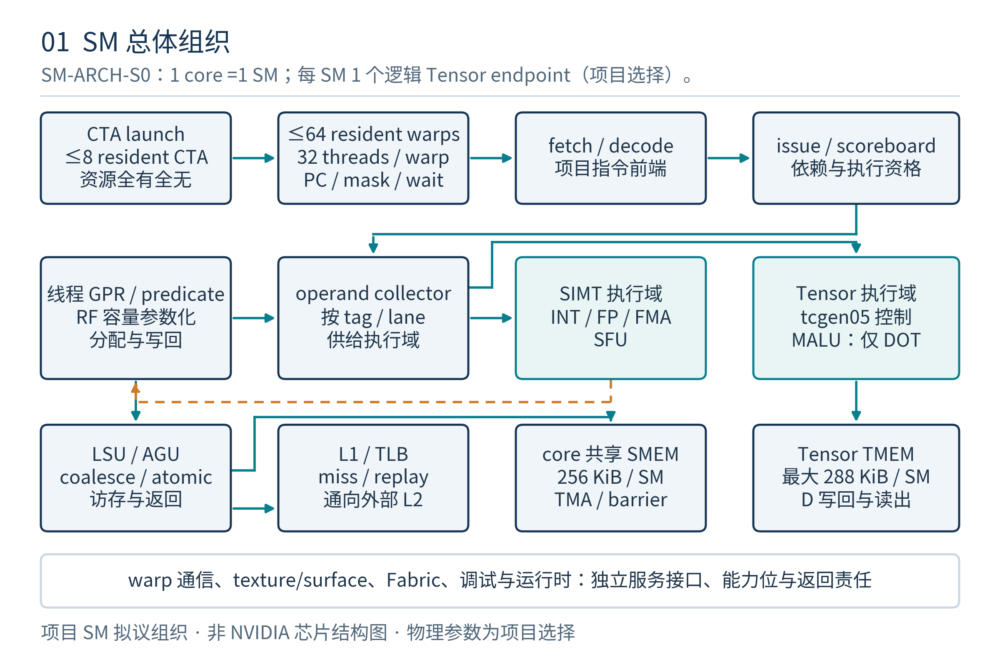
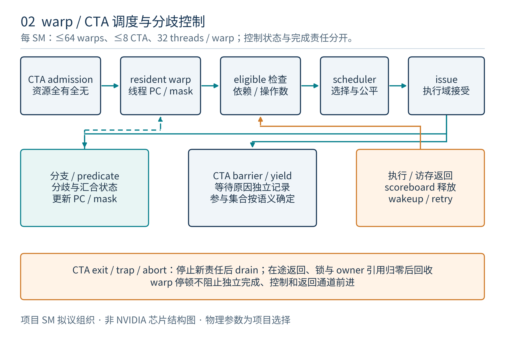
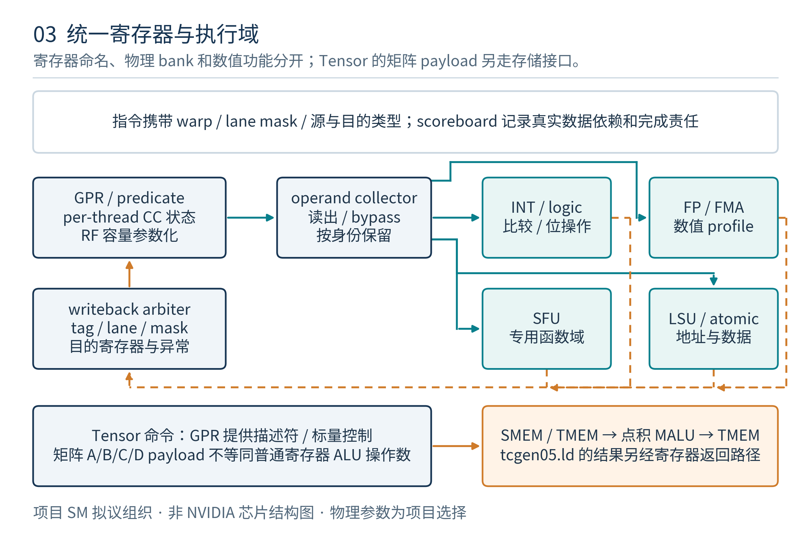
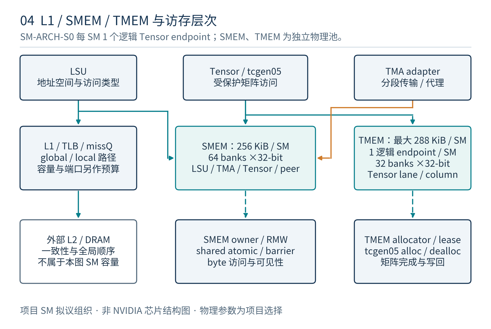
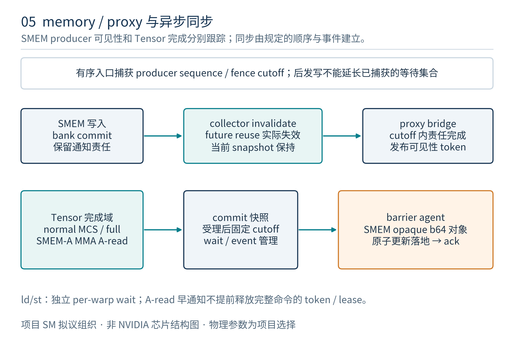
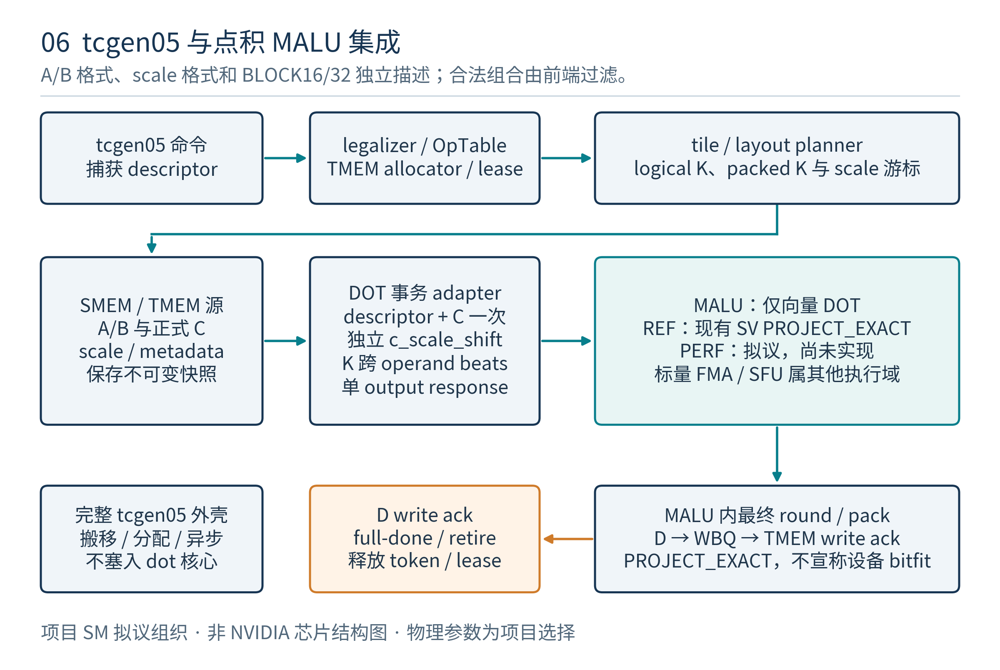
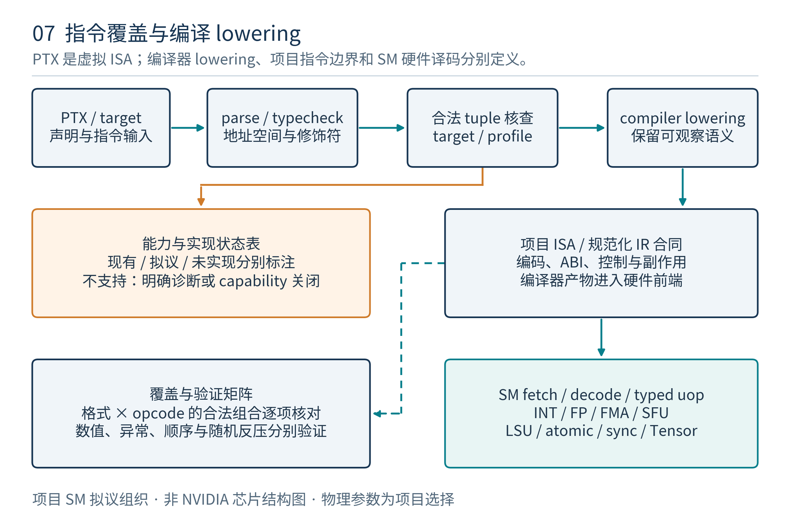

# SM 架构设计

版本：v1.0；日期：2026-11-07（Asia/Shanghai）。英文名称：Streaming Multiprocessor Architecture。基线：用户上传的 PTX ISA Release 9.4，2026-07-17。状态：**项目架构评审稿；全 SM 尚未实现**。

## 1. 目标、查验范围与证据等级

本文定义一个能够承接 PTX 语义的计算型 SM：从 kernel/CTA 驻留、线程状态和指令执行，到寄存器、普通访存、SMEM、Tensor/TMEM、同步、cluster 以及系统服务。它回答“由谁执行、保留什么状态、访问什么对象、什么时候可以消费或回收”，并给后续微架构与验证提供可检查的合同。

本文是**架构文档**。逻辑功能框不等于物理实例；不冻结 scheduler 个数、ALU lane 数、RF bank/端口、流水级、缓存行、FIFO 深度和每周期发射策略。既有 Tensor 微架构 v1.1 的具体实现建议作为下位设计引用，不在本次重复定义。SMEM 不再仅作为 Tensor 的外部接口，而是 SM 的独立共享存储子系统。

### 1.1 “查验所有指令”的可复查口径

以固定 PDF 第 9 章为全集，通过 PDF 书签重建全部小节，再逐项匹配正文编号，并反向归属全部独立 Syntax 块。结论为 **21 个指令大类、217 个说明叶子：215 个实际指令说明节，加上 `{}`、`@` 两个控制语法节**。217 个 Syntax 块全部对应到叶子；拆开同一节多个标题名得到 240 次名称出现、210 个唯一标题标签。这些数字不是 SASS opcode 数，也不是所有 type/shape/modifier 合法组合数。[P1；A1]

第 26 章把全部 217 个叶子逐项映射到本项目执行责任与处置。机器清单另保留每节的 Syntax、PTX ISA Notes、Target ISA Notes、物理 PDF/印刷页码及全部 459 个第 9 章小节。第 10 章的 35 个特殊寄存器说明节、第 11 章的 34 个 directive 说明叶子单独审视，不混入 opcode 统计。第 5 章声明、第 7 章 ABI、第 8 章内存模型与第 12 章 pragma 也属于架构约束。

**完成清点不等于已经实现全部形式。** 一个 NVIDIA target 也不必同时接纳书中所有历史和架构专属指令。本版覆盖全部指令的架构责任，并对未实现功能关闭 capability；兼容性验收必须继续落实到具体合法形式。

### 1.2 全文证据标签

| 标签 | 含义 | 能支持的结论 |
|---|---|---|
| 规范事实 P | 上传 PTX 9.4 的明确语义、目标限制和参与条件 | 某种形式的合法性、可见效果与顺序要求 |
| 公开观察 N | 已保存的官方资料、论文和专利；保留产品及访问日期 | 具体软件模型、产品规格或所研究设备的行为 |
| 项目约定 J | 本仓库冻结的逻辑边界、接口及资源配置 | 项目拟议架构；不称为 NVIDIA 未公开实现 |
| 实现证据 E | 现有源码与实际执行的检查记录 | 已验证的 PROJECT_EXACT MALU 范围 |

本轮网页直接访问返回代理 403，追加联网请求未完成。因此公开网页使用仓库先前 2026-10-26 核验记录和本地快照，本文不声称 2026-11-07 重新取得官网成功。固定 PTX PDF 与本地设计资料足以完成当前指令与架构审查。[A2；N1–N5]

## 2. SM 的系统位置与功能边界

项目术语统一为 **1 个 core 对应 1 个 SM**；目录中的 `sp` 是 core 内部执行组织，不解释为另一个 SM。SM 接收设备调度器已选定的 kernel/CTA 工作，保持驻留线程上下文并执行计算和存储命令。`soc` 负责跨 SM、L2/外存、地址翻译和系统协作等功能；逻辑服务可以在物理实现中重新分区，但不得丢失端到端语义。

| 层次 | 架构责任 | 关键边界 |
|---|---|---|
| Host/运行时/编译链 | kernel 参数、代码与资源元数据、target/capability、图依赖和 CFT endpoint 建立 | 不由 SM 从普通寄存器值猜测 launch 配置 |
| 设备/cluster 调度服务 | grid/cluster 工作分派、可协作 CTA 的资源保证、工作取消和 grid 依赖 | 独立 CTA 不保证同时驻留；合法 cluster 协作不能靠随机凑齐 |
| SM/core | CTA admission、SIMT/ITS、RF、执行域、访存和异步责任、SMEM、Tensor endpoint | 不独占 L2/显存，也不把所有系统服务复制进每个 SM |
| SoC 存储与互连 | MMU/TLB 服务、L2/global atomic、DSM 路由、TMA/Fabric 后端、外存与系统 scope 完成 | 接口接收和数据最终可见分开 |
| 可选图形/采样服务 | texture/surface 对象、坐标/格式/过滤/边界及查询 | 不是把 opaque handle 当成 global pointer |

本项目逻辑划分包括控制域、SALU/uniform 服务、VALU 整数与浮点服务、FP64、SFU、warp 通信、LSU/缓存接口、SMEM、Tensor/TMEM、异步/同步服务及系统前端。**MALU 只完成向量点积加 C**，不接管标量 FMA、除法、开方或超越函数。

## 3. 虚拟 ISA、能力配置与指令入口

PTX 是虚拟 ISA，经翻译生成目标机器指令；PTX 文本的类型和修饰符不规定 NVIDIA 的物理管线。[P1 §1.2] 本项目架构入口采用“PTX 语义 → 合法化/降低 → 项目机器指令或内部 IR → SM 执行命令”。本文不定义最终二进制编码，也不声明能运行 NVIDIA cubin；编译器和 SM 指令前端仍待实现。

### 3.1 最小合法化单位

能力检查键为 `(PTX版本, target, opcode, A/B/C/D类型, 修饰符, shape/layout, 地址空间, scope/proxy, 参与者)`。其中无关项按具体指令省略，不能只查 mnemonic。`sm_*a`、`sm_*f` 及“同 family 后续”逐项建模，不使用统一 `sm>=100` 代替。禁止把一个 kind 中存在的类型推广为所有 ALU 都可使用，也禁止把独立字段做任意笛卡尔积。

| 处置码 | 架构含义 | 本版实施状态 |
|---|---|---|
| D | 项目执行域直接承接；允许多周期 | 为目标映射；除已有 MALU 子功能外均待实现 |
| M | 经编译器、微序列或运行库降低 | 必须证明语义保持；降低器未实现 |
| S | 委托 SoC/运行时服务 | SM 仍持有依赖、完成、错误与 owner 责任 |
| C | 编译/链接或语法结构处理 | 不要求建立同名硬件单元 |
| R | 对应能力关闭，入口明确诊断 | 不能吞成 no-op 或把项目拒绝称为 PTX 规定异常 |

第 26 章 `D/M` 表示该节可按具体形式选择直接执行或降低，并非两条路径均已实现；`S/R` 表示架构保留系统合同、当前能力关闭。任何目标形式只能在合法化后选择明确的一条路径。

### 3.2 目标 profile

**SM-ARCH-S0** 是本项目集成架构，不冒充 NVIDIA target。支持目标按功能逐步启用：普通 SIMT 与存储为基础目标；tcgen05 为重点扩展；FP64、legacy MMA/WMMA、WGMMA、texture/surface、Fabric 等保留独立能力。WGMMA 原文要求 `sm_90a`，不能因为本项目关注较新 Tensor 就声明它是 Rubin 原生指令。9.4 alternate packed 浮点的部分形式明确列 `sm_100a/sm_103a`，也不能自动归入 `sm_107f`。[A3]

Ti16 原始编码未闭合、128-bit shared atomic 未实现、需要 SoC 但尚无服务的功能均保持关闭。已实现的项目 decoded-Ti16 传输与原生 `.s1z4m11` 能力独立登记。

### 3.3 别名与规范化

规范化保留具体等价条件：`bar`对应相应`barrier.aligned`形式；sm70+的`membar`按`fence.sc`处理并映射cta/gl/sys到cta/gpu/sys；`cp.async.wait_all`等价于相应commit_group加wait_group0。它们不能推广为所有barrier/fence/async操作互换。`.alias`则是编译/链接符号别名，不是执行opcode。[P1对应指令Notes；A1]

## 4. 线程层次、驻留与联合资源分配

SM 执行来自一个或多个 CTA 的 warp。项目配置 warp 为 **32 threads**；CTA 的线程线性化和 `%tid/%ntid` 保留三维 launch 信息，尾 warp 的不存在 lane 不参与执行。PTX 所述线程层次与 CUDA 当前 32-thread 模型是依据，不把所有历史 PTX target 的 warp 大小推广为永恒常量。[P1 §2–3；N1]

### 4.1 SM-ARCH-S0 的集成边界

| 项目 | 本版集成约定 | 口径 |
|---|---|---|
| warp/CTA 驻留槽上限 | ≤64 warps、≤8 CTAs，每 SM | 沿用既有 Tensor endpoint 集成预算；最多 2048 个驻留线程位置 |
| Tensor endpoint | 每 SM 逻辑映射 1 个 | 便于 owner/warp 编号对接；不推导物理 Tensor Core 个数 |
| SMEM 有效数据池 | 256 KiB，每 SM | core 共享，独立于 L1 和 TMEM |
| TMEM 数据池 | 最高 288 KiB；512-column profile 为 256 KiB | 每 Tensor endpoint；不按 CTA 数复制 |
| 通用寄存器容量 | 参数 `R_SM`，单位为 32-bit words | 物理容量/端口后续冻结，不能据64warp槽承诺最大寄存器同时驻留 |
| L1/指令/常量 cache | 功能与一致性合同在本版定义，容量参数化 | 不套用某款 Blackwell 的 carve-out 与缓存数值 |

驻留上限是多维预算的共同约束。若 CTA 占用 `W_i` 个 warp、`R_i` 个寄存器分配字和 `S_i` 字节 SMEM，则 admission 至少满足：

$$\sum_i W_i\leq64,\qquad \sum_i R_i\leq R_{SM},\qquad \sum_i S_i\leq262144,\qquad N_{CTA}\leq8$$

`R_i/S_i` 使用按实现粒度取整后的真实 reservation，另含 predicate/control/运行时必须资源。CTA 最大线程数、寄存器/线程上限与 allocation granularity 由目标 capability 声明；2048 是总驻留位置上限，不代表允许单 CTA 为 2048 threads。

### 4.2 Admission 与退出

admission 一次性取得 CTA owner、warp、RF 配额、SMEM 区间、barrier/运行时上下文及返回责任，全部成功后发布 launch。失败时保持未运行，不能先启动部分线程再等基本资源。TMEM 在运行中由 tcgen05.alloc 动态管理，不在 launch 时默认复制分配整池。

cluster launch 由设备服务协同保证所需 CTA 能共同执行。退出至少分三步：线程执行结束、CTA 内全部异步/远端责任关闭、资源与 owner generation 回收。最后一个线程 exit 不能直接覆盖还被 TMA、Tensor、Fabric、DSM 或 barrier 使用的 SMEM。

## 5. SIMT、独立线程调度与控制流

warp 是发射和通信组织，每线程保留独立的可见控制状态。项目要求支持 independent thread scheduling 的语义：同 warp 内等待线程不能永久阻止能解除其依赖的其他可执行线程；物理上使用压缩 PC、重汇合栈或其他表示由微架构决定。[P1 §3.2]

| 状态层 | 最小可见责任 | 隔离要求 |
|---|---|---|
| thread | PC、调用/返回、GPR、predicate、CC、等待与退出状态 | 不能用单一 warp carry/return PC 替代 |
| warp active group | 当前可共同发射的线程集合及动态指令实例 | 同 PC 的不同循环轮次不能合并为一次 collective |
| CTA | thread/warp 成员、barrier、SMEM/RF owner、异步引用 | CTA slot 重用必须改变 generation |
| cluster | rank→owner 映射、barrier、远端引用和 peer 生命周期 | 不等同于一个 warp 或任意两个 CTA |

`bra/brx.idx/call/ret/exit` 依各 thread 的 guard 和目标执行。predicated-off 线程既不写寄存器，也不发出 store、atomic、异步事件等副作用。`{}` 是词法 scope，`@` 是谓词语法，不能作为两个独立硬件 ALU opcode 统计。

`.uni` 是对应控制流指令对 guard/target 等的一致性承诺，不证明任意输入数据 uniform。`call/ret` 包含间接调用和分歧返回；每线程 stack/ABI 必须完整。重汇合不提供内存同步，warp 内通信须使用指令规定的参与和顺序契约。

### 5.1 Collective 实例

每类 collective 具有规定的成员、退出线程处理与一致参数条件。架构以动态实例区分同一 PC 的多次执行，不能只以 PC 匹配。`membermask`、当前 active mask、predicate、Tensor 输出禁用 mask 是四种不同对象。`.sync` 常表示到达同一操作，不统一解释为 memory fence；`.aligned` 的 collective 一致执行要求也不等于地址对齐。

## 6. 指令前端、依赖和可观察完成

前端取得项目机器指令及静态元数据，建立动态操作身份，再检查控制状态、源依赖、目的写责任、执行资源和完成返回能力。架构不要求固定宽度译码或固定发射端口；不要求所有执行域按同一时延完成。

### 6.1 发射合同

发射时要么已捕获源值，要么已保护所有尚未捕获的源；在源安全以前不得被后写覆盖。多寄存器向量、wide operand、descriptor 和 predicate 同样遵守。只捕获第一片后就释放整体依赖会破坏 `spcompress`、矩阵片段、TMEM load/store 和宽结果。

目的依赖在全部所需片段真正写入后才 ready。长延迟操作可以乱序返回，但同一线程的 PTX 可观察行为、CC/predicate 依赖、内存顺序和 collective 语义必须保持。这里的“完成”不是一个全局退休点。

| 操作效果 | 允许发布的完成 | 不足以构成完成的事件 |
|---|---|---|
| 普通寄存器算术/load | 对应目的完整写回，producer 身份匹配 | 第一片到达、执行请求接收 |
| 普通 store/atomic | 按访问语义到达规定提交/线性化与响应点 | store payload 离开 collector |
| collective | 本动态实例满足规定成员与结果合同 | 当前 active 线程单边到达 |
| 异步 Tensor/TMA/Fabric | 对应完成域的规范终点 | 发射成功或登记 commit |
| CTA/kernel 资源 | 所有仍有访问权的责任关闭 | 最后普通 ALU 完成或最后 thread exit |

### 6.2 调度进度

调度策略后续可在公平策略与吞吐策略间选择，但必须给已接收操作的 writeback、barrier update、peer 控制、wait/free/commit 和退出 drain 留出可前进路径。不能让新 Tensor 工作耗尽完成事件所必需的全部资源；不能让 ARF/RF 写回等待消费者执行，而消费者又等待该写回。

对未驻留的任意 CTA 自旋锁不承诺前进；对已被合法接收的 cluster/peer 及在途返回，服务活性要在明确的 SoC 公平假设下成立。

## 7. 寄存器、谓词、CC 与 uniform 服务

PTX `.reg` 是不可通过普通地址访问的 per-thread 虚拟寄存器，`.pred` 保存谓词；bit carrier 不等于物理 datapath 宽度。32/64/128-bit 结果可以由多个物理字承载，但必须保持完整值与依赖。`mov` 的位重解释、特殊寄存器读取和向量拆合不等同于数值 `cvt`。[P1 §5–6]

### 7.1 三类执行状态

GPR、predicate 和隐式 `CC.CF` 分别管理。`set` 输出数值编码，`setp` 输出谓词；`add.cc/addc/sub.cc/subc/mad.cc/madc` 使用每线程 carry/borrow。CC 不作为 warp 共享标志，编译 helper 不能随意覆盖正在使用的进位链；原文不要求 CC 跨 call 保存。[P1 §9.7.2]

SALU/uniform 服务是**项目可选优化域**：只有编译证明或显式项目入口契约保证相应动态实例数据一致，才可一次计算并广播；否则走 per-thread VALU。物理 uniform RF 可存在，也可用普通 RF 表示。逻辑上的线程标量指令不等于整个 warp 只需算一次。

### 7.2 动态寄存器配额

`setmaxnreg.inc/dec` 属于真实资源协议：同 CTA 的池分配到 warp，每线程配额受 target 和指令条件限制；`.inc` 可等待可用资源，新增寄存器需初始化；同一 warpgroup 的 warp 按要求执行相同操作并显式同步。当前项目未实现，不可将它当成无效果 hint。

launch 的初始 RF reservation 必须包含动态池策略，并保留接收/返回路径的进度。编译 spill 的 `.local` 地址和启用的 SMEM spilling 是不同分配方案；若选择 SMEM spilling，必须计入 CTA SMEM 预算并从程序可用区间中隔离，不能暗中占用整个共享池。

## 8. 整数、逻辑、比较与 video 架构

整数域覆盖 §9.7.1–.2、.7–.9、.20。按 type/sign、high/low/wide、packed、饱和和扩展规则逐形式验收；物理上可以复用加法、移位、比较和乘法资源，不要求每个 mnemonic 一个单元。

| 语义组 | 必须保留的行为 | 可选实现路径 |
|---|---|---|
| add/sub/abs/neg/min/max | signedness、溢出/饱和、packed 元素独立结果 | VALU；经证明 uniform 时 SALU |
| mul/mad/mul24/mad24 | 全积、`.hi/.lo/.wide`、24-bit 规则、饱和条件 | 共享乘法与多步高/低积，不能从截断低积补出高积 |
| clmad | GF(2) 无进位乘法，128-bit 中间项的指定64bit与 C XOR | XOR/shift 序列或 carryless 专用服务 |
| div/rem | 原文边界与 machine-specific 行为 | 整数迭代/降低，不借 FP 近似假定所有边界相同 |
| popc/clz/bfind/fns/brev | 位编号、符号扩展、边界和未找到编码 | 位处理服务或语义保持序列 |
| bfe/bfi/szext/bmsk/lop3/shf/shl/shr/prmt | 片段选择、超宽 shift、predicate/bit 类型和 LUT 真值表 | VALU/重排网络 |
| set/setp/selp/slct | 数值结果与谓词区别、双 predicate、比较类型 | compare/selection 服务 |
| dp2a/dp4a | 每线程 packed 整数 dot、扩展与 S32 累加 | VALU packed-dot；可选独立适配后复用 dot 服务 |
| scalar/SIMD video | extract、sign/zero extend、运算、clamp、secondary op、merge | packed 整数序列；不要求视频编解码器 |

复用 MALU 执行 `dp2a/dp4a` 是可选数值适配，不能把其对外接口改成通用 ALU，也不能让普通 packed-dot 流量饿死已接收的 Tensor 完成。本版默认由 VALU/降低路径承接。

负数 remainder 等实现相关行为固定在项目 numerical profile 中，不能把 host C 的结果称为规范唯一答案。PTX 的 16-bit machine-specific 提升语义也要在目标配置中说明，不从 carrier 位宽自行推导所有高位屏蔽规则。

## 9. 浮点、packed 算术与 SFU

浮点域覆盖常规 F32/F64、F16/BF16、mixed precision 和 alternate FP8/FP6/FP4 形式，以及分类、符号、比较和特殊函数。**支持某个存储格式，不等于支持该格式的所有操作。** 每条允许的输入/输出类型、carrier、舍入、FTZ、NaN/Inf/±0 和 target 条件均登记为 tuple。

### 9.1 普通 FPU 与数值契约

`fma` 保持融合乘加的规定舍入，不能默认“先舍入乘积再加”；`mad` 按该形式自身规范处理，不无条件合并为 FMA。`.sat/.satfinite/.relu` 不是同一个饱和模式，整数截限与 FP [0,1] 也不相同。min/max 的 NaN、±0、`.abs/.xorsign`，比较的 ordered/unordered 规则逐项保存。

FP64 标量服务可以多周期或经证明降低，但当前 MALU 的 F64 dot 不证明 `div.rn.f64`、`sqrt.rn.f64` 或普通标量 FMA 已实现。矩阵 `PROJECT_EXACT` profile 是独立数值选择，不覆盖普通 PTX 浮点的逐条结果要求。

### 9.2 9.4 packed 与 mixed precision

| 类型/形式 | 架构责任 | 不能混淆的点 |
|---|---|---|
| F16/BF16 与 x2 | 每 thread 内一个或两个独立算术结果 | packed element 不是 thread lane |
| mixed F16x2/BF16x2/F32x2 | 按 tuple 先提升或降精度并执行规定运算 | 单次/分步舍入按原文，不能做 dot 归约 |
| alternate FP8/6/4 x4 | 每 thread 四个独立结果，目的格式与 carrier 按表 | 不是 K=4 的 matrix dot；部分原文 target 为 sm100a/103a |
| E2M1x4 / E2M1p4x4 | 前者 b16 紧凑 carrier，后者 b32 byte container | padding 不增加有效精度 |
| scale 类型 | 属缩放数据或特定转换/算术 tuple | UE8M0/UE4M3/UE5M3 不自动等于通用 signed FP 乘数 |

### 9.3 SFU 与精确数学服务

`rcp/rsqrt/sqrt/div` 与 `sin/cos/lg2/ex2/tanh` 根据精度、`.approx/.full/.rn/.rz/.rm/.rp`、范围和误差要求分别选择服务。SFU 可提供近似起点，精确路径需额外校正或独立算法；不能把所有形式映射成同一低精度结果。`rcp.approx.ftz.f64` 与 `rsqrt.approx.ftz.f64` 的特殊标题单独保留，不遗漏在一般 FP64 列表外。

SFU 是独立于 MALU 的执行责任，可与 FPU 在物理上复用部分资源；共享时要保持目标误差界与完成活性。本文不以单 GPU 峰值推导 SFU 数量和吞吐。

## 10. 转换、寄存器重排、warp 通信与稀疏处理

`cvt/cvt.pack` 负责数值转换、截限、舍入与 packing；`mov/prmt` 负责指定的位组织。随机舍入 `cvt.rs` 的显式 `rbits` 是输入，不能换成隐式全局随机状态；9.4 的 `.pzo`、packed `.rz`、`.ue5m3x2`、`.scaled::n1::ue8m0` 独立合法化，不能简化成按目的位数截断。

warp 通信包括 `shfl.sync/vote.sync/match.sync/redux.sync/elect.sync/activemask` 及 legacy 形式。各条的成员、非退出线程、guard 和结果不同。`activemask` 反映当前执行集合，不预测分歧后哪些线程会再次加入。`elect.sync` 对同一 membermask 确定性选 leader；`redux.sync` 在 warp 内归约，不等同于每 thread 的 packed dot 或矩阵 dot。旧 `shfl/vote` 的 target 移除条件必须在兼容 profile 单列。

### 10.1 稀疏寄存器转换

9.4 `spcompress` 选出每四个元素中的两个，支持 MAX/MAXABS/MIN/MINABS，输出 compressed data 与 metadata；按规定优先保留 NaN，比较时 −0<+0，并保留并列选择的 implementation-specific 范围。`spdecompress` 支持其列出的多种 sparsity factor，按 metadata 散布并补零；不能只做 2:4 就宣称全形式覆盖。

源、压缩值和 metadata 的寄存器向量不能违规重叠，总量和元素限制按原文。较大 `.num` 必须允许多阶段捕获/写回；不能假定所有 PTX 指令固定 3 个源寄存器和 1 个目的。稀疏寄存器处理、`tcgen05.ld.spcompress` 与矩阵 sparse MMA 是三个入口，数据对象、参与者和完成机制不同。

## 11. 地址空间、LSU 与缓存架构

LSU 解释每 thread 的地址和访问语义，进行空间解析、权限/对齐处理、请求组织、返回重组及寄存器写回。coalescing 可以合并传输，不能合并不同线程的原子语义或丢失 lane 身份。内存请求携带语义与 owner 上下文，SoC 接收不等于 load ready 或 system-scope store 完成。

| 空间/表示 | 架构含义与服务位置 | 生命周期与限制 |
|---|---|---|
| `.reg/.sreg` | per-thread 虚拟寄存器/特定特殊寄存器 | 非普通可寻址 RAM |
| `.global` | 设备与系统地址，经 MMU/L2/外存服务 | 保留进程/地址空间、memory domain、scope 和系统能力 |
| `.local` | 每 thread 可寻址 device memory，含 spill/stack | 不是小型片上私有 SMEM |
| `.const` | 常量对象及相应读取合同 | 可广播/缓存但不改变定义的空间语义 |
| `.param` | kernel entry 参数或 device function ABI 参数 | 二者作用域与可访问方式分别处理 |
| `.shared::cta` | 本 CTA shared 字节对象 | 按 CTA owner/base/range 解释 |
| `.shared::cluster` | cluster peer 的 shared 对象 | 要求目标仍存活；跨 SM 路由不复制对象所有权 |
| generic pointer | 通过 address window 表示规定空间 | `cvta/isspacep` 保持合法映射，不是任意地址都能转换 |
| TMEM address | lane/column 专门地址 | 不能交普通 LSU 当 byte pointer |
| multimem VA / CFT handle | 多位置 VA / logical endpoint+offset | 不与普通 pointer 或 TMEM 地址互换 |

### 11.1 缓存和访问属性

L1、常量读取、readonly/texture 路径和外部 L2 具有不同职责；物理共享与否由后续设计决定。本项目 SMEM 独立于 L1，不使用动态 carve-out。cache operator、prefetch、eviction priority 与 policy 通常是性能提示，不改变 memory consistency；`discard` 则可能使内容成为不稳定未定值，不能当 no-op hint。

`ld.global.nc` 与 texture/surface 不在 PTX 第 8 章普通内存模型的适用范围内，不能自行附加 generic coherence。`ld.proxy::readonly` 要求目标在 kernel 生命周期内保持只读；不能允许 kernel 原地修改后再继续假设该路径可见。

`.volatile` 与 `.mmio` 分开：volatile 不保证 I/O 的精确读写次数，MMIO 有禁止某些合并/转发/缓存的专门合同。架构在 SM→SoC 接口保留该区别；不把所有 load/store 放进同一种可任意优化策略。

## 12. SMEM 共享存储子系统

SMEM 是所有驻留 CTA 按 owner 分配的 **core 共享256 KiB有效数据池**，服务 LSU、Tensor、TMA/异步复制、DSM、mbarrier、启用时的 Fabric 和运行时控制。每 client 不拥有一份独立容量或独立峰值。它与 TMEM 的地址、分配器、访问权限和完成机制分别定义。

### 12.1 分配与寻址

launch 依据静态、动态和可选运行时保留空间分配区间；visible bytes 与 allocator 实际占用分开。已由程序声明的 mbarrier 在静态/动态空间中计数，不能重复加一次 barrier 内存。reserved 默认0；启用 SMEM spilling 等运行时功能时才显式预算。

单CTA的visible shared上限仍受选定target/ABI与项目capability约束，256KiB物理池不等于任意target允许一个CTA声明256KiB。兼容目标必须同时满足该target的单CTA限制和本SM的联合资源预算。

每次本地或远程访问先解析目标 CTA owner，检查可见范围，再加 owner base 得物理位置。两个 CTA 都访问 offset0 时必须落到各自区间；不能直接对 CTA offset 解码 bank/row。`mapa/getctarank` 与 tensor descriptor 前端都必须保持这一目标归属。

### 12.2 共享服务和可见性

服务端接收请求之前取得响应/ack 空间、owner 引用和更新责任。普通 narrow write、RMW、atomic、barrier 与 DMA/Tensor 访问参与同一对象的仲裁。请求拆片、bank 冲突重放和同字广播可由微架构选择，但不得重复原子副作用或丢失部分返回。

关键里程碑分为：**bank 数据提交 → 对未来 collector lookup 的实际失效/版本生效 → 相关 proxy 发布**。ack 不能只表示失效消息入队；已接受操作的不可变 A snapshot 可继续使用，future reuse 则必须看见新版本。软件仍需执行规范要求的同步，硬件不会替未同步程序自动补 fence。

### 12.3 原子、ECC 与进度

规定的标量32/64-bit 原子、mbarrier 的 b64 对象以及可选128-bit CAS 按其宽度整体保持原子性；packed/vector原子按第13章的逐元素例外处理。128-bit 能力在未实现四字原子路径前关闭。RMW 需要明确的保留、锁定、提交和释放责任，不把该算术放进 MALU。Tensor 饱和时 control/peer/barrier update 仍须前进。

ECC 是可选配置。narrow ECC write 可能要求 RMW；scrub 不能迟到覆盖新 store，取得目标锁后必须重新读当前 word 并验证，再决定是否写 correction。owner 回收可取消尚未开始的可选 scrub，已开始的 RMW 要完成或有正式取消确认。

既有 v1.1 下位方案选择64 banks、1R1W等组织，理想共享峰值256B read+256B write/cycle；该数字是项目 proposal。Tensor 两路128B read若同时命中不同bank集合可耗尽读资源，LSU/TMA/Fabric不会同时额外获得一份峰值。[J2 §7.2–7.9]

## 13. 内存顺序、proxy、原子与归约

PTX 采用第8章定义的弱内存模型。SM架构要保留程序顺序、可观察顺序、acquire/release、fence-sc、原子性与因果约束，并与SoC实现端到端合同；不能用“清空LSU队列”替代全部语义。

| 维度 | 架构区分 | 典型错误 |
|---|---|---|
| scope | CTA、cluster、GPU、system；按具体指令合法化 | 把warp当成通用memory scope，或以sys扩大SMEM访问权限 |
| semantics | weak/relaxed/acquire/release/acq_rel/sc及适用形式 | 因结果已返回就推定此前所有写对系统可见 |
| proxy | generic、async、tensormap、fabric、readonly及alias关系等 | 普通fence自动替代跨proxy fence |
| atomicity | 标量元素/指定b128宽度；向量按规范逐元素 | 将vector原子升级为全vector，或将b128拆成无互斥store |
| cache hint | 性能管理与completion-bearing操作分别处理 | 把有bulk-group完成的priority操作一并忽略 |

`atom` 返回旧值，`red` 不返回且不形成 acquire pattern；内部实现是否读取旧值不能改变这一语义。FP32 atomic/reduce 的FTZ与9.4 `.noftz` 按指令、空间和形式处理。global atomic 的线性化与system能力由SoC保证；shared atomic由SMEM服务承接。

`fence.proxy` 的方向和空间/范围不能丢失：generic→async发布、tensormap更新后发布、fabric↔generic以及虚拟alias顺序各按指令。fence不代替线程到达，不直接证明Tensor计算完成；barrier也不自动覆盖所有proxy。

## 14. Warp、CTA、cluster 与 mbarrier 同步

同步域服务 warp rendezvous、CTA named barrier、cluster barrier 和 SMEM 中的 mbarrier；它不建立一个能等待任意操作的统一 done 位。

| 机制 | 参与者/对象 | 架构保证和边界 |
|---|---|---|
| bar.warp.sync | 指定warp成员 | 满足该指令的线程同步/访存顺序，不自动等所有异步管线 |
| bar/barrier | CTA内规定thread数量及barrier ID | sync/arrive/reduction各按形式；命名barrier不等同SMEM对象 |
| barrier.cluster | cluster的有效参与CTA/thread条件 | arrive与wait分离；不能仅同步当前SM中的部分CTA |
| mbarrier | SMEM内8B对齐opaque b64对象 | arrival、tx-count、phase和报告；init/inval有生命周期 |
| family-specific wait/commit | 具体async stream或寄存器责任 | 按该家族定义，不能跨家族替代 |

### 14.1 mbarrier 布局、阶段与报告

`.layout::v0/v1` 都是b64、8B对齐，但状态语义不同。v0的expected-arrival上限为2^20−1；v1为511；tx-count范围均为±(2^20−1)。主阶段 primary 在pending arrivals与tx-count都满足零条件时完成；conditional还取决于payload report。v1错误报告可令primary前进、conditional不前进；不能仅存一个parity bit模拟所有语义。[P1 §9.7.15.16]

`init` 指定布局并建立对象；`inval` 后才可改作其他用途或重新初始化。对有效对象不得任意普通load/store修改内部字段。`expect_tx/complete_tx/arrive/arrive_drop` 使用各自计数单位和规则；drop影响后续期望到达数量，不能当作简单取消一次等待。

`test_wait/try_wait` 依据primary/conditional及token/parity形式判断；conditional必须使用规定的`.parity`形式。`try_wait`可能因超时返回false，false不是错误报告，此时report值未定义；reportValue为b8 opaque值。acquire wait只有观察到相应完成、返回True时才建立规定的可见性，不能因尝试等待过就提前消费结果。布局检查、pending_count和phase复用按指令约束处理，不能看到parity变化便无视过度前进风险。

远端`.shared::cluster` mbarrier只开放规范列出的arrive/drop/expect/complete更新，不支持remote wait/init/inval。消费者在本地barrier等待；目标CTA必须仍存活。

### 14.2 对象更新与事件接收

Tensor/TMA/Fabric事件经barrier agent执行SMEM对象的原子更新，更新落地后才ack。Event入FIFO不构成barrier已前进；每项事件必须exactly-once，重发/迟到消息带身份与generation。SMEM owner一直保留到相关更新、返回及可见性责任关闭。

v1 report可追踪Fabric失败或规定的TMA数据有效性，但同一barrier不得混用规范不兼容的report机制。成功项不能清掉同一phase其他操作留下的失败。TMA报告和Fabric报告的含义分别见第15、18章。

## 15. 异步复制、TMA 与缓存异步管理

异步搬运域负责请求发起、源/目的对象引用、拆分与布局转换、相应完成追踪。**TMA不是tcgen05.cp，tensor map不是SMEM matrix descriptor，bulk group也不是经典cp.async group。** 其后端可以在SoC实现，SM仍须保持提交与等待语义。

| 入口 | 对象和效果 | 完成/可重用责任 |
|---|---|---|
| cp.async及commit/wait/mbarrier.arrive | 规定global→shared片段，含合法ignore/zero-fill形式 | per-thread经典async-group或指定mbarrier关系 |
| cp.async.bulk | 指针/size bulk，方向与multicast按形式 | mbarrier或bulk-group；依方向合法表 |
| cp.async.bulk.tensor | tensor map、多维坐标、tile/im2col/gather/scatter等 | 规定的mbarrier/bulk-group；不是通用矩阵计算 |
| cp.reduce.async.bulk{.tensor} | 拷贝时对目的元素归约 | 元素原子/数值与scope语义另保留 |
| multimem.cp{.reduce}.async.bulk | 多位置地址的bulk服务 | 多目的责任与相应complete-tx/bulk规则 |
| st.async/red.async及multimem形式 | 规定的异步store/reduction | global/shared等形式分别核查；不限定为shared-only |
| st.bulk | shared::cta区间置零 | size为8B倍数、initval只能0；不是global memset |
| applypriority.async.bulk{.tensor} | L2 eviction priority，range或tensor寻址 | 使用bulk-group；虽为缓存管理也不能伪造完成 |
| bulk/tensor prefetch | 发起允许的cache预取和priority | 按其提示及异步完成属性，不代表数据可消费 |

TMA tensor map为opaque对象，`tensormap.replace`和`tensormap.cp_fenceproxy`负责指定更新与发布；不能直接把driver enum数值作为PTX字段值。9.4 descriptor override、`.im2col_no_offs::w`、32-bit cluster multicast mask和report机制逐形式/target合法化。multicast每个目的CTA单独解析owner和barrier，数据到达一个目的不代表所有目的完成。

### 15.1 完成与局部完成

bulk-group commit只收集发射线程此前符合条件的未提交bulk操作；同组内部没有任意两项必然排序的保证。`wait_group.read`只等待规定的tensor-map/source读取阶段，用于释放源，不证明目的写入和最终可见。经典cp.async、TMA complete-tx、WGMMA和tcgen05的等待互不替代。

对一条操作拆成的全部片段，只有相应终点全满足后才完成整项责任。store向SoC提交、SMEM bank-commit、complete_tx更新、结果consumer观察是不同事件；completion units在命令中显式区分bytes、arrivals或其他单位。

### 15.2 TMA 数据有效性报告

9.4 `.report_mechanism` 的enabled形式需要layout::v1 mbarrier。检测的是规范规定的数据pattern，不是通用ECC或任意坏数据：per16bytes形式只采样规定的一个element，per_element形式按所选数据型的全1 pattern等规则判断。不能将“未报告”解释为所有元素均通过一般数值正确性检查。

默认report disabled；ignore_oob仅在规定global→shared::cta形式可用且要求report disabled。pattern命中设置报告predicate，不能据其reportValue值直接模拟Fabric的传输错误。capability、barrier布局及report机制联合检查。

## 16. Matrix 指令族、Tensor 与 dot-only MALU

SM为各代matrix入口提供独立适配与能力检查，不能只替换opcode就共用参与者/完成协议。不同前端可在数值契约兼容时复用dot后端；复用不自动产生原生兼容性。

| PTX家族 | 数据/参与模型 | 必须保留的完成和能力边界 |
|---|---|---|
| wmma.load/store/mma | warp collective、规定fragment与内存布局 | 类型/shape/布局与target分别合法；不是TMEM ld/st |
| mma/mma.sp | warp分布寄存器片段，dense/sparse/block-scale等 | 同步矩阵语义与fragment writeback；不使用tcgen05.commit代等 |
| ldmatrix/stmatrix/movmatrix | shared↔寄存器矩阵片段或寄存器重排 | 规定warp地址/shape/transpose/packed扩展；不是MALU算术 |
| wgmma.mma_async{.sp} | warpgroup，寄存器/SMEM对象与async proxy | wgmma fence/commit_group/wait_group；原文target为sm90a |
| tcgen05 | 单thread发令与warp collective混合；TMEM、descriptor及CTA group | alloc/ld/st/cp/shift/mma/fence/commit各自合同 |

### 16.1 tcgen05 集成

tcgen05前端合法化kind、shape、A/B/D格式、major-ness、scale type、BLOCK16/32、metadata、LUT/collector、target及CTA group。A/B位串先按规范packing/layout解包成逻辑向量；稀疏metadata解释位置；tile planner形成dot工作。`enable-input-d=true`时原生D_old作为MALU未缩放的正式C输入，另传独立C shift；false时按下一节提供零seed，不读取或参与旧D。D_new写回相应TMEM对象。

MMA/cp/shift/commit由一个thread发起；alloc/dealloc/permit为规定warp collective，CTA group2由两CTA各一warp联合；ld/st及其wait为相应warp collective。TMEM warp访问的四分之一lane区域与CUDA lane不是同一坐标，不能以单thread发令推导只有一个thread持有矩阵数据。

TMEM通过allocation和permit管理。项目endpoint最高576columns×128lanes×32bit=288KiB；512profile为256KiB。exclusive/non-exclusive、列数、peer与释放限制按target，SM107的576列特例不推广给所有target。SMEM launch allocation与tcgen05.alloc是两个分配器。

### 16.2 MALU 的数值与接口责任

项目MALU仅返回：

$$D=C\,2^{-s_C}+\sum_{k=0}^{K-1}\left(A_kB_k\,s_A(g_A(k))\,s_B(g_B(k))\right)$$

无A/B scale形式令相应scale为1；普通点积令`s_C=0`。原生`scale-input-d`只在规定f16/tf32 kind形式把D_old乘2^(−s)，s为0..15；项目接口用独立`c_scale_shift`表达，现有合法性检查允许相应F16/BF16或TF32组合。它不是A/B scale格式、BLOCK16/32或第三种scale矩阵。`enable-input-d=false`时前端不读取旧D，向MALU提供正式零C seed。

C shift在匹配数值profile的解码/指数/累加路径中表达，不先把缩放后的C重新打包进C_fmt而引入额外舍入或提前下溢。接口只传一次未缩放C和shift，不能前端已缩放后在MALU内再次缩放。

公式表示数学分组，实际native tuple不能任意交叉组合。接口独立表达A/B数据格式、C/D格式、scale_A/scale_B格式、block配置16或32、分组边界/offset、C缩放、长度与操作身份。Tensor适配层把原生共同scale字段映射到项目独立字段，并执行联合合法性检查。

Ti16对应`.kind::ti16/.s1z4m11`，是16bit整型类、值域[-2047,2047]、S32 D；用户先前称e1z4m11，本文按规范拼写澄清。raw位编码和原文transpose差异尚待关闭，现有RTL只接显式decoded项目传输。通用S16不能冒充raw Ti16。

PROJECT_EXACT使用精确乘积/归约及最终舍入，为项目数值profile。原生Tensor、legacy MMA和普通FMA各有自己的精度契约，不能自动同义。已有MALU的F64/INT4/B1等项目扩展也不是原生tcgen05都可编码的格式。

### 16.3 三条独立完成线

normal commit追踪本发射thread相应先前mma/cp/shift的完整完成，通过mbarrier观察；restricted commit只追踪相关MMA对SMEM A的读取完成，**不证明B读取、D写回或整个MMA完成**。tcgen05.ld/st另用wait::ld/st和寄存器片段写回约束。A-read事件不得提前回收full token、整个allocation或CTA owner。

opportunistic collector允许复用但不保证命中；B/source必须在规定的使用期保持有效。SMEM写入、future reuse失效、proxy发布与活动snapshot分开，继承第12章及既有v1.1闭合的责任。

## 17. Cluster、DSM、CTA pair 与 grid 服务

cluster是协作调度与DSM可访问范围。SoC维护cluster membership与rank→SM/owner映射；SM保留本地CTA、peer和远端在途引用。`mapa/getctarank`处理对应shared地址映射，不能只异或SM编号就构造任意peer地址。

tcgen05 CTA pair为同cluster中rank仅最低bit不同的两个CTA；CTA group2要求peer active且未退出。它不是任意两个SM，也不意味着所有cluster操作只涉及两CTA。pair资源事务、parent/child事件与失败回退需跨端点一致；exclusive CTA1只排斥本endpoint资源，不能无条件跨pair串行所有CTA1并阻塞合法cluster barrier。

SM-ARCH-S0每SM只逻辑对接一个endpoint，项目device/cluster admission因此保证启用group2的even/odd CTA分别映射到**两个可互通的不同endpoint/SM**，并共同保证资源与生命周期。这是本项目双端协议的调度约束，不是据PTX推导的通用物理限制；本版未定义同SM双逻辑参与者适配，不接纳该放置方式。

### 17.1 工作取消与动态工作分配

`clusterlaunchcontrol.try_cancel`请求原子取消一个**尚未启动**的cluster launch，异步把16B opaque response写SMEM并经mbarrier complete-tx通知；query_cancel解析成功与首CTA ID。不是杀死正在运行的cluster。成功ID在本grid内唯一；失败被观察后再次try_cancel受原文禁止，multicast目的仍需存活。

该机制需要设备工作队列/运行时配合，SM不能仅改一条本地PC模拟。取消response、barrier完成和工作ID接管必须闭合；本版无实现，能力关闭。

### 17.2 Grid 依赖

`griddepcontrol.launch_dependents`通知运行时某些dependent grid可以在条件满足后被安排，既不保证立即启动，也不代表当前grid结束。`.wait`等待prerequisite完成并建立规定可见性。不同memory synchronization domain与gpu/sys fence条件联合处理；不能把它等价为CTA barrier。

## 18. Fabric、multimem 与系统通信

Fabric/CFT需要独立SM前端和SoC transport服务。host建立logical endpoint与资源绑定；device以 **u32 leId+u64 resource offset** 引用CFT资源。该handle不是普通VA；Fabric可报告NVLink访问失败的模型也不同于普通pointer访问。该族在PTX9.3已引入。[P1 §9.7.11]

| 操作 | 架构效果 | 完成边界 |
|---|---|---|
| fabric.try_get | CFT→规定本地对象 | 追踪写入及最终报告；不能用fabric.wait证明目的ready |
| fabric.try_put | 本地对象→CFT | 源SMEM读完与远端写/最终完成分开 |
| fabric.try_red | 对CFT目的归约 | op/type、分块原子性与最终报告分别保持 |
| fabric.try_pullred | 拉取并归约CFT资源 | .sync全warp参与条件专门检查，不能套一般subset规则 |
| fabric.submit | 提交当前thread先前相关操作 | fetching限制只提交get/pullred；不是最终完成 |
| fabric.wait | 等待已提交操作的local shared reads | 只释放相应source，不保证远端或try_get目的完成 |

### 18.1 完成、错误与部分完成

最终完成使用layout::v1 mbarrier：先issue、在phase完成前submit、按规定arrive/expect_tx、等待primary，再检查report predicate/value。失败也要完成追踪和排序，不能泄漏token；成功项不清除已存在报告。barrier report::fabric不能与不兼容机制混用。

get/pullred的complete-tx按bytes，put/red按16B units，不能共用隐式“都是字节”的计数器。counted completion对目的数据访问以byte累计到8B counter，但counter需256B对齐且不与数据重叠；更新粒度未规定，看到中间增量不代表整项完成。multimem目的的counter只追踪其本设备访问。

CFT资源访问走fabric proxy，本地SMEM数据访问走async proxy，mbarrier访问走generic proxy；跨proxy发布/观察使用规范规定的方向和fence形式，不发明新的任意proxy组合。接口保留handle、proxy、scope、report/layout/phase、completion units、source-reusable与full-done及owner。错误返回不能伪装为正常零数据；application可按报告决定重试/退出，硬件不能无条件重发有副作用的归约。

### 18.2 Multimem 地址服务

`multimem.ld_reduce/st/red`、异步store/reduction和multimem bulk操作使用特殊多位置VA，普通ld/st访问此地址不合法。SoC负责映射、多目的请求、归约与相应scope语义；SM持有全部返回与完成责任。Fabric `.multimem` endpoint与multimem VA有关联但不是相同接口。

本项目目前无Fabric、系统multimem或NVLink传输实现，相关入口R；架构保留完整合同以防后续把远端请求当作本地一拍load/store。

## 19. Texture 与 surface 架构

即使项目以GPGPU Tensor为目标，全指令审查也必须处置texture/surface。计算优先profile可关闭，但不能省略说明后宣称全部PTX能力可运行。

`tex/tld4/txq/istypep`使用texture/sampler句柄或引用，涉及维数、坐标、address mode、filter、mipmap/LOD/gradient、通道类型/转换和查询。`tld4`的gather不是普通单次global load；`txq/istypep`也需要有效对象元数据。unified/independent texturing mode在模块层决定对象组合方式。

`suld/sust/sured/suq`使用surface对象、规定的像素/字节坐标与boundary mode，执行读、写、归约或查询。trap/clamp/zero等适用形式按原文，不能将surface句柄直接重解释成global pointer；sured也不能无条件套普通global atomics的全部数值/可见性假设。

本版选择 **texture/surface capability关闭**。后续可接外部sampler服务或完整软件降低，但需验证采样、格式、边界、返回、可见性及错误合同，不能以多个普通load的结果近似充当完整支持。它们不在第8章普通memory model适用范围内，不能自行加入generic顺序保证。

## 20. Stack、ABI、特殊寄存器与系统指令

### 20.1 每线程 stack 与调用

`stacksave/stackrestore/alloca`操作每thread动态栈/帧，支持device函数ABI和对齐要求；分配对象属于local可寻址存储，不从SMEM或TMEM allocator申请。restore后失效对象不能继续访问。call参数、返回值、clobber、间接目标和noreturn等由编译链与SM共同遵守；不能只存一个warp共用return PC。

### 20.2 特殊寄存器的完整责任

第10章35个说明节覆盖多项展开名称，完整索引另附[A4]。读取按具体稳定性处理，不能全部缓存成CTA常量。

| 对象组 | 必须承接的信息 | 稳定性/来源 |
|---|---|---|
| thread/warp | tid/ntid/laneid/warpid/nwarpid和lane masks | tid/lane与物理warp编号分开；warpid可能因重调度变化 |
| grid/SM | ctaid/nctaid/gridid/smid/nsmid | smid可变化、nsmid可含编号空洞，不由读值反推实际SM数量 |
| cluster | explicit标志、clusterid/shape、CTA坐标/rank/数量 | 由launch及cluster调度服务提供 |
| clock/PM/env/globaltimer | 计数器、环境与目标特定时间语义 | `%pm*`原文行为undefined；globaltimer按target，不承诺通用精确计时 |
| shared allocation | reserved offsets、total/aggr/dynamic SMEM size | 由真实launch分配导出，不能每CTA返回整个256KiB池 |
| graph/runtime | current_graph_exec等 | 与运行时环境及生命周期一致 |
| per-CTA global | perctamemoryoffset(u64)/size(u32) | 9.4结合.minperctamemory；size为1024B倍数且driver不支持时可0 |

per-CTA global slice与local stack、shared、TMEM均不同；不能把这些offset直接加到SMEM base。

### 20.3 杂项与调试

`nanosleep`是有范围/target约束的让出/等待服务，不提供内存fence或精确唤醒时刻。`brkpt/trap`分别进入规定的调试/终止路径，不能吞成普通branch。`pmevent`请求性能事件服务，PM观察受target/运行时限制；`setmaxnreg`按第7章处理。

### 20.4 Directives 与 pragma

第11章34个说明叶子包含version/target/address_size、entry/func/alias、branch/call元数据、资源/launch提示、ABI-preserve、debug/source映射、linkage、cluster及language等；不计入指令数。第5章类型/变量声明、第7章ABI与第12章pragma另行处理。

`.maxnreg/.maxntid/.reqntid/.minnctapersm`等进入编译与launch资源合同；`.minperctamemory`需要driver服务；cluster directives约束调度。`enable_smem_spilling`改变资源预算，`mma_throughput`等pragma不能当作芯片必达性能。9.4中间IR source-location仅影响映射/调试元数据，不创造新ALU功能。

## 21. 算力目标、供数与资源复用

Rubin 单GPU公开dense峰值参考为TF32=2、FP16/BF16=4、FP8/FP6 Training=17.5、NVFP4 Training=35 PFLOPS，归一化为 **0.5:1:4.375:8.75**。NVFP4 Inference的50PFLOPS为sparse，单列；不与dense训练混算。[N5]

这是产品级Tensor目标口径，不能给出SM数、每SM时钟、VALU/FP64/SFU/整数单元数或Ti16/I8的吞吐；也不能证明sm107与Rubin的映射。SM-ARCH-S0把该比值作为Tensor后端相对供给的设计目标，普通指令各格式比例仍待需求/实现预算冻结。

### 21.1 分层度量

| 层次 | 应测指标 | 本版证据边界 |
|---|---|---|
| 产品 | 同一GPU、dense/sparse、训练/推理、同一脚注 | 官方规格目标，不是本项目实测 |
| MALU数学后端 | raw term、dot关闭、格式/scale组合 | REF已验证数值；PERF-S1仍是拟议入口预算 |
| Tensor endpoint | D提交、完整MMA完成、tile/shape与peer/scale条件 | 未实现；不能仅数乘法入口宣称峰值 |
| SM | 各执行域发射/完成、ready warp、寄存器/SMEM/L1竞争、stall原因 | 当前没有SM RTL或SM性能数据 |
| kernel/系统 | 外存、SoC、TMA/Fabric、同步和尾效应 | 要有工作负载及真实服务模型后才能评估 |

### 21.2 复用原则

整数/浮点可共享部分乘法、加法、比较、转换资源；FP64可以多周期；SFU可与精确数学校正协同；legacy matrix可适配共同dot后端。复用决策必须保持数值与状态隔离、已有源快照、writeback容量、mode切换排空和完成进度。不能只按有效尾数位数同比放大吞吐，忽略scale、finalizer、RF和存储压力。

SMEM是共享服务，Tensor/LSU/TMA/peer/barrier/Fabric会竞争。TMEM和SMEM虽独立，也可能争用Tensor operand/结果返回路径；ARF/RF写回、外部L2、TMA outstanding和cluster流量均可能成为瓶颈。资源图必须同时画请求与返回，不能将每client孤立峰值相加。

### 21.3 与既有 MALU 的对应

当前REF核心开启F64时使用53×53乘法与132×32累加存储，关闭时为24×24与20×32；共享逐字carry通路。`LANES`只表示输入缓存槽，不表示多个并行SM lane。PERF-S1的159个4×4等价brick、44dot context、3finalizer是下位拟议资源，不能宣称已经达到Rubin比例或把其计数当SM架构常量。[J2；E1]

## 22. 接口、生命周期与错误恢复

架构接口按责任定义，不在本版冻结wire位宽和握手时序。每项异步事务必须唯一定位kernel epoch、CTA owner/generation、warp/thread或collective实例、operation token/generation与返回片段；字段可通过稳定引用承载，不要求全部直接铺在总线上。

| 接口 | 接受时取得的责任 | 释放/完成条件 |
|---|---|---|
| device→SM launch | 资源、身份、entry/参数、capability和cluster上下文 | admission全部成功后运行；最终owner drain |
| scheduler→执行域 | 指令、active/predicate集合、源值或保护、目的责任 | 结果完整提交或正式错误/取消 |
| LSU→SoC | VA/空间、lane/size、order/scope/proxy/domain和返回身份 | 指定可见点或load/atomic返回全部完成 |
| client→SMEM | 目标owner、byte range、数据/原子操作、response及visibility责任 | bank/返回/失效/发布按相应阶段完成 |
| core→Tensor | 动态issuer顺序、稳定descriptor/owner/capability | CQ接收与OpTable/full责任分离 |
| Tensor→RF | 目的片段、身份、writeback空间 | 全片段写入后ready，不依赖消费者先执行 |
| TMA/Fabric/DSM→SM | 本地对象引用、完成单位、phase/report、错误 | 数据/对象提交与event ack均闭合 |
| barrier agent↔SMEM | b64对象的原子更新、exactly-once事件 | 对象真实更新后ack |
| SM↔运行时 | grid依赖、工作取消、debug、context生命周期 | 有明确系统回应，不能靠本地dummy done |

### 22.1 顺序点和排空

tcgen05 issuer ticket在有序admission点确定；commit的cutoff在同一点快照，不能越过更早还没被接收的MMA。family completion prefix、A-read/full、RF写回、SMEM可见性各自推进。队列指针可以回收，但仍被事件引用的稳定metadata不能提前复用。

正常drain停止新的外部工作，却允许已接受工作所需的后续tile、结果load、commit/wait/free与barrier推进；若把所有输入一刀切，可能让已接收工作永远无法收尾。abort为独立协议，需要取消/撤销或向系统传播错误，并确认不会再有旧写入。

### 22.2 Reset、抢占和错误

本版不承诺可在任意周期抢占并恢复整个SM。最小context切换边界是所有相关责任drain后的安全点；未来精细抢占要定义RF/PC、SMEM/TMEM、allocation/permit、barrier phase、异步窗口和SoC事务的保存/恢复或取消机制。

reset/generation使迟到消息无法写新owner，但**过滤旧包不等于已撤销旧外部副作用**，必须与SoC drain/cancel或故障隔离协同。Fabric可报告失败、MMU/ECC/transport致命错误、项目非法命令诊断与PTX undefined行为分开；不新增“规范必有trap”解释原文未定义行为。

## 23. 指令覆盖与架构验收

全量账本检查“有无漏项”，ISA合规检查“每个启用tuple是否正确”，RTL验证检查“实现是否符合架构”，三者分别报告。本轮只完成第一层清点和架构审查，不能用文档生成成功替代SM仿真。

### 23.1 指令验证矩阵

| 维度 | 必测内容 | 验收证据 |
|---|---|---|
| static合法性 | release、target family、type/modifier/shape、空间、参与者 | 每个启用tuple的正例/负例及拒绝原因 |
| 普通数值 | 整数hi/wide/CC、clmad、packed、FP舍入/NaN/FTZ、convert | 独立oracle；approx按误差界，非全部逐bit等同host |
| 控制/通信 | divergence、call/ret、predication、动态collective、membermask | 同PC不同轮、partial warp、不同等待/退出反例 |
| memory | lane地址、空间、对齐、原子宽度、scope/proxy、MMIO | litmus/形式模型及有时序的SoC服务模型 |
| shared/async | owner、乱序片段、TMA报告、barrier phase、proxy publish | 真实SMEM对象与完成ack；不能只监测event脉冲 |
| matrix | 各代前端、fragment、稀疏/scale、BLOCK16/32、pair | 数值+参与/资源/完成；REF与设备profile分开 |
| 系统 | DSM、grid依赖、cancel、Fabric错误、texture/surface（若启用） | 系统服务模型、失败/延迟/重放/取消场景 |
| 活性/回收 | 满载返回、free/commit逃生、RMW、reset迟到、退出drain | 在明确外部公平假设下的进度证明或有界检查 |

### 23.2 架构反例清单

两个CTA的shared offset0不得别名；8个CTA各要64KiB时不能因有8槽就全部admit；等待锁的thread不能永久阻止同warp能解锁的thread；多片load第一片返回不能整体ready；A-read不能释放B/whole owner；successful Fabric操作不能清掉同phase已有错误；layoutv1 barrier不能用1024作为expected arrivals；128-bit CAS不能由四个无锁store冒充；晚到ECC scrub不能写回旧值；partial完成不能当full完成。

这些场景构成后续模型与RTL检查输入，本文没有声称已运行这些SM测试。现有MALU三轮数值/协议及独立decoder验证仅证明其既有dot功能，不能转成SIMT、SMEM、TMA或全指令通过率。[E1]

### 23.3 文档查验工具

`check_instruction_inventory.py`从PDF验证目录/正文/Syntax并检查第26章逐节映射；`research/instruction_coverage_check.json`保存统计、源hash及覆盖结果。它不解析所有合法qualifier组合，也不运行汇编器、设备或SM RTL。DOCX/PDF构建另检查标题、图、原生表格/公式、字体及页面边界。

## 24. 实现状态、工程映射与待决项

### 24.1 当前状态

| 功能 | 规范存在 | 本项目目标/架构 | RTL及验证状态 |
|---|---|---|---|
| dot-only MALU PROJECT_EXACT | 不是一个通用PTX opcode | 已冻结项目接口与数值profile | 已有RTL与实际检查；不含全部native Tensor前端 |
| tcgen05/TMEM/SMEM集成 | 有，逐target合法 | 架构与v1.1微架构已写 | 外围仍拟议，尚无功能RTL证据 |
| SIMT/ITS/VALU/SALU/FPU/SFU/RF/普通LSU | 有相关语义 | 本文定义职责与状态 | 未实现，相关能力不能声明可运行 |
| TMA/mbarrier/cluster/DSM | 有，逐形式/target | 本文定义系统协同 | 无本项目实现/系统验收 |
| legacy matrix/WGMMA | 有，不跨target自动继承 | 独立兼容扩展候选 | 默认关闭；需前端与数值验收 |
| texture/surface/Fabric/multimem系统服务 | 有，具目标/运行时条件 | 保留完整架构合同 | 默认关闭 |
| raw Ti16、b128 shared CAS、任意周期抢占 | 部分有规范，部分为项目机制 | 缺口独立登记 | raw Ti16/CAS关闭，抢占限安全drain边界 |

### 24.2 建议目录归属

以下是后续实现位置建议，不表示本轮创建了这些功能RTL。既有MALU位置不变。

| 位置 | 责任 |
|---|---|
| design/core/src/rtl/cp/ | launch/context、SM控制与系统命令适配，具体模块归属待微架构冻结 |
| design/core/src/rtl/sp/ | warp/执行调度、RF、EU、LSU等core内部执行组织 |
| design/core/src/rtl/sp/eu/ | integer/FP/FP64/SFU/convert/warp通信逻辑域 |
| design/core/src/rtl/sp/eu/tensor/ | Tensor控制、TMEM、operand/move与既有malu/ |
| design/core/src/rtl/sp/lsu/smem/ | core共享SMEM、RMW、barrier/proxy及client服务 |
| design/core/src/if/与common/对应子树 | typed command/return/owner/capability与共享类型 |
| design/core/src/rtl/mss/与design/soc/ | 本地存储系统适配及SoC互连/MMU/L2/TMA/Fabric分工，待下位设计冻结 |
| verif/core/与verif/soc/对应子树 | 指令语义、线程/存储模型、接口monitor、系统协同与活性验收 |

### 24.3 后续冻结条件

下一步微架构需冻结项目机器指令/IR、R_SM与动态RF池、scheduler/collector/issue和return组织、L1/MMU接口、精确/近似数学算法、SoC capability和端到端性能预算。所有新增物理数字都要有预算或测量依据。

ISA tuple capability应由“目标形式合法 + 项目路径完成 + 相应验证通过”共同开启；全量清单不是开启开关。Ti16 raw与文档transpose差异、部分9.4 summary/指令Notes版本措辞不一致须保留证据，不能猜编码或目标继承。

## 25. 来源、独立审查与版本说明

| 编号 | 来源与定位 | 使用边界 |
|---|---|---|
| P1 | 用户上传PTX ISA Release9.4，2026-07-17，1002页；[官方入口](https://docs.nvidia.com/cuda/parallel-thread-execution/) | 固定PDF为主；第9章PDF133–874/印121–862，主体PDF=印刷+12 |
| N1 | [CUDA Programming Model](https://docs.nvidia.com/cuda/cuda-programming-guide/01-introduction/programming-model.html)，既有2026-10-26快照、v13.4.2 | CTA/SM/warp/cluster软件模型，不是物理组织 |
| N2 | [CUDA Async Copies](https://docs.nvidia.com/cuda/cuda-programming-guide/04-special-topics/async-copies.html)，§4.12.2，同日快照 | TMA/tensor map背景，具体9.4行为仍以P1为准 |
| N3 | [Blackwell Tuning Guide](https://docs.nvidia.com/cuda/blackwell-tuning-guide/index.html)，§1.4；[Blackwell Ultra正文](https://developer.nvidia.com/blog/inside-nvidia-blackwell-ultra-the-chip-powering-the-ai-factory-era/) | 产品SM功能背景；不把产品容量当项目参数，未用AI摘要为证据 |
| N4 | 上传《Accurate Models of NVIDIA Tensor Cores》及两件专利US20250060938A1/US20250077615A1 | [既有论文/专利核验](../malu/research/literature_findings.md)与[架构来源审查](../tcgen05/research/architecture_source_review.md)；特定设备数值/直接卷积实施例，不证明Rubin物理SM |
| N5 | [Vera Rubin NVL72](https://www.nvidia.com/en-us/data-center/vera-rubin-nvl72/)，单GPU列与dense/sparse脚注 | [既有Rubin核验记录](../malu/research/rubin_source_crosscheck.md)；不反推SM或target |
| J1 | [tcgen05 Tensor架构](../tcgen05/TCGEN05_TENSOR_ARCHITECTURE.md) | 原生对象、格式/scale、参与与完成上位合同 |
| J2 | [Tensor微架构v1.1](../tcgen05/microarchitecture/TCGEN05_TENSOR_MICROARCHITECTURE.md) | 项目SMEM/TMEM/REF/PERF/peer实现建议；不是已实现硬件 |
| E1 | [MALU实际实现说明](../malu/RTL_IMPLEMENTATION.md)与[三轮检查](../malu/checks/2026-10-26/README.md) | 现有dot-only RTL；不作为全SM验证 |
| A1 | [全部指令清单](research/ptx94_instruction_inventory.md)与[机器证据](research/ptx94_instruction_inventory.json) | 217叶子、21类、Syntax/target逐节证据；非全部tuple解析器 |
| A2 | [公开源访问记录](research/public_source_evidence.json)与[快照索引](research/source_snapshot_manifest.json) | 本轮访问失败如实保留；历史本地快照单独记录日期/源hash |
| A3 | [执行域独立审查](research/sm_execution_architecture_review.md) | ALU/ITS/内存/同步/Fabric与新形式边界 |
| A4 | [特殊寄存器索引](research/ptx94_special_register_inventory.md) | 第10章35个说明节；多个展开名称不混算 |
| A5 | [SM集成独立审查](research/sm_integration_review.md) | 既有资源/owner/完成一致性、反例与实现状态 |

PTX文件SHA-256为`4be2905e240b70a8b176b4d6fb162714f2fc361a9503572d848ff723abf289c3`。PDF9.4 release notes有少数概括与具体instruction Notes的引入版本措辞不同，例如mbarrier layout/wait报告在专属Notes列9.3；本文按具体形式Notes保留，研究记录说明差异。实时网页不能倒替上传版页码。

本次五角色分工：agent1全量指令/特殊寄存器清点与脚本；agent2执行域、数值、内存与报告语义；agent3SM集成和一致性审查；agent4七图、DOCX/PDF及排版核验；主agent统筹、主文、合并修正与交付。三轮检查分别关注覆盖、技术一致性和产物，均不冒称SM RTL回归。

## 26. PTX 9.4 全部指令逐项架构映射

本附录每行对应一个说明叶子，节号是唯一身份，同名不同类型保留。同节多个名称同列；`D/M/S/C/R`含义见第3章。所有硬件映射是项目规划，当前可运行状态见第24章。**D/M不等于已实现；S/R表示系统合同已识别、能力当前关闭。** 具体Syntax及逐形式Target Notes见机器清单，不能把本表按节汇总的路径扩展为所有tuple均合法。

页码采用“PDF物理页/印刷页”。控制语法`{}`、`@`也列出以闭合217个Syntax块，但不计入215个实际指令说明节。

### 26.1 整数算术（PTX 9.7.1）

| PTX节号 | PDF/印刷页 | 指令标题名称 | 项目责任；处置 |
|---|---:|---|---|
| 9.7.1.1 | 142/130 | `add` | INT §8；D/M |
| 9.7.1.2 | 143/131 | `sub` | INT §8；D/M |
| 9.7.1.3 | 145/133 | `mul` | INT §8；D/M |
| 9.7.1.4 | 146/134 | `mad` | INT §8；D/M |
| 9.7.1.5 | 148/136 | `clmad` | INT §8；D/M |
| 9.7.1.6 | 149/137 | `mul24` | INT §8；D/M |
| 9.7.1.7 | 150/138 | `mad24` | INT §8；D/M |
| 9.7.1.8 | 151/139 | `sad` | INT §8；D/M |
| 9.7.1.9 | 152/140 | `div` | INT §8；D/M |
| 9.7.1.10 | 153/141 | `rem` | INT §8；D/M |
| 9.7.1.11 | 154/142 | `abs` | INT §8；D/M |
| 9.7.1.12 | 155/143 | `neg` | INT §8；D/M |
| 9.7.1.13 | 157/145 | `min` | INT §8；D/M |
| 9.7.1.14 | 159/147 | `max` | INT §8；D/M |
| 9.7.1.15 | 160/148 | `popc` | INT §8；D/M |
| 9.7.1.16 | 161/149 | `clz` | INT §8；D/M |
| 9.7.1.17 | 162/150 | `bfind` | INT §8；D/M |
| 9.7.1.18 | 164/152 | `fns` | INT §8；D/M |
| 9.7.1.19 | 165/153 | `brev` | INT §8；D/M |
| 9.7.1.20 | 166/154 | `bfe` | INT §8；D/M |
| 9.7.1.21 | 167/155 | `bfi` | INT §8；D/M |
| 9.7.1.22 | 168/156 | `szext` | INT §8；D/M |
| 9.7.1.23 | 170/158 | `bmsk` | INT §8；D/M |
| 9.7.1.24 | 171/159 | `dp4a` | INT §8；D/M |
| 9.7.1.25 | 172/160 | `dp2a` | INT §8；D/M |

### 26.2 扩展精度整数（PTX 9.7.2）

| PTX节号 | PDF/印刷页 | 指令标题名称 | 项目责任；处置 |
|---|---:|---|---|
| 9.7.2.1 | 174/162 | `add.cc` | INT/CC §7–8；D/M |
| 9.7.2.2 | 175/163 | `addc` | INT/CC §7–8；D/M |
| 9.7.2.3 | 176/164 | `sub.cc` | INT/CC §7–8；D/M |
| 9.7.2.4 | 177/165 | `subc` | INT/CC §7–8；D/M |
| 9.7.2.5 | 179/167 | `mad.cc` | INT/CC §7–8；D/M |
| 9.7.2.6 | 180/168 | `madc` | INT/CC §7–8；D/M |

### 26.3 常规浮点（PTX 9.7.3）

| PTX节号 | PDF/印刷页 | 指令标题名称 | 项目责任；处置 |
|---|---:|---|---|
| 9.7.3.1 | 184/172 | `testp` | FPU §9；D/M |
| 9.7.3.2 | 185/173 | `copysign` | FPU §9；D/M |
| 9.7.3.3 | 186/174 | `add` | FPU §9；D/M |
| 9.7.3.4 | 188/176 | `sub` | FPU §9；D/M |
| 9.7.3.5 | 190/178 | `mul` | FPU §9；D/M |
| 9.7.3.6 | 192/180 | `fma` | FPU §9；D/M |
| 9.7.3.7 | 194/182 | `mad` | FPU §9；D/M |
| 9.7.3.8 | 196/184 | `div` | SFU/数学 §9；D/M |
| 9.7.3.9 | 198/186 | `abs` | FPU §9；D/M |
| 9.7.3.10 | 199/187 | `neg` | FPU §9；D/M |
| 9.7.3.11 | 200/188 | `min` | FPU §9；D/M |
| 9.7.3.12 | 203/191 | `max` | FPU §9；D/M |
| 9.7.3.13 | 205/193 | `rcp` | SFU/数学 §9；D/M |
| 9.7.3.14 | 207/195 | `rcp.approx.ftz.f64` | SFU/数学 §9；D/M |
| 9.7.3.15 | 208/196 | `sqrt` | SFU/数学 §9；D/M |
| 9.7.3.16 | 210/198 | `rsqrt` | SFU/数学 §9；D/M |
| 9.7.3.17 | 212/200 | `rsqrt.approx.ftz.f64` | SFU/数学 §9；D/M |
| 9.7.3.18 | 213/201 | `sin` | SFU/数学 §9；D/M |
| 9.7.3.19 | 215/203 | `cos` | SFU/数学 §9；D/M |
| 9.7.3.20 | 216/204 | `lg2` | SFU/数学 §9；D/M |
| 9.7.3.21 | 218/206 | `ex2` | SFU/数学 §9；D/M |
| 9.7.3.22 | 219/207 | `tanh` | SFU/数学 §9；D/M |

### 26.4 半精度浮点（PTX 9.7.4）

| PTX节号 | PDF/印刷页 | 指令标题名称 | 项目责任；处置 |
|---|---:|---|---|
| 9.7.4.1 | 221/209 | `add` | packed FPU §9；D/M |
| 9.7.4.2 | 223/211 | `sub` | packed FPU §9；D/M |
| 9.7.4.3 | 225/213 | `mul` | packed FPU §9；D/M |
| 9.7.4.4 | 227/215 | `fma` | packed FPU §9；D/M |
| 9.7.4.5 | 229/217 | `neg` | packed FPU §9；D/M |
| 9.7.4.6 | 231/219 | `abs` | packed FPU §9；D/M |
| 9.7.4.7 | 232/220 | `min` | packed FPU §9；D/M |
| 9.7.4.8 | 235/223 | `max` | packed FPU §9；D/M |
| 9.7.4.9 | 237/225 | `tanh` | packed SFU §9；D/M |
| 9.7.4.10 | 238/226 | `ex2` | packed SFU §9；D/M |

### 26.5 混合精度浮点（PTX 9.7.5）

| PTX节号 | PDF/印刷页 | 指令标题名称 | 项目责任；处置 |
|---|---:|---|---|
| 9.7.5.1 | 241/229 | `add` | mixed FPU §9；D/M |
| 9.7.5.2 | 242/230 | `sub` | mixed FPU §9；D/M |
| 9.7.5.3 | 244/232 | `fma` | mixed FPU §9；D/M |
| 9.7.5.4 | 246/234 | `mul` | mixed FPU §9；D/M |

### 26.6 替代格式浮点（PTX 9.7.6）

| PTX节号 | PDF/印刷页 | 指令标题名称 | 项目责任；处置 |
|---|---:|---|---|
| 9.7.6.1 | 247/235 | `add` | alternate FPU §9；D/M |
| 9.7.6.2 | 250/238 | `sub` | alternate FPU §9；D/M |
| 9.7.6.3 | 252/240 | `mul` | alternate FPU §9；D/M |
| 9.7.6.4 | 254/242 | `fma` | alternate FPU §9；D/M |

### 26.7 比较与选择（PTX 9.7.7）

| PTX节号 | PDF/印刷页 | 指令标题名称 | 项目责任；处置 |
|---|---:|---|---|
| 9.7.7.1 | 258/246 | `set` | 比较/谓词 §8；D/M |
| 9.7.7.2 | 260/248 | `setp` | 比较/谓词 §8；D/M |
| 9.7.7.3 | 262/250 | `selp` | 比较/谓词 §8；D/M |
| 9.7.7.4 | 263/251 | `slct` | 比较/谓词 §8；D/M |

### 26.8 半精度比较（PTX 9.7.8）

| PTX节号 | PDF/印刷页 | 指令标题名称 | 项目责任；处置 |
|---|---:|---|---|
| 9.7.8.1 | 264/252 | `set` | packed比较 §9；D/M |
| 9.7.8.2 | 267/255 | `setp` | packed比较 §9；D/M |

### 26.9 逻辑与移位（PTX 9.7.9）

| PTX节号 | PDF/印刷页 | 指令标题名称 | 项目责任；处置 |
|---|---:|---|---|
| 9.7.9.1 | 270/258 | `and` | 位运算 §8；D/M |
| 9.7.9.2 | 271/259 | `or` | 位运算 §8；D/M |
| 9.7.9.3 | 272/260 | `xor` | 位运算 §8；D/M |
| 9.7.9.4 | 273/261 | `not` | 位运算 §8；D/M |
| 9.7.9.5 | 274/262 | `cnot` | 位运算 §8；D/M |
| 9.7.9.6 | 275/263 | `lop3` | 位运算 §8；D/M |
| 9.7.9.7 | 277/265 | `shf` | 位运算 §8；D/M |
| 9.7.9.8 | 278/266 | `shl` | 位运算 §8；D/M |
| 9.7.9.9 | 279/267 | `shr` | 位运算 §8；D/M |

### 26.10 数据移动与转换（PTX 9.7.10）

| PTX节号 | PDF/印刷页 | 指令标题名称 | 项目责任；处置 |
|---|---:|---|---|
| 9.7.10.3 | 284/272 | `mov` | RF/重排 §7、10；D/M |
| 9.7.10.4 | 285/273 | `mov` | RF/重排 §7、10；D/M |
| 9.7.10.5 | 287/275 | `shfl`（deprecated） | warp交换 §10；D/M |
| 9.7.10.6 | 290/278 | `shfl.sync` | warp交换 §10；D/M |
| 9.7.10.7 | 292/280 | `prmt` | RF/重排 §7、10；D/M |
| 9.7.10.8 | 294/282 | `ld` | LSU/空间 §11；D/S |
| 9.7.10.9 | 299/287 | `ld.global.nc` | global非一致读取 §11；D/S |
| 9.7.10.10 | 302/290 | `ldu` | global uniform load §11；D/S |
| 9.7.10.11 | 303/291 | `st` | LSU/空间 §11；D/S |
| 9.7.10.12 | 308/296 | `st.async` | async store §15、18；D/S |
| 9.7.10.13 | 310/298 | `multimem.st.async` | SoC多位置异步 §15、18；S/R |
| 9.7.10.14 | 312/300 | `st.bulk` | shared置零 §12、15；D/M |
| 9.7.10.15 | 313/301 | `multimem.ld_reduce` `multimem.st` `multimem.red` | SoC多位置VA §18；S/R |
| 9.7.10.16 | 316/304 | `prefetch` `prefetchu` | cache管理 §11；D/S |
| 9.7.10.17 | 318/306 | `applypriority` | cache管理 §11；D/S |
| 9.7.10.18 | 319/307 | `applypriority.async.bulk` | bulk/TMA §15；D/S |
| 9.7.10.19 | 320/308 | `applypriority.async.bulk.tensor` | bulk/TMA §15；D/S |
| 9.7.10.20 | 321/309 | `discard` | cache管理 §11；D/S |
| 9.7.10.21 | 322/310 | `createpolicy` | cache管理 §11；D/S |
| 9.7.10.22 | 324/312 | `isspacep` | 地址/cluster映射 §11、17；D/S |
| 9.7.10.23 | 325/313 | `cvta` | 地址/cluster映射 §11、17；D/S |
| 9.7.10.24 | 327/315 | `cvt` | 转换/packing §10；D/M |
| 9.7.10.25 | 341/329 | `cvt.pack` | 转换/packing §10；D/M |
| 9.7.10.26 | 342/330 | `mapa` | 地址/cluster映射 §11、17；D/S |
| 9.7.10.27 | 344/332 | `getctarank` | 地址/cluster映射 §11、17；D/S |
| 9.7.10.28.3.1 | 348/336 | `cp.async` | 经典cp.async §15；D/S |
| 9.7.10.28.3.2 | 350/338 | `cp.async.commit_group` | 经典cp.async §15；D/S |
| 9.7.10.28.3.3 | 351/339 | `cp.async.wait_group` `cp.async.wait_all` | 经典cp.async §15；D/S |
| 9.7.10.28.4.1 | 352/340 | `cp.async.bulk` | bulk/TMA §15；D/S |
| 9.7.10.28.4.2 | 358/346 | `cp.reduce.async.bulk` | bulk/TMA §15；D/S |
| 9.7.10.28.4.3 | 362/350 | `cp.async.bulk.prefetch` | bulk/TMA §15；D/S |
| 9.7.10.28.4.4 | 363/351 | `multimem.cp.async.bulk` | SoC多位置异步 §15、18；S/R |
| 9.7.10.28.4.5 | 365/353 | `multimem.cp.reduce.async.bulk` | SoC多位置异步 §15、18；S/R |
| 9.7.10.28.5.5 | 372/360 | `cp.async.bulk.tensor` | bulk/TMA §15；D/S |
| 9.7.10.28.5.6 | 379/367 | `cp.reduce.async.bulk.tensor` | bulk/TMA §15；D/S |
| 9.7.10.28.5.7 | 382/370 | `cp.async.bulk.prefetch.tensor` | bulk/TMA §15；D/S |
| 9.7.10.28.6.1 | 385/373 | `cp.async.bulk.commit_group` | bulk/TMA §15；D/S |
| 9.7.10.28.6.2 | 386/374 | `cp.async.bulk.wait_group` | bulk/TMA §15；D/S |
| 9.7.10.29 | 388/376 | `tensormap.replace` | tensor map更新 §15；D/M |
| 9.7.10.30 | 391/379 | `spcompress` | 稀疏寄存器 §10；D/M |
| 9.7.10.31 | 394/382 | `spdecompress` | 稀疏寄存器 §10；D/M |

### 26.11 Fabric（PTX 9.7.11）

| PTX节号 | PDF/印刷页 | 指令标题名称 | 项目责任；处置 |
|---|---:|---|---|
| 9.7.11.5.1 | 399/387 | `fabric.try_get` | Fabric/CFT §18；S/R |
| 9.7.11.5.2 | 401/389 | `fabric.try_put` | Fabric/CFT §18；S/R |
| 9.7.11.5.3 | 403/391 | `fabric.try_red` | Fabric/CFT §18；S/R |
| 9.7.11.5.4 | 405/393 | `fabric.try_pullred` | Fabric/CFT §18；S/R |
| 9.7.11.5.5 | 407/395 | `fabric.submit` | Fabric/CFT §18；S/R |
| 9.7.11.5.6 | 408/396 | `fabric.wait` | Fabric/CFT §18；S/R |

### 26.12 Texture（PTX 9.7.12）

| PTX节号 | PDF/印刷页 | 指令标题名称 | 项目责任；处置 |
|---|---:|---|---|
| 9.7.12.3 | 411/399 | `tex` | texture/sampler §19；S/R |
| 9.7.12.4 | 417/405 | `tld4` | texture/sampler §19；S/R |
| 9.7.12.5 | 420/408 | `txq` | texture/sampler §19；S/R |
| 9.7.12.6 | 422/410 | `istypep` | texture/sampler §19；S/R |

### 26.13 Surface（PTX 9.7.13）

| PTX节号 | PDF/印刷页 | 指令标题名称 | 项目责任；处置 |
|---|---:|---|---|
| 9.7.13.1 | 423/411 | `suld` | surface §19；S/R |
| 9.7.13.2 | 425/413 | `sust` | surface §19；S/R |
| 9.7.13.3 | 427/415 | `sured` | surface §19；S/R |
| 9.7.13.4 | 429/417 | `suq` | surface §19；S/R |

### 26.14 控制流（PTX 9.7.14）

| PTX节号 | PDF/印刷页 | 指令标题名称 | 项目责任；处置 |
|---|---:|---|---|
| 9.7.14.1 | 431/419 | `{}` | scope/谓词语法 §5；C |
| 9.7.14.2 | 432/420 | `@` | scope/谓词语法 §5；C |
| 9.7.14.3 | 433/421 | `bra` | ITS/控制/ABI §5、20；D/M |
| 9.7.14.4 | 434/422 | `brx.idx` | ITS/控制/ABI §5、20；D/M |
| 9.7.14.5 | 435/423 | `call` | ITS/控制/ABI §5、20；D/M |
| 9.7.14.6 | 437/425 | `ret` | ITS/控制/ABI §5、20；D/M |
| 9.7.14.7 | 438/426 | `exit` | ITS/控制/ABI §5、20；D/M |

### 26.15 并行同步与通信（PTX 9.7.15）

| PTX节号 | PDF/印刷页 | 指令标题名称 | 项目责任；处置 |
|---|---:|---|---|
| 9.7.15.1 | 440/428 | `bar` `barrier` | CTA/cluster同步 §14；D/S |
| 9.7.15.2 | 443/431 | `bar.warp.sync` | warp通信/同步 §10、14；D/M |
| 9.7.15.3 | 444/432 | `barrier.cluster` | CTA/cluster同步 §14；D/S |
| 9.7.15.4 | 446/434 | `membar` `fence` | scope/proxy顺序 §13、15；D/S |
| 9.7.15.5 | 449/437 | `atom` | atomic/red §12–13；D/S |
| 9.7.15.6 | 455/443 | `red` | atomic/red §12–13；D/S |
| 9.7.15.7 | 460/448 | `red.async` | atomic/red §12–13；D/S |
| 9.7.15.8 | 463/451 | `multimem.red.async` | SoC多位置异步 §15、18；S/R |
| 9.7.15.9 | 465/453 | `vote`（deprecated） | warp通信/同步 §10、14；D/M |
| 9.7.15.10 | 466/454 | `vote.sync` | warp通信/同步 §10、14；D/M |
| 9.7.15.11 | 468/456 | `match.sync` | warp通信/同步 §10、14；D/M |
| 9.7.15.12 | 469/457 | `activemask` | warp通信/同步 §10、14；D/M |
| 9.7.15.13 | 470/458 | `redux.sync` | warp通信/同步 §10、14；D/M |
| 9.7.15.14 | 471/459 | `griddepcontrol` | runtime grid依赖 §17；S/R |
| 9.7.15.15 | 472/460 | `elect.sync` | warp通信/同步 §10、14；D/M |
| 9.7.15.16.12 | 479/467 | `mbarrier.init` | SMEM barrier对象 §14；D/S |
| 9.7.15.16.13 | 480/468 | `mbarrier.inval` | SMEM barrier对象 §14；D/S |
| 9.7.15.16.14 | 482/470 | `mbarrier.expect_tx` | SMEM barrier对象 §14；D/S |
| 9.7.15.16.15 | 483/471 | `mbarrier.complete_tx` | SMEM barrier对象 §14；D/S |
| 9.7.15.16.16 | 485/473 | `mbarrier.arrive` | SMEM barrier对象 §14；D/S |
| 9.7.15.16.17 | 487/475 | `mbarrier.arrive_drop` | SMEM barrier对象 §14；D/S |
| 9.7.15.16.18 | 490/478 | `cp.async.mbarrier.arrive` | SMEM barrier对象 §14；D/S |
| 9.7.15.16.19 | 492/480 | `mbarrier.test_wait` `mbarrier.try_wait` | SMEM barrier对象 §14；D/S |
| 9.7.15.16.20 | 498/486 | `mbarrier.pending_count` | SMEM barrier对象 §14；D/S |
| 9.7.15.16.21 | 499/487 | `mbarrier.check_layout` | SMEM barrier对象 §14；D/S |
| 9.7.15.17 | 500/488 | `tensormap.cp_fenceproxy` | scope/proxy顺序 §13、15；D/S |
| 9.7.15.18 | 501/489 | `clusterlaunchcontrol.try_cancel` | 设备工作取消 §17；S/R |
| 9.7.15.19 | 504/492 | `clusterlaunchcontrol.query_cancel` | 取消response解析 §17；D/M/R |

### 26.16 Warp级矩阵（PTX 9.7.16）

| PTX节号 | PDF/印刷页 | 指令标题名称 | 项目责任；处置 |
|---|---:|---|---|
| 9.7.16.4.3 | 518/506 | `wmma.load` | warp矩阵移动 §16；D/M/R |
| 9.7.16.4.4 | 521/509 | `wmma.store` | warp矩阵移动 §16；D/M/R |
| 9.7.16.4.5 | 523/511 | `wmma.mma` | warp矩阵适配 §16；D/M/R |
| 9.7.16.5.14 | 586/574 | `mma` | warp矩阵适配 §16；D/M/R |
| 9.7.16.5.15 | 597/585 | `ldmatrix` | warp矩阵移动 §16；D/M/R |
| 9.7.16.5.16 | 603/591 | `stmatrix` | warp矩阵移动 §16；D/M/R |
| 9.7.16.5.17 | 606/594 | `movmatrix` | warp矩阵重排 §16；D/M/R |
| 9.7.16.6.3 | 637/625 | `mma.sp` `mma.sp::ordered_metadata` | warp矩阵适配 §16；D/M/R |

### 26.17 Warpgroup异步矩阵（PTX 9.7.17）

| PTX节号 | PDF/印刷页 | 指令标题名称 | 项目责任；处置 |
|---|---:|---|---|
| 9.7.17.5.2 | 675/663 | `wgmma.mma_async` | WGMMA独立适配 §16；D/M/R |
| 9.7.17.6.3 | 690/678 | `wgmma.mma_async.sp` | WGMMA独立适配 §16；D/M/R |
| 9.7.17.7.1 | 695/683 | `wgmma.fence` | WGMMA group §16；D/R |
| 9.7.17.7.2 | 696/684 | `wgmma.commit_group` | WGMMA group §16；D/R |
| 9.7.17.7.3 | 697/685 | `wgmma.wait_group` | WGMMA group §16；D/R |

### 26.18 第五代Tensor（PTX 9.7.18）

| PTX节号 | PDF/印刷页 | 指令标题名称 | 项目责任；处置 |
|---|---:|---|---|
| 9.7.18.7.1 | 738/726 | `tcgen05.alloc` `tcgen05.dealloc` `tcgen05.relinquish_alloc_permit` | TMEM owner/permit §16；D |
| 9.7.18.8.3 | 742/730 | `tcgen05.ld` | TMEM↔RF/wait §16；D |
| 9.7.18.8.4 | 746/734 | `tcgen05.st` | TMEM↔RF/wait §16；D |
| 9.7.18.8.5 | 748/736 | `tcgen05.wait` | TMEM↔RF/wait §16；D |
| 9.7.18.9.2 | 751/739 | `tcgen05.cp` | SMEM→TMEM/shift §16；D |
| 9.7.18.9.3 | 753/741 | `tcgen05.shift` | SMEM→TMEM/shift §16；D |
| 9.7.18.10.10.1 | 823/811 | `tcgen05.mma` | Tensor/tile→MALU §16；D |
| 9.7.18.10.10.2 | 830/818 | `tcgen05.mma.sp` | Tensor/tile→MALU §16；D |
| 9.7.18.10.10.3 | 837/825 | `tcgen05.mma.ws` | Tensor/tile→MALU §16；D |
| 9.7.18.10.10.4 | 840/828 | `tcgen05.mma.ws.sp` | Tensor/tile→MALU §16；D |
| 9.7.18.11.1 | 843/831 | `tcgen05.fence` | Tensor顺序/完成 §16；D |
| 9.7.18.12.1 | 844/832 | `tcgen05.commit` | Tensor顺序/完成 §16；D |

### 26.19 Stack操作（PTX 9.7.19）

| PTX节号 | PDF/印刷页 | 指令标题名称 | 项目责任；处置 |
|---|---:|---|---|
| 9.7.19.1 | 847/835 | `stacksave` | thread stack/ABI §20；D/M |
| 9.7.19.2 | 848/836 | `stackrestore` | thread stack/ABI §20；D/M |
| 9.7.19.3 | 849/837 | `alloca` | thread stack/ABI §20；D/M |

### 26.20 Video（PTX 9.7.20）

| PTX节号 | PDF/印刷页 | 指令标题名称 | 项目责任；处置 |
|---|---:|---|---|
| 9.7.20.1.1 | 853/841 | `vadd` `vsub` `vabsdiff` `vmin` `vmax` | packed INT/video §8；D/M |
| 9.7.20.1.2 | 854/842 | `vshl` `vshr` | packed INT/video §8；D/M |
| 9.7.20.1.3 | 856/844 | `vmad` | packed INT/video §8；D/M |
| 9.7.20.1.4 | 858/846 | `vset` | packed INT/video §8；D/M |
| 9.7.20.2.1 | 860/848 | `vadd2` `vsub2` `vavrg2` `vabsdiff2` `vmin2` `vmax2` | packed INT/video §8；D/M |
| 9.7.20.2.2 | 863/851 | `vset2` | packed INT/video §8；D/M |
| 9.7.20.2.3 | 864/852 | `vadd4` `vsub4` `vavrg4` `vabsdiff4` `vmin4` `vmax4` | packed INT/video §8；D/M |
| 9.7.20.2.4 | 867/855 | `vset4` | packed INT/video §8；D/M |

### 26.21 杂项（PTX 9.7.21）

| PTX节号 | PDF/印刷页 | 指令标题名称 | 项目责任；处置 |
|---|---:|---|---|
| 9.7.21.1 | 869/857 | `brkpt` | debug/调度/系统 §20；D/S |
| 9.7.21.2 | 869/857 | `nanosleep` | debug/调度/系统 §20；D/S |
| 9.7.21.3 | 870/858 | `pmevent` | debug/调度/系统 §20；D/S |
| 9.7.21.4 | 871/859 | `trap` | debug/调度/系统 §20；D/S |
| 9.7.21.5 | 872/860 | `setmaxnreg` | 动态RF池 §7；D |

### 26.22 特殊寄存器完整索引（不计入opcode）

| PTX节号 | PDF/印刷页 | 寄存器标题标签 | 项目状态提供方 |
|---|---:|---|---|
| 10.1 | 876/864 | `%tid` | CTA/thread启动身份与线程坐标；第20章 |
| 10.2 | 877/865 | `%ntid` | CTA launch维度；第20章 |
| 10.3 | 878/866 | `%laneid` | warp内lane编号；第20章 |
| 10.4 | 879/867 | `%warpid` | 当前warp调度位置诊断状态；第20章 |
| 10.5 | 880/868 | `%nwarpid` | warp编号上界/能力状态；第20章 |
| 10.6 | 880/868 | `%ctaid` | grid内CTA启动坐标；第20章 |
| 10.7 | 881/869 | `%nctaid` | grid CTA维度；第20章 |
| 10.8 | 882/870 | `%smid` | 当前SM调度位置诊断状态；第20章 |
| 10.9 | 883/871 | `%nsmid` | SM编号上界/能力状态；第20章 |
| 10.10 | 884/872 | `%gridid` | context内grid launch时序身份；第20章 |
| 10.11 | 885/873 | `%is_explicit_cluster` | 显式cluster launch标志；第20章 |
| 10.12 | 886/874 | `%clusterid` | grid内cluster坐标；第20章 |
| 10.13 | 887/875 | `%nclusterid` | grid cluster维度；第20章 |
| 10.14 | 888/876 | `%cluster_ctaid` | cluster内CTA坐标；第20章 |
| 10.15 | 889/877 | `%cluster_nctaid` | cluster CTA维度；第20章 |
| 10.16 | 890/878 | `%cluster_ctarank` | cluster内线性CTA rank；第20章 |
| 10.17 | 891/879 | `%cluster_nctarank` | cluster CTA总rank数；第20章 |
| 10.18 | 892/880 | `%lanemask_eq` | 由lane编号生成的mask；第20章 |
| 10.19 | 892/880 | `%lanemask_le` | 由lane编号生成的mask；第20章 |
| 10.20 | 893/881 | `%lanemask_lt` | 由lane编号生成的mask；第20章 |
| 10.21 | 894/882 | `%lanemask_ge` | 由lane编号生成的mask；第20章 |
| 10.22 | 895/883 | `%lanemask_gt` | 由lane编号生成的mask；第20章 |
| 10.23 | 895/883 | `%clock` `%clock_hi` | 执行平台cycle counter读取；第20章 |
| 10.24 | 896/884 | `%clock64` | 执行平台64bit cycle counter读取；第20章 |
| 10.25 | 897/885 | `%pm0 … %pm7` | 性能计数器/工具接口；第20章 |
| 10.26 | 898/886 | `%pm0_64 … %pm7_64` | 64bit性能计数器/工具接口；第20章 |
| 10.27 | 899/887 | `%envreg<32>` | driver初始化的执行环境ABI；第20章 |
| 10.28 | 900/888 | `%globaltimer` `%globaltimer_lo` `%globaltimer_hi` | NVIDIA工具/平台global timer接口；第20章 |
| 10.29 | 901/889 | `%reserved_smem_offset_begin` `%reserved_smem_offset_end` `%reserved_smem_offset_cap` `%reserved_smem_offset_<2>` | launch/system ABI保留shared区域元数据；第20章 |
| 10.30 | 902/890 | `%total_smem_size` | CTA launch用户shared分配大小；第20章 |
| 10.31 | 903/891 | `%aggr_smem_size` | CTA launch用户及system保留shared聚合大小；第20章 |
| 10.32 | 904/892 | `%dynamic_smem_size` | CTA launch动态shared大小；第20章 |
| 10.33 | 905/893 | `%current_graph_exec` | CUDA device graph执行上下文；第20章 |
| 10.34 | 906/894 | `%perctamemoryoffset` | driver per-CTA global memory slice地址；第20章 |
| 10.35 | 907/895 | `%perctamemorysize` | driver per-CTA global memory slice大小/stride；第20章 |
