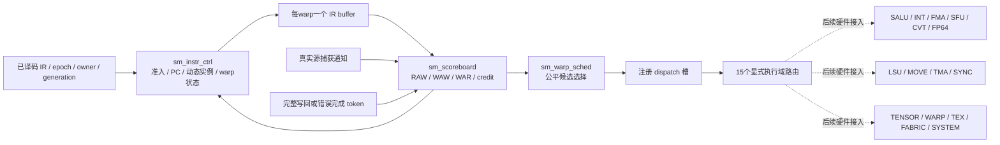

# SM 控制主干 RTL 第一版

日期：2026-11-16。本次实现 Sched、Instr Ctrl 和 scoreboard，完整SM范围见 [模块树](SM_MODULE_SCOPE.md) 与 [后端合同](SM_BACKEND_CONTRACT.md)。FMA、SFU、整数ALU、LSU、搬运和TMA均保留独立执行责任；它们不会因存在路由编号或测试模型而成为已实现硬件。

当前代码是 **UNIFORM_CONTROL_IR_V1** 控制基础模块，尚未组成完整SM或Tensor shell。它接收已译码的项目IR，有统一warp PC、无条件branch、NOP、等待和退出；不解析PTX文本／NVIDIA二进制，不实现ITS、条件分歧、call/return、指令cache、实际RF、SMEM、launch资源分配或TMA。已提交的tcgen05后端保持独立，实际接线的issue/return bridge仍须编码。

## 1. 代码结构



| 文件 | 已实现职责 |
|---|---|
| `design/core/src/common/sm_pkg.sv` | IR版本、15执行域、四个源区间/三个目的区间、GPR/predicate/CC、epoch与完整token、warp管理和fetch响应 |
| `design/core/src/if/sp/sm/sm_ctrl_if.sv` | warp管理、fetch/ack、typed dispatch、source-release、completion、可观察warp状态及SVA |
| `design/core/src/rtl/sp/sm/sm_warp_sched.sv` | 1..64个warp的round-robin候选，只有实际take才推进优先级 |
| `design/core/src/rtl/sp/sm/sm_scoreboard.sv` | 有界flight表、独立warp探测、寄存器区间依赖、源保护、身份验证、完成和返回credit |
| `design/core/src/rtl/sp/sm/sm_instr_ctrl.sv` | warp attach/detach、每owner generation历史、IR准入、PC/instance、派发槽、等待/退出和错误隔离 |

生产filelist为 `design/core/filelist/rtl/sp/sm/sm_instr_ctrl.f`。测试和运行脚本位于 `verif/core/{src,filelist,flow}/rtl/sp/sm/`。

## 2. 执行域与实现状态

`SM_EX_SALU/VALU_INT/FMA/SFU/CVT/LSU/MOVE/TMA/TENSOR/SYNC/WARP/TEX/FABRIC/SYSTEM/FP64` 是独立的路由分类。`function_id`和64bit immediate完整传给后端；本层不是全PTX tuple合法化器。控制NOP/BRA/WAIT/EXIT由本控制器处理，不通过SFU或MALU伪装执行。

capabilities是整个控制器固定的后端存在性配置。生产集成只能开放真实接入的域；测试将其连接协议BFM以验证路由和依赖，不证明该域的算术、访存、TMA或同步语义。能力关闭的IR返回 `SM_UNSUPPORTED`，不占执行flight、不改PC，不通过永久不ready隐藏缺功能。

SALU必须有可信前端提供的 `uniform_proven`，不能把`.uni`分支提示当数据uniform证明。lane_mask由前端完成规定的predicate取值后提交，必须是该warp active_mask的子集；该取值和依赖责任不能由固定填满mask替代。当前BRA、WAIT、EXIT要求完整active_mask；非uniform控制在此profile拒绝。

## 3. 准入、发射与完成的不同阶段

1. **warp attach**：校验epoch、slot、owner/generation、入口PC及active_mask。它只是可信launch管理器的控制接入，不预约RF/SMEM或启动Tensor context。同一owner存活的warp必须属于同一generation；全部detach后只接受更大generation，禁止回绕。
2. **fetch ack**：校验epoch、owner/generation、PC、IR、区间和能力，再进入该warp buffer。`SM_OK`只证明已缓存，尚未执行。错误响应保留请求身份和epoch，不能错认成新请求的成功。
3. **依赖准入**：各warp独立probe scoreboard；候选要同时拥有flight credit和dispatch槽。目的与未捕获源在这一阶段开始受保护，避免源码在后端尚未接收时被覆盖。
4. **backend dispatch**：注册载荷通过对应unit的ready握手，后端才取得执行责任。受阻时完整packet及路由保持稳定；scheduler内部的组合候选并不是这个外部packet。
5. **source release**：精确token匹配且已dispatch后，真实捕获完源寄存器才可释放WAR保护。descriptor/vector捕获尚未完成时不能提前通知。completion也可自然终结源责任。
6. **completion**：有目的的成功操作必须 `writes_committed=1`，表示全部GPR/predicate/CC写回完成。提前的成功通知只记协议错误，保留flight及RAW/WAW保护，等待真正的完成；它不会发布ready。
7. **WAIT/EXIT/detach**：WAIT和EXIT等待该warp的全部flight，包括还在dispatch槽内的预留。EXIT进入EXITED；detach只有EXITED/FAULT且无flight时成功。槽与owner的新代不能被旧返回释放。

这里的completion代表**本条IR的依赖完成域**。未来TMA/异步copy/Tensor桥须另持有源读、目的full、barrier/event/peer等异步责任，不能把“指令登记已完成”直接接到这里释放所有依赖；具体域见后端合同与既有tcgen05完成协议。

阻塞同步、memory/proxy顺序和动态collective汇合也需要专用等待/退休状态；它们不能由GPR的RAW/WAW表自动推断。真实后端接入时必须保留解除等待所需的控制信用，避免长等待占满通用flight后又挡住到达、释放或通知。当前15域协议路由测试没有证明这些尚待实现的系统协议。

## 4. scoreboard与资源复用

每个flight保存完整 `{epoch,ticket,owner,generation,warp,instance_id}`，以及265bit的源／目的mask：256个GPR、8个predicate、1个CC。多个span先取并集，支持宽向量、metadata和reduction目的；不把所有指令限制成3读1写。GPR span可到256个word，predicate span最多8个，CC一个，溢出在fetch前拒绝。

RAW等待旧目的完成；WAW等待旧写入完成；WAR等待旧源真正捕获。read/read可以共存，多个独立同warp操作可以同时在途。不同warp的寄存器编号独立。按整个warp的寄存器保守锁定，未做逐lane依赖优化。表项存储和tag credit共享，未为每个执行格式复制scoreboard；组合比较与时序/面积仍需后续综合评估。

默认64warp、16flight、每warp一个IR buffer、每周期最多一个准入、一个共享dispatch槽。共享槽受阻可能延迟其他执行域的新dispatch；返回、源释放、协议诊断不依赖该槽或warp调度而前进。后端ready不能依赖尚未发出的更年轻指令；提高多域吞吐时应增加独立队列/credit并重新验证，当前不声称Rubin发射宽度或峰值。

## 5. 错误与复位

不匹配、旧epoch/generation/ticket/instance、重复或尚未dispatch的完成都不能关闭新flight。协议错误按出现诊断脉冲的周期饱和计数，同拍多项错误合并一次；合法后端错误终结该flight并将对应warp标FAULT。已在dispatch槽承诺的更年轻操作仍须接收与排空，结果不可正常消费；没有精确异常或副作用回滚保证。尚未发出的buffer被丢弃，fault状态保持到受控detach。

独立审查发现并修正两项边界：

- 最后一条错误completion的注册retire脉冲可能与FAULT warp成功detach同拍；现在成功detach优先，旧retire不会把FREE槽重新写成FAULT。
- fetch和warp控制入口也携带epoch并检查，而非仅在执行completion token中放epoch；旧IR不会在新epoch下获得一个新token并执行。

协调reset必须清空上游IR、后端BFM／实际执行、返回与外部副作用责任，再更换epoch。epoch与capabilities仅在reset期间修改。丢弃旧返回不等于撤销已经提交的外部写。ticket/instance/generation耗尽不静默回绕。

## 6. 实际验证与后续模块

最终证据见 [checks/results_all.json](checks/results_all.json)，含正常通过和预期断言失败的独立分类、实际非零计数、源码和日志SHA256。

```bash
python3 verif/core/flow/rtl/sp/sm/run_sm_control.py --suite all --jobs 2
```

三个TB分别检查scheduler公平性与非法take断言；scoreboard的RAW/WAW/WAR、PRED/CC、完整身份、提前写回、乱序和reset；Instr Ctrl的15域协议路由、完整载荷快照、PC/动态实例、回压、WAIT/EXIT、跨代/epoch、错误排空和同拍detach。BFM并未实现实际FMA、SFU、RF或TMA。既有SM发生器的106项testplan不因这三个TB运行而改成已执行。

最终冻结源码回归实际完成8种配置：**12次正常仿真全部通过，另3次故意非法take均触发指定断言**，两类结果分别归档。Sched检查WARPS64/7/1与两个seed，scoreboard检查4warp/4flight和1/1；Instr Ctrl检查4/4两个seed、64/16和1/1。

| Instr Ctrl配置 / seed | checks | 实际dispatch | completion / 协调reset中止 |
|---|---:|---:|---:|
| 4warp / 4flight / 1907 | 647 | 34 | 33 / 1 |
| 4warp / 4flight / 2026 | 640 | 34 | 33 / 1 |
| 64warp / 16flight / 1907 | 763 | 34 | 33 / 1 |
| 1warp / 1flight / 1907 | 488 | 26 | 25 / 1 |

本次未改动已发布tcgen05的设计或测试文件；其既有报告中的63项源码hash仍匹配，未把静态一致性核对写成一次新的tcgen05动态回归。

接下来应实现联合launch/context资源管理、真实RF与operand collector/writeback、统一SMEM及barrier服务，再接入Tensor bridge；普通整数ALU、FMA/FPU、SFU、LSU/MOVE、TMA等按独立后端合同增加RTL与数值/内存模型测试。完整树中列出的模块都保留在SM范围内，逐模块以真实代码和执行证据验收。
