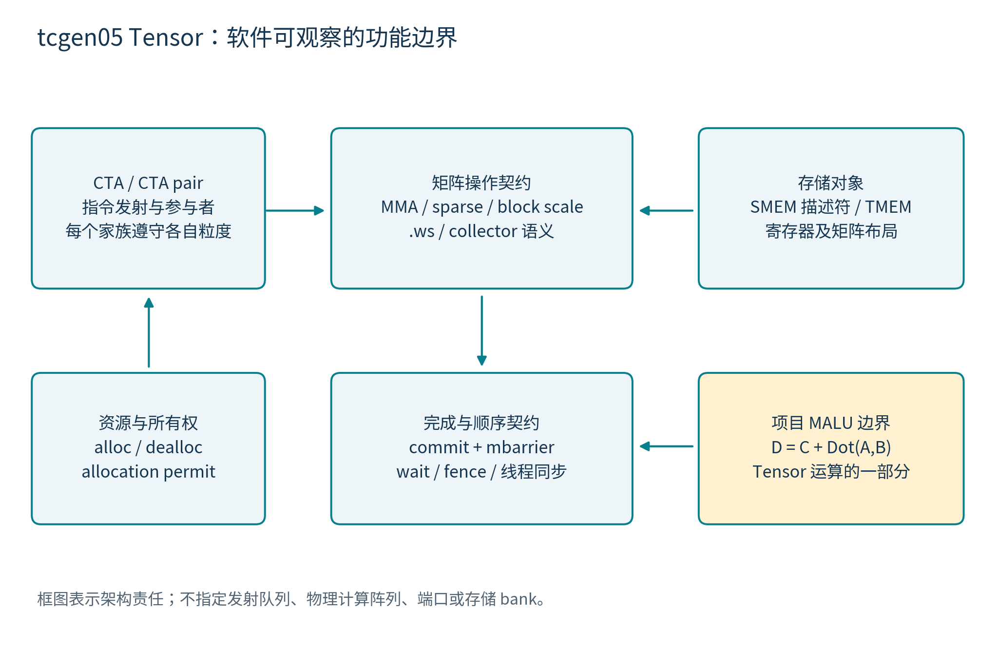
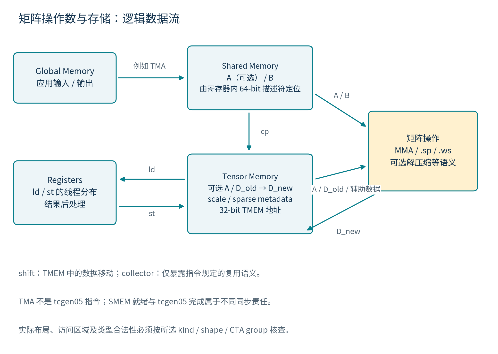
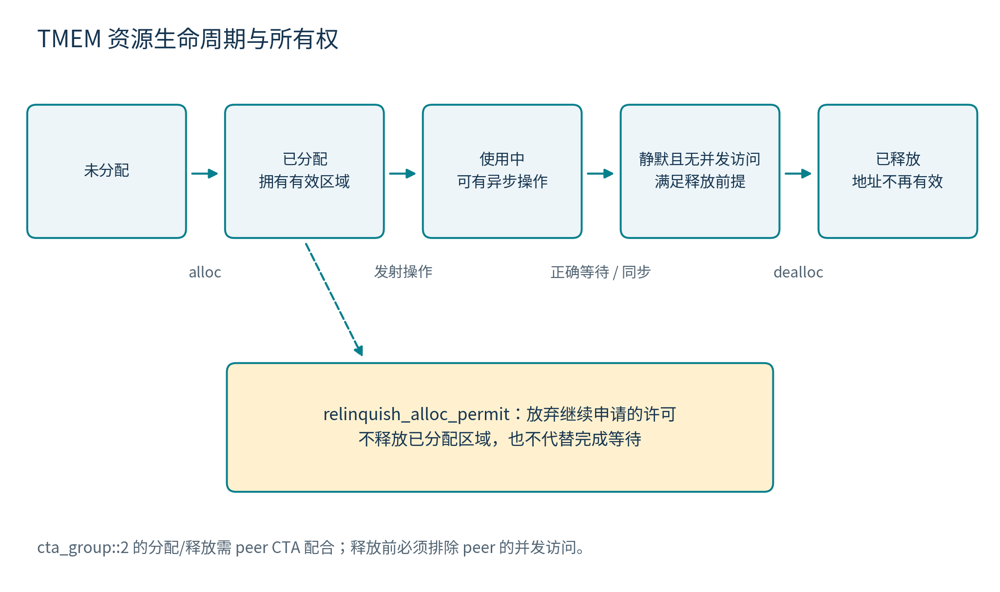
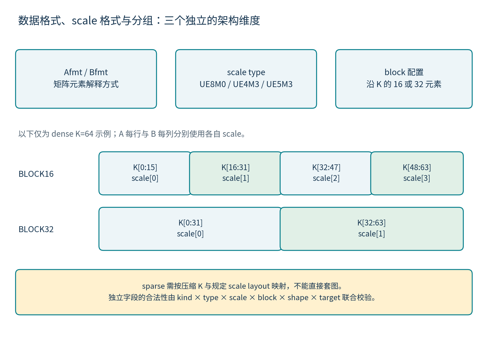
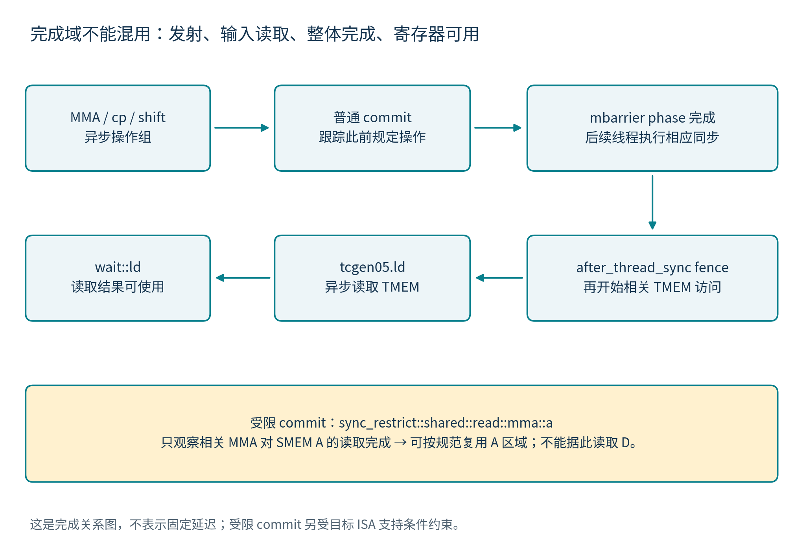

# tcgen05 Tensor 架构文档

版本：v1.0；日期：2026-10-26（Asia/Shanghai）。规范基准：用户提供的 **PTX ISA Release 9.4，2026-07-17**。文档状态：架构评审基线。

## 1. 文档目标与架构边界

本文定义 tcgen05 Tensor 的功能范围、软件可见对象、矩阵与存储组织、资源所有权、指令行为、参与者、合法配置、完成和顺序契约，以及它与项目 MALU 的关系。读者应能据此判断一个 Tensor 操作需要哪些数据、由谁发起、访问什么资源、何时允许消费结果或覆盖输入，以及哪些能力依赖特定目标。

本文停在架构层。它不决定流水级数、物理计算阵列、乘法器个数、归约网络、内部队列深度、SRAM bank、读写端口、仲裁算法、RTL 状态机或具体握手端口。PTX 公开的地址、描述符字段、数据布局和执行参与者属于架构契约，因而在本文范围内；它们不能反推物理实现。

全文使用三类证据：**规范事实**来自上传 PTX 9.4；**公开观察**来自 NVIDIA 其他文档、论文或专利，保留其目标和实验边界；**项目约定**描述本仓库的责任划分。不同证据类别不能互相代替。方括号来源编号在第 20 节解释，详细逐页核验在 [PTX 架构审查记录](research/ptx94_architecture_audit.md)。

### 1.1 三个必须分开的版本维度

| 维度 | 它回答的问题 | 本文处理方式 |
|---|---|---|
| PTX release | 该语法和语义在哪个规范版本出现？ | 固定为上传的 9.4，不用滚动网页替换页码 |
| target ISA | 某一具体功能在哪些 sm_*a / sm_*f 目标上合法？ | 按功能记录 target 条件，不只比较数字大小 |
| GPU 产品与性能 | 哪款商品 GPU 支持哪些能力、给出何种峰值？ | 产品资料单独引用；不把未证明的 target 映射到 Rubin |

tcgen05 基础家族在 PTX 8.6 引入，9.4 文档同时包含既有能力和新能力。`.red`、`.block16/.block32` 不是 9.4 首次出现。上传规范已经包含 sm_103、sm_107、sm_110 等目标相关条目，因此“tcgen05 等于一组固定的初代 Blackwell 规格”不成立。[P1 §9.7.18、版本记录]

### 1.2 与项目既有成果的关系

本仓库 MALU 的功能是向量点积加 C。它可以承担 Tensor 矩阵运算的数值子任务；完整 tcgen05 Tensor 还包含 TMEM、描述符、布局、矩阵分块、稀疏元数据、操作数复用和异步完成等职责。已有 `PROJECT_EXACT` RTL 不是完整 tcgen05 前端，也没有实现上述全部 Tensor 架构。其确定性精确求和与最终舍入属于项目数值约定。[J1]

### 1.3 功能级版本与 target 检查表

下表是重要门限，不代替每条指令的完整 Target ISA Notes。`a` 是架构专属目标，`f` 是 family 专属目标；“同 family 后续”不能改写为任意数字更大的 GPU。旧文中的 sm_101 自 PTX 9.0 重命名为 sm_110。

| 能力 | 首次 PTX 版本 | 必须保留的 target 条件 |
|---|---:|---|
| 基础 tcgen05 | 8.6 | 早期架构专属 sm_100a、sm_101a/110a；8.8 增加相应 family 目标。各 kind 有例外 |
| mxf4nvf4 kind | 8.7 | 普通与 sparse 指令的 target 列表分别核查，不能套用基础 family 条件 |
| block16/block32 拼写 | 8.8 | 对应说明要求 sm_100f 或 sm_110f；仍需联合 kind/shape/scale 条件 |
| ld.red | 8.8 | sm_101a/110a、相应 family，以及 sm_103f 同 family 后续；不是全部 sm_100 目标均支持 |
| alloc/dealloc.exclusive | 9.4 | sm_100f 或 sm_110f 同 family 后续；sm_107 的列数特例另见表 60 |
| ld{.red}.spcompress | 9.4 | sm_107a |
| kind::ti16，四种 MMA 形式 | 9.4 | sm_107f 或同 family 后续 |
| UE5M3、UE4M3+BLOCK32 | 9.4 表列能力 | sm_107f 或同 family 后续，见表 71 |
| 普通 MMA 的 LUT B 解压缩 | 9.4 | 指令 note 列 sm_107f，另有限定 kind、类型和布局 |
| 普通/sparse MMA 的 collector::b::* | 9.4 | 指令 note 列 sm_107f；不可与 ws 的既有 b0..b3 形式混为一次新增 |
| commit 的 SMEM A-read restricted 完成 | 9.4 | sm_107f 或同 family 后续 |
| commit 显式 multicast::cluster::32b | 9.4 | sm_107f 或同 family 后续；16b 与默认形式另按说明 |
| K96 特例 | 表 50 的扩展 | sm_103a、sm_107a，且只用于相应 kind/shape |
| 指定的新大 K 组合 | 表 50 的扩展 | sm_107f 或同 family 后续，仍有 M/N/类型限制 |

例如 i8 的指令 Target ISA Notes 单列架构专属目标，不能因为相邻浮点形式支持 family target 就一并开启 i8。target 能力应逐项建模，而不是用一个 `target>=100` 开关。[P1 §9.7.18.7–.12 各指令 notes]

## 2. Tensor 的架构定位与功能分区

tcgen05 是第五代 Tensor Core 操作的指令家族。它把矩阵操作与专用 Tensor Memory（TMEM）结合，并允许矩阵计算和部分数据移动在发射线程继续执行时异步推进。核心数学关系为矩阵乘加；标量除法、开方、超越函数和通用向量算术不属于本 Tensor 操作范围。

项目将 Tensor 的架构责任分为以下五项。这是功能划分，不要求一项对应一个 RTL 模块。

| 架构责任 | 输入或上下文 | 对外保证 |
|---|---|---|
| 命令与合法性 | 指令形式、kind、描述符、CTA group、target capability | 解释操作对象并检查联合配置，不能把独立字段当任意合法组合 |
| 资源与所有权 | allocation、列数、CTA/peer、allocation permit | 只在有效且有权访问的 TMEM 区域执行；满足释放和退出条件 |
| 操作数与布局 | SMEM/TMEM/寄存器、packing、scale、metadata、mask | 形成规范定义的矩阵元素及其逻辑坐标，不混淆地址空间 |
| 矩阵操作 | A、B、原 D、稀疏位置和缩放 | 按指定 dense/sparse/.ws 等语义更新 D；MALU 只承担其中的 dot 数值责任 |
| 完成与顺序 | commit、mbarrier、wait、fence、线程及 proxy 关系 | 分别表达可覆盖输入、可访问 D、可使用寄存器等条件 |

### 2.1 与周边执行与存储设施的关系

CTA/warp 发起和参与指令执行；Tensor 操作具有自己的参与粒度，不能沿用 `mma.sync` 或 `wgmma` 的参与模型。SMEM 提供 B 以及可选 A；TMEM 保存 D、可选 A 和辅助矩阵；寄存器承载描述符和 TMEM load/store 的线程片段。Global Memory 的输入输出通过周边访存机制组织，TMA 可以承担 Global→SMEM 供数，但 **TMA 不是 tcgen05 指令**。

CUDA 编程模型中的 warp 为 32 threads，同一 CTA 的线程由同一 SM 执行，cluster 内的 CTA 具有同一 GPC 内协作与同时调度的条件。这些概念规定参与和协作范围，不表示任意两 CTA 就能作为 tcgen05 peer，也不指定 Tensor 计算阵列。[N4]

TMA 的多维 tensor copy 使用 tensor map；它与 tcgen05 的 64-bit SMEM matrix descriptor 是两个不同对象。tcgen05.cp 负责 SMEM→TMEM，不能因为两者都带 Tensor 名称就写成 TMA 直接 Global→TMEM。TMA 还具有其他方向的 bulk 搬运形式，本文只画与矩阵输入有关的供数链。[N5]

SALU、VALU、SFU 可以服务地址计算、控制和结果后处理，它们不是 MALU 内部扩展出来的功能。调度器、访存单元与 Tensor 之间具体队列、端口、带宽和反压实现留到微架构设计；这里仅规定资源可见性、依赖和完成责任。[P1 §9.7.18；N1；N4；N5；J1]

## 3. 架构对象与矩阵数学模型

### 3.1 基本矩阵对象

令 A 为 M×K，B 为 K×N，D 为 M×N。普通 MMA 更新可表示为：

$$D^{\mathrm{new}}_{m,n}=\sum_{k=0}^{K-1}A_{m,k}B_{k,n}+D^{\mathrm{old}}_{m,n}$$

`enable-input-d=false` 时旧 D 不参与，数学关系为 `D_new=A×B`。tcgen05 原生指令中的加数是先前的 D 对象，不是任意独立类型、独立地址的 C。本文需要按数学习惯写 C 时，**C 就是本次操作的 D_old**。这与项目 MALU 接口中独立提供 C 的传输协议不同。[P1 §9.7.18.10]

| 对象 | 常见位置与解释 | 关键限制 |
|---|---|---|
| A | SMEM 描述符或 TMEM 地址指定 | 类型、major-ness、packing、layout 与 kind/shape 关联 |
| B | SMEM 描述符指定 | 可有 collector 或 LUT 解压缩语义；不等于任意 TMEM B 矩阵 |
| D_old / D_new | 同一目的 TMEM 矩阵对象 | D 类型由 kind/idesc 决定；不是随意选择独立 C/D 类型 |
| scale_A | TMEM 的 A 缩放矩阵 | 对 A 每行沿 K 分组 |
| scale_B | TMEM 的 B 缩放矩阵 | 对 B 每列沿 K 分组 |
| sparse metadata | TMEM 中的位置元数据 | 解释压缩 A 的逻辑位置；依 kind 和 target 改变 |
| LUT metadata | TMEM 中的 B 查找表 | 只用于规定的 LUT 解压缩形式 |
| output lane disable | 指令的输出禁止掩码 | 控制结果 lane 更新，不是 A/B 元素 mask |
| zero-column mask | `.ws` 的 B 列置零描述符 | 不等同于禁止写 D |

### 3.2 必须区分的坐标系

矩阵坐标 `(m,n,k)`、TMEM 的 `(lane,column)`、warp 的 thread lane、寄存器片段索引和 SMEM 字节偏移是不同坐标系。PTX 的 layout 定义它们之间的可见映射。`M=128` 不能直接推导 128 个物理乘法器，TMEM lane 也不能当作 CUDA thread lane 的同义词。

MMA shape `M×N×K` 描述逻辑矩阵；数据移动 shape `lane×size` 描述 TMEM 访问区域。两种 shape 不能混用来估算一次指令的物理并行度。[P1 §9.7.18.1–.3]

## 4. CTA group、指令参与者与访问权限

### 4.1 CTA 与 CTA pair

`.cta_group::1` 的操作作用于当前 CTA。`.cta_group::2` 作用于一对 CTA 的相应资源。CTA pair 是同一 cluster 中 `%cluster_ctarank` 仅最低 bit 不同的两个 CTA；最低 bit 为 0/1 分别称 even/odd，互为 peer。它不是任意两个 CTA，也不是整个 cluster 的所有 CTA。

有 `.cta_group` 的 tcgen05 操作在同一 kernel 中必须使用一致的 group 值。CTA-pair 操作发射时 peer 必须 active 且没有退出。peer 的生命周期是操作合法性的一部分，不是单纯的地址计算信息。[P1 §9.7.18.5，表 57]

### 4.2 发射粒度不等于数据访问粒度

| 操作 | CTA group 1 | CTA group 2 / 其他说明 |
|---|---|---|
| mma、cp、shift、commit | 一个 thread 发射 | CTA pair 中一个 thread 发射即可；不能无意在两侧重复发射同项工作 |
| alloc、dealloc、relinquish_alloc_permit | 一个 warp collective | 两个 CTA 各一个 warp 联合参与；第一方可能等待另一方 |
| ld、st、wait::ld/st | warp collective | 不带 CTA group；访问当前 CTA 对应 TMEM 区域 |
| fence | 需要排序的 thread 为自己的访问执行 | 一个 thread 的 fence 不自动覆盖其他 thread 的全部访问 |

TMEM load/store 中，每个 warp 访问其 warpgroup 对应的 1/4 TMEM lanes，并可以访问该区域的全部 columns。四个 warp 对应 lanes 0–31、32–63、64–95、96–127。覆盖完整 TMEM lane 视图需要 warpgroup，但这不使 MMA 的发射粒度变成 warpgroup collective。

`.sync.aligned` 要求参与线程到达同一指令并满足一致控制流等约束。对于 ld/st，warp 内线程使用相同 base TMEM 地址。**指令中的 `.sync` 不意味着异步传输已完成**；消费 load 结果或处理覆盖风险仍须遵守其完成契约。[P1 §9.7.18.5、.8]

## 5. 存储架构与 TMEM 地址

### 5.1 TMEM 的可见模型

TMEM 是专门用于 Tensor 操作的片上二维存储；横向行称 lane，纵向为 column。上传规范在 **sm_100a/sm_100f** 的说明中给出每 CTA 128 lanes×512 columns、每 cell 32 bit 的视图。这个视图对应 256 KiB 可寻址数据，但不证明每个 CTA 有物理独立复制的 256 KiB SRAM 宏，也不能泛化到全部后续 target。

TMEM 地址为 32 bit：bits 31:16 指定 lane index，bits 15:0 指定 column index。它不是一般字节指针。分配单位、矩阵类型、数据布局和操作 shape 一起决定某地址的合法含义。能编码进字段不等于拥有该位置的 allocation 或访问权。[P1 §9.7.18.1，PDF699–700/印687–688]

### 5.2 三类地址表示不得混用

| 表示 | 架构用途 | 禁止的混淆 |
|---|---|---|
| TMEM address | TMEM lane/column 和矩阵片段基址 | 不按普通 SMEM byte pointer 使用 |
| SMEM matrix descriptor | 用于矩阵寻址和布局的 64-bit 编码对象 | 不仅仅是一个 SMEM 首地址 |
| alloc 的 `[dst]` | 存放分配结果地址的 SMEM 位置 | 它不是分配得到的 TMEM 数据区域 |

### 5.3 TMEM 中的元素 packing

D 的 subword 元素不会自动紧密塞满一个 32-bit TMEM word；例如 F16 D 使用相应 word 的低 16 bit。`ld.pack::16b` 可以在读取时重组两个 16-bit 片段，`st.unpack::16b` 执行相反过程。这种传输转换与 D 的默认存储布局是两件事。

FP4/FP6 输入的 packing 依 kind、K、SMEM/TMEM 位置而异。某些路径使用 padding 或 8-bit container，另一些使用紧密打包。不能把一种输入传输布局推广到所有低位格式，也不能把 padding 位理解为新增有效数精度。[P1 §9.7.18.10.4]

## 6. TMEM 资源与所有权生命周期

### 6.1 分配模式

非 exclusive 分配按 32 列单位，列数为 32、64、128、256、512。列数须为 2 的幂，同一 CTA 执行顺序中的连续申请不得递增。分配一列涉及对应的完整 lane 维度；不能把 nCols 当 byte count。[P1 §9.7.18.7.1]

9.4 新增 `.exclusive`：列数可为 32 的整数倍，不必为 2 的幂。表 60 为 sm_100/sm_103/sm_110 列出至多 512 列，为 sm_107 列出至多 576 列。具体 target 支持还必须同时满足该指令的 Target ISA Notes；容量表不能单独替代 feature 检查。

exclusive allocation 等待没有其他 live allocation，并在存活期间排斥其他 allocation。所有权由相关 CTA 或 CTA pair 持有。释放时必须匹配同一列数及 exclusive 属性。这是规范描述的资源管理范围，不能自行扩大成全 GPU 或跨 kernel 的全局锁。

### 6.2 分配、使用、释放和退出的责任

| 阶段 | 必须满足的条件 | 可观察结果 |
|---|---|---|
| alloc | 参与 warp 满足 collective/aligned、group 与 nCols 条件 | 等资源可用并把 TMEM 地址写入指定 SMEM 位置 |
| 发布分配结果 | 给其他使用者建立正确可见性和线程顺序 | 使用者取得有效 TMEM 地址与所有权上下文 |
| 使用 allocation | 所有访问在合法范围内，异步依赖得到处理 | 指令可操作该资源；地址本身不表达完成 |
| 释放前 | 本 CTA 与 peer 均无并发 TMEM 访问 | 可以执行匹配的 dealloc |
| dealloc | group、列数和 exclusive 与原分配匹配 | allocation 结束，旧地址不可继续使用 |
| kernel 退出 | 本 kernel 的所有 allocation 已显式释放 | 不依赖隐式回收来满足规范 |

alloc 会在资源不足时阻塞；dealloc **可能阻塞**。程序既不能假定 dealloc 总是立即返回，也不能依赖它必然等待 peer 的最后一次访问。释放前的双边同步必须由程序建立。完成合法 dealloc 后，warp 可以退出，不需要为释放本身再添加退出同步；这不免除释放前排除并发访问的责任。[P1 表 58–59、§9.7.18.7.1]

### 6.3 allocation permit

`relinquish_alloc_permit` 放弃 CTA 后续分配权；该 CTA 之后再 alloc 属于非法行为。它不释放已有 allocation，不等同于 dealloc，也不意味着在途操作完成。permit 和 allocation 必须作为两个架构对象管理。alloc 写入 SMEM 的地址也不因 `.sync` 就自动向所有其他 warp 完成发布。

## 7. 指令家族完整功能视图

下表按外部效果列出指令；不把它们分解成内部微操作。细分语法、修饰符和 target 条件见后续章节。[P1 §9.7.18.7–.12]

| 指令或形式 | 架构效果 | 完成机制 |
|---|---|---|
| alloc / dealloc / relinquish_alloc_permit | 管理 TMEM 和分配许可 | 各自资源与参与契约；不能拿来等待 MMA |
| ld | TMEM→warp 分布寄存器 | wait::ld；寄存器依赖规则另见 §13 |
| ld.red | 读取并沿 columns 做每 lane 的 min/max | wait::ld |
| ld.spcompress | F32 2:4 稀疏压缩读取，产生数据和 metadata | wait::ld；9.4、sm_107a |
| ld.red.spcompress | 同时返回压缩结果及规定的归约结果 | wait::ld；组合修饰符限制独立校验 |
| st | warp 分布寄存器→TMEM | wait::st |
| cp | SMEM→TMEM，支持规定的展开和 multicast | commit + mbarrier |
| shift | 在指定 TMEM 区域移动数据 | commit + mbarrier |
| mma | dense A 的矩阵乘加，含规定的 scale、collector、LUT 形式 | commit + mbarrier |
| mma.sp | structured sparse A 的矩阵乘加 | commit + mbarrier |
| mma.ws | weight-stationary 卷积矩阵乘加 | commit + mbarrier；仅 CTA group 1 |
| mma.ws.sp | weight-stationary 与 structured sparse A 的组合 | 同上 |
| fence::before_thread_sync | 把之前 tcgen05 访问与后续顺序操作衔接 | 排序，不是完成等待 |
| fence::after_thread_sync | 把后续 tcgen05 访问与此前顺序操作衔接 | 排序，不是线程 barrier |
| commit | 登记本发射线程先前 mma/cp/shift 的完成追踪 | 使用 mbarrier 等待；commit 发射不是结果完成 |
| commit 的 sync_restrict 形式 | 只追踪相关 MMA 对 SMEM A 的读取完成 | 不代表 D 完成，不能替代普通完成事件 |

`.ld.red` 在 8.8 已存在；9.4 新增的是 `.ld{.red}.spcompress`。cp 的低位展开、MMA 的 LUT 解压缩和 ld 的稀疏压缩是三种不同转换，不应合并为一个泛化的“压缩模式”。

## 8. 描述符与配置架构

### 8.1 三类描述符

| 描述符 | 架构载体 | 表达的内容 |
|---|---|---|
| SMEM matrix descriptor | 64-bit register | matrix start、leading/stride dimension、base offset、swizzle、适用的 absolute 模式及 LUT 分段 |
| instruction descriptor（idesc） | 32-bit register | M/N/K、A/B/D 类型、sparsity、transpose/negate、scale 类型及相关 layout/ID |
| zero-column mask descriptor | 64-bit register | `.ws` B 的列置零控制；按 M 组织为规定的子 mask |

这些是架构编码宽度，不是拟定 RTL 端口。idesc 的具体字段解释随 kind 改变；同一个 bit 位置不能脱离 kind 解码。本文强调字段语义和联合限制，逐 bit 的生成应以表 51、53–56 为准。[P1 §9.7.18.4，PDF720–730/印708–718]

### 8.2 SMEM 描述符与布局

SMEM matrix start、leading byte offset 和 stride byte offset 必须 16-byte 对齐；相关编码为 `(x & 0x3ffff) >> 4`。leading stride 可以表示相对偏移，部分目标还提供 absolute 模式。base offset 与 swizzle 的重复边界配合，不能对所有布局一律写 0。

| swizzle 编码 | 意义 |
|---|---|
| 0 | no swizzle |
| 1 | 128-byte、32-byte atomicity |
| 2 | 128-byte |
| 4 | 64-byte |
| 6 | 32-byte |
| 3、5、7 | 非法 |

absolute 模式存在 K 数据为 48-byte 时的分块规则，且限制为相应 128B/16B atomicity、K-major、base offset=0 和不可 transpose；相关 target note 指向 sm_103a。它不是通用的任意地址模式。描述符保留位和固定值同样属于合法性检查，不能仅检查地址落在 SMEM 内。

### 8.3 独立配置维度与联合合法性

A/B 元素格式、scale 格式、block size、矩阵 shape、CTA group、稀疏形式、布局和 target capability 是不同语义维度。外部架构可以把它们分别表示，但必须建立合法 tuple 校验。PTX 原生 scale kind 的 A/B 使用同一个 Scale Matrix Type 字段；项目接口把两个 scale 字段分开，不会自动使“不同 A/B scale 类型”变成合法原生指令。

至少需要联合验证：`instruction form × kind × A type × B type × D type × M/N/K × CTA group × sparse version × scale type × block × layout × transpose/negate × target`。不同表的一个合法行不能随意与另一表的合法行拼接。

## 9. 原生数值类型与运算形态

### 9.1 tcgen05 的类型集合

| kind | A/B 数据格式 | D 格式 | scale |
|---|---|---|---|
| f16 | F16 | F16 或 F32 | 无 |
| f16 | BF16 | F32 | 无 |
| tf32 | TF32 | F32 | 无 |
| f8f6f4 | E4M3、E5M2、E2M3、E3M2、E2M1 | F16 或 F32 | 无 |
| mxf8f6f4 | 上述低位浮点类型 | F32 | UE8M0 |
| i8 | S8、U8 | S32 | 无 |
| mxf4 | E2M1 | F32 | UE8M0 |
| mxf4nvf4 | E2M1 | F32 | UE8M0、UE4M3、UE5M3 |
| ti16 | S1Z4M11 | S32 | 无 |

表中集合仍受 A/B 配对、K、transpose、指令形式和 target 限制。kind 名称不是任意混合精度的许可。**原生 tcgen05 表 50 没有 FP64、INT4、B1 或完整 F32 A/B 乘数行**；旧 `mma` 家族支持的类型不能直接并入该表。本项目 MALU 的更广类型范围应标为项目功能。[P1 表 50、53–55；J1]

低位格式名称描述指数与尾数：E4M3/E5M2 为 8-bit，E2M3/E3M2 为 6-bit，E2M1 为 4-bit，均包含符号位。E4M3 不表示 Inf，NaN 编码限于 0x7f/0xff；FP6 两类与 E2M1 不表示 Inf/NaN。编码精度与存储容器必须分开，例如 §5.2.3 为某些 FP6 寄存器形式规定每 byte 高两位 padding，而 Tensor 的具体 packing 还要遵守第 5、10、13 节的规则。

### 9.2 Ti16 与 TF32

Ti16 正式类型名为 `.s1z4m11`，16-bit signed integer，数学范围 `[-2047,2047]`，D 为 S32。它不是 `.e1z4m11` 浮点格式，也不能无依据按普通 S16 或 sign-magnitude 解码。现有原件没有给出足够明确的完整 raw 负数/零编码方程。因此，本架构记录其确定的类型、范围和指令能力，把 raw bit 解码保留为待决项。项目 RTL 的 decoded-Ti16 传输是显式扩展，不能冒充原生编码支持。

PTX 对 TF32 internal layout 明确留给实现决定。F32 容器低 13 bit 清零是本项目当前输入协议，不是 PTX 对所有实现的唯一物理布局。[P1 §5.2.3、§9.7.18.4.2；J1]

### 9.3 数值语义与精度边界

矩阵数学关系不等于逐项标量 IEEE FMA 序列。若规范未给出完整内部累加顺序、舍入路径或全部特殊值逐 bit 行为，架构文档不能补造一套“官方内部精度”。旧 mma 家族的精度文字、某款 GPU 的实验归约位宽，以及本项目的 exact profile 是不同层次的依据。

整数 signedness、允许的 saturation 控制、浮点 negate 和特殊值行为必须随所选形式解释。不能用一个项目级 rounding 枚举推断所有 tcgen05 指令都暴露同样舍入模式。将来做目标设备 bit-match 时，应单独固定 GPU、target、PTX 入口、编译版本和实测 profile。[P1 §9.7.18.10；L1]

把长 K 分解成多条 MMA 并用 D_old 串接，在实数数学上仍是分块求和，但不保证与另一种分块方式逐 bit 相同。指令边界、D 格式和目标数值行为都可能影响结果。架构不能为提高复用或改变 tile 形状而悄悄增加“任何拆分均逐 bit 等价”的承诺。

### 9.4 数值修饰符的权限

表 53 的 integer saturation 位只为 i8 提供 0/1 选择；Ti16 的对应位固定为 0（NA），不能套用项目 INT8 的 saturation 请求。i8 的 A/B 不能通过浮点 negate 位任意取负；Ti16 negate 的合并单元格则给出 A/B 的 0/1 选择。Ti16 transpose 另有第 19 节记录的原文冲突。

对 floating kinds，negate、transpose 和 scale-input-d 是不同功能：negate 作用于矩阵元素符号；transpose 改变逻辑矩阵访问映射；scale-input-d 作用于旧 D。三者不能简化为一个“输入变换”控制码。mxf4/mxf4nvf4 支持 negate，但不支持 transpose；更细的类型/shape 限制须继续检查表 64–67。

## 10. MMA shape 与可见数据布局

### 10.1 常规非 ws 形状

下表列出常规基线和大 K 条件的入口；它不是把每列全交叉后的无限组合。N 最大 256。dense/sparse 的 K 分别按完整数学矩阵的逻辑 K 解释，压缩后的实际 A 存储宽度另见第 12 节。[P1 表 50，PDF700–704/印688–692]

| kind | CTA group | M | N | dense K / sparse K |
|---|---:|---|---|---|
| f16 | 1 | 64、128 | 8..256，步 8 | 16 / 32 |
| f16 | 2 | 128、256 | 16..256，步 16 | 16 / 32 |
| tf32 | 1 | 64、128 | 8..256，步 8 | 8 / 16 |
| tf32 | 2 | 128、256 | 16..256，步 16 | 8 / 16 |
| f8f6f4，常规 | 1 | 64、128 | 8..256，步 8 | 32 / 64 |
| f8f6f4，常规 | 2 | 128、256 | 16..256，步 16 | 32 / 64 |
| mxf8f6f4 | 1 | 128 | 8..256，步 8 | 32 / 64；大 K 另核查 |
| mxf8f6f4 | 2 | dense 128、256；sparse 仅 256 | 16..256，步 16 | 32 / 64；大 K 另核查 |
| i8 | 1 | 64、128 | 8、16、24、32，其后 48..256 步 16 | 32 / 64 |
| i8 | 2 | 128、256 | 32..256，步 32 | 32 / 64 |
| mxf4 / mxf4nvf4 | 1 | 128 | 8..256，步 8 | 64 / 128；96/192 扩展另核查 |
| mxf4 / mxf4nvf4 | 2 | 128、256（sparse 仅 256） | 16..256，步 16 | 64 / 128；大 K 另核查 |
| ti16 | 1 | 64 | 8..256，步 8 | 16 / 32 |
| ti16 | 1 | 128 | 16..256，步 16 | 16 / 32 |
| ti16 | 2 | 128、256 | 32..256，步 32 | 16 / 32 |

大 K 的架构规则须与 target 一起使用：f8f6f4 的 dense K64 / sparse K128 含元素类型及 M/N 条件；mxf8f6f4 同样存在 K64 / K128 扩展。mxf4/mxf4nvf4 支持表列的 K96、K128 及 sparse K192 等组合。K96 仅限表中指定的 sm_103a/sm_107a；新增的大 K family 能力另依 sm_107f 条件，不能仅因 descriptor 有编码位就启用。完整特例见规范表 50 及本目录核查记录。

为避免把扩展隐藏在“另核查”中，关键行展开如下；这些行叠加前表的类型和 target 约束，不替代它们。

| 扩展 | 具体 M / K 关系 | N 与附加限制 |
|---|---|---|
| f8f6f4、CTA1 | dense K64 对应 M128；原表另列 sparse K128 | N 合并单元格写步 8 或步 16；不能自行发明 K 与两种步长的一一绑定。K64 类型脚注明确仅 E4M3/E5M2 |
| f8f6f4、CTA2 | dense K64 对应 M256；原表另列 sparse K128 | N=16..256 步 16；其余联合条件保持表 50 原意 |
| mxf8f6f4、CTA1 | M128，dense K32/64、sparse K64/128 | N=8..256 步 8；没有 f8f6f4 那条 only-FP8 脚注。FP6/FP4 的 dense K64 不能 transpose，packing 另核查 |
| mxf8f6f4、CTA2 | dense K32 可 M128/256，K64 仅 M256；sparse K64/128 仅 M256 | N=16..256 步 16 |
| mxf4 / mxf4nvf4、CTA1 | M128，dense K64/96；sparse K128/192 | N=8..256 步 8 |
| mxf4 / mxf4nvf4、CTA2 | dense K64 可 M128/256，K96/128 仅 M256；sparse K128/192 仅 M256 | N=16..256 步 16；K96 与新增 K128 的 target 条件分别检查 |

f8f6f4 的跨页表采用共享单元格，本文保留其 N 列 OR 表述，未在排版不能证明的地方额外生成精确 legalizer 规则；实施时应先澄清该关系，再固化接受集合。

### 10.2 ws 形状

`.ws` 仅支持 CTA group 1，M 为 32、64、128；dense N 为 64、128、256，sparse N 为 64、128。f16、tf32、f8f6f4、i8、ti16 有 ws 行，K 延续相应 kind 的规定；mxf8f6f4、mxf4、mxf4nvf4 没有 ws 支持。不存在 `.ws.cta_group::2` 的合法对应行。

### 10.3 layout A–G

以下 organization 名称描述公开的数据映射，不能推导真实算术阵列形状。[P1 §9.7.18.10.5]

| M / CTA group / 形式 | layout | 规范 organization | TMEM lane 对齐 |
|---|---|---|---|
| 256 / 2 | A | 4×1 | 0 |
| 128 / 2 / dense | B | 2×2 | 0 |
| 128 / 2 / sparse | C | 4×1，half utilization | 0 或 16 |
| 128 / 1 | D | 4×1 | 0 |
| 64 / 1 / ws | E | 2×2 | 0 |
| 64 / 1 / non-ws | F | 4×1，half utilization | 0 或 16 |
| 32 / 1 / ws | G | 1×4 | 0 |

layout C/F 中 A、D 与 sparse metadata 必须采用一致的 TMEM lane 对齐。transpose、major-ness、元素宽度和 swizzle 还会增加限制。例如 32-bit transpose 使用规定的 128B/32B atomicity 模式；8/16-bit transpose 排除此模式；mxf4/mxf4nvf4 本身不支持 transpose。Ti16 transpose 在表 53 与表 64 存在不一致，本文不擅自作统一承诺。

## 11. Block scaling 架构

### 11.1 数学对象与独立配置

block scaling 先按分组对 A/B 元素缩放，再执行矩阵乘加；这里的元素缩放不是把原矩阵与 scale 矩阵做普通矩阵乘法。scale_A 是按 A 每行沿 K 分组的矩阵，scale_B 是按 B 每列沿 K 分组的矩阵。它们不是一个对整条指令共用的 scalar。scale 矩阵位于 TMEM，其地址、布局和复制条件是供数契约的一部分。[P1 §9.7.18.10.7]

对于 dense、block size B 的简单逻辑表示，`g=floor(k/B)`，同一输出元素使用 `scale_A[m,g]` 和 `scale_B[g,n]`。这个表达式说明逻辑分组，不取代 TMEM layout、scale ID 或 sparse 模式下的具体索引规则。

$$\widetilde A_{m,k}=A_{m,k}\,s^A_{m,g(k)},\qquad \widetilde B_{k,n}=B_{k,n}\,s^B_{g(k),n}$$

$$D^{\mathrm{new}}_{m,n}=\sum_{k=0}^{K-1}\widetilde A_{m,k}\widetilde B_{k,n}+D^{\mathrm{old}}_{m,n}$$

| kind | A/B 格式 | scale type | block 配置 |
|---|---|---|---|
| mxf8f6f4 | FP8/FP6/FP4 规定类型 | UE8M0 | BLOCK32 |
| mxf4 | E2M1 | UE8M0 | BLOCK32 |
| mxf4nvf4 | E2M1 | UE8M0、UE4M3、UE5M3 | BLOCK16 或 BLOCK32 |

UE8M0、UE4M3、UE5M3 是 **scale 格式**，E4M3/E5M2/E2M3/E3M2/E2M1 是 **A/B 元素格式**，16/32 是 **K 分组配置**。三者必须分别表达。UE5M3，以及 UE4M3 与 BLOCK32 的组合，受 sm_107f 同 family 后续目标条件限制。字段独立不意味着所有格式与 block 均可交叉。

| scale type | 无符号数值格式 | 特殊值与寄存器表示 |
|---|---|---|
| UE8M0 | 8-bit：8 exponent、0 mantissa | 无 Inf，NaN=0xff；§5.2.3 的 packed ue8m0x2 使用 b16 |
| UE4M3 | 7-bit：4 exponent、3 mantissa | 无 Inf，NaN=0x7f；单值使用 b8，最高位以 0 padding |
| UE5M3 | 8-bit：5 exponent、3 mantissa | 无 Inf，NaN=0xff；单值使用 b8 |

上表来自 PTX §5.2.3，规定的是格式及其声明方式；它不替代 TMEM scale 矩阵的布局，也不规定内部 scale 乘法的物理实现。

### 11.2 block size 与 scale vector 数量

对于 dense，BLOCK16/BLOCK32 指定每个 scale 覆盖多少逻辑 K 元素；`.scale_vec::1X/2X/4X` 指定的是对应形式中的 scale 数量。两者不是永远一对一的别名，K 改变时不能固定映射。sparse 必须按压缩 K 与规定 scale layout 解释，不能把完整 logical K 直接套进 dense 分组计数。

| dense K 的分组示例 | BLOCK32 | BLOCK16 |
|---:|---:|---:|
| 64 | 2 个 scale | 4 个 scale |
| 96 | 3 个 scale | 6 个 scale |
| 128 | 4 个 scale | 8 个 scale |

此表说明数学分组数量，具体指令仍需存在合法 K/kind/target 行；不应由表反推任意 kind 支持 K128。mxf4 省略 scale_vectorsize 时有规定默认值，mxf4nvf4 要求显式给出。sparse logical K、压缩存储 K 与历史 scale_vec alias 的口径必须按原表处理，不能直接套用 dense 表。[P1 表 70–71]

### 11.3 scale 布局与 D 缩放

B scale 要按规定复制到 TMEM 的 32-lane partitions。sm_107f 的部分 A scale 写入规则允许采用不同复制处理，不能用单一广播假设替代各 layout。

`scale-input-d` 表示旧 D 乘 `2^(-s)`，s 为 0..15，仅允许规定的 f16/tf32 形式。它不是 A/B block scaling，也不是第三种 scale 矩阵。项目请求中如表达 C 缩放，应单独登记，不与 ABfmt、scale type 或 block size 合并。

## 12. Structured sparsity 与其他数据变换

### 12.1 sparse A 的数学与存储

`.mma.sp` 的数学 A 仍为 M×K，压缩存储为 M×(K/2) 加 metadata。metadata 把保留值放回逻辑 K 位置；被省略的位置按规定为零。D 的逻辑 shape 不因压缩而缩小。[P1 §9.7.18.10.9]

| kind 类别 | 结构 | 必须保留的限制 |
|---|---|---|
| tf32 | 1:2 | 不直接称为普通 2:4；有效 metadata 有专门规定 |
| f16、ti16、f8f6f4、mxf8f6f4、i8 | 2:4 | metadata 位解释、版本、位置和 layout 依规定 |
| mxf4、mxf4nvf4 | 成对 4:8 | 每两个元素组成子组，必须整体零或整体非零；不是任意 4-of-8 |

TF32 有效 metadata 4-bit 值为 `1110`、`0100`。上传规范对 2:4 metadata 的枚举包含需进一步核实的特殊项，不能凭常见“六种二选二”理解删改原文。mxf4/mxf4nvf4 的 sparsity version bit 也有 sm_100/103/110 与 sm_107 的目标区分。

sparse 模式的可见运算量和市场公布的 sparse 峰值必须保留统计口径；不能把压缩存储宽度当数学 K，更不能用 dense 数值简单补成所有格式的 sparse 吞吐。

### 12.2 load reduction 与 load sparse compression

`ld.red` 在每个 TMEM lane 沿 columns 做 min/max，支持规定的 F32、S32/U32 形式及相关 abs/NaN 控制。它是 TMEM 读取附带的归约，不是给 MALU 新增通用标量 ALU 指令。

`ld.spcompress` 仅在规定的 `.32x32b`、F32、`sp::2:4`、b2 metadata 形式使用；支持的重复数为 x4..x128。返回压缩数据和位置 metadata；`.red.spcompress` 另外返回规定的 reduction。组合形式的 `.NaN` 仅作用于 reduction，spcompress 本身保留 NaN。该功能由 9.4 引入且目标为 sm_107a。其输出 metadata 不应未经类型和布局适配就当作任意 `mma.sp` 的合法输入。

### 12.3 cp 的低位展开

cp 可以把规定的 `.b4x16_p64` 或 `.b6x16_p32` 展开到 `.b8x16`。这是布局与 padding 的展开，不等于浮点数值转换成任意 FP8 标准。ld 的稀疏压缩、cp 的展开与下节的 LUT 解压缩应分别建模。

## 13. 数据移动、复用与卷积架构

### 13.1 load/store 的 shape 和片段

| 基础 shape | 每 thread 的 b32 register 数量（相对 `.num`） | 备注 |
|---|---:|---|
| 32x32b | num | 访问 32 个 TMEM lanes |
| 16x64b | num | 16-lane shape |
| 16x128b | 2×num | 最大重复数受限制 |
| 16x256b | 4×num | 最大重复数受限制 |
| 16x32bx2 | num | 两个访问位置相差 immHalfSplitoff |

`.num` 为基础 shape 的 repeat factor，并非所有 shape 都允许 x128。例如 16x128b 的上限为 x64，16x256b 为 x32。寄存器向量长度、TMEM 地址对齐和 warp lane 映射必须联动计算。[P1 §9.7.18.2.3、.8，表 61/63]

### 13.2 cp 与 shift

cp 支持 4x256b、32x128b、64x128b、128x256b、128x128b 等规定的 SMEM→TMEM 形态。64x128b 配置 `warpx2::02_13` 或 `warpx2::01_23`，32x128b 使用 warpx4，以规定的 warp 分组 multicast。这里的 multicast 是数据布局行为，不能推出某种物理广播总线。

shift 在 warp 对应区域把 32-byte 元素沿 TMEM row 向下移动，最后 row 除外；隐含 shape 为 31x256b，地址 lane 要求 32 对齐。CTA group 2 的操作涉及两侧相应 TMEM。MMA `.ashift` 与独立 `tcgen05.shift` 相关，但不是同一指令或任意可互换的序列。[P1 §9.7.18.9]

### 13.3 collector 与 stationarity

默认 MMA 在规范中称 activation-stationary；`.ws` 是 weight-stationary 卷积形式，主要复用 B。collector 的 fill/use/lastuse/discard 表达许可的复用语义，**复用是 opportunistic**。即便使用 use，执行仍可能重新读取源矩阵，所以不能据“已经装入 collector”就在 MMA 完成前任意覆盖源数据。

9.4 增加普通 MMA 的 B collector 指定形式。`.ashift` 用于规定的 TMEM A row 移动，M 仅 128/256，且与相应 collector::a::fill/use 限制关联。软件可观察复用不决定内部 collector 容量、bank、寄存器实现或访问延迟。

`.ws` 的 B collector 具有 b0、b1、b2、b3 四个软件可选编号；这不是“四个物理 bank”的证明。idesc 还规定尝试 B 复用时的 maximum shift 编码，可表示 no shift、8、16、32。它约束可见复用请求，不提供命中保证或内部搬运周期。

`.ws` 的 zero-column mask 把 B 的指定列按零处理；非 block-scale 形式的 disable-output-lane 则抑制对应 D lane 的更新，CTA group 1/2 分别采用规定的 4/8 个 32-bit mask。二者不能合并成统一的“有效位”。[P1 §9.7.18.4.3、.10]

### 13.4 LUT B 解压缩

9.4 的 `.decompress::lut::b` 适用于规定的 f8f6f4/mxf8f6f4 普通 MMA 形式。SMEM 中 B 存的是 3-bit 索引，TMEM LUT 为每个规定的 8-column slice 提供 8 个候选 8-bit 值。解码后的 B 仅允许 E4M3，不能 transpose，并排除 layout B/C/F；该能力依赖 sm_107f 条件。

它不是一般熵解码器，不给任意 B 格式、任意压缩比例或任意 sparse mask 提供语义。LUT 的生命周期和数据可见性属于 MMA 输入契约。[P1 §9.7.18.10.8]

### 13.5 两份卷积专利提供什么信息

US20250060938A1 描述驻留 activation、shift 保留重叠子集并补入新数据的直接卷积序列；US20250077615A1 描述 weight-stationary 的直接卷积序列。两者支持在架构上讨论“选择驻留对象、移动窗口、补入缺失数据、执行矩阵操作、复用累加结果”的分工。

专利的 physical A-input/B-input 标签与 PTX 数学矩阵 A/B 不可未经映射就画等号。专利实施例中出现的 lane 数、collector、AGU、crossbar 或某周期供数安排不在本架构中固化，也不能据此宣称商品 GPU 必然采用同一微架构。独立权利要求与具体实施例的证据范围分开记录。[L2；L3]

## 14. 异步执行、完成与内存顺序

### 14.1 两套完成机制

| 操作对象 | 完成追踪 | 观察完成后可做的事情 |
|---|---|---|
| 本线程先前发射的 mma/cp/shift | commit 登记，mbarrier phase 完成等待 | 结合所需线程/proxy 顺序，消费相应结果或复用资源 |
| 本线程先前发射的 ld | wait::ld | 规定的读取完成；处理反依赖与存储复用风险 |
| 本线程先前发射的 st | wait::st | 规定的写入完成；再按依赖访问相应区域 |
| MMA 的 SMEM A 读取阶段 | 受限 commit 所关联的 mbarrier | 仅证明相应输入读取完成，不能据此读取 D |

commit 不阻塞等待所有矩阵计算结束；wait::ld/st 不追踪 MMA；fence 不等待结果，也不替代线程 barrier。mbarrier 的地址、phase、参与计数和作用域必须与所等待的事件对应。对错误 phase 或无关 barrier 的成功观察不能证明本次工作完成。

### 14.2 有保证的 pipelined 指令关系

规范只对指定配对给出顺序保证：[P1 §9.7.18.6.2]

| 前项→后项 | 附加条件 |
|---|---|
| mma→mma | 相同 CTA group、accumulator、shape、kind |
| cp→mma | 相同 CTA group |
| shift→mma | 相同 CTA group |
| shift→cp.4x256b | 相同 CTA group |
| mma→shift | 相同 CTA group |

commit 与它追踪的 mma/cp/shift、wait 与对应 ld/st 还有 implicit pipeline 关系。其余组合不能从“同一 thread 按程序顺序发射”推导天然按序完成。跨线程形成这些关系时还必须建立正确的线程间顺序。

### 14.3 线程间顺序

`fence::before_thread_sync` 把之前的 tcgen05 操作与后续执行顺序操作连接；`fence::after_thread_sync` 把之后的 tcgen05 操作与此前同步连接。它们与 barrier、mbarrier 或规范允许的其他 execution-ordering 操作组合，才能在不同线程之间建立所需顺序。

例如由一个 thread 发射 MMA，另一个 warp 读取 D，通常需要：发射者 commit 登记完成；消费者正确等待相应 mbarrier phase；消费者执行相应 after_thread_sync；然后 collective ld 并遵守 ld 完成规则。不能只在发射 thread 执行 fence，就认为所有消费者已同步。[P1 §9.7.18.6.3–.4]

tcgen05.ld 的真实 register dependency 会被尊重，但这不自动为任意后续 memory access、反依赖或 TMEM 复用建立顺序。此类风险仍需 wait::ld 和规范要求的同步。

### 14.4 proxy 与 SMEM 供数

tcgen05.mma/cp 的 SMEM 访问属于 async proxy。generic proxy 的 SMEM 写入、TMA 的数据到达和 Tensor 的输入读取之间，必须依据 producer 路径建立正确可见性；需要时使用 `fence.proxy.async` 等机制。**TMA 完成、跨 proxy 可见、MMA 完成是三个不同条件。**

commit 访问 mbarrier 使用 generic proxy。multicast commit 在目标 CTA 的 SMEM 相同 offset 作用于对应 barrier；它不是将 D 结果复制到多个 CTA。默认 ctaMask 为 16-bit，显式 32-bit 形式受 sm_107f 条件限制。[P1 §9.7.18.6.5、.12]

### 14.5 只跟踪 A 读取的受限 commit

`.sync_restrict::shared::read::mma::a` 在先前相关 MMA 对 **SMEM A 的读取完成** 时产生相应完成通知。这个事件可帮助确定何时复用 A 的 SMEM 区域；它不证明 B 已不再读取、D 已生成、MMA 已全部结束，或 TMEM 已可释放。消费者仍要观察普通的整体完成条件。

该能力由 9.4 引入且受 sm_107f 同 family 条件限制。原规范对 commit 的“同步类别”和“异步完成”使用不同层次术语，项目必须把“发射已执行”和“被追踪事件已完成”分别表示。[P1 §9.7.18.12.1，PDF844–846/印832–834]

## 15. 架构级操作流程与示例

以下是依赖与对象的示例，不是可直接汇编的 PTX，也不规定线程调度和流水组织。具体 barrier/proxy 操作可依据合法 pipeline 关系简化，但不能省略对应责任。

### 15.1 单 CTA dense F16，M128×N64×K16

1. 一 warp 申请满足 D 和其他 TMEM 对象布局需求的列数；发布 alloc 返回地址，并正确初始化及发布随后使用的 barrier 对象。
2. producer 把 A128×16 和 B16×64 准备到 SMEM，建立 Tensor 读取所需可见性；构造合法矩阵描述符和 f16 idesc。
3. D 类型选择 F32，首次操作令 enable-input-d=false；若需要非零 C，先按 D 布局建立 D_old，再用 true。例如经 st 初始化时，须完成 wait::st 及使用者之间所需同步。
4. 合法发射 thread 发起 MMA；为后续结果消费登记 commit 和关联 mbarrier。
5. consumer 等待正确 phase，建立跨线程 tcgen05 顺序；按 layout D 和各 warp 权限读取 TMEM。
6. collective ld 后遵守 wait::ld/依赖规则再用寄存器结果。完成所有 TMEM 访问后 matching dealloc，再退出。

单条数学运算量按普通 dense 计数为 `2×128×64×16=262144` 浮点操作。这是数学工作量，不是 cycle 数或物理单元数；若比较带独立 C 的精确计数，应统一统计约定。

### 15.2 FP4 + scale，M128×N64×K64

选择有相应 capability 的 mxf4nvf4 形式，A/B 为 E2M1，D 为 F32。A/B 格式、scale type 和 block 配置分别记录：UE8M0+BLOCK32 时，A 每行和 B 每列沿 K 分别需要两组逻辑 scale；BLOCK16 时分别需要四组。若选择 UE5M3，须先确认对应 sm_107f 目标支持。

准备 scale 矩阵的 TMEM layout 和所需复制，再准备 A/B 与 idesc。MMA 发射前，数据、scale 和 descriptor 必须引用同一逻辑 tile。不能用“FP4 模式”隐含 scale 格式，也不能由一个 beat 的长度推断 block size。完成和资源释放责任与 dense 流程一致。

### 15.3 CTA pair，M256×N128×K16

选择 f16、CTA group 2 和对应 layout A。even/odd 两个 CTA 先满足 cluster 配对与 active 条件；各一 warp 联合 alloc，双方建立所需输入与地址可见性。一个合法 thread 发射 pair MMA，不能两侧误发两次。

结果及相关 TMEM 访问按两侧布局组织。用于通知的 barrier/multicast 必须覆盖实际消费者。两侧完成所有访问并建立释放前同步后，各自参与联合 dealloc。不得让一侧提前退出或在另一侧仍访问时释放。

### 15.4 Ti16 与整数路径

对支持 kind::ti16 的目标，可选择 M128×N64×K16、A/B 为 S1Z4M11、D 为 S32。架构层能确定类型、shape 和数学范围；在 raw 编码依据补足前，项目不能声称已经把该原生指令完整接入现有 decoded-Ti16 MALU。i8 的 S8/U8 则按各自 idesc signedness 解释，不与 Ti16 混成任意整型互转。

### 15.5 卷积滑窗与驻留数据复用

先选 `.ws` 或默认 stationarity，再确定矩阵 A/B 与卷积 activation/weight 的映射。驻留对象保持规范要求的有效性；每个滑窗步骤通过合法 shift/cp/collector 操作保留重叠数据、补入缺失部分，并发起下一 MMA。D_old 可以承接前序累加结果。

这种序列解释了数据复用的架构价值，但不指定 local buffer 数量、AGU 数目或“每周期补一列”的实现。完成依赖仍按第 14 节分别处理，不能因复用而省略输入保护。

## 16. 面向本项目的架构接口契约

以下是逻辑信息和责任，不是 RTL 信号表，不规定字段位宽、总线拍数或握手协议。

| 逻辑接口 | 必须携带或保持的上下文 | 完成/责任 |
|---|---|---|
| 核心执行→Tensor 命令 | opcode/form、target capability、CTA/peer、group、kind、shape、descriptor 引用 | 指令参与者合法；区分发射与完成 |
| Tensor→资源管理 | owner、allocation 列数、exclusive、permit、生命周期 | 防止越权、释放后访问和 peer 提前退出 |
| 供数→矩阵运算 | A/B 数据及坐标、旧 D、AB/D 格式、scale 数据/类型/block、metadata、mask | 数据与配置属于同一 tile，已满足可见性 |
| 矩阵运算→MALU | 逻辑 dot 的 A/B、正式 C、数值格式及匹配 scale | MALU 只执行 dot；不负责解释全部 TMEM/SMEM 描述符 |
| Tensor→完成观察 | 操作归属、被追踪事件、barrier/phase 或 load/store 类别 | 输入读取完成、结果完成、读取完成不可混用 |
| 结果→消费者 | D 的布局/类型和所属 tile，合法访问范围 | consumer 建立顺序并完成读取后，才能覆盖或释放相关资源 |

原生 ISA legalizer 应位于能看到完整 kind/shape/target 的架构边界，而不能仅依赖 MALU 的数值格式检查。项目当前 MALU 接受的混合类型、独立 C/D、FP64、INT4、B1 等更广配置，不代表 Tensor 前端必须或可以把它们编码成 tcgen05。[J1]

## 17. 性能架构、资源复用与 Rubin 目标

架构层可以定义工作量、格式能力、驻留复用机会、数据需求和产品目标；不能从 PTX shape 推导 latency、initiation interval、频率、乘法器数量或每周期 dot 数。

资源复用首先体现在同一 A/B tile、scale、metadata 和 D_old 可以服务多个合法操作，以及 collector、shift、cp 减少重复搬运的机会。后续微架构可选择共享计算资源或提高并发度，但必须维持本文的数值、生命周期和顺序契约。当前 MALU 的串行共享乘法与逐字累加只是一个项目实现，不约束未来 Tensor 必须采用同一结构。

### 17.1 Rubin 产品目标与 ISA 合法性分开

既有核验取得的 NVIDIA Rubin 单 GPU 规格采用下表口径；不是本项目实测，也不是从 PTX 推导。[N3；R1]

| 格式/用途 | 官方单 GPU 值 | 对 FP16/BF16 归一化 |
|---|---:|---:|
| TF32 dense | 2 PFLOPS | 0.5 |
| FP16/BF16 dense | 4 PFLOPS | 1 |
| FP8/FP6 Training dense | 17.5 PFLOPS | 4.375 |
| NVFP4 Training dense | 35 PFLOPS | 8.75 |
| NVFP4 Inference sparse | 50 PFLOPS | 单列，不混入上述 dense 比例 |

这些产品值不能补全 Ti16、I8、每个 scale/BLOCK 组合的吞吐，也不能证明某个 sm_107 target 就是 Rubin。未来性能分配还需给出明确的合法 tuple、dense/sparse、训练/推理、计数口径和可达带宽。本文不把目标比写成当前 RTL 已实现的性能。

### 17.2 架构级数据需求与复用评估

对一个 dense tile，A/B 的逻辑元素数分别为 MK、KN，D 为 MN。若输入有效位宽为 bA/bB，则未计布局与复用的有效输入位数为 `MK×bA + KN×bB`。这只是数据量下界，实际 TMEM/SMEM 占用还受 padding、D 的 32-bit cell 布局、scale 复制、metadata 和 32 列分配粒度影响。不能直接用有效位数除八充当实际 TMEM allocation。

dense 分组下 scale 的逻辑项数分别为 `M×ceil(K/B)` 和 `ceil(K/B)×N`，其中 B 为 block size；对不完整组和 sparse 模式须遵守具体指令规定。一个 A tile 服务多个 N tile、一个 B tile 服务多个 M tile、D 在连续 K tile 间留驻，分别对应输入复用与累加复用机会。collector/shift/cp 提供其中部分可见机制，但实际命中率和带宽节省必须测量。

因此性能架构需要分别约束“数值工作量、数据供给、TMEM 容量/所有权、可见依赖”四项。只有在 workload 和真实实现明确后，才能把它们转成端口宽度、并发队列或计算实例数；这些转化属于后续微架构。

## 18. 架构验证与验收清单

这里定义需要验证的可观察行为，不指定 testbench 类层次或内部断言实现。当前 MALU 的三轮验证仅证明其已列出的功能，不能当作完整 Tensor 验收。[J1]

| 验证域 | 主要检查对象 | 通过标准 |
|---|---|---|
| capability / legal tuple | kind、类型、M/N/K、ws、group、scale、sparse、target | 接受合法组合；对非法组合按项目边界阻止执行，不编造 PTX trap 语义 |
| TMEM 生命周期 | alloc/exclusive/permit、列数、ownership、释放后访问 | 满足资源约束、双边参与和退出条件 |
| 地址与布局 | TMEM 地址、SMEM descriptor、A–G、packing、alignment | 逻辑矩阵与存储/寄存器映射一致 |
| 矩阵数学 | dense、enable-input-d、D 缩放、signedness、特殊值 | 与明示的 ISA/profile 合约一致；设备 bit-match 单独验收 |
| block scaling | 格式、16/32、K 索引、scale ID/布局/复制 | 不漏 scale、不串 tile；非法交叉组合不执行 |
| sparsity | logical K、压缩 A、metadata、版本、位置恢复 | 还原逻辑矩阵正确，不接受未经定义的 metadata |
| 数据移动与变换 | ld/st/cp/shift、red、spcompress、LUT | 片段、packing、metadata 和结果语义符合所选形式 |
| 复用与输入保护 | collector、ws、ashift、B zero mask、write-disable | 可观察结果正确；未把 opportunistic reuse 误当提前覆盖许可 |
| 异步与同步 | 同线程/跨线程 pipeline、commit/wait/fence、phase、proxy | 无提前读结果、提前改输入或释放；各完成域不可混用 |
| CTA pair | rank 配对、peer active、联合 alloc/dealloc、双边消费 | 不重复发射，不提前退出，无释放竞态 |
| 性能声明 | 工作量、统计口径、实际运行或综合证据 | 产品目标、架构预算、RTL测量分别标记 |

PTX 对某些非法输入定义 undefined behavior，并未承诺统一错误码或异常中断。项目可以在入口添加诊断/拒绝机制，但必须标为项目策略，不能把 MALU 的 BAD_CFG/UNSUPPORTED 状态描述成 PTX 原生异常。

## 19. 待决事项与后续微架构输入

| 事项 | 已确定 | 本版保留的缺口 |
|---|---|---|
| Ti16 raw 编码 | 正式类型、16-bit 容器、范围、S32 D、target/shape | 完整逐 bit 编码与转换依据 |
| Ti16 transpose | 表 53 与表 64 有相关字段/能力描述 | 两表不一致，需官方勘误或明确实验依据 |
| sparse metadata | 各 kind 结构和 target version 有规定 | 上传原文特殊枚举需精确核查，不凭常识删改 |
| scale alias 与 K | BLOCK16/32 与表 70 特例明确 | 历史 alias、dense/sparse K 口径重叠处继续澄清 |
| target→产品映射 | 已查到 B200/GB200、B300/GB300 官方 CC 信息 | 没有据此证明 sm_107 与 Rubin 的映射 |
| 数值 profile | 数学运算与类型明确；项目 exact profile 已定义 | 特定设备完整逐 bit 行为另建 profile |
| 微架构资源 | 架构责任和合法复用机会明确 | 并行度、流水、队列、TMEM 实现、仲裁、频率及 PPA 均待后续设计 |

后续微架构文档应以本文的对象、依赖和验收条件为输入，再做资源与时序决策；不能用某个实现选择反向改写 ISA 保证。任何新增项目扩展均应与原生 tcgen05 capability 分开版本管理。

## 20. 来源、页码与阅读路径

PDF 页码为从 1 开始的物理页；“印”指原文页脚。上传 PTX 相关章节满足 PDF 页=印刷页+12。附件原件不复制入仓库。

| 编号 | 来源 | 本文使用范围与限制 |
|---|---|---|
| P1 | 用户上传 *PTX ISA Release 9.4*，2026-07-17；[官方滚动入口](https://docs.nvidia.com/cuda/parallel-thread-execution/) | 规范基准为上传原件，不假定滚动网页与其一致；SHA256 见下 |
| N1 | [NVIDIA Blackwell Tuning Guide](https://docs.nvidia.com/cuda/blackwell-tuning-guide/) | 周边软件架构背景与已列产品目标；不能补造未来产品映射 |
| N2 | [NVIDIA CUDA GPU Compute Capability](https://developer.nvidia.com/cuda/gpus) | 产品与 compute capability 的公开映射；访问时快照边界见来源审查 |
| N3 | [Vera Rubin NVL72](https://www.nvidia.com/en-us/data-center/vera-rubin-nvl72/)；[Rubin Technical Blog](https://developer.nvidia.com/blog/inside-the-nvidia-rubin-platform-six-new-chips-one-ai-supercomputer/) | 单 GPU 峰值和 dense/sparse 脚注，非项目实测 |
| N4 | [CUDA Programming Guide：Programming Model](https://docs.nvidia.com/cuda/cuda-programming-guide/01-introduction/programming-model.html)，§1.2.2–.3 | warp、CTA、cluster 与内存角色；本轮页面 v13.4.2，不能当作上传 PTX 的同一快照 |
| N5 | [CUDA Programming Guide：Asynchronous Data Copies](https://docs.nvidia.com/cuda/cuda-programming-guide/04-special-topics/async-copies.html)，§4.12.2 | TMA 与 tensor map；与 tcgen05.cp、SMEM matrix descriptor 及其完成域分开 |
| L1 | 用户上传 [Accurate Models of NVIDIA Tensor Cores](https://arxiv.org/abs/2512.07004)，Khattak、Mikaitis，所传 v3，2026-04-04 | 特定设备与指令入口的数值实验；不推广到 Rubin、全部 FP4/FP6、Ti16 |
| L2 | 用户上传 [US20250060938A1](https://patents.google.com/patent/US20250060938A1/en)，NVIDIA，公开于 2025-02-20 | 直接卷积的驻留、shift、补入及 MMA 序列；不是商品 GPU 实现证明 |
| L3 | 用户上传 [US20250077615A1](https://patents.google.com/patent/US20250077615A1/en)，NVIDIA，公开于 2025-03-06 | weight-stationary 直接卷积；实施例与权利要求分开解释 |
| R1 | [既有 Rubin 来源交叉核验](../malu/research/rubin_source_crosscheck.md) | 官方规格脚注和第三方/知乎访问限制的真实记录 |
| J1 | [项目 MALU RTL 实现与检查](../malu/RTL_IMPLEMENTATION.md) | 项目功能与验证边界；不是 NVIDIA 规范 |

P1 上传原件 SHA256：`4be2905e240b70a8b176b4d6fb162714f2fc361a9503572d848ff723abf289c3`；1002 个 PDF 页。核心架构章节定位如下：

| 主题 | PTX 章节 | PDF / 印刷页 |
|---|---|---|
| TMEM 与地址 | §9.7.18.1 | 699–700 / 687–688 |
| MMA shape | §9.7.18.2、表 50 | 700–704 / 688–692 |
| 数据移动与 SMEM 布局 | §9.7.18.2.3–.3 | 705–720 / 693–708 |
| 描述符 | §9.7.18.4、表 51/53–56 | 720–730 / 708–718 |
| 参与者与 CTA pair | §9.7.18.5、表 57 | 730–732 / 718–720 |
| 内存顺序与同步模式 | §9.7.18.6 | 732–738 / 720–726 |
| TMEM 分配管理 | §9.7.18.7 | 738–741 / 726–729 |
| ld/st/wait | §9.7.18.8 | 741–749 / 729–737 |
| cp/shift | §9.7.18.9 | 749–754 / 737–742 |
| MMA 总体与 layout | §9.7.18.10.1–.6 | 755–774 / 743–762 |
| block scale、LUT、sparse | §9.7.18.10.7–.9 | 774–823 / 762–811 |
| 四类 MMA 指令 | §9.7.18.10.10 | 823–842 / 811–830 |
| fence 与 commit | §9.7.18.11–.12 | 843–846 / 831–834 |

论文关键依据为 PDF4–5 的矩阵定义、PDF11–12/14 的入口和覆盖范围、PDF15 表4的设备模型；它不提供全部新类型的通用实现。专利关键依据为 60938 PDF52–54 的实施例和 PDF69–70 的权利要求，以及 77615 PDF61–62 的实施例和 PDF80–81 的权利要求。逐条出处、图号和附件 SHA 见 [既有论文/专利核验](../malu/research/literature_findings.md)。

本轮补充的来源与范围审查见 [架构来源审查](research/architecture_source_review.md)。图 1–5 为依据上述契约整理的项目原创逻辑图，不是 NVIDIA 芯片框图；SVG/PNG 与生成脚本随文档保存，DOCX/PDF 构建方法见 [BUILDING.md](BUILDING.md)。
