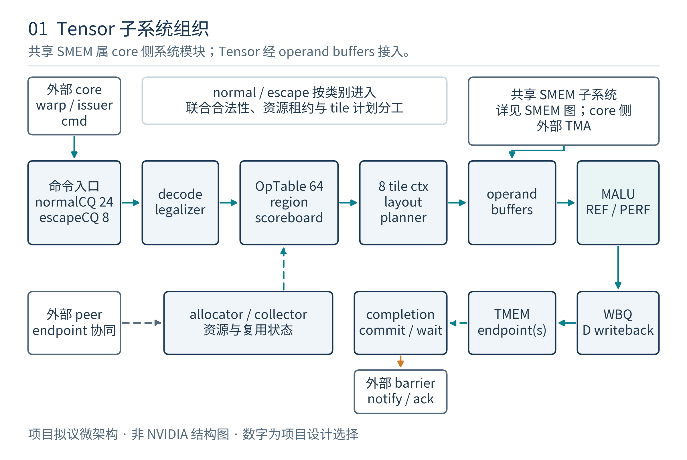
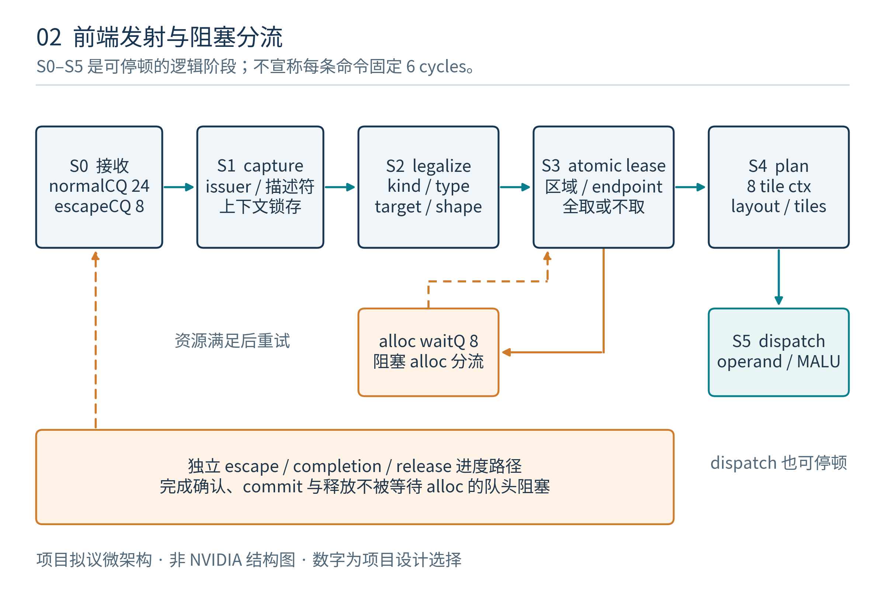
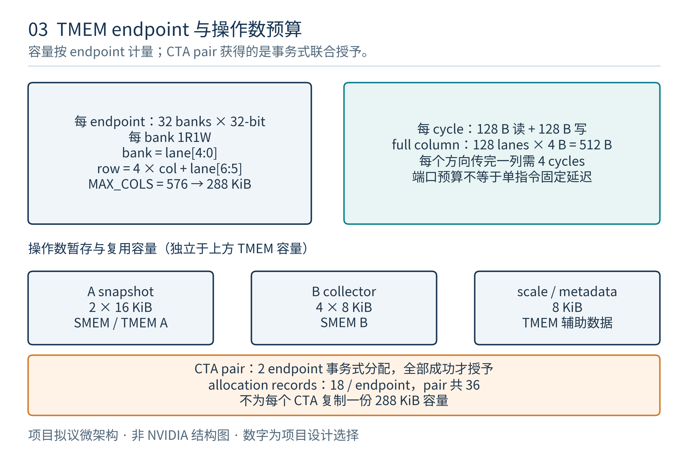
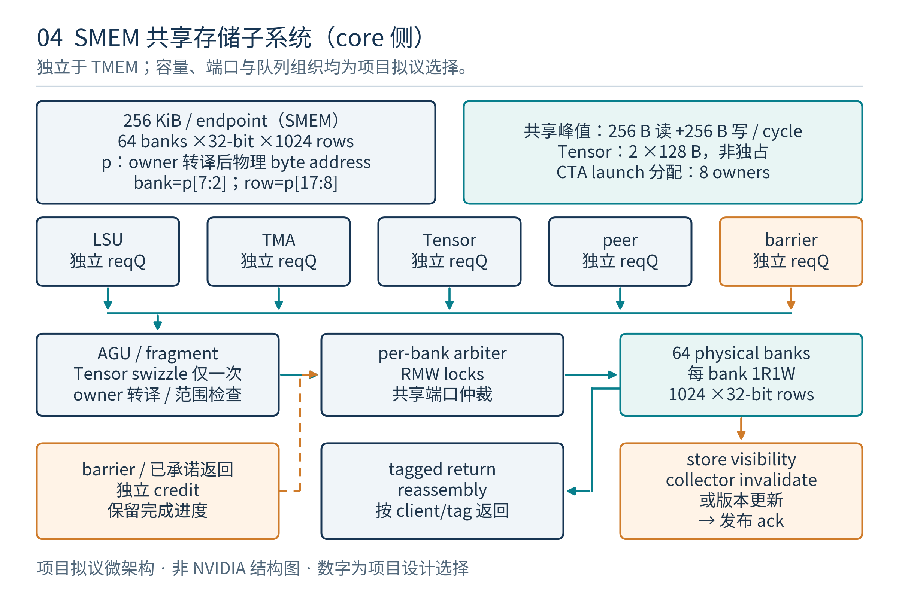
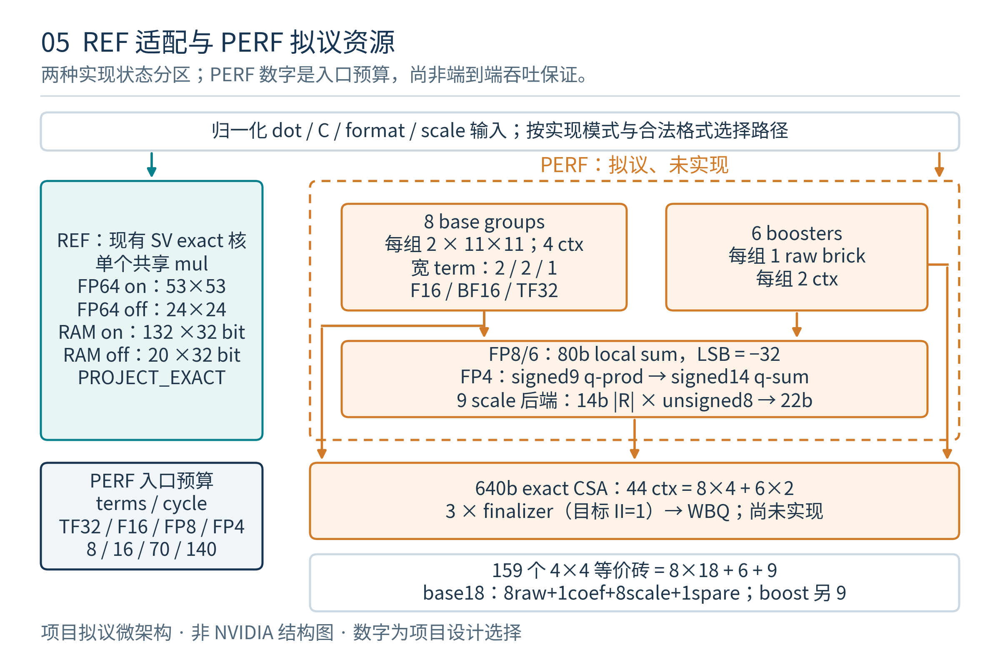
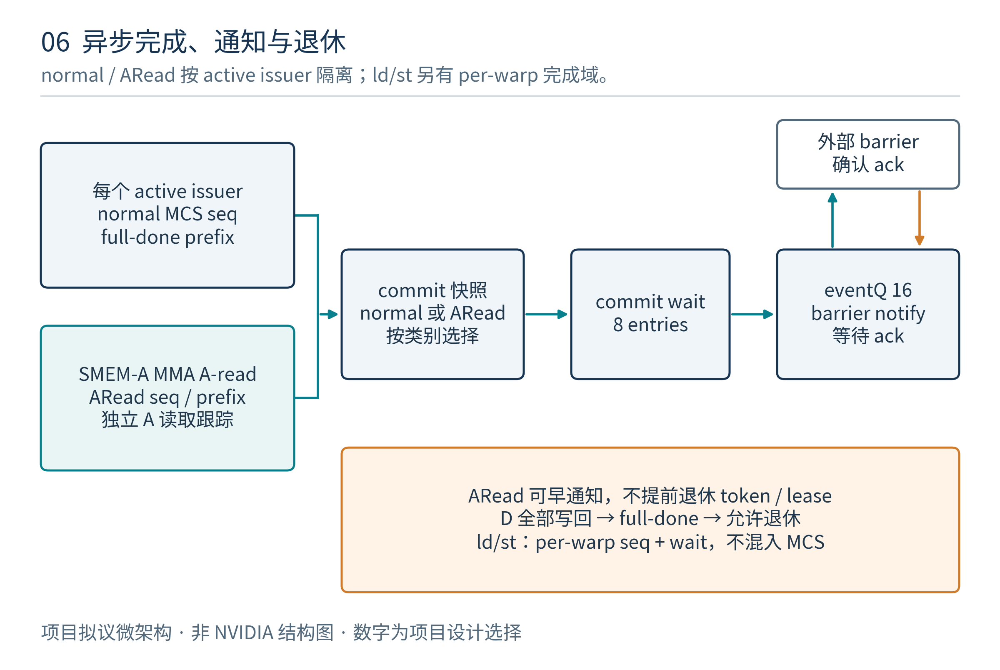

# tcgen05 Tensor 微架构文档

版本：v1.1；日期：2026-10-27（Asia/Shanghai）。状态：**项目拟议微架构，供 RTL 设计评审**。上位约束：[tcgen05 Tensor 架构 v1.0](../TCGEN05_TENSOR_ARCHITECTURE.md)，依据上传 PTX ISA 9.4。v1.1 补全 core 共享 SMEM 本体及与 Tensor 的集成；v1.0 阅读版保留为历史快照。

## 1. 实现范围、证据和设计基线

本文把架构契约落实为模块、存储、流水、队列、资源预约、接口和时序。所有新增容量、bank 映射、调度策略、流水和计算资源数量均为**本项目设计选择**，不是 NVIDIA 公开 RTL，也不表示已经复原 Blackwell/Rubin 的物理实现。

本次交付是微架构文档、工程图和可复查预算；没有新增或修改 Tensor 功能 RTL。现有代码只包含 PROJECT_EXACT MALU 及其验证，当前实现状态以 [MALU RTL 说明](../../malu/RTL_IMPLEMENTATION.md) 为准。功能仿真、综合、时序、面积、功耗和完整 tcgen05 验收都不能从本文的参数表推定为已完成。

### 1.1 两条明确的数值后端

| 后端 | 本版用途 | 已有实现与拟议边界 |
|---|---|---|
| REF | 首次集成、功能参考、宽格式项目扩展 | 复用现有一个 `malu_core`，一笔 dot 串行完成；新 Tensor 前端、TMEM 和适配器仍待编码 |
| PERF-S1 | 对齐 Rubin dense 相对配比的空间资源方案 | 新增重构乘积砖、分组精确归约、并行 context 和 finalizer；全为拟议，不能沿用 REF 的测试结论 |

两后端都选择项目 PROJECT_EXACT 数值契约：有限项精确组合，最后一次舍入。PERF 的有限项分组变换必须在此契约下保持等价。目标设备逐 bit profile 另立；本文不假定 PTX 保证 IEEE 标量 FMA 的内部次序，也不以论文参数补造某代 GPU 的数值实现。

原生前端支持集合按 target、kind、shape、layout、scale 和已实现功能共同求交。现有 MALU 的 FP64、普通 F32 乘数、INT4、B1 等项目扩展不自动成为 tcgen05 原生指令。Ti16 raw 编码与原文 transpose 冲突尚未解决，原生 capability 保持关闭；decoded-Ti16 只能经明确的项目扩展入口。

### 1.2 冻结的组织单位与参数

一个 **endpoint** 集成到项目的一个 Tensor 执行接入点，服务最多 8 个驻留 CTA owner；核心调度器同时提供 64 个 warp slot 的接入信用。两个 endpoint 可通过 peer bridge 执行 CTA-pair 操作。这是项目集成方案，不推断 NVIDIA 的 SM 物理配对。

| 参数 | 本版建议值 | 说明 |
|---|---:|---|
| TMEM banks / endpoint | 32 | 每 bank 32-bit、1R1W，读延迟目标 2 cycle |
| shared SMEM / endpoint | 256 KiB | 64 个 32-bit 1R1W physical banks，8 CTA owner 共享 |
| physical MAX_COLS | 576 | capability 选择可用 512 或 576；每列 128 lanes |
| allocation records | 18 / endpoint | pair 共 36；不按每 CTA 限 4 项 |
| resident CTA owners / warp slots | 8 / 64 | 必须与核心 admission credits 联动 |
| OpTable | 64×256 B | 异步操作的完整生命周期记录 |
| Normal CQ / Escape CQ | 24 / 8 | 分别用于普通命令与进度控制 |
| active issuer contexts | 32 | 每个 stream 窗口最大 8；空 context 可回收 |
| MMA tile contexts | 8 | 是上层命令上下文，不是物理 dot lane 数 |
| CommitWait / Event Q | 8 / 16 | 事件 credit 预留，不能等待数据通路释放才接收完成 |
| REF MALU instances | 1 | `LANES=4` 仅是接口缓存槽 |
| PERF base groups / low boosters | 8 / 6 | 资源构成见第 13 节 |
| PERF dot contexts / finalizers | 44 / 3 | 8×4 + 6×2；finalizer 目标 II=1 |

## 2. 顶层模块与数据路径

| 拟议模块 | 主要职责 | 独立保存的状态 |
|---|---|---|
| `tensor_issue_bridge` | 合并 collective，捕获 issuer/CTA/warp/epoch | collective instance、有效线程 ballot |
| `tensor_decode_legalize` | 解析描述符，选 capability/layout recipe | 不可变的规范化命令 |
| `tensor_op_table` | 生命周期、父子操作、完成计数 | token、generation、issued/returned/write-acked |
| `tensor_allocator` | TMEM、permit、exclusive、pair 分配 | bitmap、18 records、owner generation |
| `tensor_region_scoreboard` | 全范围原子 lease、RAW/WAR/WAW 排序 | 每 op 最多 8 个保守归一化范围 |
| `tensor_tile_planner` | M/N/K 展开、dot 与传输片段映射 | 8 tile contexts 的游标和 recipe ID |
| `tensor_operand_hub` | SMEM/TMEM 供数、解包、scale/metadata | source snapshot、collector、事务 tag |
| `tensor_move_engine` | ld/st/cp/shift/red/spcompress | fragment 游标和 warp register scoreboard |
| `tensor_malu_adapter` | 把 tile 元素变成 dot+C | REF 单事务映射或 PERF group/context 映射 |
| `tensor_writeback` | D 地址映射、write-disable、写回合并 | 写队列与 bank ack |
| `tensor_completion` | full/A-read/ld/st、commit/fence | issuer 前缀、CommitWait、Event Q |
| `tensor_peer_bridge` | pair 资源和子任务协议 | parent/child ID、双边 prepare/done masks |
| `core_smem_subsystem` | core 共享存储、LSU/TMA/Tensor/DSM/barrier 服务 | CTA launch 分配、64-bank 仲裁、assembly/RMW/可见性状态 |

MALU 始终只执行向量点积及其正式 C；地址生成、TMEM 分配、稀疏位置恢复、collector 管理和 mbarrier 不放入 dot 核心。SMEM 是 core 共享子系统，Tensor 是其客户端。TMA 是外部供数机制，tensor map 不与 tcgen05 SMEM matrix descriptor 合并。

## 3. 命令记录、标识和不可变配置

入口命令捕获原始描述符、指令形式、issuer、CTA group 和 core epoch。被接受后，执行过程不能再次读取可能已被后续指令覆盖的描述符寄存器。

| 记录域 | 必需内容 |
|---|---|
| identity | endpoint、CTA slot/generation、warp/thread ID、OpTable index/generation、core epoch |
| operation | opcode/form、target capability、kind、dense/sparse/ws、M/N/K、layout recipe |
| data | A/B 源描述符、D TMEM 地址、dtype、negate/transpose、enable-input-d、D shift |
| auxiliary | scale_A/B 地址、scale type、block、scale ID/layout、sparse metadata/version、LUT、mask |
| progress | 发射 stream seq、MMA-only seq、K 已接收数、D 已提交数、peer child masks、错误/flush 状态 |
| protection | allocation generations、source snapshots、全范围 lease、closure/event credits |

OpTable 每项预留 256 B：原始命令不超过 128 B，其余用于规范化配置和进度。CQ 仅持有 16 B 指针/优先级记录，CQ 出队不意味着 OpTable token 可复用。

所有异步请求与响应携带 token、generation 和 epoch。不能只用循环队列 index 匹配延迟响应。generation 回绕前必须完成 endpoint/peer/外部端口的 quiesce；不以“16-bit 很难回绕”代替正确性条件。

## 4. 前端流水、接收与发射

| 阶段 | 逻辑操作 | 允许前进的条件 |
|---|---|---|
| S0 ACCEPT | 检查 admission，捕获请求 | 普通异步命令检查 CQ/OpTable/issuer-window；escape 控制检查其独立记录/事件信用 |
| S1 CAPTURE | 固化描述符和 collective 信息 | 所有必需参与者一致，源寄存器值已捕获 |
| S2 LEGALIZE | 联合合法性、格式和地址 recipe | capability 命中且无保留位/配置问题 |
| S3 LEASE | 合并并原子取得所有资源范围 | 全部范围、pair child 和 snapshot 预算一次满足 |
| S4 PLAN | 产生 tile/dot/fragment 计划 | tile context 及后端接受预算可用 |
| S5 DISPATCH | 向执行引擎发布 | 目的队列 ready，token 所有权移交完成 |

各阶段设一个 valid register，payload 在阻塞时保持稳定。S0–S5 是建议的六段前端组织，不是所有指令固定六周期；collective 汇合、allocator、lease、存储返回和执行均可停顿。没有频率或时序收敛报告。

每个 issuer 在同一个有序 S0 admission 点分配异步序号，并对 commit/wait/fence 捕获相应 watermark；尚在 S1–S5/CQ 等待的先前 MMA 也已计入。CQ 后续重排不能改变截止点。已接收但合法性失败的命令走项目错误/取消协议，在确认诊断或 owner abort 后关闭相应序号，不能留下永久孔洞，也不能伪装成功的矩阵结果。

core bridge 必须按同 issuer 的动态指令顺序提供 admission ticket；两个入口类别不能让后来的 escape commit 越过尚未接受的更早 MMA。core 若以乱序方式送达，需先在 bridge 按 ticket 汇合，不能把“escape 不需普通信用”解释成忽略程序顺序。

commit/wait/fence/dealloc 不要求一个空普通 MCS 窗口槽或一个空异步 OpTable 项。它们使用独立控制记录；否则窗口恰好满时会把解除等待所需的 commit 一同挡住。

Normal CQ 使用可选择的 ready entry 调度，不以一个阻塞 alloc 作为全局 FIFO 头。受依赖约束的同 issuer 命令不能无条件越过；其他 issuer 的独立 dealloc、数据返回和完成事件必须继续推进。

Escape CQ 的 8 项按 4 项 commit 请求、2 项 dealloc/permit、2 项 wait/fence 分区保留；调度器在各分区间轮转。CommitWait 是后续独立表，不能与这 4 个入口槽混为一个深度。alloc 等待进入独立 8 项 wait queue，不持有发射端口。

S3 的 all-or-none 预留同时包含本命令所需的 tile context、snapshot、peer child 和最低返回/写回预算；S4 只填充已保留的计划，不能拿到 lease 后再等待这些长期资源。执行中新增 dot/context 按有界信用流式申请，不占用已有操作完成所需的保留信用。

## 5. Legalizer、能力位和 layout recipe

legalizer 查询的是具体 feature 位和已实现 recipe，而非单一 `sm>=100` 判断。原生能力与数值后端能力分别维护。

| 检查层 | 关键项目 | 失败处理 |
|---|---|---|
| ISA/target | opcode、kind、a/f target、ws/group、K 特例 | 项目入口诊断并拒绝发射；不是声称 PTX 有同名异常 |
| descriptor | 固定位、对齐、swizzle、major-ness、类型、transpose、mask | 不生成访存请求 |
| resources | allocation owner/generation、lane 权限、peer active | 等待合法资源或报告项目诊断 |
| implementation | 是否已编码并验证相应 recipe、raw decoder、numeric profile | 功能位保持关闭 |

recipe ROM/只读表至少以 kind、shape、group、ws、sparse version、packing、scale layout 为 key，输出地址增量、lane/column 映射、metadata 和 scale 索引规则。不能把逻辑 K、compressed K 和 scale 访问步长折叠成一个计数器。

Ti16 raw、Ti16 transpose 冲突和原文存在歧义的 shape 组合，在证据补足前不得通过“先猜一个编码”开启。实现已经存在的数学 dot，不等于相应 ISA 原生前端已经完成。

## 6. TMEM 分配器与 permit 状态机

每 endpoint 配 18-bit 的 32-column chunk bitmap 和 18 项 allocation record。record 保存 base/count、owner CTA 或 pair、allocation generation、exclusive 和 live-access reference count。最小分配 32 列，因此 18 项覆盖 576 列全被最小块分配的上界；同一 CTA 可以占多项。

非 exclusive 只接受 32/64/128/256/512 列及相应顺序限制。exclusive 接受 capability 允许的 32 列倍数，512/576 的上限分别处理。512-column profile 只启用前 16 个 chunks；不能因物理存了 576 列就对所有 target 开放。

| 管理状态 | 保存的资源 | 转移条件 |
|---|---|---|
| WAIT_REQUEST | 请求和 collective 证据 | owner/permit 和格式合法 |
| WAIT_CAPACITY | wait-queue 项 | 不占 TMEM bank、乘法器或普通发射端口 |
| PREPARE_PAIR | pair reservation ID | 双方有共同连续范围及 record credit |
| RESERVED | provisional chunks | 双边成功才发布；失败双方撤回再重试 |
| LIVE | allocation record 与 generation | 按 owner 权限访问 |
| DRAIN_FOR_FREE | 释放请求 | 本地及 peer live-access refs 均为 0 |
| FREE | bitmap/record 回收 | 地址 generation 失效，允许完成通知 |

pair 的联合分配由 even 侧 coordinator 选择共同的连续 chunk 区间。prepare 不向软件发布地址；双方 reservation 成功后才 commit 并写 alloc 返回值。不会一边占住全部资源无限等待另一边；失败释放 provisional reservation，保留请求和公平重试年龄。

exclusive 的作用域与实际 TMEM 资源池一致：CTA group 1 只锁其本 endpoint 的池与许可；CTA group 2 原子锁住两端池。不能把两端独立的 CTA1 exclusive 也跨整个 pair 串行，否则两边各申请后执行 cluster barrier 的程序可能环等。relinquish 仅清 owner 的后续申请许可，不清 LIVE records，也不代替 drain/dealloc。

## 7. 片上存储：TMEM 与 SMEM

### 7.1 TMEM 物理组织、端口和访问冲突

对合法 lane 0..127、physical column 0..575，选定映射：

$$bank=lane\bmod32,\qquad row=4\times column+(lane\mathbin{\mathrm{div}}32)$$

式中 div 表示对非负整数取除法的商，即 lane 的高两位。

每 bank 深度为 4×576=2304 个 32-bit word；32 banks 总容量 288 KiB，pair 为 576 KiB。它是所有 owner 共享的物理池，不是每 CTA 独立复制。

每 bank 一个读端口、一个写端口。无冲突时 endpoint 每周期最多读 128 B 并写 128 B；一个完整 128-lane column 为 512 B，至少需四个 32-lane beat。此值不等于每条 MMA 的吞吐，也不表示任意 layout 均无冲突。

建议读请求/地址寄存为 T0，bank 数据返回为 T2；实际 SRAM 宏可参数化延迟，响应按 tag 归属。写入在 bank 接受边沿提交。对同地址读写采用显式 write-forwarding；不能依赖不同 RAM macro 的 read-during-write 默认行为。

多个不同 row 命中同 bank 时排队重放；重复请求可以广播给同地址读者，写请求只能在无相互覆盖风险时合并。bank arbiter 使用带年龄的轮转，writeback drain 和已接受的 move 返回具有保留进度，不允许新 prefetch 长期饿死已有写回。

### 7.2 SMEM 的归属、容量与 CTA launch 分配

SMEM 与 TMEM 是两套物理存储。SMEM 保存程序可见的 shared 字节对象，由 generic LSU、TMA、Tensor、cluster/peer 和 mbarrier 服务端共同访问；不是仅供 Tensor 使用的 A/B cache。v1.0 只定义了它的外部接口，本节把服务端补齐。

本版选每 endpoint 256 KiB 有效数据容量，独立于 L1 和 TMEM；不实施 L1/SMEM 动态 carve-out。该数值不是 NVIDIA 某款产品的保证，也不表示每 CTA 都有 256 KiB。每 CTA 可用上限还受系统 capability、launch 配置及其他 resident owner 占用约束。

core 在 CTA launch 时提供 static shared、dynamic shared、可选 runtime reserved 大小。SMEM allocator 以 256 B 对齐分配连续区间，填入 8 项 SMEM owner table：visible_bytes 为 static+dynamic，allocation_bytes 为三者之和向上对齐。程序声明的 mbarrier 若已在 static/dynamic 内，不在 reserved 中重复计算；reserved 默认 0。

owner record 保存 CTA/cluster rank、base、visible/allocation size、generation/epoch 和 outstanding refs。launch 必须同时满足 warp、CTA slot、SMEM 和其他 residency 信用；容量不足则延后 launch，不能先让 CTA 运行再等待其基础 SMEM 区间。

generic/async/peer 请求最终访问同一 owner 的相同字节对象。`.shared::cta` 的程序 offset 先检查可见范围，再映射到 owner base；cluster 请求选择目标 CTA owner 后做同样转换。SMEM 分配不使用 `tcgen05.alloc/dealloc/relinquish`，这些指令仍只管理 TMEM。[PTX §5.1.7、§10.32；SMEM ISA 审查]

### 7.3 SMEM bank、端口和有效带宽

选用 64 个 physical banks，每 bank 1024 个 32-bit words，1R1W、同步读延迟目标 2 cycle。有效容量为 `64×1024×4 B=256 KiB`。对完成 owner 转译后的 physical byte address p：

`bank=p[7:2]，row=p[17:8]，byte_select=p[1:0]`。

owner base 按 256 B 对齐；若省略 base 转译，不同 resident CTA 的 offset=0 会错误地访问同一 word。完整访问还要检查 p+length 未越过 owner 边界。64 banks 是项目物理组织，不把 CUDA 常见的 bank 性能模型直接当作该实现事实。

无冲突时每方向最多 `64×4 B=256 B/cycle`。两个 Tensor 128 B 读向量只有在 bank 集合不重叠且无其他读竞争时才达到 256 B；此时已用满全部 64 个 R 端口，不能同时再给 LSU、peer 或 barrier 一份免费读带宽。独立 W 端口可并行至 256 B/cycle 写，但仍受同址、锁和控制仲裁限制。

相同 word 的多个读取可合并后广播；同 bank 不同 row 需要分拍。byte/half/unaligned 普通访问分解为 word fragments，重组采用项目 little-endian 布局。原子访问须满足对应自然对齐和宽度条件，不能把普通多 fragment load 的拼接误称为 atomic load。

读写同 word 采用明确的写优先旁路与访问序号，或因原子锁等待；不依赖 SRAM macro 的默认 read-during-write 行为。不同 row 的一读一写可并行。写合并只用于同一有序责任内兼容的 byte masks，不能把两个可观察的 atomic/barrier 更新合成普通 store。

### 7.4 SMEM 服务端队列、返回与执行流水

客户端与服务端缓冲分层预算；Tensor 的 32 tags、8×128 B 返回 staging 不变，不能靠它们隐含一个无限 SMEM 响应池。

| 服务端资源 | 建议容量 | 责任 |
|---|---:|---|
| Tensor request Q | 16×128 B | word-address/mask 向量与 token；每请求数据至多 128 B |
| LSU request Q | 8×256 B | 每 packet 至多 128 B 数据，另含 gather/scatter 地址、mask 和标识 |
| TMA destination/read Q | 8×256 B | 大传输先分为至多 128 B 数据段，按 producer/segment 标识 |
| peer/DSM Q | 8×256 B | 目标 owner、generation、路由与返回标识 |
| barrier/control Q | 8×64 B | mbarrier、fence/owner 控制的保留入口 |
| response assembly data | 64×256 B | 保守预留的返回/ack 空间，接收前预约 |
| assembly metadata | 64×32 B | word bitmap、expected count、source/tag、owner refs |
| RMW records / bank locks | 4×64 B / 64×32 bit | 完整原子责任与每 bank 锁归属 |
| visibility notifications | 16×32 B | store/producer 与 collector 失效、发布确认 |

256 B record 不能同时免费装下 256 B store data 和全部 warp 地址。宽 LSU warp 操作拆成两个或更多 128 B packets；core 保留整条指令的目的寄存器及完成责任，不能把第一个 packet 返回当作整条操作完成。

64 个 assembly credits 固定保留 Tensor32、LSU8、TMA8、peer8、control8。request ready 只有在入口、assembly、owner ref 和返回责任均可用时成立。write-only 请求也保留 terminal ack 位置。不能先读出无法保存的数据，再等对端给缓冲。

slot 保存至所有 fragments 完成并被客户端接受；返回可乱序，按 source/tag/generation 匹配。Tensor 服务端 32 个保留 slots 与客户端 32 个 tags 共同限制在途；客户端 8 个返回 staging 只吸收流量起伏，反压时服务端保留 assembly 数据。

建议流水为 M0 接收/信用、M1 owner 转译及 fragment 计划、M2 bank 仲裁、M3 SRAM 寄存、M4 返回重组/RMW 运算、M5 response 或 write-visible 处理。RMW 和通知 ack 可延长；这是逻辑边界，不是所有访问固定六周期。

### 7.5 Matrix AGU、swizzle 与普通字节地址

generic LSU 使用 CTA shared offset；Tensor matrix AGU 使用已捕获的 SMEM matrix descriptor、major-ness、stride、base offset、transpose、packing 和 shape 计算访问位置；TMA adapter 根据独立的 tensor map 计算 SMEM 目的布局。

三者形成最终 CTA-relative byte offsets 后，共用 owner 翻译、范围检查、physical bank decoder 和返回通路。Tensor 的 swizzle 在 matrix AGU 按 recipe 施加一次；服务端不对已 swizzled 地址重做变换。TMA 写布局与 Tensor 读 descriptor 必须描述同一个字节布局，不能因都写了“128 B swizzle”就假定任意组合一致。

AGU 核查 16 B 对齐、swizzle atomicity、absolute leading 模式和 K48 特例的 target 限制。SMEM bank 数不改变 PTX descriptor 编码；禁止为适配 64 banks 私自重定义指令地址位。

transpose/crossbar 和 FP4/FP6 padding 重排只在相应 formatter/AGU 层执行，SMEM 本体保存字节，不在普通 read 上隐式转换浮点值。cp 从 SMEM 读取后才写 TMEM；两者 bank 地址没有直接别名关系。

### 7.6 仲裁、RMW、原子与 ECC

每 bank 在满足依赖的候选中按年龄和 client 轮转，Tensor 连续读不长期压住 LSU、mbarrier 和 peer 控制。control 有独立请求及返回信用；达到年龄门限的 eligible 控制 beat 优先服务。32-cycle 门限约束首次可服务机会，不是整条 gather 的固定完成延迟；当前有界 RMW holder 结束前仍可等待。

32-bit atomic、缺少 byte-write-enable 的窄 store、ECC 窄写使用共享 `smem_rmw_engine`。64-bit atomic 和 8 B mbarrier 跨两个 32-bit banks，须由中央 arbiter 一次取得全部 locks、RMW/写回/返回及 visibility 信用。禁止先锁一个 bank 再等另一个。锁在实际 RMW 提交后释放，不等远端消费者取走 ack。

RMW engine 保存原 word、mask、操作和 owner generation；计算属于 LSU/shared-memory 服务，不占 MALU。opcode 按 core capability 开放。PTX 的 128-bit CAS 需要四个 banks 全有全无预约及相应比较/状态；在这一路径实现前，其 capability 关闭，双 bank 路径不冒称覆盖所有 shared atomics。

最老的多 bank 请求可阻止新的冲突锁预约，等待当前 holder drain 后原子授予，避免各 bank 可用窗口始终错开。RMW 开始前已保留 visibility 及 response 信用；collector 失效 sink 不等待 Tensor CQ 或消费指令，防止持锁后形成反馈环。

默认无 ECC。每 32-bit word 若配置 SECDED，另需 7 check bits：理论 raw 阵列为 312 KiB；若 macro 按 40-bit word 实现则为 320 KiB。两者均不是 256 KiB 物理占用。窄写包含 decode/merge/encode 的 RMW；不可校正错误走 owner 诊断/abort，不作为正常数据返回。

可选 scrub queue 为 8×16 B，只保存地址/owner 与重验责任，不将早先 corrected value 当作将来写回数据。scrub 取得对应 bank/word 的 RMW 预约后，重新读取当前 word 并重新检查 ECC，仅在仍需纠正时写回当前值的纠正结果。因此即便新 store 发生在旧 correction ticket 迟到入队之前，也不会把旧值覆盖回去；队列内同址取消只是减少无用工作，不是唯一正确性机制。

不要求每 word 配版本 RAM。新写和已取得锁的 scrub 按顺序完成；owner exit 可取消尚未开始的可选 scrub，已开始的 RMW 必须 drain。低优先级 scrub 不阻塞控制进度。

### 7.7 Store 可见性、proxy 与 collector 版本

请求携带 producer ID/sequence、generic 或 async proxy、owner generation。`bank write committed`、`collector future-reuse invalidated`、`proxy fence published` 是不同事件。普通 store ack 不自动等于 `fence.proxy.async`。

服务端配 64×32 B active producer records，保存 producer/owner key、issued、bank-commit prefix、visibility prefix、各 8-bit 完成窗口及 fence cutoff/reference。写接收受 `issued−visibility_prefix<8` 约束，不能让失效确认尚有孔洞时复用窗口位；序号采用有界模比较。producer 无在途写、失效和 fence 引用后可回收，后来无未完成写的 fence 可以立即满足空集合。表满只反压新 producer，不能挡已有失效/控制返回。

写提交前预约 visibility notification；提交后向 Tensor collector 发布失效/版本变化。collector 只有在 future lookup 已能观察到版本变化/失效后才确认，不能仅写入自己的 FIFO 就返回“已失效”。future reuse 仅在版本匹配时命中，当前命令固定的 immutable snapshot 保持有效。通知满则回压新写，不静默漏掉失效。

proxy bridge 在有序 admission 点捕获 fence cutoff，等待相应先前 writes 提交及 collector 失效实际生效并确认后，再发布 async 可见性 token。后来的写不能无界延长该 fence。Tensor 使用核心建立的 producer/线程顺序关系；cache 失效不把软件缺失 fence 的程序自动修成正确同步。

TMA destination writes 同样参与版本失效和 write-ack。TMA 自己依传输方向、expected bytes 和 barrier 规则判定完成；SMEM 只报告对应 fragments 落地，不能因 DMA 请求发出就触发完成。

### 7.8 TMA、DSM 与 mbarrier 的实际存储路径

TMA adapter 接收分段 SMEM 读/写，不直接修改 TMEM。multicast 每个目的 CTA 使用自己的 owner base/generation，写相同逻辑 offset 对应的本地 SMEM；fanout/byte 计数由 TMA 引擎维护。本端 ACK 只覆盖本端已提交的责任。

DSM/peer 按 destination owner 转译，不能误用发起者 base。remote 请求 pin 目的 owner 到返回/写入责任结束；peer 数据和控制独立信用，数据满队列不能挡住 barrier completion 或 owner drain。

mbarrier 是 **8-byte aligned、位于 SMEM 的 opaque b64 对象**，不是仅在外部 Event Q 的一条状态。core 的 init/inval/arrive/wait、TMA/commit 的规定更新通过 barrier agent 访问真实对象，使用双 bank 原子预约与 RMW/forwarding；不把 opaque 值猜成 NVIDIA 内部固定字段。

通知链为 `Tensor Event → barrier agent → SMEM 对象原子更新落地 → ack`。Event 源 metadata 在 ack 前稳定；不能只把通知排进 barrier queue 就宣称 arrive 完成。local polling/wait 读取正确对象及 phase，并与 init/inval 生命周期协调。

TMA complete_tx 字节责任、普通 commit 的 arrive count=1、A-read 受限通知、MMA full done 分别跟踪。remote cluster 只路由规范支持的 barrier 更新；不提供 remote *_wait，消费者等待自己的 local barrier。init/inval 与普通 store 的竞态不能因“同一个地址”自动消除。[PTX §9.7.15.16；SMEM ISA 审查]

### 7.9 CTA 退出、复位和验证要求

exit/abort 不能只清 SMEM owner valid。须排空该 owner 的 LSU/TMA/Tensor/peer 请求、RMW locks、assembly/returns、barrier 更新及失效消息，之后回收区间并改变 generation。迟到响应由旧 generation 的 drain/cancel 记录处理，不写新 owner 区间。

soft drain 继续当前 CTA 完成所需的访存和 barrier；abort 需要外部 TMA/peer 的撤销或落地确认。数据不要求逐字清零，但 owner 权限、generation、可见性状态不能带入新 CTA。

专项验收包括：多 CTA 相同 offset 不别名；generic/TMA/Tensor 对同字节对象一致；swizzle 只施加一次；64-bank 峰值及冲突重放；byte/ECC RMW；多 bank 原子无撕裂；Tensor 饱和时 barrier/peer 仍前进；返回信用耗尽可恢复；fence cutoff 不受后发写延长；scrub 不覆盖新值；owner 回收前本地/远端引用归零。当前只有文档和预算检查，尚未运行新 SMEM RTL。

## 8. Region scoreboard 与原子 lease

每个 OpTable 项最多保存 8 个 64-bit 归一化范围，资源预算共 4 KiB。范围表示 allocation/generation、column 区间、四个 32-lane 区域 mask 和读写属性，允许保守扩大。

| 依赖 | 处理 |
|---|---|
| RAW | 后读等待前写已提交及所需 ISA 顺序 |
| WAR | 后写等待前读完成，不能仅等读请求发出 |
| WAW | 同结果区域按允许的顺序提交 |
| 同命令内部别名 | 合并自身范围；不能把自身读写判为外部死锁 |
| 跨 endpoint | coordinator 一次预留全部范围和 child credit |

取得 lease 是 all-or-none：不先拿 D 再等 A，不先拿本地再无限等 peer。超过 8 个碎片范围时优先合并为 allocation hull；不能因为 layout 碎片多于 8 就拒绝一条本应支持的合法指令。扩大范围会降低并行度，应记录性能计数。

若涉及超过 8 个不同 allocation/generation，单纯 hull 合并不够。进入 coarse slow-path：预先 pin 所有覆盖范围的 allocation records，以每 endpoint 的 18-bit pin mask 逐项增加引用，并原子取得 endpoint-wide 保守 lease；pair 同时取得两端。coarse lease 等其他访问 drain 后执行，期间阻止冲突的新数据访问，控制/完成仍前进。record 被 pin 时不能回收或改变 generation；释放时逐项减引用。它牺牲并行度但不因跨多个合法 allocation 拒绝指令。

64-bit range 是局部范围/属性记录，完整 allocation generation 从已 pin 的不可变 OpTable/record 引用读取，不把所有身份字段硬塞进 64 bit。范围覆盖中存在未拥有的间隙时，仍按非法访问处理，coarse lease 不提供越权许可。

合法 A/D 别名要求在任何 D 写回前完整 snapshot 被覆盖的 A。scale、metadata 或其他合法别名也必须先保护源值；若 cache 容量不足，则扩大临时存储或分阶段保存，不能默默读取已被自身结果覆盖的数据。未实现相应别名 recipe 时必须明确关闭能力，不宣称支持。

## 9. Tile planner 与 dot 分解

planner 维护 `(m,n,k)`、TMEM `(lane,column)`、packed-source cursor、metadata cursor 和 scale cursor。三种 K 独立记录：完整数学 logical K、压缩源元素数 packed K、实际分组 scale 索引。

REF 按确定顺序遍历输出元素，每个 dot 提交整条 K 和一次 D_old。PERF 将一个 dot 固定分配给一个 base group 或 booster，从第一项到最后一项都保持该归属，避免跨 group 汇合不同的 partial dot。

稀疏展开可以抑制逻辑零的数值乘法，但必须让 metadata/scale 游标按 recipe 前进，不能把实际发射乘积个数当 logical K。对 mxf8f6f4 sparse logical K64，规范的 scale 布局只有一组对应 scale，不能按 `ceil(64/32)` 生成两组。

PROJECT_EXACT 以完整逻辑矩阵展开为参考，结构性省略项的 A 取项目定义的 +0。因此跳过有限零乘法时，仍检查对应 B 的 NaN/Inf 和零符号；`0×Inf` 必须产生该 profile 的 NaN，不能因 sparse 跳项消失。classification 和 logical-K 进度不等于 raw MAC 计数。若未来选择“结构性零不参与”的不同策略，须另命名 profile 并分别验证，不能仍称与 REF 展开逐位等价。

write-disable 在写回处抑制对应 D lane 更新。zero-column mask 在操作数形成时令规定 B 列为零，两者不共用一个控制位。首次 `enable-input-d=false` 直接建立项目零 seed，不读取并传播未初始化 D 的 NaN。

## 10. 操作数缓存、collector 与源快照

| 存储 | 建议容量 / endpoint | 用途 |
|---|---:|---|
| A snapshot | 2×16 KiB | native A tile 的命令私有不可变版本；同时可保留两个版本 |
| B collector cache | 4×8 KiB | 对应软件复用编号/内容的分块缓存，不保证完整 B 常驻 |
| scale / sparse / LUT cache | 8 KiB | canonical auxiliary 数据；容量不足按 recipe 流式访问 |
| SMEM response staging | 8×128 B | 以 credit 接收外部返回 |

A 的每个 16 KiB 版本采用 16 个 64-bit 1R1W banks，每 bank 128 words；B 的每个 8 KiB slot 同样为 16 个 64-bit banks，每 bank 64 words。每个版本/slot 理想读能力为 128 B/cycle，operand hub 分配至最多 128 B/cycle 的 A 流及 128 B/cycle 的 B 流。canonical word index 的低四位选 bank；同地址读取合并广播，不同 row 的 bank 冲突重放。auxiliary cache 建议 8 个 64-bit banks，理想 64 B/cycle。这些额外 bank 和 crossbar 计入后续 PPA，不能把容量表当作免费多端口 SRAM。

SMEM 配 32 个 outstanding tag records（每项 16 B），与 8 项 response staging 分开。响应须遵守 valid/ready 并可回压，已返回数据不被覆盖；控制/完成消息使用独立通道，避免数据回压挡住系统进度。请求窗口达到上限时停止新读。

A snapshot 分配在 lease 前预约；无可用版本时回压，不部分持有其他范围等 snapshot。native A 的 packing 和最大形状必须在 recipe 中证明能放下 16 KiB；对新增更大形状重新预算，不靠截断地址“适配”。

collector entry 区分 `reuse_valid` 与 `snapshot_live/refcount`。外部可见 SMEM 写入可以保守地使未来 reuse 失效，但不得销毁当前命令已经获得的不可变 snapshot。restricted A-read 事件发生后，软件可能覆盖原 A；当前命令必须继续使用其私有副本。

cache tag 包括 owner generation、完整 source descriptor、kind/type/packing、tile、SMEM visibility epoch 和 collector 版本。descriptor 相同不表示数据版本相同。core/TMA 可见写入通过 invalidate/epoch 接口通知；无法提供该接口时退化为不跨命令复用。

B cache 只有分块容量。ws b0..b3 是软件编号，不表示每个编号都装得下完整矩阵。miss 重新读取是合法路径，源保护必须持续至所有可能重读结束。fill/use/lastuse/discard 不作为提前覆盖源存储的许可。

## 11. 数据移动引擎

### 11.1 ld/st 与寄存器归属

ld/st 的 collective 合并使用 `{CTA generation, warp, dynamic instruction instance}`，不能只看 PC。warp 内相同 base address、控制一致性和 active ballot 在接收时核查。四个 warp 的 TMEM lane 权限分别执行，不扩大为任意 warp 全 TMEM 访问。

支持 x128 的 load 可能产生 16 KiB 的 warp 寄存器数据，采用 128 B fragment 流式返回，不配置每请求 16 KiB 暂存。8 个返回 credits 共 1 KiB；接受前保留完整目的寄存器范围，ARF 接收路径不能等待 `wait::ld` 或消费者 ready 才前进。

寄存器 scoreboard 在全部片段写入 ack 后发布本条 load 的 ready。这样真实寄存器依赖可自动等待，但不因此假装为无关 memory 操作建立顺序。wait::ld/st 分别观察对应 warp stream 的完成前缀；st 的源寄存器须在读取/捕获完成前保护。

### 11.2 cp、shift、pack

cp 复用 TMEM 写路径和 SMEM response staging，单独解释 multicast 与 FP4/FP6 padding 展开。展开只重排位表示，不调用浮点 cvt。片段进度在 TMEM write ack 后计数。

shift 按覆盖方向规划读写，使用至少一个 32-byte scratch fragment，并先捕获待覆盖的数据。若向高 lane 写，按高到低的源段顺序或完整 scratch 策略执行；不能从低到高原地覆盖未读源。pair shift 的 full done 需要双边 ack。

ld.pack/st.unpack 由 fragment formatter 完成。formatter 与 MMA 供数共享 bit-reorder 单元，单周期只归属一个 owner；不让 pack 修改共享源 snapshot。

### 11.3 red、spcompress 和 LUT

ld.red 采用每 fragment 的 min/max 比较树和跨 fragment 的部分结果寄存器。F32、S32、U32、abs、NaN 控制分别解释，不用整数比较器的排序替代浮点 NaN 规则。

ld.spcompress 每四个 F32 元素执行规定的选择，生成两项数据与 b2 index。原始相等/NaN 情形按 PTX 明确规则实现；没有明确的 tie policy 时保留 target 验证项。red.spcompress 的 NaN 控制只影响 reduction，压缩仍保留 NaN。

LUT B 路径按 3-bit index 从 canonical LUT 取 E4M3，再进入普通解码。LUT 地址对齐、8-column slice、布局排除和 target gating 在 legalizer 完成。不能把 LUT 访问混成 sparse metadata 访问。

## 12. REF MALU 适配器

REF 直接复用 `design/core/src/rtl/sp/eu/tensor/malu/malu_core.sv` 的实际接口和行为：一个共享乘法器，一个 32-bit+carry 数值通路，一个逐字精确累加器。FP64 开启时为 53×53 与 132×32；关闭时为 24×24 与 20×32。它不是每周期四项的计算阵列。

适配器状态建议为 `ALLOC_DOT → READ_SEED → SEND_REQ → STREAM_AB → WAIT_RSP → WRITE_D → RETIRE_DOT`。这是新适配器的状态，不是宣称既有 core 内部使用同名状态。

| 接口动作 | 适配规则 |
|---|---|
| 请求 | req_cfg 固定 k、A/B/C/D 类型、独立 scale 字段、block16/32 和 profile；C 只提交一次 |
| A/B beat | 每侧 4×64-bit 槽，op_count 为有效前缀；ready 阻塞时 payload 保持 |
| scale | 按两侧最早块边界切拍，同块重复相同 scale；不跨任一边界 |
| last | 只在本拍后累计有效元素恰好等于 k 时置 1 |
| response | tag 映射回 `{parent op, tile, m,n, generation}`，写回完成后才计 dot done |
| 协议错误 | 停止旧 operand stream，等待错误响应及旧在途访问 drain；不接着喂下一笔残留数据 |

由于 REF 同时仅一笔 dot，默认 8-bit tag 可以用一个有效映射槽安全转换；增加 TAG_W 只增加标识空间，不增加计算并发。请求不得在响应尚未消费时被下一请求覆盖。

原生 K 与现有 MAX_K=65535 不相同；前端只发送当前指令合法 K。F32/F64/INT4/B1、独立 C/D 和 decoded-Ti16 的更广请求通过单独项目入口，不能绕过原生 legalizer。

## 13. PERF-S1 乘积资源与复用

### 13.1 空间组织

每 endpoint 配 8 个 base group，每组两条无符号 11×11 full-product 通道；符号、指数与特殊值并行处理。每条 11×11 由九个 4×4 partial-product bricks 和移位重组构成。另配 6 个 low-only booster，各一块 4×4。这里的砖是项目逻辑分解，不是某 FPGA DSP 的映射。

| 模式 / kind | 每 base group | 6 boosters 合计 | 全 endpoint raw term 入口预算 |
|---|---:|---:|---:|
| tf32 | 1 term/cycle | 0 | 8 |
| f16 / BF16 | 2 | 0 | 16 |
| f8f6f4 / mxf8f6f4 | 8 | 6 | 70 |
| mxf4 / mxf4nvf4 | 16 | 12 | 140 |

TF32 每组只配置一条 32-bit container 解码/索引通道；F16/BF16 配两条 16-bit 通道。两者 significand 都可能使用 11-bit 乘法能力，但前端资源预算不同。该区别是为目标配比选择的项目设计，不是位宽自然推导出来的 NVIDIA 行为。

f8f6f4 中即便元素为 E2M1，仍按 70-term 模式执行；140 专用于 K≥64 的 mxf4/mxf4nvf4 路径。否则 K32 的 FP4 会使后述三个 finalizer 成为额外瓶颈。i8 可使用 base 的两通道整数模式，吞吐另列，不冒用 Rubin 未提供的整数配比。

### 13.2 砖的模式重构

FP8/FP6 的最大有效数宽为 4 bit，每个 11×11 通道选择其中四块砖产生四个独立 4×4 产品：8 base groups 共 64 项，加 6 booster 为 70。

FP4 有效数为 2 bit，一块 4×4 在低位模式隔离为两个独立 2×2 产品，禁用跨项 cross products。每 base 使用八块砖产生 16 项，boosters 产生 12 项，合计 140。不能把两个完整数直接拼接后相乘，再把交叉项当作不存在。

FP4 fractional-scale 模式中，每 base 的 18 块砖分配为：8 块 raw 产品、1 块 scale-significand product、8 块 14×8 重组乘法、1 块备用/门控。boosters 的六块已用于 raw，额外配一个 9-brick scale 后端供它们共享。

因此逻辑砖预算为 `8×18+6+9=159` 个 4×4 等价块。它不包括解码、指数、移位、压缩器、累加、finalizer 和控制，也不是面积或 DSP 总数。

### 13.3 模式切换预约

同一块砖不能同时服务下一拍 F16 的 full product 和前一笔 FP4 的 scale 后端。每 group 保存模式及各 stage 的 reservation。改变模式前排空产品、部分和、scale 工作和相关 P0–P7 valid；只保留已完成的 dot context 供 finalizer 读取。

同模式连续包可目标 II=1；模式切换有 drain 成本。不同格式同时 backlogged 时按可用 group 分配，不把四种 homogeneous 峰值相加成同时保证。

## 14. PERF 数值流水和精确分组

### 14.1 建议的八段流水

| 段 | 功能 | 关键状态 |
|---|---|---|
| P0 | unpack、类型/scale 分类、符号指数 | group/context、owner generation、logical/packed K |
| P1 | 4×4/2×2 brick product | raw partials，不做浮点 round |
| P2 | full-product 重组或低精度 block 归约 | 原始有限项精确部分和 |
| P3 | scale 系数/指数、FP4 14×8 路径 | block ID、scale generation、部分结果 |
| P4 | 注入 640-bit 累加坐标 | signed coefficient 和 shift，越界检测 |
| P5 | 只压缩当前 packet 的注入项为 S/C | 不在此加入旧 context 或首次 C |
| P6 | context S/C merge 与旁路 | 同 context 连续更新的 RAW forwarding |
| P7 | K/块进度退休、关闭资格 | 不能只按“最后一个输入已发出”关闭 dot |

这是拟议的寄存器边界，没有已验证频率。综合后可再切分组合路径，但任何 retiming 都必须同步更新 context hazard、reservation 和完成计数，不能只插数据寄存器而不改 tag/credit。

### 14.2 高精度路径

F16/BF16/TF32 每 group 只有 2/2/1 个有限 term 注入宽累加器；共享最多两个 640-bit 对阶入口和压缩器。使用固定 LSB=-300 的 S/C 双向量表示完整数学和。C seed 只参与首次 merge，`enable-input-d=false` 不注入旧 D。

S/C 的 carry vector 约定为已经左移一位后的真实数值，即 `sum=S+C`。不能在更新和 finalizer 中重复左移。每次注入均先作范围检查，再 sign-extend 到 640 bit。

P6 才把 P5 的 packet S/C、旧 context S/C 和首次 seed 合并；每份值只加一次。P5 与 P6 的分工不能解释为重复累加旧状态。

### 14.3 FP8/FP6 的局部 80-bit 归约

为复用宽对阶资源，低位产品先在局部定点坐标精确归约。E5M2 最小非零乘积为 2^-32，有限乘积幅值小于 2^32；最多 64 项的 raw group 和在该坐标内所需 signed 位数不超过 71。选用 80 bit、LSB=-32，留有余量。

FP8/FP6 的 raw 产品在局部 80-bit 对阶/压缩器中归约，完成当前 scale segment 后，只把一份精确 block sum 注入 640-bit context。UE8M0 只改变指数，不增加尾数乘法。没有把每个低位 term 都接到 640-bit barrel shifter。

使用 f8f6f4 无缩放时，可以在合法 K 结束后注入；使用 mxf8f6f4 时，在 recipe 给出的 scale 边界分别注入。稀疏边界由 packed/scale recipe 决定，不能简单用 logical K32 分割。

### 14.4 FP4 与 fractional scale

E2M1 令 `q=2x`，则 q 属于 `{0,±1,±2,±3,±4,±6,±8,±12}`。raw q-product 的幅值最大 144，需要 signed9，**不能装入 signed8**。32 项和的幅值至多 4608，signed14 足够。

$$R=\sum q_Aq_B,\qquad D_{\mathrm{term}}=R\,(m_{SA}m_{SB})\,2^{e_{SA}+e_{SB}-2}$$

scale 有效数各最多 4 bit，其乘积最大 225，用 unsigned8；R 采用独立 sign 与最多 14-bit magnitude 输入 14×8，完整保存 22-bit magnitude。不要把 scale product 按 signed8 解释。最终指数中的 `−2` 来自 q 的 1/4 单位，不能漏掉。

每 base 一条 fractional scale backend，boosters 共用一条，共 9 条，目标各 II=1。aligned dense BLOCK16 的平均需求为 `140/16=8.75` block/cycle；BLOCK32 为 4.375。队列需吸收同时结束的 block，不能只比较平均数。

六 boosters 的共享后端前设 8×32 B 的 scale-job FIFO。每条记录完整保留 immutable 的 R magnitude/sign、scale product/指数、特殊值 flags、group/context ID/generation 和 block ID。结束 block 前预约 FIFO credit；P3 已捕获记录后才释放 job、允许覆盖对应局部 block 状态。若未取得 credit，保留原 block 并回压，不能开始下一块覆盖 R。最多六路同时结束时由每组 hold register 保持记录，轮转写入 FIFO；此路径不要求一拍六写端口。

这 9 条并不覆盖任意错开的 A/B offset。若共同 scale segment 仅约 8 项，则可能需要 17.5 block/cycle，必须回压或转 REF。原生 aligned dense 走匹配 recipe；项目任意 offset 扩展不得借此冒称同样峰值。sparse 也只按实测 recipe 宣称吞吐。

FP4 的整数归约和有限 scale 合并利用 PROJECT_EXACT 的无中间舍入性质。NaN、Inf、0×Inf 和 signed zero 通过独立分类路径处理，不能用有限实数分配律推导特殊值结果。scale 为零时更新有效零符号统计，不能把原 raw 非零误计为最终非零项。

### 14.5 整数与特殊值

i8 的 signedness 在解码时决定，先产生幅值与 sign，再进入共享 product/加法资源；D 采用 S32。饱和只对原生允许的 i8 配置开放，Ti16 对应位不能启用。整数可复用宽 S/C 的低位范围，但必须正确符号扩展并完成最终 wrap/sat。

每 dot 另保存 NaN、正/负 Inf、非零有限项、全零符号一致性及 C 类别。有限项相消与“全部输入本来就是零”不是同一状态。canonical NaN、RNE/RTZ/RDN/RUP 和渐进下溢遵循项目 profile；不声称 tcgen05 原生暴露同一 rounding 字段。

## 15. Dot context、finalizer 和写回

8 个 base group 各配 4 个 contexts，6 个 boosters 各配 2 个，共 44。每项预留 192 B，包括 S/C 共 160 B 和 tag、seed、block、特殊值/进度。context 存储按 2R1W 组织：一个读口用于 merge，一个用于 finalizer；metadata/seed 单独写，避免首次 seed 与 merge 抢同一数据写口。

首次 merge 通过 seed-valid 旁路注入 C，不逐项清 640-bit RF。连续更新同一 context 时由 P6 旁路最新 S/C，不能在流水中读取旧版本。context 必须等最后一个 P6 更新和 P7 计数均完成才转 CLOSED。

每 group 保留本地 closed-ID FIFO，S/C 留在原 context；不瞬间复制所有宽向量到一个单写全局 FIFO。三个 finalizer 以 age-aware round-robin 从不同 group 取 CLOSED context，分别执行：F0 carry-propagate、F1 leading-bit/GRS、F2 round/pack。目标 II=1，实际时序待验证。

| 路径 | 最短 native dense K | raw 入口预算 | 理想平均 dot 关闭率 |
|---|---:|---:|---:|
| TF32 | 8 | 8 | 1 / cycle |
| F16/BF16 | 16 | 16 | 1 / cycle |
| FP8/FP6 kind | 32 | 70 | 2.1875 / cycle |
| MX/NV FP4 | 64 | 140 | 2.1875 / cycle |

因此一个 finalizer 不够，至少需要三个 II=1 通道才能覆盖这些平均率；三个也不是端到端充分条件。多个 group 可同拍关闭，context/closed FIFO、seed、bank 冲突和写回均可回压。

WBQ 32 项，每项 16 B，保存目的地址、结果、mask 和 token。最终 dot done 在 TMEM 写入 ack 后产生；不能在 finalizer 发出结果时提前计数。D write-disable 的无写项仍须正确归还相应 credit。

## 16. 计划接口与 credit 契约

这些是未来模块接口建议，尚不是现有 SystemVerilog 类型定义。统一 valid/ready；valid 阻塞时 payload 稳定。请求握手后所有权转移，超时不能静默丢包重发。

| 接口 | 建议数据组织 | credit 释放点 |
|---|---|---|
| core→command | ≤128 B 命令 + issuer/epoch | CQ 出队只释放 CQ；OpTable 延续至退休 |
| SMEM request | PERF 目标 2×128 B/cycle；REF 可收窄 | response 被 staging 接受并最终消费 |
| TMEM banks | 32 组各 32-bit、独立 R/W、带 byte/word mask | bank ack / read-response 消费 |
| TMEM→ARF | 128 B fragment，8 credits | ARF 写入 ack，与消费者指令是否运行无关 |
| group→finalizer | context ID + generation，完整 S/C snapshot | F0 已捕获且不再引用原 RF |
| finalizer→WBQ | 16 B result record | bank write ack 后释放结果责任 |
| completion→barrier | barrier 地址、phase/owner、mask、事件 ID | 外部 barrier agent ack |
| peer | 32 B flit、8 TX + 8 RX 保留 slots | 相应协议 ack；按控制/数据独立 credit |

SMEM 本体及服务端按第 7.2–7.9 节实现，延迟包括共享 bank、client 竞争与返回信用。2×128 B/cycle 仍是理想项目接口预算，不是既有 shared-memory 实测带宽。TMA 不直接写 TMEM；SMEM producer 可见性由 core/访存与 SMEM proxy bridge 协同提供。

## 17. 完成跟踪、commit 和 wait

### 17.1 乱序完成的有界窗口

32 个 active issuer contexts 动态分配。每个包含两组序号：MCS（mma/cp/shift）的 issued/full-prefix，以及只为 **使用 SMEM A 的 MMA** 分配的 issued/A-read-prefix；各配 8-bit completion window。接收条件为 `issued−prefix<8`，不是只数当前 active ops。

若 seq1 完成而 seq0 未完成，只置对应位，prefix 不跳过孔洞。否则 commit 截止点可能越过未完成操作。窗口满时反压新操作，已有完成和 commit 控制路径仍可前进。

32-bit 序号按有界窗口作模运算，不能用普通无符号 `prefix>=target` 跨回绕比较。CommitWait 在 watermark 到达时锁存 ready，之后不因 prefix 继续前进或回绕撤销 ready；未 ready 的目标始终在当前八项窗口内。context/epoch generation 回绕仍需第 3 节的 quiesce 条件。

只在所有相关异步操作完成、窗口无孔洞、无 pending commit 引用且外部消息已归属后回收 issuer context。后来执行 commit 时若该 issuer 无任何 outstanding 工作，可以重新建立空 context 并立即形成完成事件；不需要永远保留所有历史已完成序号。

操作 full 完成历史写入 prefix 后，数据 token 可以在自身访问和引用归零时退休，不等待软件将来发 commit。已接受 commit 的独立 metadata 留在 CommitWait/Event 引用链中。否则 64 个已完成 token 等 commit、而 commit 又要 token，会形成纯控制死锁。

### 17.2 commit 快照

普通 commit 捕获该 issuer 当前 MCS issued watermark 与 CTA group。受限 commit 捕获 SMEM-A MMA 的 A-read watermark；cp/shift 和 TMEM-A MMA 不加入该 stream，后者并非虚构一次 SMEM 读取。空集合受限 commit 也会正常形成通知。快照后新发射的命令不能延长已经提交的等待集合。

8 项 CommitWait 在接受时同时预约事件 credit。watermark 满足后进入 Event Q，经外部 barrier agent 执行规定的 arrive-on，再等待 ack 解除引用。multicast 的目标 mask、SMEM offset、CTA owner/generation 必须匹配；barrier 通知不复制 D。

Event Q 的 16 B entry 仅是 generation-checked 指针与路由摘要。完整 barrier address、mask、watermark 和 ack 状态保留在 32 B CommitWait；peer metadata 留在 peer bridge，释放/诊断 metadata 留在另设 4×32 B records。Event 源记录在 ack 前不得复用，不把一份装不下的完整通知假定为 16 B。

A-read done 的定义是“该命令以后不会再读取原 SMEM A”。完成 snapshot、所有 A 源请求和可能重读义务后才置位。它可以早于 D 完成，但绝不清 OpTable、D lease、peer child 或 normal full-done 状态。A 在 TMEM 的情形按该限定事件的实际适用性处理，不能伪造一次 SMEM 读取。

### 17.3 ld/st 与跨线程 fence

64 个 warp slots 配独立 ld/st issued/prefix/window，预算每 warp 160 bit。每条 stream 同样要求 `issued−prefix<8` 并核对 warp generation。load 在所有 ARF 片段 ack 后完成，store 在 TMEM writes ack 后完成。wait 仅观察本 stream 对应 watermark，不观察 MMA full watermark。

before/after_thread_sync 由 core 的线程顺序 token 与 Tensor issuer 状态协作实现。fence 不能变成“等待所有 endpoint 工作完成”的全局 drain，也不能省略程序要求的线程 barrier/proxy fence。保守的内部 hazard stall 不是向软件新增同步保证。

## 18. CTA pair 协议

pair 操作只生成一个 issuing-thread parent token；peer 保存 child record，不为没有发射的 peer thread 凭空增加 MCS 序号。消息携带 pair ID、parent token/generation、allocation generation 和 epoch。

| 消息阶段 | 本地与 peer 的约束 |
|---|---|
| JOIN | 检查 rank 最低 bit 配对、peer active、group 一致 |
| PREPARE | 同时预约 allocation/lease、child 和返回 credits |
| COMMIT | 双边成功后发布不可撤回的执行责任 |
| EXECUTE | 依 layout recipe 分派两端数据与 dot；不能把所有布局都硬切成 M/2 |
| A_READ_DONE | 双边相关 A 读取义务结束后设置 parent mask |
| FULL_DONE | 双边 D 与移动写入全部 ack 后设置 parent full mask |
| FREE / ACK | 排除两端并发访问后联合释放 |

pair 数据/控制消息分开调度，控制 ack 不等待普通 operand 数据 credit。重试必须具备幂等 ID；收到重复 PREPARE/ACK 不重复分配或重复 arrive。peer 提前退出、epoch 不匹配或链接失败属于项目错误处理，不靠永远等待掩盖。

## 19. 仲裁、反压与无死锁条件

共享资源按“完成已有责任优先、独立新请求公平”的顺序组织，而不是不加边界的严格优先级。年龄达到门限的普通请求必须获得服务；barrier/peer ack 和释放保留独立 credit。

| 环形等待风险 | 本方案打断点 |
|---|---|
| alloc 占住 CQ 头，dealloc 进不来 | 独立 alloc wait queue + dealloc escape 分区 |
| A/D/pair 逐个加锁形成 ABBA | all-range 原子预留，失败全部撤回 |
| FP4 scale 占砖，F16 模式切换又占砖 | 每 stage reservation，切换前排空 |
| CLOSED 占 context，WBQ 等 TMEM，TMEM 又只服务新读 | 写回 drain 保留进度，源请求可回压 |
| ARF 等 wait，wait 又等 ARF ack | ARF 写入不依赖 wait 或消费者 ready |
| commit 等 Event Q，Event Q 等新命令释放 | 接收 commit 时预约 Event credit |
| peer 控制 ack 等数据 credit | 独立控制 credits 与可前进路由 |
| A-read 提前释放命令，full 事件找不到 token | A-read/full 引用独立，full retirement 后才复用 |

Event Q 的 16 项按 8 项 commit 通知、4 项 peer 控制、4 项释放/诊断预算保留。OpTable 的本地 done-bit 更新不依赖 Event Q 空闲。任何保留分区都只能在明确的所有权转移后借用，不能被普通数据永久占满。

公平性和无死锁还依赖系统环境：被接受的访存最终返回、barrier agent 接受已预约事件、peer 的已承诺消息最终应答。验证需显式声明这些 liveness 假设，不能把任意外部永久不响应也宣称为内部无死锁。

## 20. 复位、错误与 context 生命周期

**Soft drain** 停止新 kernel/新 epoch 接入，继续当前 owner 合法执行所需的命令，尤其所有已接受操作的剩余 tiles、commit/wait/fence、结果 ld 和 dealloc。不能停止剩余 tile，却等待 parent full-done；也不能拒绝结果 load/dealloc，却要求 allocation 清空。当前 kernel 正常结束、所有返回/事件 ack 且 allocation 已合法释放后，才达到可 reset 的 quiesce。

**Abort drain** 由系统明确终止 owner：可取消尚未发射的工作，但已承诺的访存、peer 和 barrier 必须完成或收到撤销确认。所有响应均已归属/隔离后，才由 abort 管理器回收该 owner 的 allocation 和引用。它不承诺旧 kernel 得到正常结果。epoch 递增和 valid/owner/permit 清理发生在协议确认之后。TMEM 不要求逐 cell 清零，旧 allocation 数据不构成合法结果。

异步硬 reset 不能同时承诺在途 kernel 正常完成。系统必须协调 core、Tensor、TMEM/访存和 peer 的 epoch/reset；恢复前丢弃或隔离旧 epoch 返回。只清本地 FIFO 指针然后继续运行，会把旧响应误配给新 token。

数值 NaN/Inf 属于数值结果，不是协议失败。descriptor/unsupported、越界、返回 tag 错误和内部范围错误走项目诊断通路；错误命令先 drain 已接受访问，再释放资源或由 kernel abort 回收。不得把这些诊断码称作 PTX 规定的统一异常。

本版不定义运行中 kernel 的精细抢占/恢复 ABI。若后续加入 context save，必须保存 allocation/permit、OpTable、S/C、collector snapshots、completion watermarks 与 peer 责任，不能只保存用户寄存器。

## 21. 延迟、服务率与算力口径

### 21.1 REF 的真实边界

REF 的 active_words 为整数 2、非 F64 浮点 20、涉及 F64 时 132。清理 W 周期，每个有限项 RAM 加法约为 `2×(W−start_word)`，再加解码、乘法和收尾；缩放与符号处理有额外周期。具体状态和已完成的真实测试在 MALU 实现说明，本次没有为新 Tensor 仿真。

### 21.2 PERF 的 raw 资源比例

以 term issue 计，预算为 `8:16:70:140 = 0.5:1:4.375:8.75`。这对齐此前核验的 Rubin 单 GPU dense 相对数值；不构成 Rubin 物理资源模型，也不是本 RTL 已达峰值。50 PFLOPS NVFP4 inference 的 sparse 数字不混入。

raw 产品、带 scale 的有效 term、dot 关闭、D 提交和整个 MMA 完成是五种不同事件。只有供数、scale、context、finalizer、bank 和完成路径全部达到所需服务率，才可能把 raw 比例变成端到端吞吐。混合格式模式切换和 sparse 需要另测。

### 21.3 工作量下界示例

| 同为 M128×N64 的 dense 操作 | 数学 term 数 | 按入口预算的理想下界 |
|---|---:|---:|
| F16，K16 | 131072 | 8192 cycles |
| FP8，K32 | 262144 | 3745 cycles（向上取整） |
| MX/NV FP4，K64 | 524288 | 3745 cycles（向上取整） |

这是忽略所有气泡的工作量下界，不能当作精确 latency。FP8/FP4 使用不同 K，完整 tile 速度比不等于 raw term 比例；单纯拿上表 cycle 比值宣称没有对齐或已经达到 4.375/8.75 都是不正确的统计。

SMEM 2×128 B/cycle、TMEM 128 B R+W、三个 finalizer 和九个 fractional scale 后端都是项目预算。频率、面积、功耗、可达利用率和绝对 FLOPS 仍需实现及综合后给出。

### 21.4 供数与 outstanding 窗口

无复用时，TF32 的 raw A+B 有效数据需求为 64 B/cycle，F16/BF16 为 64 B/cycle，FP8 为 140 B/cycle，FP4 为 140 B/cycle；scale、metadata、padding、重读和实际 burst 利用率另计。operand hub 的 A/B 各 128 B/cycle 和 SMEM 256 B/cycle 仅是满足这一下界的预算，不保证冲突访问同样达到它。

外部往返延迟为 L cycle、每周期目标 r 个请求时，outstanding 至少要约 rL。32 tags 在 r=2 下只覆盖约 16-cycle 的持续窗口；更长延迟、响应阻塞或 collector miss 可降低供数率。8 个 staging slots 负责短时缓冲，不代替 32 个在途 tags，也不是吸收任意无回压 burst 的保证。

## 22. 主要存储和资源预算

| 资源 | 每 endpoint 的数据容量 / 数量 | 备注 |
|---|---|---|
| TMEM | 288 KiB；512 profile 使用 256 KiB | 32 banks 1R1W，非每 CTA 复制 |
| core shared SMEM | 256 KiB 有效数据 | 64 banks 1R1W；ECC 可选另计 |
| SMEM client request queues | 8.5 KiB | Tensor 2、LSU/TMA/peer 各 2、control 0.5 KiB |
| SMEM response assembly | 16 KiB data + 2 KiB metadata | 64×256 B + 64×32 B，分 client 保留 |
| SMEM owner/RMW/bank locks | 512 / 256 / 256 B | 8×64 B / 4×64 B / 64×32 bit |
| SMEM visibility/scrub queues | 512 / 128 B | 16×32 B；可选 8×16 B |
| SMEM active producer tracking | 2 KiB | 64×32 B，commit/visibility 窗口及 fence cutoff |
| A / B / auxiliary | 32 / 32 / 8 KiB | snapshot、chunk collector、cache |
| OpTable | 16 KiB | 64×256 B |
| range scoreboard | 4 KiB | 64×8×64 bit |
| tile contexts | 2 KiB | 8×256 B |
| issuer contexts | 1 KiB | 32×256 bit 预算 |
| ld/st tracking | 1280 B | 64×160 bit |
| ARF return staging | 1 KiB | 8×128 B |
| SMEM response staging | 1 KiB | 8×128 B |
| SMEM outstanding tags | 512 B | 32×16 B，与 response staging 分开 |
| Normal/Escape CQ | 384 / 256 B | 指针与控制记录 |
| CommitWait/Event Q | 256 / 256 B | 8×32 / 16×16 B |
| release/diagnostic metadata | 128 B | 4×32 B，事件 ack 前稳定 |
| allocation/owner/wait records | 288 / 512 / 256 B | 18×16、8×64、8×32 B |
| WBQ | 512 B | 32×16 B |
| peer RX/TX | 合计 512 B | 各 8×32 B，分配控制信用 |
| REF accumulator | 4224 bit 或 640 bit | 已有实现，不含全部控制与寄存器 |
| PERF dot contexts | 8448 B | 44×192 B，2R1W 建议 |
| PERF closed IDs | 88 B | 44×16 bit，上限预算 |
| PERF booster scale-job FIFO | 256 B | 8×32 B；各 booster 另有一份 hold register |
| PERF full product bricks | 159×4×4 等价块 | 包含 boost scale 额外 9 块，不是 DSP 数 |
| PERF finalizers | 3 | 640-bit CPA/LZ/round，目标 II=1 |

表中未计流水寄存器、局部 80-bit/14-bit block sum、tag ECC、互连/多路器、宏的冗余与测试开销，因此不能把表加总当面积。两个 endpoint 的相同本地资源通常各一份；pair 协调和系统共享设施另计。现有 REF 单核的资源审计不证明本表 PERF 已综合。

## 23. 建议 RTL 文件边界与实现次序

下列是未来编码建议；本文没有创建这些功能 RTL 文件。

| 位置 / 文件族 | 对应实现 |
|---|---|
| `design/core/src/if/sp/eu/tensor/` | command、TMEM、SMEM、ARF、peer、completion interfaces |
| `design/core/src/common/` | op token、owner、capability、recipe、request/response types |
| `design/core/src/rtl/sp/eu/tensor/ctrl/` | issue/collective、legalizer、OpTable、scoreboard、completion |
| `design/core/src/rtl/sp/eu/tensor/tmem/` | bank wrapper、allocator、arbiter、access protection |
| `design/core/src/rtl/sp/lsu/smem/` | core 共享 bank、launch allocator、client adapter、RMW/barrier/proxy 服务 |
| `design/core/src/if/sp/lsu/smem/` | LSU/TMA/Tensor/peer/barrier 请求、返回、owner 与可见性接口 |
| `design/core/src/rtl/sp/eu/tensor/move/` | ld/st/cp/shift、format/reduction/compression |
| `design/core/src/rtl/sp/eu/tensor/operand/` | snapshot、collector、scale/meta/LUT、tile planner |
| `design/core/src/rtl/sp/eu/tensor/malu/` | 既有 REF 核；新 adapter 与 PERF 后端分版本管理 |
| `verif/core/` 对应子树 | 接口 monitor、scoreboard、数值 oracle、随机回压及 peer 模型 |

建议先实现 REF 单 CTA dense 与完整生命周期，再加入 pair/scale/sparse/移动扩展，最后引入 PERF。每阶段以 capability 位公开实际范围；不能因文档画出了所有模块，就一次性打开全 ISA 支持。

## 24. 验证策略与验收条件

| 层次 | 必须验证的行为 | 证据要求 |
|---|---|---|
| 参数/数学 | bank 一一映射、队列容量、FP4 位宽、brick 与服务率预算 | 可重算的数值检查，不称为 RTL 仿真 |
| 单元 | allocator、lease、stream prefix、mode reservation、formatter | 定向边界和反例测试 |
| 数值后端 | Fraction/整数独立 oracle、特殊值、相消、所有舍入、scale 分组 | REF/PERF 分别执行；禁止直接复制 DUT 函数作 oracle |
| 子系统 | TMEM/ARF/SMEM 乱序与随机回压、dot/tile/D 提交 | 无零用例假通过，完整统计实际执行量 |
| pair | 双边异步延迟、重复消息、prepare rollback、peer reset | parent/child exactly-once 与 generation 隔离 |
| 活性 | 所有 escape、credits、公平性、完成孔洞 | 在明确外部公平假设下证明或有界检查 |
| 性能 | 各合法 kind/shape/scale、dense/sparse、模式切换、bank 冲突 | raw、dot、D、MMA 四层分别计数，不能只测乘法入口 |

关键断言包括：未拥有 allocation 不访问；lease all-or-none；window 不越过孔洞；A-read 不退休 full token；D ack 前不 full-done；scale product 无截断；同砖多模式预约不重叠；ARF credit 不依赖 wait；reset 后旧 epoch 不写新 context；资源计数既不泄漏也不重复归还。

现有 MALU 的 10861 数值/55 协议及 66999 decoder 检查属于既有 REF 单元证据，不计作本文新 Tensor、PERF 或 peer 的测试。

## 25. 风险、待决项与变更规则

| 项目 | 本版选择 | 需要后续关闭的风险 |
|---|---|---|
| 数值 profile | PROJECT_EXACT | 原生目标 bit-match 不能直接沿用 |
| Ti16 | 原生 raw 关闭，项目 decoded 单列 | raw 编码与 transpose 勘误 |
| TMEM 宏 | 32 banks、1R1W、2-cycle read | 宏可得性、时序、同址行为、ECC |
| SMEM 宏与共享服务 | 64 banks、256 KiB、1R1W、分 client credits | client 竞争、RMW、barrier 进度、proxy/collector 失效与退出 drain |
| PERF | 159-brick + 44ctx + 3 finalizer 方案 | 面积、PPA、模式 drain、闭合突发与实际利用率 |
| scale | aligned dense 基准，特殊 recipe 分开 | sparse/错位边界、aux cache 与 backend 压力 |
| active owner / issuer | 8 CTA、32 active issuers | admission 与回收活性，不能把容量耗尽变成静默拒绝 |
| pair | 双边事务 + 独立控制 credit | 系统路由、peer lifecycle 和 reset 协调 |
| 前端 recipe | 逐能力启用 | 原文含糊处不能猜测开启 |

改变 group 数、context 数、端口、流水或位宽时，必须联动更新 reservation、credit、完成跟踪、资源预算和回归计划。吞吐目标改变时以合法 tuple 与 dense/sparse 口径重新评审，不能仅修改 README 的比例。

## 26. 来源、独立审查与文档状态

规范事实继承上位架构文档的 PTX 9.4 原件、页码和附件校验值；本版不把滚动网页视为同一快照。论文和两份专利只提供数值观察与数据复用线索，不证明本文的 bank、砖数、流水或缓存就是商品 GPU 实现。

- [PTX 9.4 架构核验](../research/ptx94_architecture_audit.md)：TMEM、target、格式、scale、metadata、完成域。
- [公开来源与专利边界审查](../research/architecture_source_review.md)：CUDA、TMA、产品与专利证据。
- [本版 ISA→微架构正确性审查](research/isa_to_microarchitecture_review.md)：不变量与反例。
- [本版数值及资源审查](research/arithmetic_resource_review.md)：备选方案与选中 S1 分开，FP4/scale 位宽及吞吐限制。
- [本版控制/TMEM 审查](research/control_memory_review.md)：容量、lease、credits、pair 与 drain。
- [SMEM ISA 边界](research/smem_isa_review.md) · [SMEM 资源](research/smem_resource_review.md) · [SMEM 控制](research/smem_control_review.md)：v1.1 新增子系统的独立审查。
- [可重算设计预算](research/design_budget.json)：bank 映射、砖数、位宽和服务率的实际数值检查，非 RTL 仿真；生成脚本为 `check_design_budget.py`。
- [现有 MALU RTL 和真实验证记录](../../malu/RTL_IMPLEMENTATION.md)：仅作为 REF 接口和数值基线。

图 1–6 是本项目微架构方案图；所有新增模块仍待编码与验证。文档构建、图源及结构质量检查见 [BUILDING.md](BUILDING.md)。
