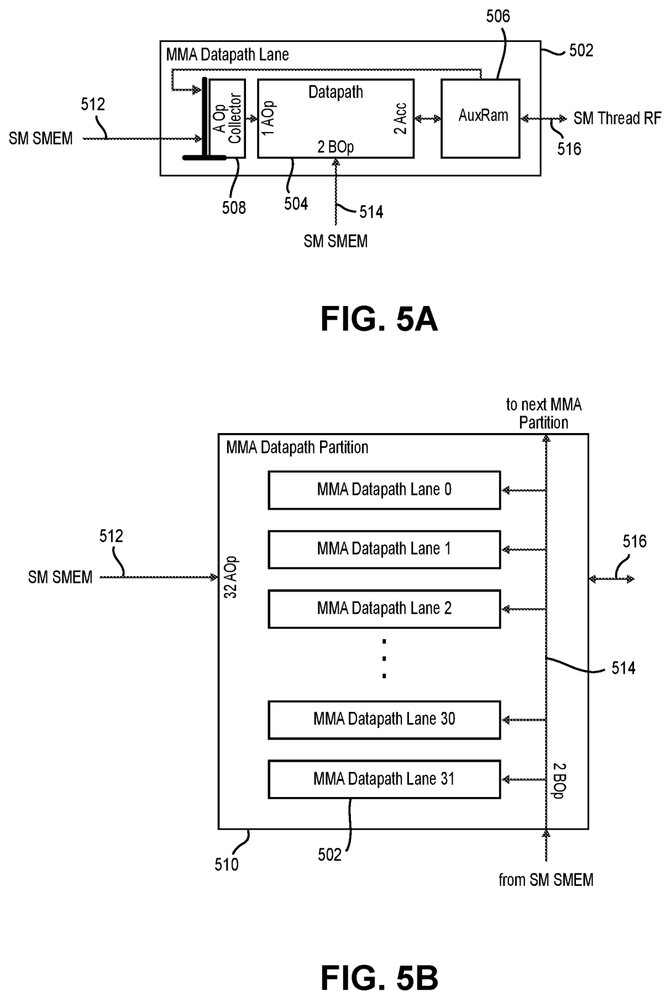
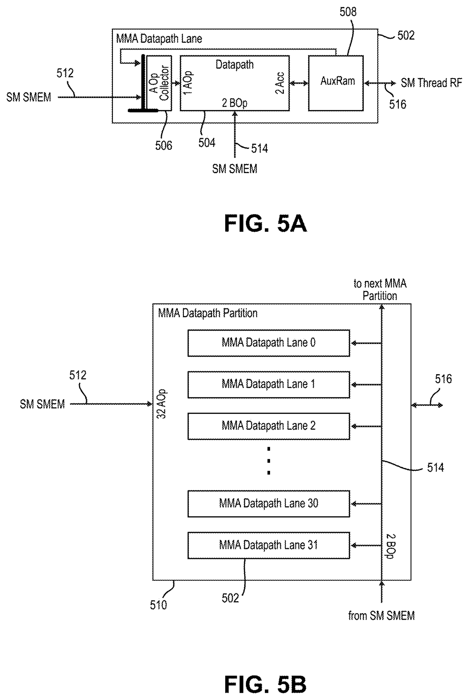

# tcgen05 的 MALU 数量与 M×N×K 核查

核查日期：2026-11-11。依据用户上传的 PTX ISA 9.4、两件 NVIDIA 专利和数值模型论文，并补查 NVIDIA CUTLASS 公开源码。本文先核规格，不把正在编写的单核 REF 草稿视为目标硬件实现。

## 1. 已确认与尚未确认的数值

| 对象 | 可确认数值 | 证据和适用边界 |
|---|---|---|
| tcgen05 常规 MMA 指令的 M/N/K | 按 kind、CTA group、dense/sparse、ws 变化；见下表 | PTX 9.4 表50，物理PDF700–704／印刷688–692；是整条指令的数学矩阵，不是单个 MALU 的物理阵列 |
| B200 数值归约组长 | F16/BF16 为16，TF32为8，所测原生FP8为32 | 上传论文PDF12／15，特定入口的数值模型；不是物理MALU数量，也不是每拍乘法器数 |
| 专利中的物理 datapath 示例 | 每分区32 lane；完整示例128 lane＝4×32 lane | US20250060938A1 PDF52–54 [0093–0094,0108]；US20250077615A1 PDF61–62 [0100,0106]；未证明它就是某款商品 GPU 的 Tensor Core |
| Blackwell Ultra 的 Tensor Core/SM 数 | 4 | NVIDIA官方文章正文“Streaming multiprocessors”“NVIDIA Tensor Cores”；特定 Blackwell Ultra，不据此填 Rubin 的内部配置 |
| Rubin 每个 Tensor Core 内物理 MALU 数量 | **现有已核证据不足，不能给一个已证实的整数** | 不能把32 lane/partition、128 lane/示例或4 Tensor Cores/SM机械拼接成商品对应关系 |
| Rubin 单个物理 MALU 的固定 M×N×K、II、每拍完成数 | **尚未证实** | PTX指令形状、论文数值分组、专利搬运宽度均不足以唯一确定它们 |

“不知道物理数量”不能成为随意采用单个串行核的理由。此前把一个已有 MALU 顺序遍历整块矩阵的 REF 路径当作本次实现主线，没有落实用户要求的 Rubin 算力配比。它只能作为功能参考，不能代表目标 Tensor Core 阵列。

## 2. M/N/K 的定义与计算量

PTX §9.7.18.2.1 定义 A 为 M×K、B 为 K×N、D 为 M×N。逻辑上有 M×N 个输出点积，每个点积含 K 项乘积；dense浮点运算量按通常 FLOP 口径为 2MNK，整数对应OPS口径。**一条指令完成这个计算量，不表示一个时钟完成，也不表示存在 M×N 个物理 MALU。**

下文 `8:8:256` 表示从8到256、步长8。sparse K仍是完整数学矩阵的 K，压缩 A 的有效存储 K/2 另列；不能把它替换成指令 K。

### 2.1 常规 non-ws 基线

| kind／A、B格式 | CTA group | M | N | dense K | sparse K |
|---|---:|---|---|---:|---:|
| f16：F16/BF16 | 1 | 64、128 | 8:8:256 | 16 | 32 |
| f16：F16/BF16 | 2 | 128、256 | 16:16:256 | 16 | 32 |
| tf32：TF32 | 1 | 64、128 | 8:8:256 | 8 | 16 |
| tf32：TF32 | 2 | 128、256 | 16:16:256 | 8 | 16 |
| f8f6f4：E4M3/E5M2/E2M3/E3M2/E2M1 | 1 | 64、128 | 8:8:256，扩展行另核联合条件 | 32 | 64 |
| f8f6f4：同上 | 2 | 128、256 | 16:16:256 | 32 | 64 |
| mxf8f6f4：上述低位格式＋UE8M0 scale | 1 | 128 | 8:8:256 | 32 | 64 |
| mxf8f6f4：同上 | 2 | dense：128、256；sparse：仅256 | 16:16:256 | 32 | 64 |
| i8：S8/U8 | 1 | 64、128 | 8、16、24、32、48、64、…、256 | 32 | 64 |
| i8：S8/U8 | 2 | 128、256 | 32:32:256 | 32 | 64 |
| mxf4／mxf4nvf4：E2M1＋各自合法scale | 1 | 128 | 8:8:256 | 64 | 128 |
| mxf4／mxf4nvf4：同上 | 2 | dense：128、256；sparse：仅256 | 16:16:256 | 64 | 128 |
| ti16：S1Z4M11 | 1 | 64 | 8:8:256 | 16 | 32 |
| ti16：S1Z4M11 | 1 | 128 | 16:16:256 | 16 | 32 |
| ti16：S1Z4M11 | 2 | 128、256 | 32:32:256 | 16 | 32 |

来源：表50，PDF700–704。F16输入可有F16/F32结果，BF16对应F32；TF32、MX浮点对应F32，i8/Ti16对应S32。非MX f8f6f4有F16/F32结果。表是基线摘要，不把 kind 中的格式集合视为任意混配许可；仍需核每条指令的类型、packing、transpose、descriptor及target限制。

Ti16 为 `.s1z4m11` 整数类，非浮点指数格式。原生表没有普通F32、F64、INT4或B1乘数行；已有项目 MALU 支持它们，不能据此加进 tcgen05 原生表。

### 2.2 大 K 与目标限制

| 扩展 | CTA group／M | dense K | sparse K | 必须保留的限制 |
|---|---|---:|---:|---|
| f8f6f4 | CTA1 的扩展dense行明确M128；CTA2扩展dense行明确M256 | 64 | 表列128 | dense K64 仅E4M3/E5M2；CTA1的N列OR以及sparse共享shape单元格不能直接展开为已验证的全组合，见下段 |
| mxf8f6f4 | CTA1 M128 | 64 | 128 | N=8:8:256；FP6/FP4 dense K64有transpose/packing限制，不能套非MX的only-FP8结论 |
| mxf8f6f4 | CTA2 M256 | 64 | 128 | N=16:16:256；sparse仅M256 |
| mxf4／mxf4nvf4 | CTA1 M128 | 96 | 192 | N=8:8:256；K96架构专属target限制 |
| mxf4／mxf4nvf4 | CTA2 M256 | 96、128 | 192 | N=16:16:256；不能给M128开dense K96/128或sparse行 |

表50在PDF701–702的 f8f6f4 项跨页合并 shape、N、A/B类型单元格。原文 CTA1 N 列写 `steps of 8 OR steps of 16`，另有 `128×N×K¹`／dense K¹=64。原文确实列 sparse K64/128，但将这些共享单元格展开为每个 M、N、K 的可汇编接受集合，还需要对应 target 的汇编器或其他规范表交叉验证。**本核查保留这个具体未闭合点，不声称已经验证所有笛卡尔积；实现不得据此猜测开放。**

PDF704／印692、§9.7.18.2.1.1 Target ISA Note明确：

- K96仅列 `sm_103a`、`sm_107a` 架构专属目标。
- f8f6f4／mxf8f6f4 的 dense K64、sparse K128，列 `sm_107f or higher in the same family`。
- mxf4／mxf4nvf4 的 dense K128、sparse K192，列同一 `sm_107f` family条件。

这些是上传9.4的精确文字。不能把“higher”理解为任意数值更大的SM，也不能由编号未经证实就认定是Rubin。必须与相应指令自己的Target ISA Notes求交。

### 2.3 ws 形状

所有 `.ws` 仅 CTA group1，M∈{32,64,128}；dense N∈{64,128,256}，sparse N∈{64,128}。

| kind | dense K | sparse K | 说明 |
|---|---:|---:|---|
| f16 | 16 | 32 | D与AB类型仍按原表 |
| tf32 | 8 | 16 | TF32结果F32 |
| f8f6f4 | 32、64 | 64、128 | 共享类型脚注、target及大K条件继续适用；不是所有FP6/FP4大K均可任意transpose |
| i8 | 32 | 64 | S8/U8、S32结果 |
| ti16 | 16 | 32 | S1Z4M11、S32结果 |

mxf8f6f4、mxf4、mxf4nvf4没有ws行；所有ws CTA group2均Invalid。来源PDF701–704表50。`.ws` 的N是矩阵形状，不能把它当成某个collector容量或物理MALU数。

### 2.4 sparse K、block scale 和搬运形状

| 项目 | 数值／规则 | 不应混同的对象 |
|---|---|---|
| sparse数学K | 如F16为32、TF32为16、FP8基线为64、MXFP4基线为128 | 不是dense K；A压缩存储宽度K/2不是数学K |
| TF32稀疏结构 | 1:2 | 不笼统称全部2:4 |
| F16/Ti16/i8/f8f6f4/mxf8f6f4 | 2:4 | metadata合法集合另核 |
| mxf4/mxf4nvf4 | 成对4:8 | 非任意4-of-8 |
| scale block | BLOCK16或BLOCK32，按kind/scale/target限制 | 是scale沿K分组，不是MALU物理K，也不是任意指令K |
| tcgen05.cp | 4×256b、32×128b、64×128b、128×256b、128×128b | 是lane×搬运位数，非MMA的M×N×K |
| tcgen05.shift | 隐式31×256b | 非31个MALU，也非K=256元素 |

稀疏结构来源§9.7.18.10.9；搬运shape来源PDF705／印693、§9.7.18.2.3。scale格式与AB格式独立，既有架构§11已有详细表；改变K需要重新确定scale数量与布局，不能固定把scale_vec等同BLOCK16/32。

## 3. 一个 MALU 的数值组长能确认到什么程度

上传《Accurate Models of NVIDIA Tensor Cores》给B200特定入口的数值模型：F16/BF16分组16，TF32分组8，tcgen05原生FP8分组32。这里的 N_FMA 是一次共同累加的乘积项数。把它记成数学上的 `1×1×16`、`1×1×8`、`1×1×32` 可以说明单输出归约；**不能据此宣布一个物理MALU恰有16/8/32乘法器，也不能据此填每TC的MALU数量。** 论文没有验证FP6/FP4及Rubin数值路径。

例如，FP16 `128×128×16` 一条指令含16384个输出点积、262144个乘积项。它既可以由多个物理点积单元分时计算，也可以有不同宽度、II与并行度的实现；这些都符合相同数学shape。单凭形状不能选择一个串行核，更不能倒推16384个物理核。

要确定阵列，至少须联合确定：

1. 每个MALU每次接受多少乘积项 `K_slice`；
2. 每个MALU的点积发起间隔 `II_dot`，以及每拍是否有多个输出；
3. 每TC／每SM的同时工作单元数与数据供给；
4. 对应格式下的实际 `MAC/cycle`，以及指令所跨的TC/SM数量。

若一次dot invocation恰消费一个K_slice并产生一个输出，其理想吞吐关系为 `MAC/cycle = MALU_count × K_slice / II_dot`。若完整dot由多个slice组成，则slice入口率使用 `K_slice/II_slice`，dot完成率使用完整K和II_dot，不能把两种间隔混用。同一吞吐可有多组解；甚至“lane”“MALU”“accumulator context”在不同资料里也未必一一对应。论文里的数值分组不能替代这些硬件证据。

## 4. 两件专利真正给出的物理组织

US20250060938A1 PDF54 [0108] 有明确短引：`a 128-lane datapath made up of 4 32-lane datapaths`。PDF52 [0093]、PDF53 [0094]也说明32-lane partition与128-lane示例。US20250077615A1 PDF61 [0100]、PDF62 [0106]有对应32／128-lane示例。

这不是仅软件lane的描述：它确实涉及datapath物理实施例。但文本没有证明“一个32-lane partition就是一个Rubin Tensor Core”，也没有定义每lane有几个MALU、每MALU每拍计算几个向量、单向量K是多少。

两图也不能机械计数：60938 Fig5A标 `2 AOp / 2 BOp / 2 Acc`，77615 Fig5A标 `1 AOp / 2 BOp / 2 Acc`。未规定这些数字对应空间并行、时分输入还是寄存槽；尤其 `2 Acc` 不能自动解释成两条每拍完成的dot。

60938 PDF54 [0110]的 `32-byte vector of packed values` 是载体／搬运示例。其[0118–0119]矩阵符号是 `(M×C)·(C×K)`：**专利中的C才对应一般GEMM的K，专利K对应输出通道数N。** 因此不能把128 lanes、32 bytes、专利K filters拼成128×32×K的MALU阵列。

逐页短引及论文原文解释见[几何文献核验](../rtl/malu_geometry_literature.md)。

## 5. 补充公开代码交叉核对

2026-11-11实际取得 NVIDIA CUTLASS `include/cute/atom/mma_traits_sm100.hpp` 与 `include/cute/arch/mma_sm100_umma.hpp`。前者 F16/BF16 traits 的 `K = 256 / sizeof_bits<ValTypeA>` 得K16，F16/BF16 sparse traits用 `512 / sizeof_bits<a_type>` 得逻辑K32，普通F8F6F4 traits明确K32。它交叉支持SM100相应封装的**指令shape**，不提供Rubin每TC的物理MALU计数。

还实际读取第三方教学工具 [gpu-roofline-explorer MODEL.md](https://github.com/tlrmchlsmth/gpu-roofline-explorer/blob/main/MODEL.md)。作者明确称其为analytical teaching model，并标注hypothetical旧代shape与固定aggregate peak；其中B200 `256×256×16`标为CTA pair。它能帮助避免把指令大小当物理并行度，不能用作独立微架构实测或MALU数量证据。另取得[微基准仓库README](https://github.com/0xha0/gpu-bench)，仅用于确认调查线索；本次未在B200/Rubin运行其benchmark，不引用未取得的硬件数据。

本次Google、Bing、NVIDIA官方页、Colfax、Chips and Cheese及知乎正常HTTPS均遇代理HTTP403；提升执行权限后Google仍403。GitHub网页／raw下载可用，故继续使用可取得源码和上传原件。未声称读到本次未取得的知乎正文，也未把搜索结果、模型、专利实施例伪装成商品实测。

## 6. 对RTL的约束与当前状态

- 单核REF是功能参考，只能验证控制与数值闭环，不作为满足Rubin算力配比的计算阵列。
- 此前PERF-S1的8 base group、6 booster、44 context、159个4×4等价砖是项目自定预算，未证明是NVIDIA的物理数量；不能回答“每Tensor Core有几个MALU”。
- 指令M/N/K、MALU的K_slice、阵列P_M/P_N、存储lane、scale block与压缩K分别建模；没有证据时不默认相等。
- 对照Rubin的dense比例 `TF32:F16/BF16:FP8/FP6:NVFP4 Training=0.5:1:4.375:8.75`，需要验证端到端terms/cycle与带宽、scale、归约、finalizer；仅复制若干个现有串行MALU也不能自动满足该比例。
- 目前单核REF代码仍是未提交草稿，集成验收未完成；本研究不将单元测试通过扩称为完整tcgen05/Rubin实现完成。

原件哈希、补查源码哈希、来源URL与断言边界保存在[来源清单](malu_geometry_sources.json)。

## 7. 独立复核

agent2直接重读上传PTX PDF700–705，复核基线、大K、ws、i8/Ti16的N步长、MX CTA2 sparse的M256限制，以及本文保留的非MX f8f6f4跨页联合条件未闭合点；没有发现表格必须修正项。论文／专利的物理含义与数值模型边界已逐页核对。复核建议补充的整数OPS口径、slice入口间隔与完整dot间隔区别已纳入正文。该复核不是GPU硬件实验或可汇编全组合验证。
