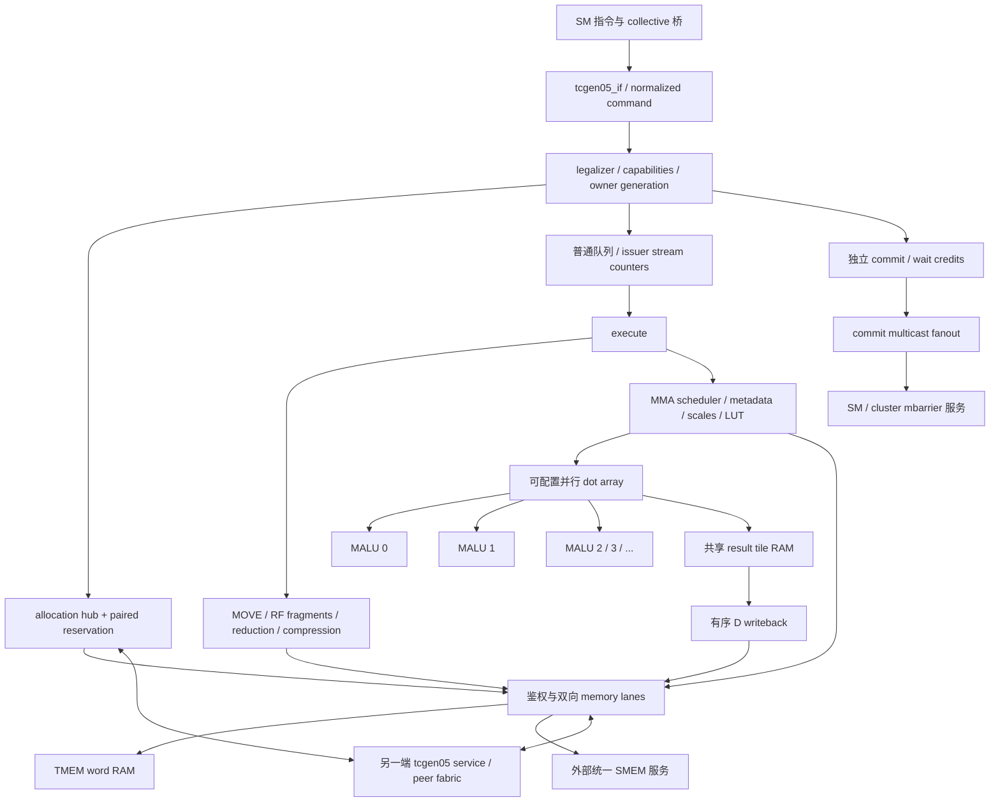

# tcgen05 SystemVerilog 实现与交付说明

日期：2026-11-16。设计入口为 `design/core/src/rtl/sp/eu/tensor/tcgen05/tcgen05.sv`，统一接口为 `design/core/src/if/sp/eu/tensor/tcgen05/tcgen05_if.sv`。

本版实现 PTX ISA 9.4 tcgen05 的分配、搬运、矩阵计算、同步与完成通知功能族。输入是 SM/core 已收集参与线程、捕获寄存器操作数后的规范化命令，包含原生 descriptor 和格式字段；本模块不负责 NVIDIA 二进制取指译码。下文分别给出实现、实际测试和仍需设备或规范消歧的边界，不能把有限回归等同所有合法修饰组合的穷举证明。

数值采用既有 MALU 的 `PROJECT_EXACT`：有限乘积与求和保持精确表示，最后按目标格式舍入。它是项目功能实现，尚未证明与 NVIDIA 内部求和顺序逐位相同，也没有 Rubin 峰值算力、物理 MALU 数量或 PPA 的实现证明。关于指令 M/N/K 与物理阵列的区别，见 [几何核查](../research/TCGEN05_MALU_GEOMETRY_AUDIT.md)。

## 1. 数据与控制结构



默认 top 为四个独立 MALU 并发执行输出 dot，`DOT_ENGINES` 可配置；共享输入读取、地址生成和结果存储。每个 MALU 做向量点积加一次 C seed，不实现 SALU/VALU/SFU 的标量运算。`LANES=4` 表示一次输入 beat 的元素槽数，不表示每个 MALU 内有四个并行乘法器。

普通 parent 命令顺序执行，parent 内多个 dot 可并发。设计没有把 tag 数量或多个 context 当成物理算术并行；`tcgen05_dot_array` 实际例化多个 `malu_core`。旧的串行 `tcgen05_engine` 原型不在生产源码或 filelist 内。

## 2. 文件与模块

| 位置／模块 | 职责 |
|---|---|
| `design/core/src/common/tcgen05_pkg.sv` | 命令、响应、RF 片段、事件、事务身份、allocation record 与 capability 类型 |
| `design/core/src/common/tcgen05_layout_pkg.sv` | native A–G 布局、SMEM descriptor/swizzle、metadata/scale/LUT 地址生成 |
| `design/core/src/if/sp/eu/tensor/tcgen05/tcgen05_if.sv` | core、RF、SMEM、peer control、peer memory 与事件 ready/valid 接口及稳定性断言 |
| `tcgen05.sv` | owner/issuer 状态、准入、队列、stream cutoff、peer PIN、错误隔离与完成 |
| `tcgen05_legalize.sv` | type/kind/shape/target capability、modifier 合法化与 scale normalization |
| `tcgen05_allocator.sv` | TMEM 列分配、permit、exclusive、容量等待、generation 与内部两阶段资源状态 |
| `tcgen05_allocator_hub.sv` | 多 client 请求仲裁、注册 skid 与响应路由，pending allocation 不独占入口 |
| `tcgen05_pair.sv` | even/odd 协调、两端 reserve/publish/rollback 和 free prepare/commit/cancel |
| `tcgen05_control_mux.sv` | peer 控制仲裁与响应身份校验 |
| `tcgen05_alloc_return.sv` | native alloc 的本地／对端 SMEM 地址写回并等待 ack |
| `tcgen05_execute.sv` | MOVE 与 MMA 分流 |
| `tcgen05_move.sv`、`tcgen05_move_math.sv` | 完整 RF 片段、LD/ST、归约／压缩、CP 展开／multicast、SHIFT |
| `tcgen05_mma.sv`、`tcgen05_dot_array.sv` | dot 调度、dense/sparse/WS/scale/LUT/collector、共享结果 tile、D 写回与 ashift |
| `tcgen05_memory.sv`、`tcgen05_memory_lane.sv` | 独立 outbound 与 incoming service，owner/allocation/SMEM 范围鉴权与事务号隔离 |
| `tcgen05_word_arbiter.sv`、`tcgen05_tmem.sv` | 受阻请求锁定、word 服务、32-bank TMEM 存储与 byte strobes |
| `tcgen05_commit_fanout.sv` | 按 16/32-bit mask 实际输出每个目标事件 |

上表未写完整路径的设计模块均位于 `design/core/src/rtl/sp/eu/tensor/tcgen05/`。生产 filelist 为 `design/core/filelist/rtl/sp/eu/tensor/tcgen05/tcgen05.f`；验证同层目录分别位于 `verif/core/src/rtl`、`verif/core/filelist/rtl` 和 `verif/core/flow/rtl`。

## 3. 接口与数值配置

三种 recipe 明确区分：

| recipe | 用途与布局 |
|---|---|
| `TC_RECIPE_NATIVE` | PTX descriptor、原生 TMEM/scale/metadata/LUT 布局，严格检查表50形状和 capability |
| `TC_RECIPE_CANONICAL` | 项目 packed 数学对象，显式 row/column strides，便于独立小矩阵 oracle；小形状不冒充 native shape |
| `TC_RECIPE_WORD32_REF` | 既有按 word 展开的测试传输兼容入口；附加窄范围检查，与新 top 共用后端 |

命令分别携带 `cfg.a_fmt`、`cfg.b_fmt`、`cfg.c_fmt/d_fmt`；scale 独立携带 `a_scale_fmt/b_scale_fmt`、payload 对象、`scale_mode` 和 `block_size`。`BLOCK16/BLOCK32` 是显式配置，不能由 AB 格式名称代替。native 只接受规范允许的联合组合，接口字段独立并不表示全部组合合法。

`scale_vec1X/2X` 导出 BLOCK32，`scale_vec4X` 导出 BLOCK16；表70的 scale 数量按 kind、语法和 K 归一化，不统一使用 `ceil(K/block)`。scale data ID 是 byte-plane 选择，区别于项目的 element block offset：native element offset 必须为0；1/3个scale的ID允许0..3，2/6个只允许0/2，4/8个必须为0。A、B 数量均先检查范围，再缩为接口位宽。

Ti16 由 `FMT_TI16` 与 `ti16_decoded` 显式区分。当前输入为已解码的有符号整数，范围 −2047..2047；未把尚无唯一公开说明的 raw S1Z4M11 位编码猜成一种 sign-magnitude 编码。raw 模式拒绝，SM 桥必须提供约定的 decoded 值。

native tcgen05 不增加 FP64、完整 F32 乘数、INT4 或 B1 指令。既有 MALU 支持的这些格式只可经项目 recipe/配置使用；top 默认 `ENABLE_FP64=0`，单元测试显式打开 FP64 扩展时另记参数。

每个 RF 片段包含32个线程的一个 b32 寄存器、index、DATA/META/RED kind、mask、last 及身份。最大 x128 传输通过片段流完成，不截成单个寄存器；ST 核对全部片段，LD 完成必须等待实际 RF 接收。

## 4. 资源复用与数据保护

| 默认项目配置 | 显式数据容量／结构 |
|---|---|
| TMEM `COLS=576` | 128×576×32 bit，288 KiB；32 banks，word port 串行服务 |
| `DOT_ENGINES=4, ENABLE_FP64=0` | 四个共享 24×24 数值乘法路径，每个 MALU 内跨元素／格式复用 |
| 每个 MALU 精确累加 RAM | 20×32 bit，80 B；FP64 扩展时132×32 bit，528 B |
| 共享 result tile `MAX_M=MAX_N=256` | FP64 关闭时有效数据256 KiB；打开64-bit结果时512 KiB，四个引擎共用一份 |
| MOVE | 流式 RF 与固定大小压缩窗口，容量不随 repeat 增加；见 [MOVE说明](MOVE_IMPLEMENTATION.md) |
| 控制 | 普通队列4、commit4、wait4、issuer32、owner8、peer child8；均为项目深度 |

这些是 RTL 表达的数据结构／运算结构，不是映射后 SRAM 宏、DSP 个数、面积、频率或功耗结果。默认 MAX_K 为256；native 形状仍须通过合法化。

`python3 tools/tcgen05_resource_audit.py` 对 FP64 关闭／开启两种配置实际 elaboration，校验四个 `malu_core` 实例及每核心的一条共享乘法路径、累加RAM位宽和深度。报告与压缩XML见 [资源审计](checks/resources/resources.json)。高位结果plane的容量表是代码数据合同，不是综合后宏测量。

每个 dot 创建时取得独立 context 和固定 result index。返回结果先进入共享 tile；全部 dot 的源 A/B、旧 C、metadata、scale、LUT 均消费完，才顺序写 D。这样即使 native A 或 metadata 与 D 共用物理列，也不会破坏后续读取。该缓冲的容量代价已列出，不能将它隐藏为“零成本复用”。

禁用 input-D 时不读取旧 D；C 只在 dot descriptor 注入一次，独立 C shift 由 MALU 精确累加路径处理。scale beat 同时在 A、B 的块边界截断；logical K、stored sparse K、物理 word 数各自推进。

出错前尚未开始 D 写回的 MMA 不发布已算出的暂存结果；开始写回后若外部写入失败，已提交 word 不回滚。MOVE 也可能已提交部分写入。owner 随之隔离，后续正常执行返回 `TC_PRIOR_ERROR`，清理命令仍可执行；不能消费失败命令的部分结果。

## 5. 生命周期、双端协议与完成

1. `CTX_INIT/RELEASE` 是项目 launch 控制，包含 owner/generation；地址本身不是权限。每次 allocation 和访问都检查身份。generation 不在同一 reset epoch 内静默重用。
2. kernel 的 `cta_group` 由 CTX_INIT 固定，后续 grouped 操作必须匹配。SM launch 管理还要保证同 kernel 的各 owner 配置一致。
3. group2 分配按 even 端优先做两阶段预留与发布；任一端失败释放 provisional 责任。free 先锁两端记录再释放，容量等待和控制释放各有可前进通路。
4. 矩阵／搬运的远端访问先 PIN，直到所有远端数据责任完成后 UNPIN；对端 dealloc 不能绕过引用。内存请求检查实时 allocation，provisional/release_pending 记录不提供普通访问权限。
5. outgoing 请求和 incoming service 分别有执行 lane，再仲裁本地 RAM/SMEM；两端同时读对方时不会各自占住唯一服务状态机相互等待。
6. 对外内存事务号为64bit，包含 reset epoch、序号与 lane 身份。错误／旧号响应不能满足当前请求；SM fabric 必须返回原身份，并在协调 reset 时隔离旧事务。
7. 旧 RELEASE 响应按 generation 清理 issuer/fault；新 INIT 设置新 group 并清理新代故障状态。旧响应不能覆盖已启动的新代 context。
8. LD/ST、MCS full、SMEM-A read 使用独立 stream。commit/wait 在接受时冻结 cutoff；后发工作不能延长此前通知。restricted commit 不提前释放 D、peer 或完整 parent 责任。
9. 两种 fence 在本 endpoint 采用较强的 issuer 已接受工作 drain，再向 core ack。core 仍负责线程同步与普通内存/proxy 顺序；它们不由 Tensor 模块生成。
10. commit 注册使用独立 credit，完成事件不依赖普通队列空闲。multicast 对每个 set bit 恰好输出一次，mask0不伪造目标；错误事件 `arrive_count=0`，成功为1。

事件的 `event_ready` 必须代表外部 mbarrier 服务已执行规定更新，或已取得独立、不会随源 context 释放而失效的目标责任。仅把事件暂存进一个可丢失的普通队列，不足以证明 mbarrier 完成。当前交付的是事件接口、fanout 和服务协议测试；真实 SMEM mbarrier agent 将在 SM 阶段接入。

## 6. 24类功能与实际验证入口

下表映射 [功能清单](instruction_inventory.md) 的类别，而非 opcode 或全部合法 tuple 的计数。动态通过状态与精确计数以 [最终报告](checks/final/results_all.json) 为准，报告含每次运行参数、seed、源码及日志 SHA256。

| ID | 功能 | 执行模块 | 定向验证入口 |
|---|---|---|---|
| 001 | alloc / exclusive / 容量等待 / SMEM返回 | allocator、hub、pair、alloc_return | allocator；control/pair；cluster 双端真实 SMEM 写回 |
| 002 | dealloc / 双端释放 / 在途排除 | allocator、pair、top | allocator；endpoint；cluster PIN 期间拒绝释放 |
| 003 | relinquish_alloc_permit | allocator、pair | allocator；cluster 释放既有记录与后续申请拒绝 |
| 004 | LD全部shape/repeat/RF片段 | move | move 三seed；endpoint RF ack；cluster |
| 005 | ld.pack16 | move | move 相邻列 bit 比较 |
| 006 | ld.red min/max F32/S32/U32 | move、move_math | move；math 6000独立 oracle 向量 |
| 007 | ld.spcompress | move、move_math | move DATA/META；math NaN/相等/index选择 |
| 008 | ld.red.spcompress | move、move_math | move DATA/META/RED分别检查 |
| 009 | ST全部shape/repeat/源捕获 | move | move；endpoint；cluster |
| 010 | st.unpack16 | move | move 低16bit与高位保留检查 |
| 011 | wait::ld/st | top stream tracking | endpoint RF反压、独立cutoff与MCS隔离 |
| 012 | CP全部shape、warpx2/4、B4/B6展开 | move、layout | move；cluster双端；layout descriptor点检查 |
| 013 | shift.down | move | move quarter滑窗与CP4 tail刷新；cluster |
| 014 | dense MMA / input-D / Cshift / Dmask | mma、dot_array、MALU | mma各格式、矩阵oracle、native D/F/B及even/odd；endpoint |
| 015 | block-scale、scale mode、BLOCK16/32 | legalize、layout、mma | legalizer ID与capability边界；layout原图；mma native MXFP8/NVFP4 |
| 016 | collector fill/use/lastuse/discard | mma | mma A/B lifetime、use-after-lastuse拒绝 |
| 017 | MMA ashift | mma | mma完整M128行移动；legalizer约束与transpose预拒绝 |
| 018 | LUT B decompression | mma、layout | mma 3-bit跨word索引、native LUT及与scale组合 |
| 019 | MMA sparse | mma、layout | mma 7种2:4 metadata、TF32 1:2、MXFP4成对4:8、原生FP16 |
| 020 | MMA WS / B collector / zero-column | mma | mma原例mask、column shift、B collector与D mask分离 |
| 021 | MMA WS sparse | mma | mma WS+metadata+zero-column 数值比较 |
| 022 | fence before/after_thread_sync | top | endpoint 持有先前MCS，两种fence都不能提前完成 |
| 023 | commit normal/restricted | top、fanout | endpoint Aread早于full、cutoff、空集合、反压与错误；cluster |
| 024 | commit multicast16/32 / remote | fanout、top | fanout三seed每目标责任；endpoint高位mask、zero mask及remote unicast |

其他专用测试包括 TMEM 全空间写读、16种byte mask、非法列与reset；allocator hub注册请求稳定；pair失败回滚；两端同时发peer memory的前进性；多MALU tag独占、乱序返回与配置缩放。layout单元覆盖七种native layout的409600个输出地址；这些地址点不计为409600条MMA执行。

## 7. 运行与证据

```bash
python3 tools/bootstrap_verilator.py
python3 verif/core/flow/rtl/sp/eu/tensor/tcgen05/run_tcgen05.py --suite all --jobs 2
```

工具基准为 Verilator 5.032，所有 suite 先严格 lint，再编译执行，启用 `MALU_ASSERTIONS` 与 `TCGEN05_ASSERTIONS`。仅豁免公共package未用字段／参数和异步reset的同步SVA采样；TB中的过程模型本地豁免BLKSEQ。未关闭WIDTH、LATCH、UNOPTFLAT等数据/控制问题。

runner 检查非零执行计数与 PASS 标记，保留原退出状态，并在结束时校验所有受测 SV/filelist/runner 文件 SHA256 未变。构建缓存只复用匹配工具、参数和源码签名的产物。早期单元JSON保留当时源码hash，不能替代最终central报告。106个SM指令发生器testplan用例仍保持其原本的NOT_RUN状态；本次 tcgen05 suite 不是那套计划的执行记录。

本次最终 `--suite all --jobs 2` 实际完成 **22种配置、29次配置/seed仿真，全部通过**。包括三次endpoint、三次allocator、两次TMEM、四次dot array、三次MMA、三次MOVE、一次6000-vector math、166项legalizer、825662项layout、六次控制/回滚/双向访存/fanout，以及两次双端cluster集成。双端每次执行24条命令、1101项检查；上述数量分别计量，不合并成PTX指令覆盖率。

## 8. 明确保留的设备与规范边界

[布局说明](LAYOUT_IMPLEMENTATION.md)列出六项来源边界：大K表格的跨页联合形状需目标汇编交叉检查；Ti16 raw/transpose以及一处sparse collector语法冲突；WS zero-column示例与表述的差异；shift方向缺少官方索引伪码；内部数值顺序与物理MALU组织未披露。

当前 SHIFT 为选定32-lane quarter的 `dst[r]=old[r+1]`、tail保留；MMA ashift 则对整个 M128/256 的 stored-K 行做同方向移动，不能每32行重新开始。方向依据专利滑窗和官方CUTLASS tail-refresh序列消歧，未声称经过原生GPU测量。转置 TMEM-A 与 ashift 的项目组合在读取前拒绝，避免误用contiguous-row移动。

下一步的 SM 实施边界与接口见 [SM RTL接入准备](../../sm/RTL_NEXT_STEPS.md)。它包括实际统一SMEM、mbarrier、RF/scoreboard与collective桥，尚未把这些外围服务写成“已经有完整SM”。
