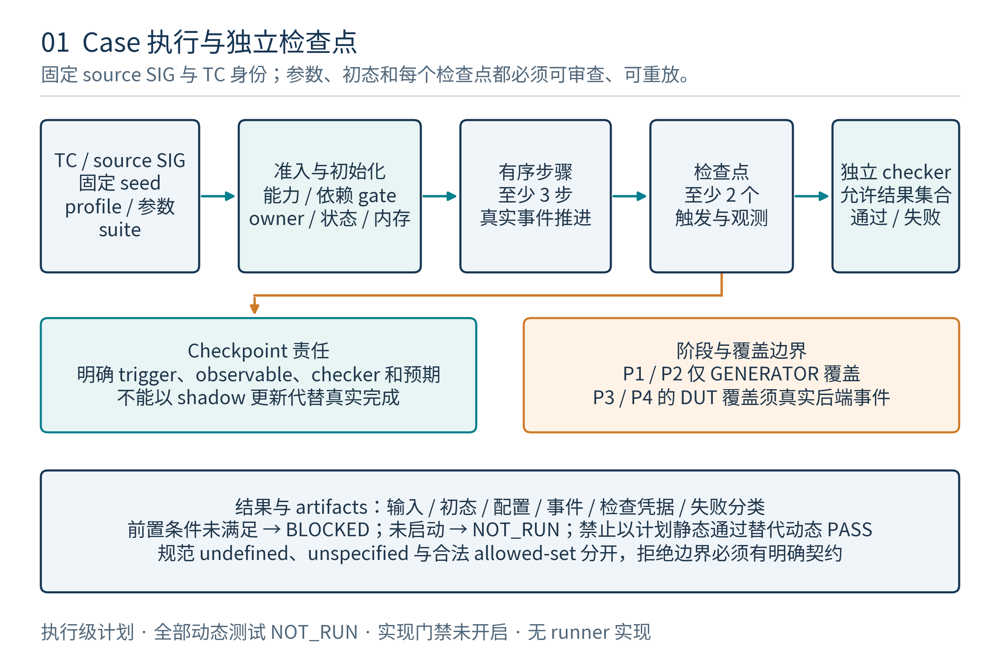
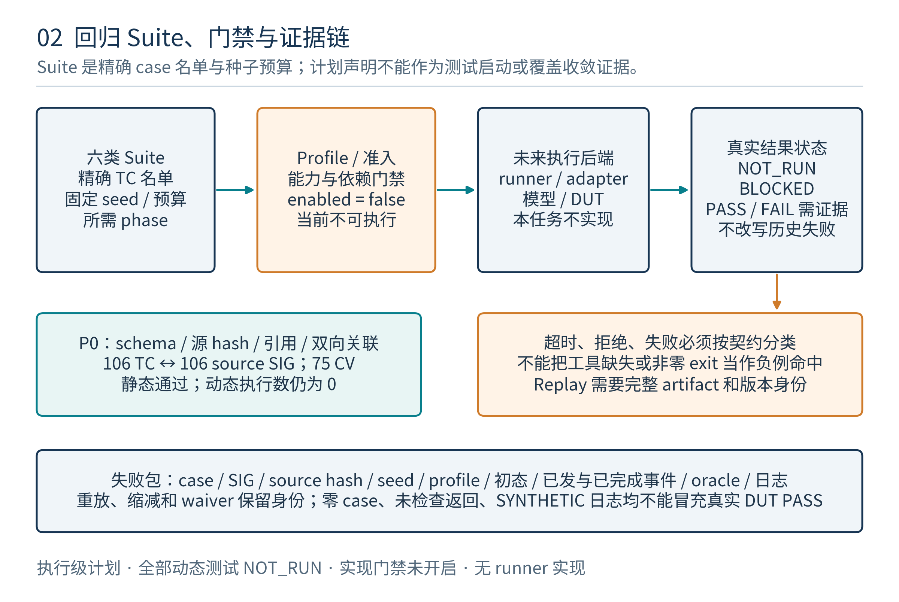

# SM 指令发生器 Testplan

版本：v1.0；日期：2026-11-09（Asia/Shanghai）。计划编号：SM-INSTR-GEN-TESTPLAN。上位输入：[SM指令发生器vPlan](../../vplan/sm_instr_gen/SM_INSTR_GEN_VPLAN.md)。本文是用例配置、步骤和回归安排；**106个功能用例及873条计划运行记录均为NOT_RUN，当前动态配置全部关闭**。

## 1. 目的、测试对象与本次交付

本testplan把vPlan的106个SIG测试点一对一展开为106个TC用例。每例给出前置条件、参数、初始化、执行顺序、观察点、独立通过/失败判据、覆盖关联、固定seed、超时策略和证据产物。它承接“验证什么”，落实为“用什么配置、按什么步骤验证，以及如何判断结果”。

对象包括验证端指令／整程序发生器、独立合法性与资源审计、IR/后端适配、参考模型、结果/协议检查器及未来SM/SoC环境。指令发生器不是SM instruction fetch；typed IR、PTX文本和项目native编码分层处理。当前native编码、完整generator、参考执行环境和SM/SoC后端仍未实现，本文不提供假运行命令。

本版交付完整用例JSON、8个配置profile、6类suite、873条固定seed的计划运行矩阵CSV/JSON、两张流程图和DOCX/PDF。可实际运行的`check_testplan.py`只验证计划数据完整性，不执行106个用例，也不把计划记录改为通过。

## 2. 基线、身份与可追踪性

源版本固定为PTX ISA9.4和已发布的SM架构/vPlan。四个源文件及SHA-256写入所有主数据的`source_files`：vPlan testpoints、vPlan features、vPlan正文、SM架构正文；源变化必须重新审查用例和覆盖分母。

| 身份 | 本版规则 | 不代表什么 |
|---|---|---|
| SIG-* | 上位106个测试点，源title/phase/feature/CV保留 | 不是已执行case |
| TC-* | 将同一SIG前缀替换为TC，106个一对一 | 不因进入多个suite增加case数量 |
| PLAN-* | suite、case与repeat index唯一组合，873条 | 不是执行结果或coverage事件 |
| GEN-* / CV-* | 沿用25个验证特性、75个覆盖点 | 不等于全部合法tuple已展开或覆盖 |
| PTX源节 | 沿用217指令/语法说明及35特殊寄存器追踪 | 215实际指令说明+2语法，不是217个opcode |

每个TC的`source_title/phase/feature_ids/coverage_ids`与源逐值核对。25个特性的用例数为：通常每特性4例，SYNC/ASYNC各5例，TMEM/MATRIX各6例，共106例。P1/P2/P3/P4分别为50/27/23/6例。

## 3. 阶段、准入与真实状态

| 阶段 | 执行对象 | 准入依赖 | 当前情况 |
|---|---|---|---|
| P0_PLAN_STATIC | JSON/CSV/schema/文档及关联 | Python、jsonschema和仓库文件 | 可运行计划静态检查，不产生动态覆盖 |
| P1_GENERATOR_UNIT | generator、独立audit、fixture/期望制品、回放/分布逻辑 | unit API与独立检查实现 | NOT_RUN；对应动态profile关闭 |
| P2_REFERENCE_PROGRAM | 独立语义/数值/资源/内存模型和可选编译流程 | 模型/工具与适用范围冻结 | NOT_RUN；对应动态profile关闭 |
| P3_SM_RTL | 实际SM driver、admit/return/检查事件 | 完整SM/adapter/monitor及合法recipe | NOT_RUN；对应动态profile关闭 |
| P4_SOC | 多SM、cluster/DSM/TMA/Fabric及系统服务 | 系统服务、故障和公平合同 | NOT_RUN；对应动态profile关闭 |

当前用例`current_status=NOT_RUN`，`current_gate=BLOCKED_MISSING_IMPLEMENTATION`。二者分别表示未执行和准入原因；不能将阻塞解释为失败，也不能将“已列入回归”解释为已运行。将来执行状态必须来自独立run结果和真实事件，不能靠修改本计划的常量伪造证据。

## 4. 八个配置Profile及覆盖规则

| Profile | 阶段与backend合同 | 关键配置 | 执行开关 |
|---|---|---|---|
| TP-P0-STATIC | 本目录metadata validator | 只检查源、映射、状态、seed与矩阵 | true，仅静态工具 |
| TP-GEN-BASE | 未来generator/unit API | 普通候选、独立audit、无真实DUT sink | false |
| TP-GEN-NEGATIVE | 未来legalizer/unit API | 单因素负例、baseline必须合法、UB隔离 | false |
| TP-REF-BASE | 未来独立reference API | profile/allowed-outcome关系检查 | false |
| TP-SM-BASE | 未来SM driver/monitors | 实际事件、S0资源和任意允许完成顺序 | false |
| TP-SM-STRESS | 未来SM压力recipe | 接近合法admission容量、返回扰动、保留cleanup | false |
| TP-SOC-BASE | 未来跨SM系统服务 | cluster/pair/remote owner与typed完成单位 | false |
| TP-SOC-FAULT | 未来定义明确的系统fault注入 | 可报告失败、partial/full、不可盲重试副作用 | false |

`config_profiles.json`是配置源。exact target、合法形式库hash、项目capability hash、R_SM、分配粒度、单CTA shared上限等必须实际解析；`null`表示未冻结，不能当0或默认支持。S0的warp32、≤64warp/≤8CTA、SMEM256KiB、TMEM最高288KiB是项目配置，不能成为所有NVIDIA target的通用规格。

profile的初始程序预算建议为body1024条、cleanup预留128条、CFG32块、loop上限8、call depth4。**这些是待校准的验证预算，不是ISA限制。** 具体case参数优先，但必须经过独立合法性/资源/预算审查；不得截断必要witness、稀疏/scale对象或cleanup来适配默认值。超过预算而无评审覆盖时保持BLOCKED。

## 5. 数据集、地址对象与初始化

每个run使用独立、可重建的RF/predicate/CC、内存对象、descriptor、barrier与异步账本。普通输入、scratch、guard/canary、reserved、期望输出和故障侧拷贝分开；不得读取未定义源或依赖旧run留下的内容。

| 对象 | 初始化要求 | 结束检查 |
|---|---|---|
| GPR/predicate/CC | 每thread定义与guard明确；DUT CC通过合法producer建立，不发明可写CC/FP CSR | 值、掩码、CC和未改写状态正确 |
| global/local/shared | 对齐、完整range、初始化字节与owner明确；地址算术检查完整值再编码 | canary、write mask、别名和对象生命周期 |
| SMEM | launch联合预算；不同CTA相同offset不别名，reserved不重复/越权计数 | 所有客户端、RMW/barrier/proxy/远端引用关闭 |
| TMEM | 通过合法allocation创建；结果地址发布给实际参与者 | full/ld-st/peer责任排除后匹配dealloc |
| mbarrier | 指令init布局，不随机填opaque字段；phase与typed counts清楚 | phase必要观察、引用关闭、再inval/复用 |
| matrix/scale/meta | carrier/padding、logical/packed/compressed K、scale分组与版本明确 | 不变源snapshot、collector失效和结果布局 |
| runtime/CFT/texture对象 | 使用该phase真实服务或明确reference fixture | 句柄、报告、远端完成及错误合同 |

P1可在独立软件fixture中声明初始状态，但不能将fixture操作当成真实DUT寄存器写。只有合法操作序列可进入P3/P4；SYNTHETIC日志、损坏侧拷贝和reference fault injection必须带来源标记，禁止回流真实DUT coverage库。

## 6. 通用执行步骤与观察点



每个用例的专属步骤在第20章，通用顺序如下：

1. 读取TC与source/hash、suite和run seed；检查profile、backend、oracle、recipe、预算及目标形式是否就绪。
2. 物化本次配置、数据、RNG子流、环境schedule和期望判据；建立全新的对象/责任账本。
3. 生成或载入语义候选，独立审计type/target/参与者、CFG/依赖、对象边界和全路径资源/HB；负例核对破坏rule及预期拒绝层。
4. 通过准入后才调用该phase的真实API；P1/P2只产生发生器/模型事件，P3/P4才有实际SM/SoC事件。
5. 在case指定观察点核对值、允许集合、mask、source capture、typed partial/full、phase/report和owner。执行失败立即保存首错，保留必要收尾路径。
6. 结清或正式取消义务，核对完整输出和canary，生成checker/coverage/diagnostic；没有checked证据不能报告功能PASS。
7. 按suite需要对同一immutable manifest回放或缩减，保存原始与缩减包；确认源与数据未漂移。

日志身份至少含run ID、epoch、CTA owner/generation、warp/thread或collective动态实例、TC/SIG/form ID、operation/fragment、阶段及错误分类。sourceIR→lowered/native→实际实例的provenance必须可追踪，不能用源级重复寄存器名假定DUT物理hazard发生。

## 7. Oracle、负例与结果分类

| 情形 | 检查方式 | 不能采用的捷径 |
|---|---|---|
| 确定性单例结果 | 独立bit/整数/正确舍入模型 | host溢出、普通double或DUT相同helper自证 |
| 多个合法结果 | 审查过的allowed set/关系/线性化判据 | 无data race就强制唯一结果 |
| approximate数学 | 每形式范围、误差和特例 | 对所有SFU统一epsilon |
| static非法/禁用 | 指定legalizer/编译层的具体rule拒绝 | 任意非零exit、缺工具即PASS |
| ISA明示UB | 隔离于正常数值执行 | 假定硬件trap或唯一输出 |
| unspecified/implementation-specific | 已审查profile/关系可检查，无oracle则BLOCKED | 一概等同UB或随意给golden |
| 定义的系统失败 | 原操作report/partial/full与副作用合同 | 失败当正常零数据、盲重试归约 |
| timeout/不前进 | wait graph、work bound与公平假设诊断 | 固定周期超时自动等同DUT死锁 |

PASS要对应本例的正向或明确预期拒绝/故障判据，不等于“没有崩溃”。功能FAIL、环境BLOCKED、未启动NOT_RUN和TIMEOUT_UNCLASSIFIED分别保留；无证据的skip不得缩小强制覆盖分母。弱内存/并发atomic可以无data race仍有多种合法返回/最终值，只有允许集合被证明为单例才逐值比较。

## 8. 计算、依赖与控制流的具体见证

整数用例枚举0/±1、signed min/max、hi/lo/wide和2/4word carry链；clmad用独立GF(2)多项式模型，不能复用普通整数乘法golden。位移0、width−1、width及更大值按各形式规则检查，机器相关项有独立profile。

F32融合FMA可使用`a=1+2^-23`、`b=1−2^-23`、`c=−1`的见证：在规定RNE且未改变语义的F32形式下，融合数学结果为`−2^-46`；先将乘积舍入到F32再相加会得到零。该见证用于区分路径，不能把所有mad自动等同FMA，也不能推广到任意target/profile。NaN/Inf、signed zero、FTZ和finite-only格式分别合法化；有限-only格式不凭空生成NaN编码。

RAW/WAR/WAW、宽返回片段、predicate和CC按最终注入流检查。重命名/优化已消除的hazard只能记源级生成，不能记DUT hazard检查。CFG覆盖1/31/32/33thread尾warp、有界loop和分歧call/ret；`.uni`仅用于对应guard/target一致的动态参与者。warp collective按自身mask/退出/同参规则，不共享“mask非零即合法”的宽松条件。

P1的数值与CFG测试检查候选/期望制品和独立audit，不宣称SM执行。REPLAY/REDUCE用例必须物化全部输入、版本与schedule；缩减后重新审计合法性并重现原signature，不能将新UB或新timeout当原故障缩小结果。

## 9. 存储、同步与异步专项步骤

地址测试从typed object生成完整range和别名，不将local stack、SMEM、TMEM、multimem VA或CFT handle相互裸cast。普通确定子集、atomic并发和weak-memory litmus分用oracle；MMIO访问次数/顺序、volatile、readonly/nc、hint、discard及completion-bearing priority分别检查。

SMEM使用8CTA×32KiB恰好占用256KiB池的conditional witness，同时检查target单CTA限、RF/warp/reserved；8CTA×64KiB是池超配负例，9CTA是S0槽数负例。前一个不能仅因等于池容量便无条件admit。不同owner的offset0、byte/half RMW、packed逐元素atomic、关闭b128和可选晚到scrub分别验证。

mbarrier v0/v1都为b64/8B对齐，但v1到达数上限511，primary/conditional/report不同。事务期望用合法原子arrive.expect_tx，或先expect_tx并保留pending arrival再arrive，覆盖complete早/晚到；不能先放开最后arrival再补期望。try_wait false时report未定义，不能消费payload；True acquire才建立规定可见性。

classic cp.async、bulk/TMA、wgmma、tcgen05 full/A-read/ld-st和Fabric local-read/full分账。数据bank commit、collector失效生效、proxy发布和barrier对象原子更新ack是不同观察点；FIFO接收不等于对象更新或目的可消费。TMA report按规定pattern/采样，不是通用ECC。

## 10. TMEM专属用例与顺序

TMEM用例源于`SIG-TMEM-001..006`，对应`TC-TMEM-001..006`；第20章给出全部配置与步骤，matrix/async/sync另外关联其相关义务。

| TC | 重点 | 必须观察的终点 |
|---|---|---|
| TC-TMEM-001 | 分配顺序、exclusive/非exclusive、512/576target、permit | 匹配范围/属性；relinquish不释放allocation |
| TC-TMEM-002 | 地址类型、warp collective、quarter lane、CTA group2 | 同参/参与与owner，非法形式停在preflight |
| TC-TMEM-003 | ld/st pack/unpack、ld.red、ld.spcompress布局 | 独立lane/column→寄存器/metadata结果 |
| TC-TMEM-004 | cp/shift/ld/st并发、多片wait | 真实TMEM/RF提交；首片和A-read不能代full |
| TC-TMEM-005 | 在途访问、wait后dealloc及退出重用 | 所有本地/peer访问排除、迟到generation隔离 |
| TC-TMEM-006 | even/odd跨两个endpoint的双端资源与parent/child | 双边完整责任结清，不半发布/半释放 |

统一程序链为合法alloc→发布地址→按layout访问/搬移/计算→各自完成与可见性→排除两端访问→匹配dealloc→退出。permit、allocation、MCS full、restricted A-read、ld/st及SMEM owner不合成一个done位。group2遵守S0的不同可互通SM放置与同kernel group一致性；不能将exclusive CTA1扩成全pair互斥并阻断cluster进度。

## 11. Matrix、scale与MALU接口见证

A/B格式、C/D格式、scale_A/B格式、BLOCK16/32、独立offset、Cshift分别配置，但最终必须通过native tuple与项目接口联合合法性。raw Ti16关闭，decoded项目协议另列；finite-only低位格式、稀疏metadata与scale合法范围按具体形式检查。

PROJECT_MALU_ADAPTER可分开采用两类见证，不能无证据把二者组合成同一native tuple：

- 未启用AB block scale的合法F16输入，K=4、所有A/B=1、C=8、合法Cshift=3；精确项目数学结果为5。`enable-input-d=false`时另测旧D为NaN却不读取/参与，正式零C使结果为4。
- AB scale启用时选择已批准格式组合，K=64、Cshift=0，分别BLOCK16/32及最早块边界切beat；例如BLOCK32下A/B offset15/31，第一beat只能先取1个元素，不能因LANES=4跨B块。后续K/offset不随stall重起。

两个命名见证已分别落入TC-MATRIX-002与TC-MATRIX-006的canonical参数；offset见证A/B各有3项unity scale，分别覆盖17/32/15与1/32/31元素。它们仍须在对应目标/profile明确允许时才执行。C缩放在指数/累加路径表达，不预量化再缩放；C每dot只加入一次。稀疏logical K与compressed K、packing和scale分组不同；结构零与Inf/NaN按所选profile处理，不一概跳过。 TC-MATRIX-001显式枚举原生i8/ti16与project INT8/INT4/B1、decoded Ti16、F32/F64扩展，能力和编码分别门禁；TC-MATRIX-003按TF32 1:2、批准2:4与FP4成对4:8分型，不从六种数学2-of-4组合推断全部原生metadata。整数/B1只用合法S32和整数溢出判据，不注入浮点NaN/Inf。

复用压力覆盖高低精度/scale/finalizer、operand返回和TMEM写回。MALU仅dot，普通FP FMA/SFU另域。Rubin峰值比例不是抽样权重或本testplan时延判据，现有串行MALU检查也不证明完整matrix前端已实现。

## 12. Cluster、Fabric与系统服务

cluster/DSM的target、rank映射、joint admission、peer存活和remote owner引用是前置条件。工作取消只取消未启动cluster；16B opaque response与mbarrier完成分别检查，观察失败后不非法重试。griddepcontrol需要runtime服务，不当成CTA barrier。

Fabric的get/pullred按bytes，put/red按16B units；8B counter需256B对齐且与数据不重叠。issue/submit/期望登记/primary wait/report必须完整，fabric.wait仅证明相应local SMEM源读结束。CFT=fabric、local SMEM=async、barrier=generic按规范方向衔接；成功不清同phase旧错误，partial counter不证明full，失败不自动取消已经发生的远端副作用。

texture/surface当前关闭；P1可验证capability拒绝，P4正向需要完整采样/格式/边界/查询服务，不能用global load替代。stack、setmaxnreg、debug、nanosleep和sreg按各自ABI/稳定性处理；没有通用FP CSR。per-CTA global依赖directive/driver，size可能为0，不能解释为SMEM。

## 13. 六类回归Suite与准入



| Suite | 用例数 | 每例独立基线数 | 计划run数 | 目的 |
|---|---:|---:|---:|---|
| SMOKE | 25 | 1 | 25 | 每feature第一个P1用例，最小流水/审计入口 |
| DIRECTED | 106 | 1 | 106 | 全部源测试点的确定边界与协议见证 |
| NEGATIVE | 52 | 2 | 104 | 已声明单因素拒绝、错误分类或项目保护路径 |
| RANDOM | 49 | 8 | 392 | 只随机case明确允许、审计通过的参数维度 |
| STRESS | 34 | 4 | 136 | case/phase内的合法压力、乱序和收尾；P1/P2不算DUT |
| REPLAY | 55 | 2 | 110 | immutable manifest、artifact一致性或原故障重现 |

各TC可属于多个suite，106是唯一用例数，873是展开后的计划记录数。suite不改变case phase、profile或CV scope；全部`profile_override=null`。STRESS仅使用本例已定义并审计的压力recipe，不能临时猜FIFO深度/固定时延或超配资源；recipe缺失则该run BLOCKED。

执行推进顺序是P0→P1/P2 entry gates→对应P3/P4环境smoke→定向→随机→压力→triage/closure。表中SMOKE为P1入口集合，不代替P3/P4真实adapter的smoke recipe。 CSV/JSON行序仅为确定性枚举，不是启动顺序；未来调度按phase和显式依赖DAG准入。TC-REGRESS-004是不可重入的只读闭合观察器，仅消费外层已完成的22个P3叶子证据，不调用自身或任何case；缺必需证据时BLOCKED，23个源P3用例总数不变。低阶段成功不能开放缺实现的高阶段；前置gate失败时停止升级，保留被阻塞列表与原因。

REPLAY表中的“2”是两个独立基线实验，**不是对同一故障包换seed回放两次**。每个基线完成后，回放使用原始完整manifest/数据/schedule/seed，不再派生新seed；对确定性结果比对一致值，对允许多结果的程序仍用合法关系，保故障缩减要求原signature成立。

## 14. 固定Seed、计划运行矩阵与覆盖归属

按源`testpoints`数组0-based序号i设置：

$$seed_{case}=\mathtt{0x534D0000}+i$$

固定suite index为SMOKE0、DIRECTED1、NEGATIVE2、RANDOM3、STRESS4、REPLAY5，repeat_index从0开始：

$$seed_{run}=seed_{case}+suiteIndex\times\mathtt{0x100000}+repeatIndex\times\mathtt{0x10000}$$

本版873个seed均为唯一uint32，无溢出。run ID为`PLAN-<suite>-<TC>-R<两位repeat>`，case、源SIG、phase、profile、timeout、seed与当前状态逐列写入[run_matrix.csv](run_matrix.csv)，同内容保留在`planned_runs.json`。

seed只决定输入的一部分；manifest仍需所有源/tool/schema/backend/capability/profile/bin registry、初始化、RNG子流、rbits和环境schedule。不得因相同seed就省略不同target、工具或数据hash。重复执行同一真实证据不增加覆盖；P1/P2仅GENERATOR，DUT_SCENARIO只由P3/P4真实事件触发。

计划记录、候选、合法化、driver接受、DUT admitted、typed partial/full和checked分账。特别是GENERATOR/CHECKED是独立audit结论，不是DUT结果已检查。75个CV关联完整不等于全部bins已展开；未冻结的必需合法形式保持UNRESOLVED并阻止相应关闭。

## 15. 环境Schedule、超时与不前进诊断

各run物化独立opcode/operand/CFG/resource/timing/fault随机子流。允许的返回置换只作用于可并发责任；ready阻塞期间payload稳定，旧generation不能改新owner。全局worker顺序、wall clock和未记录PRNG调用不能影响同manifest刺激。

| Timeout策略 | 初始host预算建议 | 其他边界 | 耗尽后处理 |
|---|---:|---|---|
| GEN_BOUNDED | 300秒 | 每候选最多256次约束尝试；body/cleanup预算独立 | UNSAT有rule证据；否则TIMEOUT_UNCLASSIFIED |
| REFERENCE_BOUNDED | 900秒 | 初始1,000,000 semantic steps，按CFG/dot工作量审查 | 保存最后事件、模型和wait graph，诊断后分类 |
| SM_PROGRESS | 1800秒 | cycle/progress阈值须由真实workload/backend合同解析 | 采集实际进度/外部assumption，不自动判DUT死锁 |
| SOC_PROGRESS | 3600秒 | 远端服务、report与cancel/drain阈值需冻结 | 保留endpoint/owner/phase/副作用证据，禁止盲重试 |

这些数字是待校准的验证host预算，不是NVIDIA硬件时延保证。cycle阈值当前为null，相关run不能以此准入。超过预算但无诊断不能PASS；缺外部服务与DUT内部环等待应通过wait graph、已接受责任及公平assumption分别归因。正常drain保留必要wait/commit/load/free，abort/reset需正式取消/隔离合同。

## 16. 必须保留的证据与回放包

每个真实run目录将以run ID标识，至少包含：完整manifest、effective config与源hash、program/IR与可用backend产物、初始化字节/descriptor、环境schedule、独立audit、期望/允许集合、实际事件、checker/coverage、状态与首错diagnostic。缺失backend时目录只能记录准入BLOCKED，不伪造成功代码或波形。

失败额外保存首错前后窗口、source→native provenance、live owner/obligation、wait graph、barrier phase/tx-unit、服务assumption、外部已commit/可取消副作用，以及原始与缩减包。重跑成功不得覆盖首错；重复失败要关联同signature，不生成多个虚假独立coverage命中。

回放先核对全部输入hash和工具，再恢复独立初态并按原artifact运行。缩减每次重新独立审计def-use、CFG、参与者、资源/HB、profile和原failure predicate，不能通过删除wait/peer或创造UB保留一个新的timeout。未能稳定复现标NONDETERMINISTIC并保留环境记录。

## 17. 验收、关闭和状态真值表

| 实际情况 | 结果归类 | 允许的证据说明 |
|---|---|---|
| 只有计划或P0校验 | NOT_RUN；计划静态结果可PASS | 不宣称106动态测试通过 |
| generator/oracle/backend/capability缺失 | BLOCKED | 记录缺失项和phase，不静默skip |
| 正向结果及所有必需义务/判据匹配 | PASS | 有非空实际checked、完整manifest及覆盖证据 |
| 指定负例在指定层按具体rule拒绝 | 该负例PASS | 不计该功能正向DUT覆盖 |
| 定义的系统fault按合同完成/报告 | 该fault case按具体判据判定 | 失败副作用与partial/full完整记录 |
| 数值/协议/身份/副作用不匹配 | FAIL | 保留首错/原始输入和可重现signature |
| 超时且根因不明 | TIMEOUT_UNCLASSIFIED | 不自动当DUT FAIL或重跑后PASS |
| 零case/零checked/未审查waiver | 未满足关闭条件 | 不用旧MALU数字或缩分母补齐 |

退出只针对冻结的enabled case/variant/bin范围，全部mandatory可达项需实际证据。P3的23个源case与P4的6个系统case分gate关闭，不能借P3结果声称SoC完成。期望工具拒绝/静态关闭可以作为相应负例结果，不能证明原生指令已执行。

## 18. 文件、实际命令与维护方式

| 文件 | 用途 |
|---|---|
| SM_INSTR_GEN_TESTPLAN.md / DOCX / PDF | 本执行计划及阅读版 |
| testcases.json | 106个完整case，SIG一对一与具体步骤/判据 |
| config_profiles.json | 8配置，明确动态开关和未解析项 |
| campaigns.json | 6suite、名单、repeat、准入、stop和超时策略 |
| planned_runs.json / run_matrix.csv | 873条相同的计划记录与固定seed |
| check_testplan.py / schemas/ | 实际可运行的P0数据与关联检查 |
| reports/ | P0、自检、阅读版QA和独立交付检查 |
| research/ | 分工细化稿与技术审查；不是执行结果 |

从仓库根运行实际计划静态校验：

```bash
python3 verif/core/testplan/sm_instr_gen/check_testplan.py
```

该工具验证schema、source hash、106/75关联、8profile/6suite、seed推导、873条展开、CSV逐值和当前状态。它不调用generator、仿真器或SM。阅读版构建见[BUILDING.md](BUILDING.md)，本目录未实现runner；不得把未来接口合同写成当前可运行命令。

源变化后需重新审查TC/配置/矩阵/覆盖和证据兼容性；更新case或suite必须重新生成并校验`planned_runs.plan_inputs`及CSV。维护时保留稳定TC/SIG identity，不按显示排序重新分配seed，不把某suite的排除项伪装为已通过。

## 19. 独立审查与实施依赖

本testplan保留vPlan的阶段和数值/顺序/资源合同，不扩大ISA合法组合或现有RTL能力。普通ALU/FP与dot-only MALU分开；native矩阵与PROJECT_EXACT各有profile，Ti16 raw缺口不猜编码；scope/proxy、mbarrier report、TMA/Fabric完成单位和全程序cleanup分别验证。

三名分工agent细化ISA/系统、计算/控制/回放、存储/异步/TMEM资源case；主agent细化环境/覆盖/回归、配置和矩阵并合并；工具agent负责schema/静态检查、两图与阅读版。原始分工稿是authoring provenance，最终`testcases.json`是审查和执行合同源；若发现差异应记录合并修正。

三轮检查分别核对源与矩阵、技术判据/实施门禁、产物和阅读质量。P0通过、图表可读或所有ID齐全均不代表发生器/模型/SM/SoC已实现或动态测试已执行。

## 20. 全部106个执行用例

以下按源顺序分特性展开。每例包含固定seed/profile/phase/suite、前置与初态、参数、步骤、观察点、通过/失败和预期产物。所有数值和参数仅在其target/recipe合法且已解析时生效，未知门禁不可绕过；预期产物名表示后续真实执行必须生成，不表示这些结果文件当前已存在。

### 20.1 GEN-ISA-01：规范、target与项目capability合法性


#### TC-ISA-001：全部目录及别名身份

| `TC-ISA-001` 项目 | 执行内容 |
|---|---|
| 源与阶段 | `SIG-ISA-001`；P1\_GENERATOR\_UNIT；CV-ISA-001 |
| 配置与seed | TP-GEN-BASE；fixed\_seed=0x534d0000（1397555200）；GEN\_BOUNDED |
| 回归与当前状态 | SMOKE, DIRECTED, NEGATIVE；NOT\_RUN / BLOCKED\_MISSING\_IMPLEMENTATION |
| 前置条件 | 1. 固定并核对源vPlan/testpoint、PTX9.4 inventory、target/capability、规则及模型版本hash；fixed\_seed由主campaign在运行前赋值。<br>2. 发生器、unit harness和独立合法性/结构审计器必须可用；共享source身份不等于共享待测约束函数。<br>3. 执行本case前冻结timeout预算；缺预算、模型、工具或服务时保持BLOCKED，不以空执行关闭case。 |
| 参数1 | timeout\_budget\_ref = campaign配置中与timeout\_policy对应的有限预算；不在本case猜测SM固定周期。 |
| 参数2 | instruction\_descriptions = 215 |
| 参数3 | control\_syntax\_descriptions = 2 |
| 参数4 | sreg\_descriptions = 35 |
| 参数5 | directive\_descriptions = 34 |
| 参数6 | identity\_key = source section, not mnemonic |
| 参数7 | target\_snapshot\_count\_min = 2 |
| 参数8 | mutations = \[{"field":"one source section identity","action":"duplicate one record while omitting a different record","expected\_layer":"INDEPENDENT\_INVENTORY\_AUDIT"}\] |
| 初始化 | 1. 固定源目录和两份独立target快照只读；输出索引、计数和mapping账本为空。<br>2. {}、@、sreg、directive均有独立entry\_kind，不占普通执行opcode计数。 |
| 执行步骤 | 1. 载入两份源inventory并校验SHA，按source section遍历217个说明叶子和35个sreg说明；另索引34个directive。<br>2. 生成每节的identity与别名/同名多类型记录；保留mov两说明节和同节多个名称，不以mnemonic去重。<br>3. 用独立提取的source集合逐项核对section、名称数组、物理/印刷页码和entry\_kind，再按各target筛选可用形式。<br>4. 在隔离索引副本中只制造一个身份替换错误（重复一节并遗漏一节），确认集合审计报错；不将该副本送发生器正向流。 |
| 观察点 | 1. 基线索引为217唯一指令/语法说明，其中215 instruction与2 syntax，另35 sreg；不是opcode或tuple数。<br>2. 同名/别名记录未丢失；变异副本定位到重复与缺失的具体section而不是仅总数相等就通过。 |
| 通过条件 | 1. 所有源身份/页码匹配且scope计数独立；target快照不被隐式继承。<br>2. 基线可审计，身份替换副本被独立审计拒绝并保留差异。<br>3. 实际执行量、检查量及所需覆盖非空，所有必需检查满足；本case当前NOT\_RUN不因计划/静态检查而变为PASS。 |
| 失败条件 | 1. 源hash变化后继续合并旧覆盖，或只比较总数漏掉身份替换。<br>2. 语法/sreg/directive被当可执行opcode，或同名节被去重。 |
| 预期产物 | 1. manifest.json<br>2. case\_result.json<br>3. coverage\_delta.json<br>4. source\_identity\_diff.json<br>5. identity\_index.json<br>6. target\_snapshots.json |


#### TC-ISA-002：target与capability单因素变异

| `TC-ISA-002` 项目 | 执行内容 |
|---|---|
| 源与阶段 | `SIG-ISA-002`；P1\_GENERATOR\_UNIT；CV-ISA-002 |
| 配置与seed | TP-GEN-BASE；fixed\_seed=0x534d0001（1397555201）；GEN\_BOUNDED |
| 回归与当前状态 | DIRECTED, NEGATIVE；NOT\_RUN / BLOCKED\_MISSING\_IMPLEMENTATION |
| 前置条件 | 1. 固定并核对源vPlan/testpoint、PTX9.4 inventory、target/capability、规则及模型版本hash；fixed\_seed由主campaign在运行前赋值。<br>2. 发生器、unit harness和独立合法性/结构审计器必须可用；共享source身份不等于共享待测约束函数。<br>3. 执行本case前冻结timeout预算；缺预算、模型、工具或服务时保持BLOCKED，不以空执行关闭case。 |
| 参数1 | timeout\_budget\_ref = campaign配置中与timeout\_policy对应的有限预算；不在本case猜测SM固定周期。 |
| 参数2 | baseline\_source = independently audited legal-form registry |
| 参数3 | mutation\_cardinality = 1 |
| 参数4 | mutation\_axes = \["exact\_target","family\_membership","one\_operand\_type","one\_modifier"\] |
| 参数5 | target\_examples = 仅使用已核验recipe展示sm\_90a WGMMA及sm\_107相关a/f门限；不是所有形式用同一target。 |
| 参数6 | unknown\_rule\_expected = BLOCKED\_RULE\_UNRESOLVED |
| 初始化 | 1. 每个baseline有独立LEGAL verdict及source/target证据；baseline IR冻结。<br>2. project capability状态单独记录，不把target合法等同project已实现。 |
| 执行步骤 | 1. 为每个target边界载入一个已独立核验合法baseline，先确认原样可被相应合法化路径接受。<br>2. 复制baseline并只改变一个target/family/type/modifier字段；保留其余IR、对象、参与者及seed子流不变。<br>3. 用独立规则表先预测被违反的规则与拒绝层，再提交baseline与mutant；未知规则单列BLOCKED。<br>4. 对照结构差分确认恰一字段改变，并检查拒绝原因只对应预期约束；恢复baseline再次审计以排除全拒绝器。 |
| 观察点 | 1. 基线仍合法且有实际accept记录；规范target和project capability分别出结论。<br>2. mutant差分恰一字段，拒绝rule/layer匹配；unknown rule不被当accept或负例PASS。 |
| 通过条件 | 1. 全部选择的baseline接受，单因素mutant按独立规则判断且拒绝可解释。<br>2. 实际执行量、检查量及所需覆盖非空，所有必需检查满足；本case当前NOT\_RUN不因计划/静态检查而变为PASS。 |
| 失败条件 | 1. 多个无关字段被静默重写，或只按sm数字大小继承a/f能力。<br>2. 基线和mutant全部拒绝却报负例通过，或缺规则自动排除。 |
| 预期产物 | 1. manifest.json<br>2. case\_result.json<br>3. coverage\_delta.json<br>4. baseline\_mutant\_diff.json<br>5. legality\_verdicts.json<br>6. rule\_provenance.json |


#### TC-ISA-003：关闭能力与lowering证据

| `TC-ISA-003` 项目 | 执行内容 |
|---|---|
| 源与阶段 | `SIG-ISA-003`；P2\_REFERENCE\_PROGRAM；CV-ISA-001 |
| 配置与seed | TP-REF-BASE；fixed\_seed=0x534d0002（1397555202）；REFERENCE\_BOUNDED |
| 回归与当前状态 | DIRECTED, NEGATIVE；NOT\_RUN / BLOCKED\_MISSING\_IMPLEMENTATION |
| 前置条件 | 1. 固定并核对源vPlan/testpoint、PTX9.4 inventory、target/capability、规则及模型版本hash；fixed\_seed由主campaign在运行前赋值。<br>2. 所用独立参考解释器/允许结果模型及lowering或服务reference route必须可用；P2结果不计真实SM执行。<br>3. 执行本case前冻结timeout预算；缺预算、模型、工具或服务时保持BLOCKED，不以空执行关闭case。<br>4. 本case至少一条可执行且有证明的reference lowering路线已注册；否则整体保持BLOCKED。 |
| 参数1 | timeout\_budget\_ref = campaign配置中与timeout\_policy对应的有限预算；不在本case猜测SM固定周期。 |
| 参数2 | route\_trials = \["native\_disabled","lowering\_certificate\_absent","service\_absent","separately\_enabled\_proven\_lowering"\] |
| 参数3 | mutation\_cardinality = 1 |
| 参数4 | disabled\_route\_diagnostic = CAPABILITY\_DISABLED |
| 参数5 | lowering\_proof = rule/version/hash and independent observable-relation check |
| 初始化 | 1. 规范合法baseline已确认，project native/lowering/service开关初始关闭。<br>2. 功能capability与lowering证明登记独立，外部service没有默认可用假设。 |
| 执行步骤 | 1. 载入一项规范合法但项目关闭的baseline，保存原始语义与输入状态。<br>2. 逐个尝试native、lowering、service路线，每次仅改变该路线选择，确认关闭/缺证书/缺服务被对应层拒绝而非no-op。<br>3. 在独立future-enabled profile中仅登记已证明lowering及其版本；若没有证书则保留该trial BLOCKED，不临时编造helper。<br>4. 对可用证明路线执行原语义和lowered程序参考模型，比较可见寄存器、guard、CC和副作用；保存relation与证明hash。 |
| 观察点 | 1. 关闭路径没有任何functional issue；每次路线选择变更可重放且拒绝原因明确。<br>2. 启用lowering只有同时具备capability和有效证书时产生，reference观测关系满足声明。 |
| 通过条件 | 1. 未实现路径明确拒绝；至少一项实际可用的证明路线完成独立relation检查才能关闭本case。<br>2. 实际执行量、检查量及所需覆盖非空，所有必需检查满足；本case当前NOT\_RUN不因计划/静态检查而变为PASS。 |
| 失败条件 | 1. 无证明fallback、静默no-op，或service缺失被当成功。<br>2. 仅成功输出lowered文本就计执行等价，或缺证书仍关闭case。 |
| 预期产物 | 1. manifest.json<br>2. case\_result.json<br>3. coverage\_delta.json<br>4. route\_decisions.json<br>5. lowering\_certificate\_manifest.json<br>6. reference\_relation.json |


#### TC-ISA-004：入口一致性

| `TC-ISA-004` 项目 | 执行内容 |
|---|---|
| 源与阶段 | `SIG-ISA-004`；P3\_SM\_RTL；CV-ISA-003 |
| 配置与seed | TP-SM-BASE；fixed\_seed=0x534d0003（1397555203）；SM\_PROGRESS |
| 回归与当前状态 | DIRECTED, NEGATIVE, STRESS；NOT\_RUN / BLOCKED\_MISSING\_IMPLEMENTATION |
| 前置条件 | 1. 固定并核对源vPlan/testpoint、PTX9.4 inventory、target/capability、规则及模型版本hash；fixed\_seed由主campaign在运行前赋值。<br>2. 项目接口版本、SM RTL/driver/monitor及本case启用服务必须可用；native编码未冻结时不得发送伪二进制。<br>3. 执行本case前冻结timeout预算；缺预算、模型、工具或服务时保持BLOCKED，不以空执行关闭case。 |
| 参数1 | timeout\_budget\_ref = campaign配置中与timeout\_policy对应的有限预算；不在本case猜测SM固定周期。 |
| 参数2 | positive\_route = selected enabled project instruction/IR adapter route |
| 参数3 | negative\_change = one contract-defined invalid project route token |
| 参数4 | negative\_class = NONISA\_ROBUSTNESS |
| 参数5 | expected\_rejection\_layer = PROJECT\_ADAPTER |
| 参数6 | encoding = only frozen backend contract; no guessed native bits |
| 初始化 | 1. 真实adapter状态清空，启用route和合法输入对象已登记。<br>2. 负例fault ID及其接收/拒绝/错误ack合同已书面定义。 |
| 执行步骤 | 1. 生成并独立审计合法baseline，绑定实例ID/route/owner后送真实driver，记录valid/ready和accept事件。<br>2. 等待对应真实完成/检查事件，确认baseline副作用与参考值一致；不以preflight通过代替issue。<br>3. 复制baseline，仅通过项目fault API将route token改为合同定义非法值，其他payload/握手稳定性保持合法。<br>4. 送adapter隔离负例并观察规定拒绝/错误事件、无非预期写入及资源收尾；分别统计preflight、accept、reject、complete和checked。 |
| 观察点 | 1. 正向有真实accept、complete及checked证据，动态身份/route不串。<br>2. 负例在项目合同层被处理且无不允许副作用；preflight拒绝从未计DUT执行。 |
| 通过条件 | 1. 正向真实执行关系正确，负例只按已定义项目错误合同判定。<br>2. 实际执行量、检查量及所需覆盖非空，所有必需检查满足；本case当前NOT\_RUN不因计划/静态检查而变为PASS。 |
| 失败条件 | 1. 无真实issue事件却报告执行覆盖，或合法/非法实例被错误路由。<br>2. 非法route导致非预期写入/重复ack/责任泄漏，或被宣称PTX UB trap一致性。 |
| 预期产物 | 1. manifest.json<br>2. case\_result.json<br>3. coverage\_delta.json<br>4. adapter\_event\_trace.jsonl<br>5. route\_scoreboard.json<br>6. fault\_contract.json |


### 20.2 GEN-IR-01：语义IR、序列化与adapter边界


#### TC-IR-001：IR完整往返

| `TC-IR-001` 项目 | 执行内容 |
|---|---|
| 源与阶段 | `SIG-IR-001`；P1\_GENERATOR\_UNIT；CV-IR-001 |
| 配置与seed | TP-GEN-BASE；fixed\_seed=0x534d0004（1397555204）；GEN\_BOUNDED |
| 回归与当前状态 | SMOKE, DIRECTED, REPLAY；NOT\_RUN / BLOCKED\_MISSING\_IMPLEMENTATION |
| 前置条件 | 1. 固定并核对源vPlan/testpoint、PTX9.4 inventory、target/capability、规则及模型版本hash；fixed\_seed由主campaign在运行前赋值。<br>2. 发生器、unit harness和独立合法性/结构审计器必须可用；共享source身份不等于共享待测约束函数。<br>3. 执行本case前冻结timeout预算；缺预算、模型、工具或服务时保持BLOCKED，不以空执行关闭case。 |
| 参数1 | timeout\_budget\_ref = campaign配置中与timeout\_policy对应的有限预算；不在本case猜测SM固定周期。 |
| 参数2 | operand\_kinds = \["register","immediate","packed\_bits","symbolic\_address","descriptor","metadata"\] |
| 参数3 | semantic\_fields = \["width","signedness","byte\_order","mask","owner\_generation","numerical\_profile","source\_identity","completion\_obligation"\] |
| 参数4 | json\_order = irrelevant |
| 参数5 | raw\_ti16\_encoding = not synthesized |
| 初始化 | 1. schema及semantic IR版本冻结；symbolic object/owner可由独立registry解析。<br>2. 语义基线AST包含小宽度、跨word及向量operand，无native编码假设。 |
| 执行步骤 | 1. 按六类operand构造合法typed AST，并显式设置mask、owner/generation、profile与完成义务。<br>2. 使用发生器序列化器输出IR，再由独立schema解码器恢复AST。<br>3. 仅重排无语义JSON键次序，重复decode并比较规范化语义；同时检查packed载体和地址引用没有转成普通整数。<br>4. 选择一字段（如signedness）在隔离副本变异，确认语义比较定位差异而非按字符串顺序决定相等。 |
| 观察点 | 1. 完整往返后所有语义字段与引用身份相等；无隐式host byte order依赖。<br>2. 键重排不改变语义，单字段变异被比较器识别。 |
| 通过条件 | 1. 每类operand实际往返并通过独立语义比较；变异对照不被错误视为相等。<br>2. 实际执行量、检查量及所需覆盖非空，所有必需检查满足；本case当前NOT\_RUN不因计划/静态检查而变为PASS。 |
| 失败条件 | 1. 位宽、符号、mask、owner或完成义务丢失/默认填充改变语义。<br>2. 仅比较JSON字符串或复用同一序列化实现作为独立oracle。 |
| 预期产物 | 1. manifest.json<br>2. case\_result.json<br>3. coverage\_delta.json<br>4. input\_ast.json<br>5. serialized\_ir.json<br>6. decoded\_ast.json<br>7. semantic\_diff.json |


#### TC-IR-002：编码后端门禁

| `TC-IR-002` 项目 | 执行内容 |
|---|---|
| 源与阶段 | `SIG-IR-002`；P1\_GENERATOR\_UNIT；CV-IR-002 |
| 配置与seed | TP-GEN-BASE；fixed\_seed=0x534d0005（1397555205）；GEN\_BOUNDED |
| 回归与当前状态 | DIRECTED, NEGATIVE；NOT\_RUN / BLOCKED\_MISSING\_IMPLEMENTATION |
| 前置条件 | 1. 固定并核对源vPlan/testpoint、PTX9.4 inventory、target/capability、规则及模型版本hash；fixed\_seed由主campaign在运行前赋值。<br>2. 发生器、unit harness和独立合法性/结构审计器必须可用；共享source身份不等于共享待测约束函数。<br>3. 执行本case前冻结timeout预算；缺预算、模型、工具或服务时保持BLOCKED，不以空执行关闭case。 |
| 参数1 | timeout\_budget\_ref = campaign配置中与timeout\_policy对应的有限预算；不在本case猜测SM固定周期。 |
| 参数2 | output\_modes = \["semantic\_ir","native\_requested"\] |
| 参数3 | native\_backend\_state = UNFROZEN\_OR\_UNAVAILABLE |
| 参数4 | mutations = \[{"field":"schema\_version","kind":"unknown\_version"},{"field":"reserved\_field","kind":"one\_invalid\_reserved\_value"}\] |
| 参数5 | mutation\_cardinality\_per\_trial = 1 |
| 参数6 | reject\_layer = SCHEMA\_OR\_BACKEND\_GATE |
| 初始化 | 1. semantic IR schema可用，native后端标记未冻结/不可用；native输出buffer为空。<br>2. 保留字段的约束来自实际已冻结IR schema，若无定义该trial BLOCKED。 |
| 执行步骤 | 1. 提交合法semantic IR输出请求，校验可产生带版本和source identity的IR制品。<br>2. 保持语义不变只将输出模式改为native，检查明确backend gate拒绝且fetch流无任何payload。<br>3. 从原始IR分别构造未知schema版本和单个保留字段非法值的隔离变异，各trial只变一个字段。<br>4. 用独立schema/backend审计核对拒绝层及版本记录，并确认未把PTX文本UTF-8或IR JSON字节作为机器指令输出。 |
| 观察点 | 1. IR成功输出与native被阻塞的结果分开，native buffer和DUT issue计数保持零。<br>2. 未知版本/保留位变异被各自规则拒绝，合法IR基线不受影响。 |
| 通过条件 | 1. semantic输出符合schema，native未冻结时明确拒绝，无伪二进制或隐式fallback。<br>2. 实际执行量、检查量及所需覆盖非空，所有必需检查满足；本case当前NOT\_RUN不因计划/静态检查而变为PASS。 |
| 失败条件 | 1. 返回任意文本字节并标native成功，或未知schema被静默接受。<br>2. 同时改变多个字段导致拒绝原因不可归属。 |
| 预期产物 | 1. manifest.json<br>2. case\_result.json<br>3. coverage\_delta.json<br>4. backend\_gate.json<br>5. schema\_negative\_diff.json<br>6. output\_artifact\_manifest.json |


#### TC-IR-003：降低保持

| `TC-IR-003` 项目 | 执行内容 |
|---|---|
| 源与阶段 | `SIG-IR-003`；P2\_REFERENCE\_PROGRAM；CV-IR-001 |
| 配置与seed | TP-REF-BASE；fixed\_seed=0x534d0006（1397555206）；REFERENCE\_BOUNDED |
| 回归与当前状态 | DIRECTED, NEGATIVE；NOT\_RUN / BLOCKED\_MISSING\_IMPLEMENTATION |
| 前置条件 | 1. 固定并核对源vPlan/testpoint、PTX9.4 inventory、target/capability、规则及模型版本hash；fixed\_seed由主campaign在运行前赋值。<br>2. 所用独立参考解释器/允许结果模型及lowering或服务reference route必须可用；P2结果不计真实SM执行。<br>3. 执行本case前冻结timeout预算；缺预算、模型、工具或服务时保持BLOCKED，不以空执行关闭case。 |
| 参数1 | timeout\_budget\_ref = campaign配置中与timeout\_policy对应的有限预算；不在本case猜测SM固定周期。 |
| 参数2 | lowering\_set = only reviewed rules with observable-relation certificates |
| 参数3 | observable\_state = \["destinations","predicate","CC","memory\_side\_effects","thread\_control"\] |
| 参数4 | temporary\_policy = declared dead temporaries or saved/restored live state |
| 参数5 | negative\_change = one missing certificate or one declared live CC clobber per isolated trial |
| 初始化 | 1. 原始语义和lowered程序解释器可独立实现；输入状态有活跃predicate/CC和guard关闭分支。<br>2. helper临时寄存器集合、可见状态及允许clobber已经声明。 |
| 执行步骤 | 1. 选择一条有证书lowering，在相同初始状态运行原语义reference并保存可见终态/事件。<br>2. 运行对应lowered程序reference，记录helper临时寄存器和CC读写轨迹。<br>3. 按声明观测relation比较终态与side effects，忽略仅被证明dead的临时状态；检查guard/rounding未改变。<br>4. 在隔离trial删除该证书或只引入一次live CC clobber，确认分别得到缺证明拒绝或relation反例，不执行无证据fallback。 |
| 观察点 | 1. 原/降级可见行为满足证书定义，live CC/predicate/guard不被helper破坏。<br>2. 缺证书与数值/状态relation不等价是不同结果，均保存具体证据。 |
| 通过条件 | 1. 至少一项真实reference lowering关系成立；单因子对照能定位证书缺失或state clobber。<br>2. 实际执行量、检查量及所需覆盖非空，所有必需检查满足；本case当前NOT\_RUN不因计划/静态检查而变为PASS。 |
| 失败条件 | 1. 忽略live CC或内存副作用，只比较最终目的数值就宣称等价。<br>2. 无证书helper被隐式选择，或两个oracle共用待测lowering函数。 |
| 预期产物 | 1. manifest.json<br>2. case\_result.json<br>3. coverage\_delta.json<br>4. original\_reference\_trace.jsonl<br>5. lowered\_reference\_trace.jsonl<br>6. lowering\_relation.json<br>7. clobber\_diff.json |


#### TC-IR-004：总线stall与采样

| `TC-IR-004` 项目 | 执行内容 |
|---|---|
| 源与阶段 | `SIG-IR-004`；P3\_SM\_RTL；CV-IR-003 |
| 配置与seed | TP-SM-BASE；fixed\_seed=0x534d0007（1397555207）；SM\_PROGRESS |
| 回归与当前状态 | DIRECTED, RANDOM, STRESS, REPLAY；NOT\_RUN / BLOCKED\_MISSING\_IMPLEMENTATION |
| 前置条件 | 1. 固定并核对源vPlan/testpoint、PTX9.4 inventory、target/capability、规则及模型版本hash；fixed\_seed由主campaign在运行前赋值。<br>2. 项目接口版本、SM RTL/driver/monitor及本case启用服务必须可用；native编码未冻结时不得发送伪二进制。<br>3. 执行本case前冻结timeout预算；缺预算、模型、工具或服务时保持BLOCKED，不以空执行关闭case。 |
| 参数1 | timeout\_budget\_ref = campaign配置中与timeout\_policy对应的有限预算；不在本case猜测SM固定周期。 |
| 参数2 | ready\_schedule = \["bounded\_hold\_low","single\_accept","alternating\_ready","drain\_high"\] |
| 参数3 | fragment\_plan = from selected frozen adapter schema |
| 参数4 | identity\_key = \["tag","generation","fragment\_index"\] |
| 参数5 | tag\_reuse = only after permitted retirement; generation then changes |
| 初始化 | 1. adapter接口/分片合同冻结；source事务和payload hash已固定，scoreboard无在途条目。<br>2. 驱动器与monitor独立采样，最终drain窗口允许进度。 |
| 执行步骤 | 1. 准备一个多片IR实例与一个在合法回收后复用tag但generation不同的实例，分别登记payload hash。<br>2. 对第一实例保持valid并让ready在有限窗口为低，逐拍记录payload/identity；随后放行各片。<br>3. 仅按接口允许的回收点复用tag并提交新generation，交错其他合法事务及随机ready。<br>4. 拉高ready完成drain，按(tag,generation,fragment)核对唯一accept和route；单独等待指令的真实完成，区分适配接收与执行结束。 |
| 观察点 | 1. valid阻塞期间全部payload、tag/generation和fragment身份稳定；每片恰一次accept。<br>2. tag复用不混generation，adapted事件不被计为指令已完成。 |
| 通过条件 | 1. 所有计划分片在有界公平ready条件下唯一接收且hash/route一致；完成计数来自相应真实事件。<br>2. 实际执行量、检查量及所需覆盖非空，所有必需检查满足；本case当前NOT\_RUN不因计划/静态检查而变为PASS。 |
| 失败条件 | 1. 阻塞期间变值、重复接收副作用、丢片或旧generation串入新事务。<br>2. 只记录adapter accept便提前报告指令完成。 |
| 预期产物 | 1. manifest.json<br>2. case\_result.json<br>3. coverage\_delta.json<br>4. handshake\_trace.jsonl<br>5. payload\_hashes.json<br>6. fragment\_scoreboard.json |


### 20.3 GEN-DEP-01：寄存器、谓词、CC与访存依赖


#### TC-DEP-001：依赖链与无关流混合

| `TC-DEP-001` 项目 | 执行内容 |
|---|---|
| 源与阶段 | `SIG-DEP-001`；P1\_GENERATOR\_UNIT；CV-DEP-001 |
| 配置与seed | TP-GEN-BASE；fixed\_seed=0x534d0008（1397555208）；GEN\_BOUNDED |
| 回归与当前状态 | SMOKE, DIRECTED, RANDOM；NOT\_RUN / BLOCKED\_MISSING\_IMPLEMENTATION |
| 前置条件 | 1. 发生器/对应unit harness和独立审计器已实现；当前缺失，因此本case为NOT\_RUN/BLOCKED\_MISSING\_IMPLEMENTATION。<br>2. 锁定PTX9.4 form/target证据、项目capability、IR/schema及数值profile；缺规则的variant为BLOCKED而非PASS。<br>3. 独立checker不调用generator或DUT的同一合法性、decode、rounding helper；共享常量及独立边界已评审。 |
| 参数1 | parameter\_status = 下列规模/调度值是待冻结的测试预算建议，不是SM时延、native编码或当前运行结果。 |
| 参数2 | seed\_strategy = 固定seed由主testplan赋值；RNG子流和所有抽样结果写入完整manifest，边界枚举不依赖随机偶然命中。 |
| 参数3 | dependency\_shapes = \["RAW","WAR","WAW","independent","partial\_write","predicate","CC"\] |
| 参数4 | planned\_instruction\_counts = \[8,64,256\] |
| 参数5 | dependency\_distances = \[0,1,2,7,31\] |
| 参数6 | carrier\_widths = \[32,64,128\] |
| 参数7 | wide\_rule = 64/128为载体/片段，不据此发明128bit ALU opcode；仅已定义IR别名关系建重叠。 |
| 初始化 | 1. 输入和旧目的均初始化，thread/warp命名空间隔离。<br>2. 每个模板记录期望依赖边与所选合法操作，不以相同字符串寄存器名代替别名模型。 |
| 执行步骤 | 1. 合成每类依赖与无关流的边界距离程序，给每次定义分配稳定source ID。<br>2. 独立分析器从最终IR重建path-sensitive def-use/live range和合法alias图，不读取generator预填边作为真值。<br>3. 将重建图与目标模板比较，记录修复/重命名/优化前后哪些hazard消失。<br>4. 验证所有读有定义，保存source到lowered映射契约；本P1只关闭生成形状bin，不计实际SM hazard。 |
| 观察点 | 1. 每个目标依赖边真实存在，合法宽片段关系已明确；未定义读不被默认0掩盖。<br>2. 无关流与不同thread同编号寄存器未被错误合并成依赖。 |
| 通过条件 | 1. 全部枚举形状/距离有独立图证据；合法化修复后消失的目标形状不算命中。<br>2. P1边/图覆盖与DUT hazard覆盖分账，源信息可复现。 |
| 失败条件 | 1. checker复用generator边集自证、误认跨thread别名或假造宽度重叠。<br>2. 缺定义/错误live range进入正常样本，或重命名消除依赖后仍算DUT hazard。 |
| 预期产物 | 1. 完整manifest与source/target/capability/profile/tool/IR hash（计划产物）<br>2. generated\_IR\_and\_expected\_edges.json<br>3. independently\_rebuilt\_defuse\_graph.json<br>4. source\_lowered\_provenance.json |


#### TC-DEP-002：隐式状态与分歧定义

| `TC-DEP-002` 项目 | 执行内容 |
|---|---|
| 源与阶段 | `SIG-DEP-002`；P1\_GENERATOR\_UNIT；CV-DEP-002 |
| 配置与seed | TP-GEN-BASE；fixed\_seed=0x534d0009（1397555209）；GEN\_BOUNDED |
| 回归与当前状态 | DIRECTED, NEGATIVE, RANDOM；NOT\_RUN / BLOCKED\_MISSING\_IMPLEMENTATION |
| 前置条件 | 1. 发生器/对应unit harness和独立审计器已实现；当前缺失，因此本case为NOT\_RUN/BLOCKED\_MISSING\_IMPLEMENTATION。<br>2. 锁定PTX9.4 form/target证据、项目capability、IR/schema及数值profile；缺规则的variant为BLOCKED而非PASS。<br>3. 独立checker不调用generator或DUT的同一合法性、decode、rounding helper；共享常量及独立边界已评审。 |
| 参数1 | parameter\_status = 下列规模/调度值是待冻结的测试预算建议，不是SM时延、native编码或当前运行结果。 |
| 参数2 | seed\_strategy = 固定seed由主testplan赋值；RNG子流和所有抽样结果写入完整manifest，边界枚举不依赖随机偶然命中。 |
| 参数3 | branch\_shapes = \["diamond","nested\_diamond"\] |
| 参数4 | guard\_masks = \["all\_true","all\_false","even\_lanes","odd\_lanes","upper\_half"\] |
| 参数5 | CC\_chain\_words = \[2,4\] |
| 参数6 | single\_fault\_variants = \["remove\_dominating\_init","helper\_temp\_alias","CC\_clobber\_between\_producer\_consumer","call\_then\_unredefined\_CC\_read"\] |
| 参数7 | repair\_policy = 仅显式允许时插入支配定义/替换临时寄存器，并另存修复后正例；原负例不计通过。 |
| 初始化 | 1. 正向基线中masked写之前有旧值，所有启用线程的CC与predicate有可证明producer。<br>2. call/helper clobber规则来自冻结ABI；不要求CC跨call保存。 |
| 执行步骤 | 1. 创建CC/双predicate/masked定义跨分支使用的合法程序，独立审计所有可到达路径。<br>2. 对每个基线只注入一个定义缺失或helper alias/clobber故障，保留mutation位置与规则ID。<br>3. 由独立分析器判定哪条路径/哪个lane缺定义；按配置拒绝或显式修复并重新全路径审计。<br>4. 比较修复前后IR、clobber/live-range和目标覆盖；非法候选不得发给DUT。 |
| 观察点 | 1. predicated-off定义未制造虚假producer；分支merge保守保留每lane定义来源。<br>2. CC活链与helper/call边界的处理符合ABI，不将未初始化CC当恒零。 |
| 通过条件 | 1. 正常链通过、单因素错误被独立定位；允许修复的产物有新身份与复审记录。<br>2. CV-DEP-002只由独立generator侧审计CHECKED采样，拒绝与接受分开。 |
| 失败条件 | 1. 只模拟一次随机路径便认定全路径有定义、把CC当warp共享状态或任意保留过call。<br>2. 静默修复并仍算原负例命中、错误候选进入functional stream。 |
| 预期产物 | 1. 完整manifest与source/target/capability/profile/tool/IR hash（计划产物）<br>2. baseline\_mutation\_repair\_triples.json<br>3. lane\_path\_definition\_report.json<br>4. CC\_predicate\_clobber\_report.json |


#### TC-DEP-003：别名相关性

| `TC-DEP-003` 项目 | 执行内容 |
|---|---|
| 源与阶段 | `SIG-DEP-003`；P2\_REFERENCE\_PROGRAM；CV-DEP-001 |
| 配置与seed | TP-REF-BASE；fixed\_seed=0x534d000a（1397555210）；REFERENCE\_BOUNDED |
| 回归与当前状态 | DIRECTED, RANDOM；NOT\_RUN / BLOCKED\_MISSING\_IMPLEMENTATION |
| 前置条件 | 1. 发生器/对应unit harness和独立审计器已实现；当前缺失，因此本case为NOT\_RUN/BLOCKED\_MISSING\_IMPLEMENTATION。<br>2. 锁定PTX9.4 form/target证据、项目capability、IR/schema及数值profile；缺规则的variant为BLOCKED而非PASS。<br>3. 独立checker不调用generator或DUT的同一合法性、decode、rounding helper；共享常量及独立边界已评审。<br>4. 参考程序解释/编译路线及独立oracle均存在并版本锁定；结果只作P2证据，不填SM RTL覆盖。 |
| 参数1 | parameter\_status = 下列规模/调度值是待冻结的测试预算建议，不是SM时延、native编码或当前运行结果。 |
| 参数2 | seed\_strategy = 固定seed由主testplan赋值；RNG子流和所有抽样结果写入完整manifest，边界枚举不依赖随机偶然命中。 |
| 参数3 | spaces = \["global","shared","local"\] |
| 参数4 | access\_sizes\_bytes = \[1,2,4,8,16\] |
| 参数5 | object\_bytes = 128 |
| 参数6 | overlap\_classes = \["same\_range","contained","one\_byte\_overlap","adjacent","disjoint"\] |
| 参数7 | owner\_classes = \["same\_CTA","different\_CTA\_same\_shared\_offset","different\_thread\_local","same\_global\_via\_alias"\] |
| 参数8 | ordering = \["single\_thread\_program\_order","defined\_release\_acquire\_HB","alias\_proxy\_fence\_when\_required"\] |
| 初始化 | 1. 每个typed对象有symbolic owner/base/长度、初始化byte内容和canary；不同CTA/shared offset0独立。<br>2. 别名映射表和对应proxy/HB合同冻结；无同步竞争不生成单一顺序golden。 |
| 执行步骤 | 1. 按实际对象构造重叠/相邻/不相交访问并建立必要HB，另构造整数地址相等但owner不同的反例对。<br>2. 独立range checker规范化为(owner, physical-object, byte interval)并重算依赖，不只看原始整数地址。<br>3. 参考程序模型执行允许顺序，独立内存模型验证边和最终bytes/允许集合。<br>4. 保存实际byte写mask、alias/proxy映射与HB证明，检查canary和未写字节。 |
| 观察点 | 1. 区间交集与依赖图一致；不同owner/local thread即使offset相同也不别名。<br>2. 逐值比较只用于允许集合已证明单例的观察；其他情况按合法顺序/集合检查。 |
| 通过条件 | 1. range/alias/HB关系一致，参考观察不出现模型禁止结果。<br>2. byte/half/wide交叠保持定义的mask，不依赖cache命中决定正确性。 |
| 失败条件 | 1. shared/local owner错误、地址别名漏fence、无HB竞争被误写成唯一golden。<br>2. race-free被无条件当唯一结果、partial byte写破坏邻接canary。 |
| 预期产物 | 1. 完整manifest与source/target/capability/profile/tool/IR hash（计划产物）<br>2. typed\_object\_alias\_map.json<br>3. byte\_range\_dependency\_graph.json<br>4. HB\_and\_allowed\_outcomes.json<br>5. memory\_byte\_diffs.json |


#### TC-DEP-004：乱序/分片结果

| `TC-DEP-004` 项目 | 执行内容 |
|---|---|
| 源与阶段 | `SIG-DEP-004`；P3\_SM\_RTL；CV-DEP-003 |
| 配置与seed | TP-SM-BASE；fixed\_seed=0x534d000b（1397555211）；SM\_PROGRESS |
| 回归与当前状态 | DIRECTED, RANDOM, STRESS；NOT\_RUN / BLOCKED\_MISSING\_IMPLEMENTATION |
| 前置条件 | 1. 发生器/对应unit harness和独立审计器已实现；当前缺失，因此本case为NOT\_RUN/BLOCKED\_MISSING\_IMPLEMENTATION。<br>2. 锁定PTX9.4 form/target证据、项目capability、IR/schema及数值profile；缺规则的variant为BLOCKED而非PASS。<br>3. 独立checker不调用generator或DUT的同一合法性、decode、rounding helper；共享常量及独立边界已评审。<br>4. 真实SM RTL、已冻结项目机器入口/IR adapter及正式驱动协议可用；不使用PTX文本字节冒充native编码。<br>5. 实际admit/writeback/completion与lane/fragment/producer monitor可用，外部服务的公平/延迟合同已配置。 |
| 参数1 | parameter\_status = 下列规模/调度值是待冻结的测试预算建议，不是SM时延、native编码或当前运行结果。 |
| 参数2 | seed\_strategy = 固定seed由主testplan赋值；RNG子流和所有抽样结果写入完整manifest，边界枚举不依赖随机偶然命中。 |
| 参数3 | result\_width\_bits = \[64,128\] |
| 参数4 | fragment\_count\_candidates = \[2,4\] |
| 参数5 | fragment\_delivery\_orders = \["in\_order","last\_first","interleaved\_two\_producers"\] |
| 参数6 | planned\_delays\_cycles = \[0,1,7,31\] |
| 参数7 | consumer\_distances = \[0,1,8\] |
| 参数8 | stale\_return\_variant = 仅正式generation/abort协议允许时注入旧返回；缺该合同则variant BLOCKED，不伪造合法接口事件。 |
| 初始化 | 1. 宽结果与消费者、短算术、CC流使用独特thread/producer标识；所有旧目的初值已知。<br>2. 返回fragment编号和整体ready的正式观测点冻结；允许乱序的接口才重排返回。 |
| 执行步骤 | 1. 构造宽load/move等合法长延迟producer，后跟依赖consumer及同名后写，独立审计实际lowered hazard。<br>2. 通过真实adapter执行，在允许处重排/延迟fragment并交错短算术/其他thread。<br>3. 逐片记录capture/writeback/ready与consumer读值，独立scoreboard关联完整producer。<br>4. 在有正式旧generation注入合同的variant观察late return隔离，最后drain并核对全部动态义务。 |
| 观察点 | 1. 第一片或最后编号片先到均不能在缺片时发布整体ready。<br>2. 源捕获、WAW最终值与旧generation唤醒都按正确动态身份，不靠寄存器号猜producer。 |
| 通过条件 | 1. 真实形成的hazard及完整结果被检查，consumer从不读取部分/旧值，所有责任结清。<br>2. 迟到返回variant若启用，旧包不覆盖/唤醒新producer；不支持时显式blocked而非伪PASS。 |
| 失败条件 | 1. 首片ready、漏片、重复writeback、跨generation唤醒、WAR源被后写污染。<br>2. 驱动违反返回协议却把DUT反应当正常功能失败，或没有实际hazard仍计覆盖。 |
| 预期产物 | 1. 完整manifest与source/target/capability/profile/tool/IR hash（计划产物）<br>2. fragment\_and\_ready\_event\_trace.jsonl<br>3. actual\_hazard\_provenance.json<br>4. producer\_scoreboard.json<br>5. late\_generation\_classification.json |


### 20.4 GEN-ALU-01：整数、位操作、packed dot与video


#### TC-ALU-001：乘加与进位边界

| `TC-ALU-001` 项目 | 执行内容 |
|---|---|
| 源与阶段 | `SIG-ALU-001`；P1\_GENERATOR\_UNIT；CV-ALU-001 |
| 配置与seed | TP-GEN-BASE；fixed\_seed=0x534d000c（1397555212）；GEN\_BOUNDED |
| 回归与当前状态 | SMOKE, DIRECTED, RANDOM；NOT\_RUN / BLOCKED\_MISSING\_IMPLEMENTATION |
| 前置条件 | 1. 发生器/对应unit harness和独立审计器已实现；当前缺失，因此本case为NOT\_RUN/BLOCKED\_MISSING\_IMPLEMENTATION。<br>2. 锁定PTX9.4 form/target证据、项目capability、IR/schema及数值profile；缺规则的variant为BLOCKED而非PASS。<br>3. 独立checker不调用generator或DUT的同一合法性、decode、rounding helper；共享常量及独立边界已评审。 |
| 参数1 | parameter\_status = 下列规模/调度值是待冻结的测试预算建议，不是SM时延、native编码或当前运行结果。 |
| 参数2 | seed\_strategy = 固定seed由主testplan赋值；RNG子流和所有抽样结果写入完整manifest，边界枚举不依赖随机偶然命中。 |
| 参数3 | operand\_width\_candidates = \[16,32,64\] |
| 参数4 | signedness = \["signed","unsigned"\] |
| 参数5 | value\_classes = \["0","1","-1\_if\_signed","MIN","MAX","MAX-1","alternating\_bits","single\_high\_bit"\] |
| 参数6 | form\_selection = 逐form过滤add/sub/mul/mad及.cc/.hi/.lo/.wide；不把64bit carrier自动解释成合法mul.wide.u64。 |
| 参数7 | carry\_chain\_words = \[2,4\] |
| 参数8 | instruction\_budget\_per\_program = \[8,32,128\] |
| 初始化 | 1. 每个thread的输入寄存器与CC初始化来自各自命名空间；正向链不依赖未定义CC。<br>2. 枚举跨word全1进位、全0借位和signed MIN/MAX相邻边界；未启用的形式不进入正常流。 |
| 执行步骤 | 1. 从审计通过form实例枚举边界对，并分别构造mul高/低/宽结果及2/4word进位链的typed IR。<br>2. 独立validator核对位宽、sign、合法修饰符、读取定义和CC producer；将单项错误variant留在preflight。<br>3. 以任意精度整数算完整数学结果，再按该指令规定截取/扩展/wrap/sat，单独生成carry/borrow期望制品。<br>4. 把generator自带期望（若有）与独立结果对照，保存每个源表达式、完整乘积与最终位串；本P1不执行SM。 |
| 观察点 | 1. 独立审计后每个正常读有支配定义，.hi/.wide期望确由完整乘积取得。<br>2. 每条chain的中间word与CC逐项可重算；signed/unsigned解释不共用host溢出语义。 |
| 通过条件 | 1. 已启用边界variant及CC期望全部匹配独立整数模型；未启用variant明确blocked/rejected。<br>2. 合法/非法审计分类、候选制品与CV-ALU-001命中清单可追溯，P1不增加DUT检查数。 |
| 失败条件 | 1. 低积被当作高积、符号扩展错误、CC串thread或使用host signed overflow决定golden。<br>2. 缺oracle/零variant却报PASS，或未定义CC/非法tuple进入正常流。 |
| 预期产物 | 1. 完整manifest与source/target/capability/profile/tool/IR hash（计划产物）<br>2. boundary\_vectors.json<br>3. integer\_full\_product\_and\_CC\_oracle.json<br>4. independent\_audit.json |


#### TC-ALU-002：位处理与carryless

| `TC-ALU-002` 项目 | 执行内容 |
|---|---|
| 源与阶段 | `SIG-ALU-002`；P1\_GENERATOR\_UNIT；CV-ALU-002 |
| 配置与seed | TP-GEN-BASE；fixed\_seed=0x534d000d（1397555213）；GEN\_BOUNDED |
| 回归与当前状态 | DIRECTED, NEGATIVE, RANDOM；NOT\_RUN / BLOCKED\_MISSING\_IMPLEMENTATION |
| 前置条件 | 1. 发生器/对应unit harness和独立审计器已实现；当前缺失，因此本case为NOT\_RUN/BLOCKED\_MISSING\_IMPLEMENTATION。<br>2. 锁定PTX9.4 form/target证据、项目capability、IR/schema及数值profile；缺规则的variant为BLOCKED而非PASS。<br>3. 独立checker不调用generator或DUT的同一合法性、decode、rounding helper；共享常量及独立边界已评审。 |
| 参数1 | parameter\_status = 下列规模/调度值是待冻结的测试预算建议，不是SM时延、native编码或当前运行结果。 |
| 参数2 | seed\_strategy = 固定seed由主testplan赋值；RNG子流和所有抽样结果写入完整manifest，边界枚举不依赖随机偶然命中。 |
| 参数3 | bit\_width\_candidates = \[16,32,64\] |
| 参数4 | shift\_counts = \["0","1","width-1","width","width+1","0xffffffff"\] |
| 参数5 | bitfield\_positions = \["0","1","width-1","width","width+1"\] |
| 参数6 | bitfield\_lengths = \["0","1","width-1","width","width+1"\] |
| 参数7 | clmad\_width = 64 |
| 参数8 | clmad\_values = \["0","1","bit0","bit63","all\_ones","alternating\_0x55\_0xaa"\] |
| 初始化 | 1. 各位处理指令使用其合法位宽与count语义，位号和bitfield边界不按host移位定义推导。<br>2. clmad的a/b/c均为u64位向量，另保留普通整数乘法结果作不等价对照而非golden。 |
| 执行步骤 | 1. 枚举shift/bitfield/count组合及clmad hi/lo基向量，逐form过滤已定义与实现相关输入域。<br>2. 独立bit-vector解释器按规格处理超宽shift、mask、sign extension、查找失败和LUT；无合同项标UNRESOLVED。<br>3. 独立GF(2)模型用XOR多项式生成128bit积，选hi/lo64再XOR c，检查generator候选期望。<br>4. 将明示UB候选隔离到preflight，不为其生成唯一数值或trap期望；保存规则与拒绝原因。 |
| 观察点 | 1. bit63乘bit63等基向量的hi/lo选段能由GF(2)多项式重算。<br>2. width及width+1的处理由每条原生语义/已审查profile决定，不触发host语言未定义移位。 |
| 通过条件 | 1. 所有有定义或profile化variant的期望符合独立位模型；UB隔离与oracle缺失blocked均有记录。<br>2. clmad不复用普通有进位乘加模型，P1审计不计真实DUT覆盖。 |
| 失败条件 | 1. GF(2)被普通乘法替代、移位边界按host编译器偶然值比较、UB值被判功能不一致。<br>2. 明示非法输入混入正常流或全部边界被静默过滤。 |
| 预期产物 | 1. 完整manifest与source/target/capability/profile/tool/IR hash（计划产物）<br>2. bitvector\_boundary\_manifest.json<br>3. gf2\_hi\_lo\_oracle.json<br>4. undefined\_vs\_profile\_classification.json |


#### TC-ALU-003：packed与video语义

| `TC-ALU-003` 项目 | 执行内容 |
|---|---|
| 源与阶段 | `SIG-ALU-003`；P2\_REFERENCE\_PROGRAM；CV-ALU-001 |
| 配置与seed | TP-REF-BASE；fixed\_seed=0x534d000e（1397555214）；REFERENCE\_BOUNDED |
| 回归与当前状态 | DIRECTED, RANDOM；NOT\_RUN / BLOCKED\_MISSING\_IMPLEMENTATION |
| 前置条件 | 1. 发生器/对应unit harness和独立审计器已实现；当前缺失，因此本case为NOT\_RUN/BLOCKED\_MISSING\_IMPLEMENTATION。<br>2. 锁定PTX9.4 form/target证据、项目capability、IR/schema及数值profile；缺规则的variant为BLOCKED而非PASS。<br>3. 独立checker不调用generator或DUT的同一合法性、decode、rounding helper；共享常量及独立边界已评审。<br>4. 参考程序解释/编译路线及独立oracle均存在并版本锁定；结果只作P2证据，不填SM RTL覆盖。 |
| 参数1 | parameter\_status = 下列规模/调度值是待冻结的测试预算建议，不是SM时延、native编码或当前运行结果。 |
| 参数2 | seed\_strategy = 固定seed由主testplan赋值；RNG子流和所有抽样结果写入完整manifest，边界枚举不依赖随机偶然命中。 |
| 参数3 | families = \["dp2a","dp4a","enabled\_scalar\_video","enabled\_SIMD\_video"\] |
| 参数4 | element\_classes = \["zero","one","signed\_min","signed\_max","unsigned\_max","alternating\_sign","one\_hot\_element"\] |
| 参数5 | accumulator\_classes = \["0","-1","S32\_MIN","S32\_MAX"\] |
| 参数6 | program\_lengths = \[4,32,128\] |
| 初始化 | 1. 用逐element独特标记构造packed载体，C/merge operand初始化为可区分旧位与新位的pattern。<br>2. 冻结每条video的extract/sign/clamp/secondary-op/merge表以及dp2a/dp4a合法输入sign组合。 |
| 执行步骤 | 1. 生成单element激活、全element极值及混合符号的参考程序；所有carrier/padding经独立审计。<br>2. 参考程序执行器运行各启用形式，输出逐thread结果和最终载体；记录操作身份及源tuple。<br>3. 独立标量化模型逐element extract/extend计算数学结果，再依原文clamp/merge或S32结果规则打包。<br>4. 逐位置比较参考结果、未写入的merge位和C累加；不能调用DUT decoder或用matrix dot模型代替全部语义。 |
| 观察点 | 1. 单element激活只改变规定输出位置，符号扩展与高/低片段选择独立核对。<br>2. 饱和边界、C极值和secondary op先后顺序的中间值可重算。 |
| 通过条件 | 1. 参考程序结果与独立逐元素模型一致，未指定写入位置保持初始merge位。<br>2. 每个启用form至少有非零边界样本；无DUT执行覆盖声明。 |
| 失败条件 | 1. 跨element串位、packed被归约为错误单标量、饱和/merge顺序错或C重复加入。<br>2. 只检查载体低位而遗漏其余element，或oracle调用了被测解释器同一helper。 |
| 预期产物 | 1. 完整manifest与source/target/capability/profile/tool/IR hash（计划产物）<br>2. reference\_program\_and\_trace.json<br>3. scalarized\_element\_oracle.json<br>4. packed\_merge\_diffs.json |


#### TC-ALU-004：算术与CC压力

| `TC-ALU-004` 项目 | 执行内容 |
|---|---|
| 源与阶段 | `SIG-ALU-004`；P3\_SM\_RTL；CV-ALU-003 |
| 配置与seed | TP-SM-BASE；fixed\_seed=0x534d000f（1397555215）；SM\_PROGRESS |
| 回归与当前状态 | DIRECTED, RANDOM, STRESS；NOT\_RUN / BLOCKED\_MISSING\_IMPLEMENTATION |
| 前置条件 | 1. 发生器/对应unit harness和独立审计器已实现；当前缺失，因此本case为NOT\_RUN/BLOCKED\_MISSING\_IMPLEMENTATION。<br>2. 锁定PTX9.4 form/target证据、项目capability、IR/schema及数值profile；缺规则的variant为BLOCKED而非PASS。<br>3. 独立checker不调用generator或DUT的同一合法性、decode、rounding helper；共享常量及独立边界已评审。<br>4. 真实SM RTL、已冻结项目机器入口/IR adapter及正式驱动协议可用；不使用PTX文本字节冒充native编码。<br>5. 实际admit/writeback/completion与lane/fragment/producer monitor可用，外部服务的公平/延迟合同已配置。 |
| 参数1 | parameter\_status = 下列规模/调度值是待冻结的测试预算建议，不是SM时延、native编码或当前运行结果。 |
| 参数2 | seed\_strategy = 固定seed由主testplan赋值；RNG子流和所有抽样结果写入完整manifest，边界枚举不依赖随机偶然命中。 |
| 参数3 | resident\_warp\_candidates = \[1,2,4,8\] |
| 参数4 | instructions\_per\_warp = \[64,512,4096\] |
| 参数5 | stream\_mix = \["integer\_add\_shift","multiply\_hi\_wide","CC\_chain","packed\_dot\_video"\] |
| 参数6 | planned\_external\_stall\_cycles = \[0,1,7,31\] |
| 参数7 | delay\_guard = 仅在正式返回/反压协议允许处施加有限stall；SM\_PROGRESS上限由服务公平合同和工作量派生。 |
| 初始化 | 1. 每warp/thread使用不同输入指纹与独立CC链；跨call使用CC前重新定义。<br>2. 初始化完整RF/数据和预期结果表；冻结真实capability、服务配置和admit/complete/check计数。 |
| 执行步骤 | 1. 生成边界与随机混合程序，独立审计并保留source→lowered→实际DUT操作的映射。<br>2. 通过正式adapter发送，分别记录握手/admit、source capture、结果片段与CC相关事件。<br>3. 用独立timing子流对合法返回/ready施加有限stall，交错同目的/依赖流与无关流。<br>4. scoreboard按thread和动态producer比较完整值/CC，drain全部责任后封存真实覆盖与manifest。 |
| 观察点 | 1. 未捕获source保持保护；CC与普通结果的每个consumer引用正确producer。<br>2. admitted/completed/checked可关联，stall不使同一指令重复计数或丢失。 |
| 通过条件 | 1. 全部启用合法指令结果/CC一致且无跨thread串扰，实际checked数量非零并匹配动态流。<br>2. 在配置公平假设下drain闭合，无将吞吐峰值/固定产品时延当通过条件。 |
| 失败条件 | 1. 错forward、过早ready、旧写覆盖新结果、CC串扰、重复副作用或orphan指令。<br>2. 在公平前提有效时持续无进度；外部永久stall须另归类而非直接报DUT deadlock。 |
| 预期产物 | 1. 完整manifest与source/target/capability/profile/tool/IR hash（计划产物）<br>2. admit\_writeback\_CC\_trace.jsonl<br>3. integer\_scoreboard\_results.json<br>4. progress\_wait\_graph.json<br>5. materialized\_timing\_schedule.json |


### 20.5 GEN-FP-01：普通浮点、混合/packed与SFU


#### TC-FP-001：舍入与特殊值分桶

| `TC-FP-001` 项目 | 执行内容 |
|---|---|
| 源与阶段 | `SIG-FP-001`；P1\_GENERATOR\_UNIT；CV-FP-001 |
| 配置与seed | TP-GEN-BASE；fixed\_seed=0x534d0010（1397555216）；GEN\_BOUNDED |
| 回归与当前状态 | SMOKE, DIRECTED, RANDOM；NOT\_RUN / BLOCKED\_MISSING\_IMPLEMENTATION |
| 前置条件 | 1. 发生器/对应unit harness和独立审计器已实现；当前缺失，因此本case为NOT\_RUN/BLOCKED\_MISSING\_IMPLEMENTATION。<br>2. 锁定PTX9.4 form/target证据、项目capability、IR/schema及数值profile；缺规则的variant为BLOCKED而非PASS。<br>3. 独立checker不调用generator或DUT的同一合法性、decode、rounding helper；共享常量及独立边界已评审。 |
| 参数1 | parameter\_status = 下列规模/调度值是待冻结的测试预算建议，不是SM时延、native编码或当前运行结果。 |
| 参数2 | seed\_strategy = 固定seed由主testplan赋值；RNG子流和所有抽样结果写入完整manifest，边界枚举不依赖随机偶然命中。 |
| 参数3 | format\_candidates = \["F16","BF16","F32","F64"\] |
| 参数4 | operation\_candidates = \["add","sub","mul","fma","mad","min","max","testp","copysign"\] |
| 参数5 | rounding\_candidates = \["rn","rz","rm","rp"\] |
| 参数6 | value\_classes = \["+0","-0","min\_subnormal","max\_subnormal","min\_normal","max\_finite","+Inf","-Inf","qNaN","sNaN\_if\_defined","half\_ULP\_ties","cancellation"\] |
| 参数7 | F32\_example\_input\_bits = \["00000000","80000000","00000001","007fffff","00800000","7f7fffff","7f800000","ff800000","7fc00001","7f800001"\] |
| 参数8 | modifier\_selection = 逐form过滤FTZ/noFTZ/sat/satfinite/relu，不能对F64等未允许形式强加修饰符。 |
| 初始化 | 1. 锁定独立FP oracle版本和NaN/zero/FTZ规则，generator golden与oracle来源不相同。<br>2. 每种启用format枚举正负临界值与每个允许rounding；未规定NaN payload不建立唯一位模式。 |
| 执行步骤 | 1. 从原始格式编码与精确有理/整数表示生成边界向量和相邻ULP样本，不靠host float cast产生golden。<br>2. 独立validator检查tuple、carrier、rounding与modifier；建立可检查位mask/允许NaN集合。<br>3. 独立oracle输出逐形式正确舍入值或允许集合，特殊值走显式分类；普通fma按融合语义。<br>4. 核对候选分桶、generator期望制品和可序列化位串；本P1只检查激励/期望，不声称FP执行通过。 |
| 观察点 | 1. 半ULP的even/odd尾数、进位跨指数、subnormal/normal切换及overflow方向均有非空样本。<br>2. NaN payload、±0和FTZ比较mask来自规则；0×Inf等特殊组合不被有限Fraction模型吞掉。 |
| 通过条件 | 1. 边界类别与独立oracle一致；没有规定的payload仅按允许集合检查。<br>2. 未审查的tuple/oracle为blocked，P1不填DUT浮点覆盖。 |
| 失败条件 | 1. 把double运算无条件当FP32/FP64精确FMA、NaN全部逐bit比对或错误清除负零。<br>2. 为了凑覆盖对不存在的modifier/格式组合给出golden。 |
| 预期产物 | 1. 完整manifest与source/target/capability/profile/tool/IR hash（计划产物）<br>2. FP\_input\_bits\_and\_classes.json<br>3. rounding\_and\_specialvalue\_oracle.json<br>4. NaN\_allowed\_masks.json |


#### TC-FP-002：packed/mixed target联合约束

| `TC-FP-002` 项目 | 执行内容 |
|---|---|
| 源与阶段 | `SIG-FP-002`；P1\_GENERATOR\_UNIT；CV-FP-002 |
| 配置与seed | TP-GEN-BASE；fixed\_seed=0x534d0011（1397555217）；GEN\_BOUNDED |
| 回归与当前状态 | DIRECTED, NEGATIVE, RANDOM；NOT\_RUN / BLOCKED\_MISSING\_IMPLEMENTATION |
| 前置条件 | 1. 发生器/对应unit harness和独立审计器已实现；当前缺失，因此本case为NOT\_RUN/BLOCKED\_MISSING\_IMPLEMENTATION。<br>2. 锁定PTX9.4 form/target证据、项目capability、IR/schema及数值profile；缺规则的variant为BLOCKED而非PASS。<br>3. 独立checker不调用generator或DUT的同一合法性、decode、rounding helper；共享常量及独立边界已评审。 |
| 参数1 | parameter\_status = 下列规模/调度值是待冻结的测试预算建议，不是SM时延、native编码或当前运行结果。 |
| 参数2 | seed\_strategy = 固定seed由主testplan赋值；RNG子流和所有抽样结果写入完整manifest，边界枚举不依赖随机偶然命中。 |
| 参数3 | tuple\_groups = \["mixed\_F16x2\_BF16x2\_F32x2","alternate\_FP8\_FP6\_FP4\_UE8M0\_x4"\] |
| 参数4 | target\_candidates = \["sm\_90a","sm\_100a","sm\_103a","sm\_107f"\] |
| 参数5 | element\_markers = \["all\_distinct","one\_element\_nonzero","alternating\_sign","one\_special\_element"\] |
| 参数6 | carrier\_variants = \["E2M1x4\_b16","E2M1p4x4\_b32","FP6\_byte\_padded\_b32","F32x2\_b64"\] |
| 参数7 | mutations = \["target\_only","carrier\_width\_only","documented\_required\_padding\_only","one\_type\_role\_only"\] |
| 初始化 | 1. 正向基线逐form源规则已审查；不把9.4新增推成sm107自动支持。<br>2. 每element值可独立辨认；NaN/Inf只用于该格式实际支持的编码。 |
| 执行步骤 | 1. 构造每个启用mixed/alternate tuple，检查其载体、padding和逐element角色。<br>2. 独立validator分别重算正向合法性以及单因素target/carrier mutation的拒绝层/理由。<br>3. 独立逐element oracle计算期望；用单element非零样本证明四项输出不能被合并为dot。<br>4. 保存正/负基线、mutation diff与允许输出；非法与UB只在preflight隔离，不生成硬件trap期望。 |
| 观察点 | 1. mixedpacked的sm107f family与alternate x4专属target依据分别定位，未按SM数字统一继承。<br>2. 修改一个element只影响其规定结果位置；E2M1紧凑与padded载体转换不串位。 |
| 通过条件 | 1. 正例与独立tuple/element模型一致，负例命中指定规则，未静默改写后算负例成功。<br>2. oracle缺失的variant明确blocked；P1结果不计真实packed硬件覆盖。 |
| 失败条件 | 1. 把x4当K=4归约、强行允许非法target、忽略禁止padding或错误NaN编码。<br>2. 任何非零退出码均算mutation命中，缺工具被报成正确拒绝。 |
| 预期产物 | 1. 完整manifest与source/target/capability/profile/tool/IR hash（计划产物）<br>2. packed\_tuple\_baselines.json<br>3. single\_fault\_mutations.json<br>4. per\_element\_expected\_results.json<br>5. independent\_target\_audit.json |


#### TC-FP-003：SFU误差与FMA对照

| `TC-FP-003` 项目 | 执行内容 |
|---|---|
| 源与阶段 | `SIG-FP-003`；P2\_REFERENCE\_PROGRAM；CV-FP-001 |
| 配置与seed | TP-REF-BASE；fixed\_seed=0x534d0012（1397555218）；REFERENCE\_BOUNDED |
| 回归与当前状态 | DIRECTED, RANDOM；NOT\_RUN / BLOCKED\_MISSING\_IMPLEMENTATION |
| 前置条件 | 1. 发生器/对应unit harness和独立审计器已实现；当前缺失，因此本case为NOT\_RUN/BLOCKED\_MISSING\_IMPLEMENTATION。<br>2. 锁定PTX9.4 form/target证据、项目capability、IR/schema及数值profile；缺规则的variant为BLOCKED而非PASS。<br>3. 独立checker不调用generator或DUT的同一合法性、decode、rounding helper；共享常量及独立边界已评审。<br>4. 参考程序解释/编译路线及独立oracle均存在并版本锁定；结果只作P2证据，不填SM RTL覆盖。 |
| 参数1 | parameter\_status = 下列规模/调度值是待冻结的测试预算建议，不是SM时延、native编码或当前运行结果。 |
| 参数2 | seed\_strategy = 固定seed由主testplan赋值；RNG子流和所有抽样结果写入完整manifest，边界枚举不依赖随机偶然命中。 |
| 参数3 | F32\_fma\_witness = {"a":"1+2^-23","b":"1-2^-23","c":"-1","rounding":"rn","ftz":false,"fused\_math":"-2^-46","separate\_mul\_add\_result":"+0"} |
| 参数4 | SFU\_candidates = \["sin","cos","lg2","ex2","div","rcp","rsqrt"\] |
| 参数5 | domain\_sampling = \["source\_defined\_endpoints","adjacent\_representable\_values","zero","signed\_zero","powers\_of\_two","minmax\_exponents","Inf\_NaN\_if\_defined"\] |
| 参数6 | error\_policy = 每form从固定规则读取ULP/relative/absolute界与适用区间；无规则不使用统一epsilon。 |
| 初始化 | 1. 参考程序执行器与独立高精度oracle可分别提供结果，不共用被测数值helper。<br>2. 精确、full、approx及ftz forms的域/误差/特殊值规则已版本锁定。 |
| 执行步骤 | 1. 生成明确融合与先乘后加不同的F32 witness及邻域值，另建立SFU分段边界集合。<br>2. 独立模型先证明witness的两个精确关系，再让参考解释/编译路线执行对应合法程序。<br>3. 对正确舍入形式逐位或允许NaN集合比较，对approx形式按各自区间和误差公式检查。<br>4. 记录输入编码、参考输出、高精度值、误差计算及被采用规则；缺规则variant为blocked。 |
| 观察点 | 1. rn且非FTZ的F32 witness产生融合-2^-46而独立mul后add为+0，足以区分两条语义。<br>2. SFU域边界/特殊输入不沿用普通有限数epsilon；精确与approx判据互不替代。 |
| 通过条件 | 1. 所有启用参考执行结果落入对应允许集合/误差界，规则ID与计算过程可重算。<br>2. 非空FMA witness被检查；仅P2 reference证据，不声称SM SFU/FP已实现。 |
| 失败条件 | 1. FMA被错误拆分、approx套单一epsilon、超定义区间仍使用不适用误差公式。<br>2. oracle实际调用同一被测libm函数或将设备未公开数值假装精确bitfit。 |
| 预期产物 | 1. 完整manifest与source/target/capability/profile/tool/IR hash（计划产物）<br>2. fused\_vs\_split\_witness.json<br>3. reference\_execution\_trace.jsonl<br>4. SFU\_error\_domain\_report.json |


#### TC-FP-004：混合执行域

| `TC-FP-004` 项目 | 执行内容 |
|---|---|
| 源与阶段 | `SIG-FP-004`；P3\_SM\_RTL；CV-FP-003 |
| 配置与seed | TP-SM-BASE；fixed\_seed=0x534d0013（1397555219）；SM\_PROGRESS |
| 回归与当前状态 | DIRECTED, RANDOM, STRESS；NOT\_RUN / BLOCKED\_MISSING\_IMPLEMENTATION |
| 前置条件 | 1. 发生器/对应unit harness和独立审计器已实现；当前缺失，因此本case为NOT\_RUN/BLOCKED\_MISSING\_IMPLEMENTATION。<br>2. 锁定PTX9.4 form/target证据、项目capability、IR/schema及数值profile；缺规则的variant为BLOCKED而非PASS。<br>3. 独立checker不调用generator或DUT的同一合法性、decode、rounding helper；共享常量及独立边界已评审。<br>4. 真实SM RTL、已冻结项目机器入口/IR adapter及正式驱动协议可用；不使用PTX文本字节冒充native编码。<br>5. 实际admit/writeback/completion与lane/fragment/producer monitor可用，外部服务的公平/延迟合同已配置。 |
| 参数1 | parameter\_status = 下列规模/调度值是待冻结的测试预算建议，不是SM时延、native编码或当前运行结果。 |
| 参数2 | seed\_strategy = 固定seed由主testplan赋值；RNG子流和所有抽样结果写入完整manifest，边界枚举不依赖随机偶然命中。 |
| 参数3 | resident\_warp\_candidates = \[1,2,4,8\] |
| 参数4 | operations\_per\_warp = \[64,512,2048\] |
| 参数5 | domain\_candidates = \["F32","F64","half\_BF16\_packed","mixed\_alternate\_packed","SFU"\] |
| 参数6 | dependent\_consumer\_distances = \[0,1,7,31\] |
| 参数7 | planned\_stall\_windows = \[0,1,8,32\] |
| 初始化 | 1. 每operation携带允许的类型/rounding/FTZ/profile身份，初始化含非对称element值与特殊值。<br>2. 真实capability不支持的domain显式记录blocked，不静默删去后声称跨域全通过。 |
| 执行步骤 | 1. 独立审计混合程序并生成各operation的精确/允许集合/误差oracle，冻结完整manifest。<br>2. 经真实adapter发射并用合法反压切换高/低精度、长短时延及不同warp。<br>3. 记录admit、完整writeback、consumer与mode/profile关联；每个DUT实际形成的依赖单独确认。<br>4. scoreboard按每operation的规则检查结果并drain；比较不以吞吐目标或统一固定时延为条件。 |
| 观察点 | 1. 前后两种mode的特殊值/舍入/profile未串用，packed各element保持独立。<br>2. dependent consumer不得提前使用部分/旧结果；实际CHECKED与完整返回一一关联。 |
| 通过条件 | 1. 所有实际启用操作满足各自数值判据且完成义务闭合，真实checked样本非零。<br>2. 合法stall不改变结果/身份；资源压力下在公平合同内持续前进。 |
| 失败条件 | 1. mode切换使rounding/FTZ/NaN规则污染其他指令，或者共享SFU只提供错误统一近似值。<br>2. 零实际执行、缺失oracle或仅数admit便宣称FP通过。 |
| 预期产物 | 1. 完整manifest与source/target/capability/profile/tool/IR hash（计划产物）<br>2. FP\_domain\_operation\_manifest.json<br>3. DUT\_value\_profile\_trace.jsonl<br>4. per\_operation\_numeric\_check.json<br>5. progress\_and\_actual\_hazards.json |


### 20.6 GEN-CVT-01：转换、packing及寄存器稀疏变换


#### TC-CVT-001：数值转换边界

| `TC-CVT-001` 项目 | 执行内容 |
|---|---|
| 源与阶段 | `SIG-CVT-001`；P1\_GENERATOR\_UNIT；CV-CVT-001 |
| 配置与seed | TP-GEN-BASE；fixed\_seed=0x534d0014（1397555220）；GEN\_BOUNDED |
| 回归与当前状态 | SMOKE, DIRECTED, REPLAY；NOT\_RUN / BLOCKED\_MISSING\_IMPLEMENTATION |
| 前置条件 | 1. 固定并核对源vPlan/testpoint、PTX9.4 inventory、target/capability、规则及模型版本hash；fixed\_seed由主campaign在运行前赋值。<br>2. 发生器、unit harness和独立合法性/结构审计器必须可用；共享source身份不等于共享待测约束函数。<br>3. 执行本case前冻结timeout预算；缺预算、模型、工具或服务时保持BLOCKED，不以空执行关闭case。 |
| 参数1 | timeout\_budget\_ref = campaign配置中与timeout\_policy对应的有限预算；不在本case猜测SM固定周期。 |
| 参数2 | form\_selection = independently validated per-target integer&lt;-&gt;FP and FP&lt;-&gt;FP recipes |
| 参数3 | value\_classes = \["zero\_signed","normal\_midpoint\_and\_neighbors","min\_subnormal\_boundary","max\_finite\_overflow\_boundary","integer\_range\_boundary","NaN\_Inf\_where\_defined"\] |
| 参数4 | modifier\_trials = \["rn/rz where legal","sat/satfinite where legal","pzo where legal","rs with explicit rbits where legal"\] |
| 参数5 | rbits\_policy = manifest contains exact operand bits; repeat identical then change only rbits |
| 初始化 | 1. 每条recipe已声明源/目的格式、carrier、rounding/FTZ及target；未知规则形式不进入正向。<br>2. 独立转换模型使用数学值/整数表示，不调用DUT decoder。 |
| 执行步骤 | 1. 按每条合法recipe计算可表示边界与精确中点，构造中点两侧、溢出/下溢及符号样本。<br>2. 分别生成合法rounding/saturation/pzo trial；每次仅改变一个允许modifier并保留相同数值输入。<br>3. 对rs形式把rbits作为显式operand写入manifest，先同rbits重复，再单改rbits进行配对试验。<br>4. 比较生成/序列化结果与独立转换模型；bitcast路径作为不同操作，不能替代cvt数值规则。 |
| 观察点 | 1. 每条结果使用该recipe的rounding/FTZ/NaN规则，不能以目标位数截断替代。<br>2. 同输入和rbits可重放；rbits改变不牵连其他随机子流或隐式全局RNG。 |
| 通过条件 | 1. 全部选定边界样本与独立规则一致，所有执行形式具有合法target证据。<br>2. 实际执行量、检查量及所需覆盖非空，所有必需检查满足；本case当前NOT\_RUN不因计划/静态检查而变为PASS。 |
| 失败条件 | 1. 舍入/饱和/pzo被忽略，或rs结果依赖未记录隐式随机状态。<br>2. 不支持的modifier被当通用功能，或误把bitcast等同数值转换。 |
| 预期产物 | 1. manifest.json<br>2. case\_result.json<br>3. coverage\_delta.json<br>4. conversion\_vectors.json<br>5. rounding\_reference.json<br>6. rbits\_manifest.json<br>7. serialized\_operands.json |


#### TC-CVT-002：稀疏载体约束

| `TC-CVT-002` 项目 | 执行内容 |
|---|---|
| 源与阶段 | `SIG-CVT-002`；P1\_GENERATOR\_UNIT；CV-CVT-002 |
| 配置与seed | TP-GEN-BASE；fixed\_seed=0x534d0015（1397555221）；GEN\_BOUNDED |
| 回归与当前状态 | DIRECTED, NEGATIVE；NOT\_RUN / BLOCKED\_MISSING\_IMPLEMENTATION |
| 前置条件 | 1. 固定并核对源vPlan/testpoint、PTX9.4 inventory、target/capability、规则及模型版本hash；fixed\_seed由主campaign在运行前赋值。<br>2. 发生器、unit harness和独立合法性/结构审计器必须可用；共享source身份不等于共享待测约束函数。<br>3. 执行本case前冻结timeout预算；缺预算、模型、工具或服务时保持BLOCKED，不以空执行关闭case。 |
| 参数1 | timeout\_budget\_ref = campaign配置中与timeout\_policy对应的有限预算；不在本case猜测SM固定周期。 |
| 参数2 | operations = \["spcompress","spdecompress"\] |
| 参数3 | recipe\_source = enabled legal spfactor/idxsize/num/elemsize/descriptor tuples |
| 参数4 | register\_total\_limit = 253 |
| 参数5 | boundary\_selection = highest reachable legal total &lt;=253; do not assume exactly253 is attainable |
| 参数6 | negative\_mutation = {"field":"one output register binding","change":"alias one live input register without changing vector lengths","expected\_rule":"VECTOR\_OPERAND\_OVERLAP\_FORBIDDEN","expected\_layer":"LEGALIZER\_ONLY","classification":"PTX\_UB\_QUARANTINED"} |
| 初始化 | 1. 输入/输出vector分配互不重叠，descriptor与elemsize一致；总量按相应公式计算。<br>2. 合法recipe及register-set审计器可用；不存在固定253恰可达到的假设。 |
| 执行步骤 | 1. 遍历当前target启用recipe，独立计算data/cdata/mdata长度及寄存器总量，选择小规模与最高可达合法边界。<br>2. 为每个recipe分配互不重叠集合并生成descriptor/metadata，核对padding和输入span等条件。<br>3. 复制一个合法baseline，仅把一个输出寄存器绑定改成已用输入，保持num、长度、descriptor和总量不变。<br>4. 只向legalizer提交重叠副本，要求单一重叠违规诊断并标UB quarantine；对合法baseline继续结构审计，不发送负例到普通数值执行流。 |
| 观察点 | 1. 合法长度、总量&lt;=253、descriptor一致性和无重叠均独立成立。<br>2. 负例恰改变一个binding且只验证legalizer拒入，不设硬件trap或普通值oracle。 |
| 通过条件 | 1. 所有启用recipe的可达边界被正确选取，重叠mutant被隔离，合法基线不被错误过滤。<br>2. 实际执行量、检查量及所需覆盖非空，所有必需检查满足；本case当前NOT\_RUN不因计划/静态检查而变为PASS。 |
| 失败条件 | 1. 按字面253制造不存在的tuple，或漏检vector复用/总量条件。<br>2. 执行重叠UB并把设备返回/崩溃当预期通过。 |
| 预期产物 | 1. manifest.json<br>2. case\_result.json<br>3. coverage\_delta.json<br>4. sparse\_recipe\_sizes.json<br>5. register\_allocation.json<br>6. single\_binding\_diff.json<br>7. legalizer\_rejections.json |


#### TC-CVT-003：选择与补零允许集合

| `TC-CVT-003` 项目 | 执行内容 |
|---|---|
| 源与阶段 | `SIG-CVT-003`；P2\_REFERENCE\_PROGRAM；CV-CVT-001 |
| 配置与seed | TP-REF-BASE；fixed\_seed=0x534d0016（1397555222）；REFERENCE\_BOUNDED |
| 回归与当前状态 | DIRECTED, NEGATIVE；NOT\_RUN / BLOCKED\_MISSING\_IMPLEMENTATION |
| 前置条件 | 1. 固定并核对源vPlan/testpoint、PTX9.4 inventory、target/capability、规则及模型版本hash；fixed\_seed由主campaign在运行前赋值。<br>2. 所用独立参考解释器/允许结果模型及lowering或服务reference route必须可用；P2结果不计真实SM执行。<br>3. 执行本case前冻结timeout预算；缺预算、模型、工具或服务时保持BLOCKED，不以空执行关闭case。<br>4. PTX§9.7.10.30/.31 PDF392–395的选择与implementation-specific说明作为oracle边界；不得扩展为任意输出都合法。 |
| 参数1 | timeout\_budget\_ref = campaign配置中与timeout\_policy对应的有限预算；不在本case猜测SM固定周期。 |
| 参数2 | compress\_patterns = \["two\_equal\_extrema","three\_or\_more\_NaNs","minus\_zero\_plus\_zero","repeated\_second\_extreme"\] |
| 参数3 | decompress\_metadata\_classes = \["0&lt;=index&lt;num\_target: defined placement","index&gt;num\_target: implementation-specific in source","index==num\_target: source-boundary interpretation requires review"\] |
| 参数4 | oracle = allowed-selection set plus exact chosen-value/metadata consistency and zero fill |
| 参数5 | unknown\_target\_behavior = BLOCKED\_SOURCE\_REVIEW, not invented unique golden |
| 参数6 | negative\_mutation = {"field":"one output metadata index","change":"choose an element outside source-permitted winner set in a checker-only result fixture","expected\_layer":"REFERENCE\_RESULT\_CHECKER"} |
| 参数7 | pattern\_applicability = NaN patterns only use source-legal formats encoding NaN; finite-only FP and integer recipes do not receive invented NaN bit strings. |
| 参数8 | negative\_fixture\_baseline = Use a group with a strict permitted winner set so a single metadata-index mutation has a demonstrably disallowed selection. |
| 初始化 | 1. 允许的selection/tie/NaN规则已登记，metadata补零模型独立。<br>2. implementation-specific/OOB行为若无目标定义，只保留符号允许集/阻塞，不标PTX UB。 |
| 执行步骤 | 1. 仅在支持相应值类的合法输入格式构造等值极值、≥3个NaN和±0组，独立枚举规范允许的winner集合；整数/finite-only格式不伪造NaN。<br>2. 通过reference route取得压缩数据与metadata，检查选中索引和值一致、NaN优先及-0&lt;+0规则；不强制唯一tie-break。<br>3. 用in-range metadata执行解压reference，逐位置检查散布与未填零；对index&gt;num\_target单列implementation-specific trial，仅在已登记目标行为模型下检查。<br>4. 将index==num\_target解释缺口标review gate；另在checker-only输出fixture中仅改一个winner index，确认非法结果被允许集合检查器拒绝。 |
| 观察点 | 1. 所有正向selection属于允许集合，chosen data与metadata相符，合法解压补零逐位置正确。<br>2. implementation-specific、source解释缺口和真正UB分类分开；没有对前者施加通用唯一golden。 |
| 通过条件 | 1. 定义域内结果及允许集合关系正确；checker-only单索引反例被识别。<br>2. 目标未定义行为没有被偷偷当固定值或UB执行预期。<br>3. 实际执行量、检查量及所需覆盖非空，所有必需检查满足；本case当前NOT\_RUN不因计划/静态检查而变为PASS。 |
| 失败条件 | 1. tie-break被硬编码成唯一索引，NaN/±0优先规则或补零被破坏。<br>2. 把source声明implementation-specific的索引行为当硬件trap或把==边界解释缺口直接通过。 |
| 预期产物 | 1. manifest.json<br>2. case\_result.json<br>3. coverage\_delta.json<br>4. selection\_allowed\_sets.json<br>5. reference\_sparse\_results.json<br>6. decompression\_position\_checks.json<br>7. behavior\_classification.json |


#### TC-CVT-004：多寄存器返回

| `TC-CVT-004` 项目 | 执行内容 |
|---|---|
| 源与阶段 | `SIG-CVT-004`；P3\_SM\_RTL；CV-CVT-003 |
| 配置与seed | TP-SM-BASE；fixed\_seed=0x534d0017（1397555223）；SM\_PROGRESS |
| 回归与当前状态 | DIRECTED, STRESS；NOT\_RUN / BLOCKED\_MISSING\_IMPLEMENTATION |
| 前置条件 | 1. 固定并核对源vPlan/testpoint、PTX9.4 inventory、target/capability、规则及模型版本hash；fixed\_seed由主campaign在运行前赋值。<br>2. 项目接口版本、SM RTL/driver/monitor及本case启用服务必须可用；native编码未冻结时不得发送伪二进制。<br>3. 执行本case前冻结timeout预算；缺预算、模型、工具或服务时保持BLOCKED，不以空执行关闭case。 |
| 参数1 | timeout\_budget\_ref = campaign配置中与timeout\_policy对应的有限预算；不在本case猜测SM固定周期。 |
| 参数2 | large\_vector\_recipe = largest selected legal .num recipe within operand/register budgets |
| 参数3 | return\_schedule = \["first\_fragment\_only\_then\_stall","middle\_fragment\_stall","drain"\] |
| 参数4 | dependency\_tests = \["consumer\_waits\_for\_all\_required\_fragments","later\_writer\_waits\_for\_uncaptured\_sources"\] |
| 初始化 | 1. 真实wide/vector转换route及RF片段/源捕获monitor可用，所有目的片段标未就绪。<br>2. 源和guard保存在合法活跃寄存器，recipe满足本target长度与253总量等约束。 |
| 执行步骤 | 1. 为大.num稀疏变换或宽转换生成非重复分量pattern，先用独立模型建立全部目的片段期望。<br>2. 发射操作并在首片返回后施加有限RF backpressure，同时放入依赖consumer和可能后写源的合法指令。<br>3. 观察中间片段和源捕获状态，确认consumer尚不能读取未完成整体且后写不会覆盖未捕获源。<br>4. 放行drain并收齐全部片段，再执行consumer与后写，逐片和最终结果核对且检查每片恰结算一次。 |
| 观察点 | 1. 首片返回不使多片目的整体ready，允许的片段级ready也必须匹配消费者确切需求。<br>2. 源值直到实际捕获前受保护，全部片段写回后consumer读取完整正确结果。 |
| 通过条件 | 1. 全部必需片段被真实检查，源/目的依赖和反压恢复正确，无固定延迟假设。<br>2. 实际执行量、检查量及所需覆盖非空，所有必需检查满足；本case当前NOT\_RUN不因计划/静态检查而变为PASS。 |
| 失败条件 | 1. 首片触发整体ready、片段丢失/重复，或WAR覆盖未捕获源。<br>2. RF backpressure改变输入、metadata或profile。 |
| 预期产物 | 1. manifest.json<br>2. case\_result.json<br>3. coverage\_delta.json<br>4. rf\_fragment\_trace.jsonl<br>5. source\_capture\_ledger.json<br>6. consumer\_scoreboard.json |


### 20.7 GEN-CTRL-01：CFG、predication、ITS与调用


#### TC-CTRL-001：有界控制图

| `TC-CTRL-001` 项目 | 执行内容 |
|---|---|
| 源与阶段 | `SIG-CTRL-001`；P1\_GENERATOR\_UNIT；CV-CTRL-001 |
| 配置与seed | TP-GEN-BASE；fixed\_seed=0x534d0018（1397555224）；GEN\_BOUNDED |
| 回归与当前状态 | SMOKE, DIRECTED, RANDOM；NOT\_RUN / BLOCKED\_MISSING\_IMPLEMENTATION |
| 前置条件 | 1. 发生器/对应unit harness和独立审计器已实现；当前缺失，因此本case为NOT\_RUN/BLOCKED\_MISSING\_IMPLEMENTATION。<br>2. 锁定PTX9.4 form/target证据、项目capability、IR/schema及数值profile；缺规则的variant为BLOCKED而非PASS。<br>3. 独立checker不调用generator或DUT的同一合法性、decode、rounding helper；共享常量及独立边界已评审。 |
| 参数1 | parameter\_status = 下列规模/调度值是待冻结的测试预算建议，不是SM时延、native编码或当前运行结果。 |
| 参数2 | seed\_strategy = 固定seed由主testplan赋值；RNG子流和所有抽样结果写入完整manifest，边界枚举不依赖随机偶然命中。 |
| 参数3 | basic\_block\_counts = \[4,8,16\] |
| 参数4 | branch\_nesting\_depths = \[0,1,2,3\] |
| 参数5 | loop\_trip\_counts = \[0,1,2,8\] |
| 参数6 | maximum\_call\_depth\_candidates = \[0,1,3\] |
| 参数7 | indirect\_target\_set\_sizes = \[1,2,4\] |
| 参数8 | instruction\_budget\_including\_cleanup = \[32,128,512\] |
| 初始化 | 1. 每thread入口PC、输入、guard、call frame和初始化集合明确；控制预算含收尾。<br>2. 每个循环有独立检查的ranking/有限trip count，间接目标表只含合法同型目标。 |
| 执行步骤 | 1. 按diamond/嵌套分支/loop/call模板合成CFG，枚举0/1/边界迭代和可到达边。<br>2. 独立CFG分析器重算目标合法性、支配/后支配、可达性、每lane def-use与loop ranking。<br>3. 在全部可到达路径检查对象/调用/cleanup闭合；预算不足时拒绝扩展body而非截断尾部。<br>4. 输出静态边/路径证明及候选分布；本P1只确认生成程序合法与有界。 |
| 观察点 | 1. 0次循环不读取body才定义的值，分支merge之后每个正常读均有合法来源。<br>2. 每个backedge有ranking证据，间接目标与返回/ABI匹配。 |
| 通过条件 | 1. 所有正向CFG有终止与全路径合法性证据，实际未生成的edge不算命中。<br>2. UNSAT/预算不足在有界时间内明确诊断，零程序不能PASS。 |
| 失败条件 | 1. 只模拟一条随机路径替代全路径审计、非法间接目标或用watchdog超时证明循环正确。<br>2. 截断指令流遗留call frame/异步cleanup或未初始化读取。 |
| 预期产物 | 1. 完整manifest与source/target/capability/profile/tool/IR hash（计划产物）<br>2. CFG\_and\_source\_IR.json<br>3. dominance\_reachability\_ranking.json<br>4. path\_definition\_and\_cleanup\_report.json |


#### TC-CTRL-002：谓词与uniform证明

| `TC-CTRL-002` 项目 | 执行内容 |
|---|---|
| 源与阶段 | `SIG-CTRL-002`；P1\_GENERATOR\_UNIT；CV-CTRL-002 |
| 配置与seed | TP-GEN-BASE；fixed\_seed=0x534d0019（1397555225）；GEN\_BOUNDED |
| 回归与当前状态 | DIRECTED, NEGATIVE, RANDOM；NOT\_RUN / BLOCKED\_MISSING\_IMPLEMENTATION |
| 前置条件 | 1. 发生器/对应unit harness和独立审计器已实现；当前缺失，因此本case为NOT\_RUN/BLOCKED\_MISSING\_IMPLEMENTATION。<br>2. 锁定PTX9.4 form/target证据、项目capability、IR/schema及数值profile；缺规则的variant为BLOCKED而非PASS。<br>3. 独立checker不调用generator或DUT的同一合法性、decode、rounding helper；共享常量及独立边界已评审。 |
| 参数1 | parameter\_status = 下列规模/调度值是待冻结的测试预算建议，不是SM时延、native编码或当前运行结果。 |
| 参数2 | seed\_strategy = 固定seed由主testplan赋值；RNG子流和所有抽样结果写入完整manifest，边界枚举不依赖随机偶然命中。 |
| 参数3 | guard\_patterns = \["all\_true","all\_false","even\_lanes","odd\_lanes","lower\_half","single\_lane"\] |
| 参数4 | guarded\_effect\_candidates = \["register\_write","store","atomic","async\_issue\_if\_enabled"\] |
| 参数5 | uniform\_sites = \["branch\_guard\_and\_target","indirect\_index\_or\_call\_target"\] |
| 参数6 | negative\_mutation = 仅改变一个lane的guard/target以破坏相应.uni合同，单独preflight拒绝。 |
| 初始化 | 1. 旧目的值、存储canary与副作用计数期望初始化；predication与active/membermask分开。<br>2. uniform证明使用可到达动态active group的符号值关系，不凭某个seed碰巧相等。 |
| 执行步骤 | 1. 生成各guard模式与guarded effect候选，并在有符号一致证明的site选择.uni。<br>2. 独立lane symbolic分析重算有效执行mask和guard/target一致性，审计副作用期望制品。<br>3. 对单因素违反.uni的候选独立拒绝，保留合法baseline和准确破坏关系。<br>4. 在unit参考语义中验证被屏蔽操作不创建write/store/atomic/async义务，保存审计trace；不冒充真实DUT事件。 |
| 观察点 | 1. all\_false不制造新producer或副作用，mixed mask只更新允许lane。<br>2. .uni仅证明该控制site合同，不给其他数据指令统一广播许可。 |
| 通过条件 | 1. 合法proof被复算，负例精确拒绝，candidate副作用集合符合per-lane guard。<br>2. P1 synthetic/unit事件不增加真实admitted/checked计数。 |
| 失败条件 | 1. mask语义混淆、随机数据碰巧相等被当证明、被屏蔽side effect仍进入正常trace。<br>2. 非法.uni被执行并以硬件trap或具体返回值作ISA oracle。 |
| 预期产物 | 1. 完整manifest与source/target/capability/profile/tool/IR hash（计划产物）<br>2. guard\_active\_effect\_sets.json<br>3. uniform\_symbolic\_proofs.json<br>4. single\_mutation\_preflight\_results.json |


#### TC-CTRL-003：call/ret和thread exit

| `TC-CTRL-003` 项目 | 执行内容 |
|---|---|
| 源与阶段 | `SIG-CTRL-003`；P2\_REFERENCE\_PROGRAM；CV-CTRL-001 |
| 配置与seed | TP-REF-BASE；fixed\_seed=0x534d001a（1397555226）；REFERENCE\_BOUNDED |
| 回归与当前状态 | DIRECTED, RANDOM；NOT\_RUN / BLOCKED\_MISSING\_IMPLEMENTATION |
| 前置条件 | 1. 发生器/对应unit harness和独立审计器已实现；当前缺失，因此本case为NOT\_RUN/BLOCKED\_MISSING\_IMPLEMENTATION。<br>2. 锁定PTX9.4 form/target证据、项目capability、IR/schema及数值profile；缺规则的variant为BLOCKED而非PASS。<br>3. 独立checker不调用generator或DUT的同一合法性、decode、rounding helper；共享常量及独立边界已评审。<br>4. 参考程序解释/编译路线及独立oracle均存在并版本锁定；结果只作P2证据，不填SM RTL覆盖。 |
| 参数1 | parameter\_status = 下列规模/调度值是待冻结的测试预算建议，不是SM时延、native编码或当前运行结果。 |
| 参数2 | seed\_strategy = 固定seed由主testplan赋值；RNG子流和所有抽样结果写入完整manifest，边界枚举不依赖随机偶然命中。 |
| 参数3 | call\_depths = \[1,2,3\] |
| 参数4 | return\_site\_counts = \[1,2,3\] |
| 参数5 | thread\_exit\_patterns = \["none","one\_lane","lower\_half\_after\_sync","tail\_warp\_existing\_lanes"\] |
| 参数6 | frame\_size\_candidates\_bytes = \[8,32,128\] |
| 参数7 | loop\_rounds = \[1,2,8\] |
| 初始化 | 1. 每thread有独立frame/return上下文和不同参数；ABI、stack alignment及clobber规则冻结。<br>2. 退出前引用/async义务闭合，后续collective成员按该条规则重新合法审计。 |
| 执行步骤 | 1. 生成分歧call、多个ret site、匹配save/restore及部分线程退出的合法参考程序。<br>2. 独立全路径检查callee签名、返回参数、frame lifetime和退出后的参与者集合。<br>3. 参考执行器按thread推进PC/stack，独立控制模型逐事件核对return目标与定义的结果。<br>4. 检查restore后不再访问旧对象，结束时保留合法退出集合与全部frame释放证据。 |
| 观察点 | 1. 不同thread即使在同warp从不同ret site返回，均回到其正确caller。<br>2. 成员退出不等同当前不active；后续mask满足逐指令合同。 |
| 通过条件 | 1. 参考trace满足独立控制/ABI/生命周期关系，无跨thread return PC或栈对象串扰。<br>2. 只比较规范保证的clobber/结果，CC不强制跨call保存。 |
| 失败条件 | 1. 共享warp return PC、过期frame访问、非法返回目标或退出后仍有资源引用。<br>2. 对本来合法的ret/exit调度差异指定唯一不必要时序。 |
| 预期产物 | 1. 完整manifest与source/target/capability/profile/tool/IR hash（计划产物）<br>2. per\_thread\_call\_return\_trace.jsonl<br>3. ABI\_frame\_object\_map.json<br>4. exit\_and\_collective\_legality.json |


#### TC-CTRL-004：ITS解锁场景

| `TC-CTRL-004` 项目 | 执行内容 |
|---|---|
| 源与阶段 | `SIG-CTRL-004`；P3\_SM\_RTL；CV-CTRL-003 |
| 配置与seed | TP-SM-BASE；fixed\_seed=0x534d001b（1397555227）；SM\_PROGRESS |
| 回归与当前状态 | DIRECTED, RANDOM, STRESS；NOT\_RUN / BLOCKED\_MISSING\_IMPLEMENTATION |
| 前置条件 | 1. 发生器/对应unit harness和独立审计器已实现；当前缺失，因此本case为NOT\_RUN/BLOCKED\_MISSING\_IMPLEMENTATION。<br>2. 锁定PTX9.4 form/target证据、项目capability、IR/schema及数值profile；缺规则的variant为BLOCKED而非PASS。<br>3. 独立checker不调用generator或DUT的同一合法性、decode、rounding helper；共享常量及独立边界已评审。<br>4. 真实SM RTL、已冻结项目机器入口/IR adapter及正式驱动协议可用；不使用PTX文本字节冒充native编码。<br>5. 实际admit/writeback/completion与lane/fragment/producer monitor可用，外部服务的公平/延迟合同已配置。 |
| 参数1 | parameter\_status = 下列规模/调度值是待冻结的测试预算建议，不是SM时延、native编码或当前运行结果。 |
| 参数2 | seed\_strategy = 固定seed由主testplan赋值；RNG子流和所有抽样结果写入完整manifest，边界枚举不依赖随机偶然命中。 |
| 参数3 | warp\_count = 1 |
| 参数4 | handoff\_round\_candidates = \[2,4,16\] |
| 参数5 | waiter\_group\_candidates = \["lane0\_wait\_lane1\_publish","lower\_half\_wait\_upper\_half\_publish"\] |
| 参数6 | communication = 已初始化shared flag/data，使用被支持的release/acquire或对应原子协议，禁止无同步data race。 |
| 参数7 | progress\_budget = 由冻结的驻留/调度/返回公平上限及handoff轮数派生，不能假定任意未驻留CTA会解锁。 |
| 初始化 | 1. producer与waiter均已驻留，解除依赖的线程不需要被waiter持有的完成资源。<br>2. flag与payload初始化，scope/proxy和每轮collective成员合法，round标签不重复。 |
| 执行步骤 | 1. 先独立审计同warp合法handoff程序的HB、必要执行者、循环进度与完整cleanup。<br>2. 真实执行中让部分线程等待flag/事件，其他线程保留可执行producer路径，施加允许的有限服务延迟。<br>3. monitor关联每轮producer发布、waiter acquire与相同PC多轮collective的动态实例。<br>4. 依据实际wait-for图与公平合同判进度，等待全部线程/资源drain后比较payload与round标签。 |
| 观察点 | 1. 等待线程没有永久阻止同warp可解除依赖的线程执行。<br>2. waiter只在正确发布/观察后消费数据，collective不跨round匹配。 |
| 通过条件 | 1. 所有已接收合法handoff在明确假设下完成，数据/HB正确且无实例混并。<br>2. 超时诊断区分外部永久stall、假设不成立和DUT真实等待环，非空真实progress证据保存。 |
| 失败条件 | 1. 可执行producer被永久压制、读取未发布数据或不同循环轮次被合成同一collective。<br>2. 以任意固定周期或未驻留CTA假设判断DUT，导致合法长时延误报。 |
| 预期产物 | 1. 完整manifest与source/target/capability/profile/tool/IR hash（计划产物）<br>2. ITS\_handoff\_program.json<br>3. real\_thread\_and\_HB\_events.jsonl<br>4. wait\_for\_graph\_and\_fairness.json<br>5. round\_payload\_checks.json |


### 20.8 GEN-COLL-01：Warp通信与collective参与者


#### TC-COLL-001：成员与source lane

| `TC-COLL-001` 项目 | 执行内容 |
|---|---|
| 源与阶段 | `SIG-COLL-001`；P1\_GENERATOR\_UNIT；CV-COLL-001 |
| 配置与seed | TP-GEN-BASE；fixed\_seed=0x534d001c（1397555228）；GEN\_BOUNDED |
| 回归与当前状态 | SMOKE, DIRECTED, RANDOM；NOT\_RUN / BLOCKED\_MISSING\_IMPLEMENTATION |
| 前置条件 | 1. 发生器/对应unit harness和独立审计器已实现；当前缺失，因此本case为NOT\_RUN/BLOCKED\_MISSING\_IMPLEMENTATION。<br>2. 锁定PTX9.4 form/target证据、项目capability、IR/schema及数值profile；缺规则的variant为BLOCKED而非PASS。<br>3. 独立checker不调用generator或DUT的同一合法性、decode、rounding helper；共享常量及独立边界已评审。 |
| 参数1 | parameter\_status = 下列规模/调度值是待冻结的测试预算建议，不是SM时延、native编码或当前运行结果。 |
| 参数2 | seed\_strategy = 固定seed由主testplan赋值；RNG子流和所有抽样结果写入完整manifest，边界枚举不依赖随机偶然命中。 |
| 参数3 | warp\_size = 32 |
| 参数4 | existing\_lane\_count\_candidates = \[1,2,16,31,32\] |
| 参数5 | membermask\_candidates = \["0xffffffff","0x0000ffff","0x55555555","0x80000001"\] |
| 参数6 | partition\_width\_candidates = \[1,2,4,8,16,32\] |
| 参数7 | source\_delta\_classes = \["0","1","partition\_last","clamp\_boundary","beyond\_clamp\_if\_defined"\] |
| 参数8 | positive\_mask\_rule = 逐指令约束并与真实existing/live成员一致；不存在lane或违反同步source的情况不算正例。 |
| 初始化 | 1. 每lane输入含唯一lane标签，active/guard/membermask分开初始化。<br>2. shfl/vote/match/redux/elect等逐条参与、source与target规则已审查，legacy默认按target门禁。 |
| 执行步骤 | 1. 枚举mask/partition/source边界与partial warp，只保留相应form允许的正向组合。<br>2. 独立validator重算成员/参数一致性、live/exited与source lane合法性。<br>3. 独立逐lane模型生成交换/ballot/match等期望制品，source无效时只采用原文实际规定而非猜默认值。<br>4. 保存合法选择、被过滤规则及有限分母；本P1不执行真实warp会合。 |
| 观察点 | 1. 非连续subset与partial warp仍遵守当前指令合同，executing lane不被漏出membermask。<br>2. clamp/partition边界的source选择可独立重算，不混CUDA lane与packed element。 |
| 通过条件 | 1. 正常样本逐条合法且逐lane期望一致，未定义source只隔离不指定值。<br>2. 有非空mask/source边界命中证据，接受/拒绝统计分开。 |
| 失败条件 | 1. 一个宽泛sync规则接纳所有mask、source来自未参与lane却强制某个值。<br>2. 仅有candidate文本便宣称会合/实际结果覆盖。 |
| 预期产物 | 1. 完整manifest与source/target/capability/profile/tool/IR hash（计划产物）<br>2. member\_source\_boundary\_cases.json<br>3. per\_instruction\_participant\_audit.json<br>4. lane\_reference\_results.json |


#### TC-COLL-002：guard/退出单因素负例

| `TC-COLL-002` 项目 | 执行内容 |
|---|---|
| 源与阶段 | `SIG-COLL-002`；P1\_GENERATOR\_UNIT；CV-COLL-002 |
| 配置与seed | TP-GEN-BASE；fixed\_seed=0x534d001d（1397555229）；GEN\_BOUNDED |
| 回归与当前状态 | DIRECTED, NEGATIVE；NOT\_RUN / BLOCKED\_MISSING\_IMPLEMENTATION |
| 前置条件 | 1. 发生器/对应unit harness和独立审计器已实现；当前缺失，因此本case为NOT\_RUN/BLOCKED\_MISSING\_IMPLEMENTATION。<br>2. 锁定PTX9.4 form/target证据、项目capability、IR/schema及数值profile；缺规则的variant为BLOCKED而非PASS。<br>3. 独立checker不调用generator或DUT的同一合法性、decode、rounding helper；共享常量及独立边界已评审。 |
| 参数1 | parameter\_status = 下列规模/调度值是待冻结的测试预算建议，不是SM时延、native编码或当前运行结果。 |
| 参数2 | seed\_strategy = 固定seed由主testplan赋值；RNG子流和所有抽样结果写入完整manifest，边界枚举不依赖随机偶然命中。 |
| 参数3 | mutation\_dimensions = \["issuer\_not\_in\_mask","one\_required\_member\_missing","one\_guard\_disagrees","one\_uniform\_operand\_disagrees","legacy\_removed\_target"\] |
| 参数4 | mutations\_per\_baseline = 1 |
| 参数5 | baseline\_member\_patterns = \["full\_live\_warp","legal\_subset","legal\_partial\_warp"\] |
| 参数6 | injection\_boundary = 独立preflight/全程序合法化；UB候选绝不进入正常DUT数值流。 |
| 初始化 | 1. 每个mutation都有独立审计合法baseline，所选违例在当前form确实禁止。<br>2. 已退出与暂不active状态明确，拒绝层/规则不是从generator预填expected值直接信任。 |
| 执行步骤 | 1. 先产生并独立确认合法collective程序及目标限制，保存baseline原件。<br>2. 一次只改变一个member/guard/operand/target关系，禁止修复器自动补成员后算负例成功。<br>3. 独立全程序审计定位破坏的规则；语义UB、target非法与项目关闭分别分类。<br>4. 确认非法stream未送DUT，正常baseline保持可接受，输出mutation diff和具体拒绝证据。 |
| 观察点 | 1. 拒绝原因与单项变异有因果联系，而不是缺backend/不相关错误。<br>2. UB隔离不制造trap、deadlock时延或唯一数据golden。 |
| 通过条件 | 1. 每个已定义的违规维度被正确分类/拒绝，baseline未误杀，CV-COLL-002按独立audit CHECKED采样。<br>2. 拒绝、blocked、未运行与DUT检查数严格分离。 |
| 失败条件 | 1. 把任何非零exit当目标约束命中、缺工具当PASS或偷偷修好mutation。<br>2. 不一致collective被执行并以挂死/某个结果当ISA功能oracle。 |
| 预期产物 | 1. 完整manifest与source/target/capability/profile/tool/IR hash（计划产物）<br>2. legal\_baselines.json<br>3. one\_fault\_mutation\_diffs.json<br>4. preflight\_rule\_and\_layer\_results.json |


#### TC-COLL-003：会合与归约模型

| `TC-COLL-003` 项目 | 执行内容 |
|---|---|
| 源与阶段 | `SIG-COLL-003`；P2\_REFERENCE\_PROGRAM；CV-COLL-001 |
| 配置与seed | TP-REF-BASE；fixed\_seed=0x534d001e（1397555230）；REFERENCE\_BOUNDED |
| 回归与当前状态 | DIRECTED, RANDOM；NOT\_RUN / BLOCKED\_MISSING\_IMPLEMENTATION |
| 前置条件 | 1. 发生器/对应unit harness和独立审计器已实现；当前缺失，因此本case为NOT\_RUN/BLOCKED\_MISSING\_IMPLEMENTATION。<br>2. 锁定PTX9.4 form/target证据、项目capability、IR/schema及数值profile；缺规则的variant为BLOCKED而非PASS。<br>3. 独立checker不调用generator或DUT的同一合法性、decode、rounding helper；共享常量及独立边界已评审。<br>4. 参考程序解释/编译路线及独立oracle均存在并版本锁定；结果只作P2证据，不填SM RTL覆盖。 |
| 参数1 | parameter\_status = 下列规模/调度值是待冻结的测试预算建议，不是SM时延、native编码或当前运行结果。 |
| 参数2 | seed\_strategy = 固定seed由主testplan赋值；RNG子流和所有抽样结果写入完整manifest，边界枚举不依赖随机偶然命中。 |
| 参数3 | round\_counts = \[2,4,8\] |
| 参数4 | families = \["shfl","vote","match","redux","elect","activemask"\] |
| 参数5 | per\_lane\_round\_tag = round\*64+lane，按输入format合法表示 |
| 参数6 | allowed\_schedule\_orders = \["ordered\_groups","reverse\_ready\_groups","interleaved\_ready\_groups"\] |
| 参数7 | FP\_reduction\_cases = 仅启用tuple支持时加入NaN/±0，并按对应允许集合检查。 |
| 初始化 | 1. 每轮PC可相同但动态轮次ID不同；各form成员和退出状态经独立审计。<br>2. 参考解释器与独立会合模型分别存在，不能共用其内部rendezvous表作为golden。 |
| 执行步骤 | 1. 生成同PC多轮collective及不同合法ready-group次序，输入携带lane/round标签。<br>2. 参考程序按允许调度推进，记录每个动态实例的真实当前active/live/member集合。<br>3. 独立模型逐实例检查交换、ballot/match/归约、elect确定性和activemask当时的集合。<br>4. 比较每轮结果；允许的调度差异按关系或集合处理，禁止把activemask当未来参与者预测。 |
| 观察点 | 1. 相同membermask的elect按原文确定性选择，而不是每轮任意新leader。<br>2. 任何结果tag只来自当前实例允许的lane/round，NaN/signed-zero采用对应形式规则。 |
| 通过条件 | 1. 多种允许次序下无跨轮混并、漏成员或错误结果，参考输出均满足独立关系。<br>2. P2结果不计真实SM rendezvous覆盖；不可达/非法组合有显式原因。 |
| 失败条件 | 1. 只以PC合并实例、activemask预测未来active线程、采用host reduction任意顺序作为唯一golden。<br>2. 合法schedule差异被误报或共同模型内部表自证。 |
| 预期产物 | 1. 完整manifest与source/target/capability/profile/tool/IR hash（计划产物）<br>2. reference\_collective\_program.json<br>3. dynamic\_member\_round\_events.jsonl<br>4. allowed\_outcome\_and\_lane\_tag\_checks.json |


#### TC-COLL-004：真实warp会合

| `TC-COLL-004` 项目 | 执行内容 |
|---|---|
| 源与阶段 | `SIG-COLL-004`；P3\_SM\_RTL；CV-COLL-003 |
| 配置与seed | TP-SM-BASE；fixed\_seed=0x534d001f（1397555231）；SM\_PROGRESS |
| 回归与当前状态 | DIRECTED, RANDOM, STRESS；NOT\_RUN / BLOCKED\_MISSING\_IMPLEMENTATION |
| 前置条件 | 1. 发生器/对应unit harness和独立审计器已实现；当前缺失，因此本case为NOT\_RUN/BLOCKED\_MISSING\_IMPLEMENTATION。<br>2. 锁定PTX9.4 form/target证据、项目capability、IR/schema及数值profile；缺规则的variant为BLOCKED而非PASS。<br>3. 独立checker不调用generator或DUT的同一合法性、decode、rounding helper；共享常量及独立边界已评审。<br>4. 真实SM RTL、已冻结项目机器入口/IR adapter及正式驱动协议可用；不使用PTX文本字节冒充native编码。<br>5. 实际admit/writeback/completion与lane/fragment/producer monitor可用，外部服务的公平/延迟合同已配置。 |
| 参数1 | parameter\_status = 下列规模/调度值是待冻结的测试预算建议，不是SM时延、native编码或当前运行结果。 |
| 参数2 | seed\_strategy = 固定seed由主testplan赋值；RNG子流和所有抽样结果写入完整manifest，边界枚举不依赖随机偶然命中。 |
| 参数3 | warp\_count\_candidates = \[1,2,4\] |
| 参数4 | round\_counts = \[2,4,16\] |
| 参数5 | member\_patterns = \["full\_live","legal\_noncontiguous\_subset","legal\_partial\_warp"\] |
| 参数6 | planned\_service\_delay\_cycles = \[0,1,7,31\] |
| 参数7 | stall\_method = 只通过合法memory/执行域返回延迟造成ready差异，不篡改DUT内部成员或直接强迫非法lane事件。 |
| 初始化 | 1. 真实warp/动态实例/generation监控可关联到源程序轮次；lane/round输入独特。<br>2. 所有成员最终在规定公平假设下可到达同一实例，不生成故意缺员UB。 |
| 执行步骤 | 1. 构造合法collective循环，独立审计mask/guard/参数与前置访存依赖。<br>2. 经真实SM驱动执行，插入允许的有限返回延迟与执行域stall形成不同lane就绪次序。<br>3. rendezvous monitor按warp+dynamic\_instance+generation收集实际到达/释放/结果，不只看PC。<br>4. 独立lane/allowed-set oracle检查结果并drain；同步完成不被当作其他async流full done。 |
| 观察点 | 1. 实例只在本条规定成员满足后完成，不提前释放/重复完成或跨round配对。<br>2. source lane/归约结果与当前member集合匹配，异步完成域仍独立。 |
| 通过条件 | 1. 非空真实会合和结果均正确，所有合法成员最终释放且CV-COLL-003来自实际checked事件。<br>2. 计数可关联到实际admit/complete/checked，不以P1或P2日志补DUT证据。 |
| 失败条件 | 1. 漏参与者、跨warp/round/generation混并、结果过早ready或无限等待合法可到达成员。<br>2. 测试本身制造缺员UB却按功能失败归咎DUT。 |
| 预期产物 | 1. 完整manifest与source/target/capability/profile/tool/IR hash（计划产物）<br>2. real\_rendezvous\_trace.jsonl<br>3. dynamic\_instance\_provenance.json<br>4. lane\_results\_and\_async\_domain\_checks.json |


### 20.9 GEN-MEM-01：地址空间、别名、普通LDST与缓存


#### TC-MEM-001：空间与地址边界

| `TC-MEM-001` 项目 | 执行内容 |
|---|---|
| 源与阶段 | `SIG-MEM-001`；P1\_GENERATOR\_UNIT；CV-MEM-001 |
| 配置与seed | TP-GEN-BASE；fixed\_seed=0x534d0020（1397555232）；GEN\_BOUNDED |
| 回归与当前状态 | SMOKE, DIRECTED, NEGATIVE, RANDOM, REPLAY；NOT\_RUN / BLOCKED\_MISSING\_IMPLEMENTATION |
| 前置条件 | 1. 固定PTX9.4清单及SM-ARCH-S0来源hash通过preflight；独立形式/资源审计器与本阶段harness已实现。<br>2. 由manifest绑定精确target、capability及合法form allowlist；未解析的target/形式保持UNRESOLVED并阻止对应正向分支，不推定数字更大的target继承能力。 |
| 参数1 | target\_binding = MANIFEST\_EXACT\_TARGET\_AND\_FORM\_ALLOWLIST\_REQUIRED |
| 参数2 | unresolved\_capability\_policy = BLOCK\_POSITIVE\_BRANCH\_AND\_REPORT\_UNRESOLVED |
| 参数3 | spaces = \["global","local","entry\_param","func\_param","const","shared::cta","generic"\] |
| 参数4 | object\_bytes = 4096 |
| 参数5 | canary\_bytes\_each\_side = 32 |
| 参数6 | access\_bytes = \[1,2,4,8,16\] |
| 参数7 | positive\_offsets = \["0","natural\_alignment","4096-access\_bytes"\] |
| 参数8 | negative\_offsets = \["4096-access\_bytes+1"\] |
| 参数9 | threads = 32 |
| 参数10 | alias\_variants = \["disjoint","same\_object\_overlapping\_legal\_views"\] |
| 初始化 | 1. 各空间对象分配独立typed owner与初始化字节pattern(i)=i mod251，guard填充独立canary。<br>2. param/const对象只生成该空间允许的访问；local按thread分别建对象；generic窗口由fixture定义。 |
| 执行步骤 | 1. 先构造每种启用空间/宽度的边界正例，按对应form验证对齐、读扩展、mask与权限。<br>2. 生成同一对象的合法别名及不同owner相同offset；独立审计从完整range而非截位后地址判断。<br>3. 从已合法baseline单独变异越界/对齐/权限；只送preflight，不将undefined程序送数值DUT。<br>4. 序列化并重读IR，确认所有use由初始化支配，关闭引用并生成合法退出尾部。 |
| 观察点 | 1. typed对象边界、初始化与generic转换独立检查均成立。<br>2. 每个负例恰因预定rule拒绝；canary/对象写mask期望不被地址截断改变。 |
| 通过条件 | 1. 所有启用正例保留原空间语义及完整byte range；合法别名身份正确。<br>2. 负例诊断层/原因可重放；未解析空间标blocked而非pass。 |
| 失败条件 | 1. 正例存在越权/未初始化读取，或不同CTA/local owner被错误合并。<br>2. 把编译器缺失、任意非零退出或其他约束错误当作预定边界负例命中。 |
| 预期产物 | 1. manifest.json：锁定2026-11-09测试计划、源hash、seed/子流、profile、实际target/capability及服务配置。<br>2. program.ir与data\_objects.json：保留指令身份、CFG、typed对象、初始化及cleanup。<br>3. resource\_audit.json与event\_obligations.json：独立账本/HB/phase/单位审计。<br>4. case\_result.json与coverage\_delta.json：区分生成/审计/接收/完成/检查，本阶段真实执行量及NOT\_RUN/BLOCKED原因。 |


#### TC-MEM-002：属性与cache指令

| `TC-MEM-002` 项目 | 执行内容 |
|---|---|
| 源与阶段 | `SIG-MEM-002`；P1\_GENERATOR\_UNIT；CV-MEM-002 |
| 配置与seed | TP-GEN-BASE；fixed\_seed=0x534d0021（1397555233）；GEN\_BOUNDED |
| 回归与当前状态 | DIRECTED, NEGATIVE, REPLAY；NOT\_RUN / BLOCKED\_MISSING\_IMPLEMENTATION |
| 前置条件 | 1. 固定PTX9.4清单及SM-ARCH-S0来源hash通过preflight；独立形式/资源审计器与本阶段harness已实现。<br>2. 由manifest绑定精确target、capability及合法form allowlist；未解析的target/形式保持UNRESOLVED并阻止对应正向分支，不推定数字更大的target继承能力。 |
| 参数1 | target\_binding = MANIFEST\_EXACT\_TARGET\_AND\_FORM\_ALLOWLIST\_REQUIRED |
| 参数2 | unresolved\_capability\_policy = BLOCK\_POSITIVE\_BRANCH\_AND\_REPORT\_UNRESOLVED |
| 参数3 | object\_bytes = 256 |
| 参数4 | attributes = \["volatile","mmio","readonly","global\_nc","prefetch","discard","cache\_policy","priority"\] |
| 参数5 | readonly\_writes\_same\_kernel = false |
| 参数6 | mmio\_access\_count\_fixture = 4 |
| 参数7 | discard\_after\_read\_policy = 不对未重新定义内容设唯一值oracle；重新初始化并同步后再检查 |
| 参数8 | negative\_trial = {"class":"STATIC\_FRONTEND\_SCHEMA\_NEGATIVE","baseline":"independently approved memory-attribute candidate","single\_mutation":"replace exactly one registered attribute symbol with TESTPLAN\_UNREGISTERED\_MEMORY\_ATTR\_v1","injection\_layer":"SEMANTIC\_IR\_FRONTEND\_SCHEMA","expected\_detector\_rule":"FRONTEND\_SCHEMA\_UNREGISTERED\_MEMORY\_ATTRIBUTE","native\_encoding":"none; unknown symbolic token never lowered","DUT\_execution\_allowed":false} |
| 初始化 | 1. 建立普通内存、kernel只读对象及平台提供的MMIO寄存器fixture，三者无别名。<br>2. 每个属性从独立合法form库选择；MMIO实际地址/权限只由平台fixture提供。 |
| 执行步骤 | 1. 分别生成volatile与MMIO读写意图，保留访问次数/合并约束分类，不能推导volatile等于MMIO。<br>2. 生成只读/nc/prefetch/policy操作，确认没有给nc/texture添加generic coherence或本kernel写readonly。<br>3. 生成discard及有完成义务的priority操作；discard后避免唯一值检查或经合法重新定义后消费。<br>4. 在合法baseline的隔离副本中仅把一个memory-attribute symbol改为TESTPLAN\_UNREGISTERED\_MEMORY\_ATTR\_v1；独立前端schema须按未注册属性规则拒绝，禁止降低或发送DUT。<br>5. 独立分类、roundtrip并闭合priority group/对象引用；输出未知属性的拒绝原因。 |
| 观察点 | 1. 属性分类和proxy/cache副作用由独立规则重算。<br>2. MMIO、readonly lifetime和completion-bearing priority不被普通hint修复器删除。<br>3. NEGATIVE trial恰一项symbol变异，指定FRONTEND\_SCHEMA层/rule拒绝；baseline仍合法且不猜native保留编码。 |
| 通过条件 | 1. 发生器保留对应访问/完成合同；所有已知未定值均与确定值oracle隔离。<br>2. 无平台MMIO fixture时该分支blocked，不伪造物理I/O地址。 |
| 失败条件 | 1. 将MMIO可观察访问合并，或从volatile推出精确I/O次数。<br>2. discard后断言未定义数据必须保持旧值，或吞掉带完成责任的priority操作。 |
| 预期产物 | 1. manifest.json：锁定2026-11-09测试计划、源hash、seed/子流、profile、实际target/capability及服务配置。<br>2. program.ir与data\_objects.json：保留指令身份、CFG、typed对象、初始化及cleanup。<br>3. resource\_audit.json与event\_obligations.json：独立账本/HB/phase/单位审计。<br>4. case\_result.json与coverage\_delta.json：区分生成/审计/接收/完成/检查，本阶段真实执行量及NOT\_RUN/BLOCKED原因。 |


#### TC-MEM-003：memory litmus

| `TC-MEM-003` 项目 | 执行内容 |
|---|---|
| 源与阶段 | `SIG-MEM-003`；P2\_REFERENCE\_PROGRAM；CV-MEM-001 |
| 配置与seed | TP-REF-BASE；fixed\_seed=0x534d0022（1397555234）；REFERENCE\_BOUNDED |
| 回归与当前状态 | DIRECTED, RANDOM, REPLAY；NOT\_RUN / BLOCKED\_MISSING\_IMPLEMENTATION |
| 前置条件 | 1. 固定PTX9.4清单及SM-ARCH-S0来源hash通过preflight；独立形式/资源审计器与本阶段harness已实现。<br>2. 由manifest绑定精确target、capability及合法form allowlist；未解析的target/形式保持UNRESOLVED并阻止对应正向分支，不推定数字更大的target继承能力。<br>3. 独立语义/内存/事件模型及其允许结果集合已锁定；生成器shadow不能作为唯一oracle。 |
| 参数1 | target\_binding = MANIFEST\_EXACT\_TARGET\_AND\_FORM\_ALLOWLIST\_REQUIRED |
| 参数2 | unresolved\_capability\_policy = BLOCK\_POSITIVE\_BRANCH\_AND\_REPORT\_UNRESOLVED |
| 参数3 | threads = 2 |
| 参数4 | atomic\_object = shared::cta u32 x=0 |
| 参数5 | atomic\_exchange\_values = \[1,2\] |
| 参数6 | allowed\_atomic\_outcomes = \[{"old\_t0":0,"old\_t1":1,"final\_x":2},{"old\_t0":2,"old\_t1":0,"final\_x":1}\] |
| 参数7 | litmus\_modes = \["明确HB的singleton子集","并发atomic合法线性化","catalogue声明的弱内存litmus"\] |
| 参数8 | scope\_proxy = 从具体合法recipe绑定，不将warp当memory scope |
| 初始化 | 1. x及通信data/flag初始化为0，通信变量/原子对象分区且带初始化版本。<br>2. 允许集合由独立内存/线性化模型产生；不从host任意调度产生唯一gold。 |
| 执行步骤 | 1. 构建具有显式HB的确定通信子集，独立证明允许集合为单例后才启用逐值比对。<br>2. 构建两thread atomic.exch的并发程序，枚举两种合法线性化并记录返回值和最终值。<br>3. 加入源catalogue的weak-memory litmus，探索模型允许顺序，只拒绝禁止结果。<br>4. 对每个调度完成相应访问与同步，收集结果/返回值后关闭对象引用并退出。 |
| 观察点 | 1. race-free与singleton分类独立；atomic返回值/最终值满足同一可验证线性化。<br>2. 模型探索不将所有弱内存行为强制成一个顺序解释器结果。 |
| 通过条件 | 1. singleton子集严格匹配；atomic示例只接受给定两组一致结果。<br>2. 其他litmus按其明确模型allowed set/关系检查，未解析语义阻止关闭。 |
| 失败条件 | 1. 仅因程序race-free就拒绝另一合法原子顺序，或接受无法统一线性化的返回/最终值。<br>2. 模型没有执行任何可达结果却报告allowed-outcome检查通过。 |
| 预期产物 | 1. manifest.json：锁定2026-11-09测试计划、源hash、seed/子流、profile、实际target/capability及服务配置。<br>2. program.ir与data\_objects.json：保留指令身份、CFG、typed对象、初始化及cleanup。<br>3. resource\_audit.json与event\_obligations.json：独立账本/HB/phase/单位审计。<br>4. case\_result.json与coverage\_delta.json：区分生成/审计/接收/完成/检查，本阶段真实执行量及NOT\_RUN/BLOCKED原因。<br>5. memory\_allowed\_outcomes.json与linearization\_witness.json：保存模型、具体观察和关系见证。 |


#### TC-MEM-004：合并与返回

| `TC-MEM-004` 项目 | 执行内容 |
|---|---|
| 源与阶段 | `SIG-MEM-004`；P3\_SM\_RTL；CV-MEM-003 |
| 配置与seed | TP-SM-BASE；fixed\_seed=0x534d0023（1397555235）；SM\_PROGRESS |
| 回归与当前状态 | DIRECTED, RANDOM, STRESS, REPLAY；NOT\_RUN / BLOCKED\_MISSING\_IMPLEMENTATION |
| 前置条件 | 1. 固定PTX9.4清单及SM-ARCH-S0来源hash通过preflight；独立形式/资源审计器与本阶段harness已实现。<br>2. 由manifest绑定精确target、capability及合法form allowlist；未解析的target/形式保持UNRESOLVED并阻止对应正向分支，不推定数字更大的target继承能力。<br>3. SM、对应adapter和monitor真实可用；全部事务的owner/epoch/返回身份及服务公平合同已配置。 |
| 参数1 | target\_binding = MANIFEST\_EXACT\_TARGET\_AND\_FORM\_ALLOWLIST\_REQUIRED |
| 参数2 | unresolved\_capability\_policy = BLOCK\_POSITIVE\_BRANCH\_AND\_REPORT\_UNRESOLVED |
| 参数3 | threads = 32 |
| 参数4 | initialized\_data\_bytes = 8192 |
| 参数5 | element\_bytes = \[1,2,4,8\] |
| 参数6 | address\_patterns = \["同地址广播候选","连续lane","128B stride","不同对象合法别名"\] |
| 参数7 | logical\_response\_fragments = \[1,2,4\] |
| 参数8 | delivery\_orders = \["顺序","逆序","合法随机"\] |
| 参数9 | mmio\_fixture\_accesses = 4 |
| 初始化 | 1. data按lane/offset生成唯一可核对pattern；MMIO fixture与普通内存分离。<br>2. 预留整目的寄存器及片段归属，SoC合法返回/重放身份已注册。 |
| 执行步骤 | 1. 生成不同lane地址分布与宽度，先审计空间、范围及每lane副作用。<br>2. 实际驱动SM，服务模型按合法顺序/逆序/随机返回片段，穿插4次已定义MMIO访问。<br>3. 首片返回时检查整目的仍未ready；全部片段ack后才允许后继消费者。<br>4. 等待全部ordinary访问/副作用关闭，核对canary、MMIO计数并drain。 |
| 观察点 | 1. 每lane/byte返回对应原指令/owner，合并/replay不能丢失或重复副作用。<br>2. MMIO访问次数与顺序仅依据fixture的对应form合同检查。 |
| 通过条件 | 1. 结果、mask及源/目的身份正确；所有完成均恰一次且整值ready时点正确。<br>2. 实际checked trace和零泄漏账本存在，不以接口输出文本计执行。 |
| 失败条件 | 1. 首fragment即整体ready、tag错配，或普通coalescing策略合并了不允许的MMIO访问。<br>2. 外部未按服务合同返回时仍无分类地归咎DUT或报告pass。 |
| 预期产物 | 1. manifest.json：锁定2026-11-09测试计划、源hash、seed/子流、profile、实际target/capability及服务配置。<br>2. program.ir与data\_objects.json：保留指令身份、CFG、typed对象、初始化及cleanup。<br>3. resource\_audit.json与event\_obligations.json：独立账本/HB/phase/单位审计。<br>4. case\_result.json与coverage\_delta.json：区分生成/审计/接收/完成/检查，本阶段真实执行量及NOT\_RUN/BLOCKED原因。<br>5. sm\_admit\_return\_trace.jsonl、lane\_byte\_scoreboard.json、mmio\_observations.json。 |


### 20.10 GEN-SMEM-01：SMEM owner、共享服务与RMW


#### TC-SMEM-001：多CTA与联合预算

| `TC-SMEM-001` 项目 | 执行内容 |
|---|---|
| 源与阶段 | `SIG-SMEM-001`；P1\_GENERATOR\_UNIT；CV-SMEM-001 |
| 配置与seed | TP-GEN-BASE；fixed\_seed=0x534d0024（1397555236）；GEN\_BOUNDED |
| 回归与当前状态 | SMOKE, DIRECTED, NEGATIVE, REPLAY；NOT\_RUN / BLOCKED\_MISSING\_IMPLEMENTATION |
| 前置条件 | 1. 固定PTX9.4清单及SM-ARCH-S0来源hash通过preflight；独立形式/资源审计器与本阶段harness已实现。<br>2. 由manifest绑定精确target、capability及合法form allowlist；未解析的target/形式保持UNRESOLVED并阻止对应正向分支，不推定数字更大的target继承能力。 |
| 参数1 | target\_binding = MANIFEST\_EXACT\_TARGET\_AND\_FORM\_ALLOWLIST\_REQUIRED |
| 参数2 | unresolved\_capability\_policy = BLOCK\_POSITIVE\_BRANCH\_AND\_REPORT\_UNRESOLVED |
| 参数3 | smem\_pool\_bytes = 262144 |
| 参数4 | cta\_slots\_limit = 8 |
| 参数5 | warp\_slots\_limit = 64 |
| 参数6 | launch\_scenarios = \[{"ctas":4,"visible\_bytes\_each":65536,"reserved\_bytes\_each":0},{"ctas":5,"visible\_bytes\_each":65536,"reserved\_bytes\_each":0},{"ctas":8,"visible\_bytes\_each":31744,"reserved\_bytes\_each":1024}\] |
| 参数7 | warps\_each\_cta = 4 |
| 参数8 | RF\_budget = R\_SM及编译分配取整后联合检查 |
| 参数9 | same\_local\_offset = 0 |
| 初始化 | 1. 用S0资源表建立空pool；单CTA target/ABI上限若小于候选请求，先标该正向变体unresolved/disabled。<br>2. visible与allocation/reserved区间分账，8个owner generation不同。 |
| 执行步骤 | 1. 依次实例化4×64KiB恰好满、5×64KiB超预算和8×(31KiB+1KiBreserved)场景。<br>2. 独立计算warp、RF、SMEM真实reservation与target单CTA限制，未全部获得前不发布launch。<br>3. 在获准owner的offset0写不同值，检查逻辑对象隔离及程序不能访问reserved。<br>4. 模拟所有已接受CTA正常结束并关闭引用，再回收区间/递增generation。 |
| 观察点 | 1. 有CTA slot不等于通过shared/RF预算；拒绝或等待不能留下半admit owner。<br>2. 同offset不同owner不别名；reserved不与已声明barrier重复计算。 |
| 通过条件 | 1. 每个场景的联合预算与独立interval模型一致，超预算CTA未运行。<br>2. 所有已接受owner最终只回收一次，未偷用任意target单CTA可见容量。 |
| 失败条件 | 1. 8槽被当成8份256KiB，或pool有空间就无视target单CTA上限。<br>2. 失败launch泄漏RF/shared reservation，或用户数据写入reserved。 |
| 预期产物 | 1. manifest.json：锁定2026-11-09测试计划、源hash、seed/子流、profile、实际target/capability及服务配置。<br>2. program.ir与data\_objects.json：保留指令身份、CFG、typed对象、初始化及cleanup。<br>3. resource\_audit.json与event\_obligations.json：独立账本/HB/phase/单位审计。<br>4. case\_result.json与coverage\_delta.json：区分生成/审计/接收/完成/检查，本阶段真实执行量及NOT\_RUN/BLOCKED原因。 |


#### TC-SMEM-002：RMW与原子能力

| `TC-SMEM-002` 项目 | 执行内容 |
|---|---|
| 源与阶段 | `SIG-SMEM-002`；P1\_GENERATOR\_UNIT；CV-SMEM-002 |
| 配置与seed | TP-GEN-BASE；fixed\_seed=0x534d0025（1397555237）；GEN\_BOUNDED |
| 回归与当前状态 | DIRECTED, NEGATIVE, REPLAY；NOT\_RUN / BLOCKED\_MISSING\_IMPLEMENTATION |
| 前置条件 | 1. 固定PTX9.4清单及SM-ARCH-S0来源hash通过preflight；独立形式/资源审计器与本阶段harness已实现。<br>2. 由manifest绑定精确target、capability及合法form allowlist；未解析的target/形式保持UNRESOLVED并阻止对应正向分支，不推定数字更大的target继承能力。 |
| 参数1 | target\_binding = MANIFEST\_EXACT\_TARGET\_AND\_FORM\_ALLOWLIST\_REQUIRED |
| 参数2 | unresolved\_capability\_policy = BLOCK\_POSITIVE\_BRANCH\_AND\_REPORT\_UNRESOLVED |
| 参数3 | shared\_bytes = 256 |
| 参数4 | word\_bytes = 4 |
| 参数5 | initial\_word\_hex = 11223344 |
| 参数6 | byte\_offsets = \[0,1,2,3\] |
| 参数7 | write\_masks = \["单byte","两个互不重叠byte"\] |
| 参数8 | atomic\_variants = \["合法S32 scalar","合法packed FP逐元素"\] |
| 参数9 | b128\_shared\_capability = false |
| 参数10 | negative\_b128\_request = 只供preflight拒绝，不用四store替代 |
| 初始化 | 1. 共享words和guard初始化；合法atomic对象按实际宽度对齐且不与ordinary并发访问混用。<br>2. packed元素初值为可精确表示的小整数，独立模型按每scalar element提供原子性。 |
| 执行步骤 | 1. 构建byte/half masked write意图并独立计算little-endian merge，不假设宏有免费byte端口。<br>2. 构建scalar与packed atomic合法程序，保留各元素/返回义务及必要HB。<br>3. 从合法候选变异为关闭的b128 shared CAS，检查capability拒绝且不发出非原子降级序列。<br>4. 对合法程序完成写回/同步和对象回收，独立审计所有RMW责任。 |
| 观察点 | 1. 原子宽度及packed逐元素粒度不被扩大或缩窄。<br>2. b128关闭分支在指定层拒绝，byte mask期望不受地址合并影响。 |
| 通过条件 | 1. 合法正例的mask、数值与义务完整；负例准确报告缺失capability。<br>2. 无用普通四store模拟b128整体原子的假支持。 |
| 失败条件 | 1. RMW丢写、packed被强制whole-vector原子，或b128 silently lower为无互斥store。<br>2. 缺少合法form来源仍接受任意atomic op/type。 |
| 预期产物 | 1. manifest.json：锁定2026-11-09测试计划、源hash、seed/子流、profile、实际target/capability及服务配置。<br>2. program.ir与data\_objects.json：保留指令身份、CFG、typed对象、初始化及cleanup。<br>3. resource\_audit.json与event\_obligations.json：独立账本/HB/phase/单位审计。<br>4. case\_result.json与coverage\_delta.json：区分生成/审计/接收/完成/检查，本阶段真实执行量及NOT\_RUN/BLOCKED原因。 |


#### TC-SMEM-003：可见性与collector版本

| `TC-SMEM-003` 项目 | 执行内容 |
|---|---|
| 源与阶段 | `SIG-SMEM-003`；P2\_REFERENCE\_PROGRAM；CV-SMEM-001 |
| 配置与seed | TP-REF-BASE；fixed\_seed=0x534d0026（1397555238）；REFERENCE\_BOUNDED |
| 回归与当前状态 | DIRECTED, RANDOM, REPLAY；NOT\_RUN / BLOCKED\_MISSING\_IMPLEMENTATION |
| 前置条件 | 1. 固定PTX9.4清单及SM-ARCH-S0来源hash通过preflight；独立形式/资源审计器与本阶段harness已实现。<br>2. 由manifest绑定精确target、capability及合法form allowlist；未解析的target/形式保持UNRESOLVED并阻止对应正向分支，不推定数字更大的target继承能力。<br>3. 独立语义/内存/事件模型及其允许结果集合已锁定；生成器shadow不能作为唯一oracle。 |
| 参数1 | target\_binding = MANIFEST\_EXACT\_TARGET\_AND\_FORM\_ALLOWLIST\_REQUIRED |
| 参数2 | unresolved\_capability\_policy = BLOCK\_POSITIVE\_BRANCH\_AND\_REPORT\_UNRESOLVED |
| 参数3 | ctas = 1 |
| 参数4 | warps = 4 |
| 参数5 | A\_view = F16 M128xK16 |
| 参数6 | B\_view = F16 K16xN64 |
| 参数7 | A\_versions = \["v0=1","v1=2"\] |
| 参数8 | B\_value = 1 |
| 参数9 | C\_value = 0 |
| 参数10 | event\_orders = \["bankcommit→enqueue→apply→publish","apply延后且旧snapshot继续使用"\] |
| 参数11 | collector\_policy = future lookup失效确认与active immutable snapshot独立 |
| 初始化 | 1. A/B/C均初始化，建立v0源版本和命令私有A snapshot；仅使用已解析合法f16 recipe。<br>2. proxy/线程交接由模型的canonical recipe表示，尚未把enqueue当实际失效。 |
| 执行步骤 | 1. 建立v0矩阵操作及对应源引用，记录snapshot不变量。<br>2. 在合法A-read/线程交接后改写原A到v1，保留B和full/D责任。<br>3. 分别探索失效入队、实际apply与proxy publish的允许间隔，未来命令只在发布后读取v1。<br>4. 比较旧命令v0与新命令v1的结果关系，关闭两命令/full与源引用后回收对象。 |
| 观察点 | 1. 失效enqueue不能产生future-visible ack；publish只覆盖captured cutoff。<br>2. 活动snapshot不因原A写入被覆盖，B的可能重读责任未被A-read释放。 |
| 通过条件 | 1. 旧命令使用v0、新命令在合法发布后使用v1，HB与版本模型一致。<br>2. 参考事件所有允许顺序均无提前复用或遗留引用。 |
| 失败条件 | 1. future reuse仍命中v0，或原A更新销毁active snapshot。<br>2. 以A-read释放整个SMEM slice/B/D/full token。 |
| 预期产物 | 1. manifest.json：锁定2026-11-09测试计划、源hash、seed/子流、profile、实际target/capability及服务配置。<br>2. program.ir与data\_objects.json：保留指令身份、CFG、typed对象、初始化及cleanup。<br>3. resource\_audit.json与event\_obligations.json：独立账本/HB/phase/单位审计。<br>4. case\_result.json与coverage\_delta.json：区分生成/审计/接收/完成/检查，本阶段真实执行量及NOT\_RUN/BLOCKED原因。<br>5. reference\_visibility\_trace.jsonl、collector\_version\_witness.json。 |


#### TC-SMEM-004：共享竞争及scrub

| `TC-SMEM-004` 项目 | 执行内容 |
|---|---|
| 源与阶段 | `SIG-SMEM-004`；P3\_SM\_RTL；CV-SMEM-003 |
| 配置与seed | TP-SM-STRESS；fixed\_seed=0x534d0027（1397555239）；SM\_PROGRESS |
| 回归与当前状态 | DIRECTED, STRESS, REPLAY；NOT\_RUN / BLOCKED\_MISSING\_IMPLEMENTATION |
| 前置条件 | 1. 固定PTX9.4清单及SM-ARCH-S0来源hash通过preflight；独立形式/资源审计器与本阶段harness已实现。<br>2. 由manifest绑定精确target、capability及合法form allowlist；未解析的target/形式保持UNRESOLVED并阻止对应正向分支，不推定数字更大的target继承能力。<br>3. SM、对应adapter和monitor真实可用；全部事务的owner/epoch/返回身份及服务公平合同已配置。 |
| 参数1 | target\_binding = MANIFEST\_EXACT\_TARGET\_AND\_FORM\_ALLOWLIST\_REQUIRED |
| 参数2 | unresolved\_capability\_policy = BLOCK\_POSITIVE\_BRANCH\_AND\_REPORT\_UNRESOLVED |
| 参数3 | clients = \["LSU","TMA","Tensor","peer","barrier"\] |
| 参数4 | shared\_object\_bytes = 4096 |
| 参数5 | bank\_profile = 显式选择v1.1项目64x32bit1R1W配置，或绑定实际实现配置 |
| 参数6 | hotspot\_word\_offsets = \[0,256\] |
| 参数7 | ecc\_modes = \["OFF","ON\_IF\_IMPLEMENTED"\] |
| 参数8 | scrub\_sequence = \["旧read纠正责任","new store","迟到scrub入队","锁内重读当前word"\] |
| 初始化 | 1. 多owner buffer/canary和barrier对象合法初始化；所有client带正确generation。<br>2. ECC可选分支要求真实模型/实现存在，否则该分支blocked；服务公平和有限回压schedule固定。 |
| 执行步骤 | 1. 对共享热点与分散地址混合施加5类client压力，不给每client额外免费峰值。<br>2. 制造旧corrected-read后新store，再让旧scrub ticket迟到入队，验证锁内重读。<br>3. 压满本类response预算并保留control完成进度；允许已有返回与barrier RMW继续。<br>4. 停止新增压力、解除有限回压，drain所有owner/client/RMW/scrub/visibility责任后回收。 |
| 观察点 | 1. scrub没有写回旧cached corrected值，owner byte range与RMW原子宽度正确。<br>2. response/visibility控制责任不依赖消费者先执行，公平假设实际兑现。 |
| 通过条件 | 1. 当前word保持新store数据或其当前ECC纠正结果，无旧值覆盖或跨owner别名。<br>2. 在服务合同满足下控制/返回前进并最终drain，所有ack恰一次。 |
| 失败条件 | 1. old scrub覆盖新值、RMW撕裂或client占光控制保留进度形成环等。<br>2. 将ECC未实现/服务永久stall当作已运行通过。 |
| 预期产物 | 1. manifest.json：锁定2026-11-09测试计划、源hash、seed/子流、profile、实际target/capability及服务配置。<br>2. program.ir与data\_objects.json：保留指令身份、CFG、typed对象、初始化及cleanup。<br>3. resource\_audit.json与event\_obligations.json：独立账本/HB/phase/单位审计。<br>4. case\_result.json与coverage\_delta.json：区分生成/审计/接收/完成/检查，本阶段真实执行量及NOT\_RUN/BLOCKED原因。<br>5. owner\_rmw\_visibility\_trace.jsonl、scrub\_race\_witness.json、wait\_for\_graph.json。 |


### 20.11 GEN-SYNC-01：Barrier、mbarrier布局/phase与内存顺序


#### TC-SYNC-001：mbarrier生命周期

| `TC-SYNC-001` 项目 | 执行内容 |
|---|---|
| 源与阶段 | `SIG-SYNC-001`；P1\_GENERATOR\_UNIT；CV-SYNC-001 |
| 配置与seed | TP-GEN-BASE；fixed\_seed=0x534d0028（1397555240）；GEN\_BOUNDED |
| 回归与当前状态 | SMOKE, DIRECTED, NEGATIVE, REPLAY；NOT\_RUN / BLOCKED\_MISSING\_IMPLEMENTATION |
| 前置条件 | 1. 固定PTX9.4清单及SM-ARCH-S0来源hash通过preflight；独立形式/资源审计器与本阶段harness已实现。<br>2. 由manifest绑定精确target、capability及合法form allowlist；未解析的target/形式保持UNRESOLVED并阻止对应正向分支，不推定数字更大的target继承能力。 |
| 参数1 | target\_binding = MANIFEST\_EXACT\_TARGET\_AND\_FORM\_ALLOWLIST\_REQUIRED |
| 参数2 | unresolved\_capability\_policy = BLOCK\_POSITIVE\_BRANCH\_AND\_REPORT\_UNRESOLVED |
| 参数3 | barrier\_alignment\_bytes = 8 |
| 参数4 | layouts = \["v0","v1"\] |
| 参数5 | arrival\_counts\_v0 = \[1,2,1048575\] |
| 参数6 | arrival\_counts\_v1 = \[1,2,510,511\] |
| 参数7 | invalid\_arrival\_v1 = \[512\] |
| 参数8 | tx\_boundary\_model\_values = \[-1048575,0,1048575\] |
| 参数9 | counter\_boundary\_mode = 大计数用符号计数单元模型，不伪造百万驻留threads |
| 参数10 | phase\_count = 3 |
| 初始化 | 1. barrier独占shared对象处于未init；每变体拥有独立owner/phase ID。<br>2. target/layout/操作合法性已解析，typed tx units按recipe绑定。 |
| 执行步骤 | 1. 生成各layout合法init/use序列，明确arrival与expect/complete数目及单位。<br>2. 采用原子arrive.expect\_tx或先expect并保留arrival后arrive，探索complete早/晚到。<br>3. 执行wait/phase观察与合法arrive\_drop变体，再按复用规则inval；大边界使用有界符号计数。<br>4. 对v1=512或active对象普通写/重复init作单因素静态负例，不送正常执行。 |
| 观察点 | 1. 独立计数器保留signed tx并检查layout上限，不按thread槽限制符号计数模型。<br>2. active对象生命周期、phase与inval前引用准确；无提前phase推进。 |
| 通过条件 | 1. 所有合法模板按正确phase闭合；负例命中指定layout/lifetime规则。<br>2. 0执行、无规则或符号模型不覆盖的分支不算通过。 |
| 失败条件 | 1. v1允许512、tx units混淆、active barrier被普通store重置。<br>2. 先最后arrival再expect导致phase提前结束，或以parity单bit替代逻辑phase。 |
| 预期产物 | 1. manifest.json：锁定2026-11-09测试计划、源hash、seed/子流、profile、实际target/capability及服务配置。<br>2. program.ir与data\_objects.json：保留指令身份、CFG、typed对象、初始化及cleanup。<br>3. resource\_audit.json与event\_obligations.json：独立账本/HB/phase/单位审计。<br>4. case\_result.json与coverage\_delta.json：区分生成/审计/接收/完成/检查，本阶段真实执行量及NOT\_RUN/BLOCKED原因。 |


#### TC-SYNC-002：phase与报告

| `TC-SYNC-002` 项目 | 执行内容 |
|---|---|
| 源与阶段 | `SIG-SYNC-002`；P1\_GENERATOR\_UNIT；CV-SYNC-002 |
| 配置与seed | TP-GEN-BASE；fixed\_seed=0x534d0029（1397555241）；GEN\_BOUNDED |
| 回归与当前状态 | DIRECTED, NEGATIVE, REPLAY；NOT\_RUN / BLOCKED\_MISSING\_IMPLEMENTATION |
| 前置条件 | 1. 固定PTX9.4清单及SM-ARCH-S0来源hash通过preflight；独立形式/资源审计器与本阶段harness已实现。<br>2. 由manifest绑定精确target、capability及合法form allowlist；未解析的target/形式保持UNRESOLVED并阻止对应正向分支，不推定数字更大的target继承能力。 |
| 参数1 | target\_binding = MANIFEST\_EXACT\_TARGET\_AND\_FORM\_ALLOWLIST\_REQUIRED |
| 参数2 | unresolved\_capability\_policy = BLOCK\_POSITIVE\_BRANCH\_AND\_REPORT\_UNRESOLVED |
| 参数3 | layout = v1 |
| 参数4 | phase\_count = 4 |
| 参数5 | logical\_phase\_ids = \[0,1,2,3\] |
| 参数6 | observations = \["primary真conditional假","try\_wait false","成功项不清旧错误"\] |
| 参数7 | report\_value = opaque b8，只按已定义predicate/允许报告关系检查 |
| 初始化 | 1. 每个phase有已初始化对象与独立逻辑ID；错误报告由合法producer模型产生。<br>2. 保留pending arrival/expect登记以防phase过早结束，不要求conditional在失败时最终成功。 |
| 执行步骤 | 1. 构造一个合法报告失败phase，使primary终点到达而conditional条件不成立。<br>2. 插入允许的try\_wait false观察，不把此时report读作有效值。<br>3. 交错成功/失败producer，再按合法观察及生命周期推进后续phase并覆盖parity复用。<br>4. 在定义的错误处理路径关闭primary/报告及资源责任，必要复用先inval，禁止无限等失败conditional。 |
| 观察点 | 1. primary/conditional分别检查，逻辑phase而非仅parity决定本次观察归属。<br>2. 成功事件不擦除本phase已有报告，false不释放payload消费权。 |
| 通过条件 | 1. 报告/phase/false语义与独立模型一致，失败conditional不会制造无解除条件cleanup。<br>2. 四phase的合法复用和等待身份可重放。 |
| 失败条件 | 1. 把primary成功等同conditional成功，或比较false时未定义report。<br>2. 旧phase等待误认新phase，或错误cleanup一直等不可能的conditional。 |
| 预期产物 | 1. manifest.json：锁定2026-11-09测试计划、源hash、seed/子流、profile、实际target/capability及服务配置。<br>2. program.ir与data\_objects.json：保留指令身份、CFG、typed对象、初始化及cleanup。<br>3. resource\_audit.json与event\_obligations.json：独立账本/HB/phase/单位审计。<br>4. case\_result.json与coverage\_delta.json：区分生成/审计/接收/完成/检查，本阶段真实执行量及NOT\_RUN/BLOCKED原因。 |


#### TC-SYNC-003：fence与HB模板

| `TC-SYNC-003` 项目 | 执行内容 |
|---|---|
| 源与阶段 | `SIG-SYNC-003`；P2\_REFERENCE\_PROGRAM；CV-SYNC-001 |
| 配置与seed | TP-REF-BASE；fixed\_seed=0x534d002a（1397555242）；REFERENCE\_BOUNDED |
| 回归与当前状态 | DIRECTED, NEGATIVE, RANDOM, REPLAY；NOT\_RUN / BLOCKED\_MISSING\_IMPLEMENTATION |
| 前置条件 | 1. 固定PTX9.4清单及SM-ARCH-S0来源hash通过preflight；独立形式/资源审计器与本阶段harness已实现。<br>2. 由manifest绑定精确target、capability及合法form allowlist；未解析的target/形式保持UNRESOLVED并阻止对应正向分支，不推定数字更大的target继承能力。<br>3. 独立语义/内存/事件模型及其允许结果集合已锁定；生成器shadow不能作为唯一oracle。 |
| 参数1 | target\_binding = MANIFEST\_EXACT\_TARGET\_AND\_FORM\_ALLOWLIST\_REQUIRED |
| 参数2 | unresolved\_capability\_policy = BLOCK\_POSITIVE\_BRANCH\_AND\_REPORT\_UNRESOLVED |
| 参数3 | recipes = \["generic→async共享发布","tensor-map update→发布→TMA","fabric与本地generic交接"\] |
| 参数4 | producer\_consumer\_threads = 2 |
| 参数5 | payload\_bytes = 256 |
| 参数6 | scope\_variants = \["具体recipe允许的cta","启用时cluster/gpu/sys"\] |
| 参数7 | negative\_mutations = \["删除必要proxy fence","反转方向","替换为无关thread barrier"\] |
| 初始化 | 1. payload、控制flag、descriptor/tensor-map对象按各自空间初始化且互不混用。<br>2. 独立内存/proxy模型包含所用recipe与target条件。 |
| 执行步骤 | 1. 逐recipe生成producer写入、正确线程/proxy发布与consumer访问，保持scope/方向和cutoff。<br>2. 探索后发写不延长先前fence cutoff的允许顺序。<br>3. 从合法程序单因素删除/反转必要边，验证resource/HB审计拒绝。<br>4. 在参考模型完成所有责任并drain后比较可见性关系，不以全局清队列实现fence。 |
| 观察点 | 1. consumer访问被正确HB/可见性边支配，不以barrier或queue接收代替。<br>2. scope只决定同步范围，不扩大shared owner访问权。 |
| 通过条件 | 1. 合法参考程序只产生允许结果，mutant准确命中缺失方向/HB规则。<br>2. 无无关family完成被当作该proxy发布。 |
| 失败条件 | 1. 普通fence被视作所有proxy万能发布，或系统scope越权访问shared。<br>2. oracle未经模型证明就将弱内存关系强制唯一顺序结果。 |
| 预期产物 | 1. manifest.json：锁定2026-11-09测试计划、源hash、seed/子流、profile、实际target/capability及服务配置。<br>2. program.ir与data\_objects.json：保留指令身份、CFG、typed对象、初始化及cleanup。<br>3. resource\_audit.json与event\_obligations.json：独立账本/HB/phase/单位审计。<br>4. case\_result.json与coverage\_delta.json：区分生成/审计/接收/完成/检查，本阶段真实执行量及NOT\_RUN/BLOCKED原因。<br>5. proxy\_hb\_graph.json、cutoff\_and\_visibility\_witness.json。 |


#### TC-SYNC-004：对象更新与等待

| `TC-SYNC-004` 项目 | 执行内容 |
|---|---|
| 源与阶段 | `SIG-SYNC-004`；P3\_SM\_RTL；CV-SYNC-003 |
| 配置与seed | TP-SM-BASE；fixed\_seed=0x534d002b（1397555243）；SM\_PROGRESS |
| 回归与当前状态 | DIRECTED, STRESS, REPLAY；NOT\_RUN / BLOCKED\_MISSING\_IMPLEMENTATION |
| 前置条件 | 1. 固定PTX9.4清单及SM-ARCH-S0来源hash通过preflight；独立形式/资源审计器与本阶段harness已实现。<br>2. 由manifest绑定精确target、capability及合法form allowlist；未解析的target/形式保持UNRESOLVED并阻止对应正向分支，不推定数字更大的target继承能力。<br>3. SM、对应adapter和monitor真实可用；全部事务的owner/epoch/返回身份及服务公平合同已配置。 |
| 参数1 | target\_binding = MANIFEST\_EXACT\_TARGET\_AND\_FORM\_ALLOWLIST\_REQUIRED |
| 参数2 | unresolved\_capability\_policy = BLOCK\_POSITIVE\_BRANCH\_AND\_REPORT\_UNRESOLVED |
| 参数3 | barrier\_alignment\_bytes = 8 |
| 参数4 | expected\_arrivals = 1 |
| 参数5 | event\_schedule = \["event入队","延后对象RMW","对象commit","ack","True acquire观察"\] |
| 参数6 | try\_wait\_probes = \["对象commit前","对象commit后"\] |
| 初始化 | 1. 初始化barrier及关联payload；命令/事件引用持有稳定owner/phase metadata。<br>2. 服务允许有限延迟RMW并保证最终前进，不规定固定周期。 |
| 执行步骤 | 1. 发起可产生真实完成事件的已启用操作，先使event可接收而对象RMW尚未提交。<br>2. 在对象更新前观察wait与消费者门禁，不能因event enqueue即可消费。<br>3. 让barrier agent真正原子更新SMEM对象并ack，消费者完成正确True acquire观察。<br>4. 核对payload消费/phase并drain所有事件、对象引用和寄存器返回。 |
| 观察点 | 1. 事件接收、对象commit、ack、成功观察四事件按合同区分。<br>2. metadata在ack前稳定，重试不会重复arrive或complete。 |
| 通过条件 | 1. 对象更新前无提前消费，更新和正确观察后数据可用。<br>2. exactly-once更新/返回且退出无悬空owner引用。 |
| 失败条件 | 1. FIFO接收触发假完成，或True/false判断读错owner/phase。<br>2. 元数据提前复用、重复计数或未兑现公平导致无法分类的hang。 |
| 预期产物 | 1. manifest.json：锁定2026-11-09测试计划、源hash、seed/子流、profile、实际target/capability及服务配置。<br>2. program.ir与data\_objects.json：保留指令身份、CFG、typed对象、初始化及cleanup。<br>3. resource\_audit.json与event\_obligations.json：独立账本/HB/phase/单位审计。<br>4. case\_result.json与coverage\_delta.json：区分生成/审计/接收/完成/检查，本阶段真实执行量及NOT\_RUN/BLOCKED原因。<br>5. barrier\_object\_commit\_trace.jsonl、wait\_observation\_scoreboard.json。 |


#### TC-SYNC-005：remote规则与release进度

| `TC-SYNC-005` 项目 | 执行内容 |
|---|---|
| 源与阶段 | `SIG-SYNC-005`；P4\_SOC；CV-SYNC-003 |
| 配置与seed | TP-SOC-BASE；fixed\_seed=0x534d002c（1397555244）；SOC\_PROGRESS |
| 回归与当前状态 | DIRECTED, NEGATIVE, STRESS, REPLAY；NOT\_RUN / BLOCKED\_MISSING\_IMPLEMENTATION |
| 前置条件 | 1. 固定PTX9.4清单及SM-ARCH-S0来源hash通过preflight；独立形式/资源审计器与本阶段harness已实现。<br>2. 由manifest绑定精确target、capability及合法form allowlist；未解析的target/形式保持UNRESOLVED并阻止对应正向分支，不推定数字更大的target继承能力。<br>3. 跨SM/SoC运行时、对应服务及取消/返回模型可用；未实现系统能力保持blocked。 |
| 参数1 | target\_binding = MANIFEST\_EXACT\_TARGET\_AND\_FORM\_ALLOWLIST\_REQUIRED |
| 参数2 | unresolved\_capability\_policy = BLOCK\_POSITIVE\_BRANCH\_AND\_REPORT\_UNRESOLVED |
| 参数3 | ctas = 2 |
| 参数4 | sms = 2 |
| 参数5 | barrier\_owner\_rank = 1 |
| 参数6 | barrier\_alignment\_bytes = 8 |
| 参数7 | allowed\_remote\_operations = \["source表允许的arrive/drop/expect/complete"\] |
| 参数8 | consumer\_wait\_location = rank1本地barrier |
| 参数9 | static\_mutations = \["remote wait","remote init","remote inval"\] |
| 初始化 | 1. 两个CTA已共同admit且目标rank1存活；barrier由本地owner按合法layout初始化。<br>2. expect/arrival/tx数目和单位按具体remote recipe预先配平。 |
| 执行步骤 | 1. 由rank0对rank1合法barrier更新，保持实际owner引用和目标offset。<br>2. 将控制更新与大量DSM数据返回交错，保留独立控制/返回进度。<br>3. rank1只在自己的local对象正确等待；单独对remote wait/init/inval执行preflight负例。<br>4. 等待全部远端更新/数据/返回，解除owner pin后按cluster退出合同回收。 |
| 观察点 | 1. remote更新经真实对象原子commit后ack，消费者未执行非法remote wait。<br>2. 退出前远端引用归零，控制信用不被数据反压永久占满。 |
| 通过条件 | 1. 正向remote/local协议闭合且计数正确；静态负例无进入正常DUT数值检查。<br>2. 延迟更新不写回已重用owner。 |
| 失败条件 | 1. 通过裸SM号/XOR构造目标，或提前回收目标barrier/shared。<br>2. 将remote不支持操作当规范要求硬件trap或普通成功。 |
| 预期产物 | 1. manifest.json：锁定2026-11-09测试计划、源hash、seed/子流、profile、实际target/capability及服务配置。<br>2. program.ir与data\_objects.json：保留指令身份、CFG、typed对象、初始化及cleanup。<br>3. resource\_audit.json与event\_obligations.json：独立账本/HB/phase/单位审计。<br>4. case\_result.json与coverage\_delta.json：区分生成/审计/接收/完成/检查，本阶段真实执行量及NOT\_RUN/BLOCKED原因。<br>5. soc\_remote\_barrier\_trace.jsonl、owner\_reference\_ledger.json。 |


### 20.12 GEN-ASYNC-01：cp.async、TMA与bulk/priority完成


#### TC-ASYNC-001：group与方向约束

| `TC-ASYNC-001` 项目 | 执行内容 |
|---|---|
| 源与阶段 | `SIG-ASYNC-001`；P1\_GENERATOR\_UNIT；CV-ASYNC-001 |
| 配置与seed | TP-GEN-BASE；fixed\_seed=0x534d002d（1397555245）；GEN\_BOUNDED |
| 回归与当前状态 | SMOKE, DIRECTED, NEGATIVE, REPLAY；NOT\_RUN / BLOCKED\_MISSING\_IMPLEMENTATION |
| 前置条件 | 1. 固定PTX9.4清单及SM-ARCH-S0来源hash通过preflight；独立形式/资源审计器与本阶段harness已实现。<br>2. 由manifest绑定精确target、capability及合法form allowlist；未解析的target/形式保持UNRESOLVED并阻止对应正向分支，不推定数字更大的target继承能力。 |
| 参数1 | target\_binding = MANIFEST\_EXACT\_TARGET\_AND\_FORM\_ALLOWLIST\_REQUIRED |
| 参数2 | unresolved\_capability\_policy = BLOCK\_POSITIVE\_BRANCH\_AND\_REPORT\_UNRESOLVED |
| 参数3 | families = \["classic\_cp\_async","bulk\_copy\_reduce","async\_store\_reduce","bulk\_priority","st\_bulk"\] |
| 参数4 | classic\_fragment\_bytes = \[4,8,16\] |
| 参数5 | group\_counts = \[0,1,2\] |
| 参数6 | st\_bulk\_size\_bytes = \[8,16,64\] |
| 参数7 | st\_bulk\_initval = 0 |
| 参数8 | object\_bytes = 512 |
| 参数9 | direction\_binding = 逐form合法方向，不自行扩展语法 |
| 初始化 | 1. 各source/destination对象初始化且按所选form对齐；每family建立独立issuer/group。<br>2. classic/bulk/TMA与priority能力分开，barrier/group对象按recipe声明。 |
| 执行步骤 | 1. 遍历合法方向和空/非空group，生成相应commit/wait或barrier完成链。<br>2. 对st.bulk只生成合法shared置零尺寸/值，对priority保留bulk完成义务。<br>3. 变异为跨family wait或非法方向，独立审计应拒绝而不是自动换成另一wait。<br>4. 构造完整cleanup，保存每条义务的source可重用点和目的终点。 |
| 观察点 | 1. classic/bulk/WGMMA/tcgen05 group互不替代，empty group按自身规则处理。<br>2. st.bulk不被打印成global memset或任意init值。 |
| 通过条件 | 1. 所有合法recipe方向、group与收尾完整；指定mutant准确拒绝。<br>2. 未解析方向/能力记录blocked，不静默降级。 |
| 失败条件 | 1. 统一async\_done清全部family，或丢弃priority completion。<br>2. 负例被修成正例后仍算原规则拒绝覆盖。 |
| 预期产物 | 1. manifest.json：锁定2026-11-09测试计划、源hash、seed/子流、profile、实际target/capability及服务配置。<br>2. program.ir与data\_objects.json：保留指令身份、CFG、typed对象、初始化及cleanup。<br>3. resource\_audit.json与event\_obligations.json：独立账本/HB/phase/单位审计。<br>4. case\_result.json与coverage\_delta.json：区分生成/审计/接收/完成/检查，本阶段真实执行量及NOT\_RUN/BLOCKED原因。 |


#### TC-ASYNC-002：TMA descriptor与report

| `TC-ASYNC-002` 项目 | 执行内容 |
|---|---|
| 源与阶段 | `SIG-ASYNC-002`；P1\_GENERATOR\_UNIT；CV-ASYNC-002 |
| 配置与seed | TP-GEN-BASE；fixed\_seed=0x534d002e（1397555246）；GEN\_BOUNDED |
| 回归与当前状态 | DIRECTED, NEGATIVE, REPLAY；NOT\_RUN / BLOCKED\_MISSING\_IMPLEMENTATION |
| 前置条件 | 1. 固定PTX9.4清单及SM-ARCH-S0来源hash通过preflight；独立形式/资源审计器与本阶段harness已实现。<br>2. 由manifest绑定精确target、capability及合法form allowlist；未解析的target/形式保持UNRESOLVED并阻止对应正向分支，不推定数字更大的target继承能力。 |
| 参数1 | target\_binding = MANIFEST\_EXACT\_TARGET\_AND\_FORM\_ALLOWLIST\_REQUIRED |
| 参数2 | unresolved\_capability\_policy = BLOCK\_POSITIVE\_BRANCH\_AND\_REPORT\_UNRESOLVED |
| 参数3 | tensor\_ranks = \[1,2,3,4,5\] |
| 参数4 | 2d\_example\_elements = \[32,16\] |
| 参数5 | element\_type = F16或所选report形式允许类型 |
| 参数6 | report\_modes = \["disabled","per16bytes\_if\_legal","per\_element\_if\_legal"\] |
| 参数7 | oob\_variants = \["无OOB","一个边界元素OOB"\] |
| 参数8 | ignore\_oob = 仅合法global→shared::cta且report disabled |
| 参数9 | multicast\_destination\_sets = \[\[0\],\[0,1\]\] |
| 初始化 | 1. tensor-map由锁定fixture/合法构建器产生；不用driver enum直接猜PTX字段。<br>2. shared/barrier对象、owner与payload按目的分别初始化，report enabled分支用合法v1。 |
| 执行步骤 | 1. 生成各rank/layout/override的已证合法form，再组合report/OOB/multicast约束。<br>2. 初始化能被规定采样位置检测的pattern及仅非采样位置命中的对照；不把pattern报告当通用ECC。<br>3. 逐一变异layout/report/barrier/ignore\_oob/mask，独立checker核对目标规则。<br>4. 为合法程序生成copy、观察、consumer和对象cleanup，保存目的布局期望。 |
| 观察点 | 1. tensor map和SMEM matrix descriptor/TMEM地址类型不互换。<br>2. report-enabled/v1与ignore\_oob/report-disabled组合符合具体form。 |
| 通过条件 | 1. 合法fixture可独立重构布局/采样；负例命中预定tuple规则。<br>2. 缺合法rank/override来源时对应分支unresolved且不关闭覆盖。 |
| 失败条件 | 1. 随机填native descriptor字段、给不支持方向启用ignore\_oob。<br>2. 未采样pattern不报告就被当作通用数据完整性失败。 |
| 预期产物 | 1. manifest.json：锁定2026-11-09测试计划、源hash、seed/子流、profile、实际target/capability及服务配置。<br>2. program.ir与data\_objects.json：保留指令身份、CFG、typed对象、初始化及cleanup。<br>3. resource\_audit.json与event\_obligations.json：独立账本/HB/phase/单位审计。<br>4. case\_result.json与coverage\_delta.json：区分生成/审计/接收/完成/检查，本阶段真实执行量及NOT\_RUN/BLOCKED原因。<br>5. tensor\_map\_fixture.json、layout\_and\_report\_sampling\_audit.json。 |


#### TC-ASYNC-003：partial/full边界

| `TC-ASYNC-003` 项目 | 执行内容 |
|---|---|
| 源与阶段 | `SIG-ASYNC-003`；P2\_REFERENCE\_PROGRAM；CV-ASYNC-001 |
| 配置与seed | TP-REF-BASE；fixed\_seed=0x534d002f（1397555247）；REFERENCE\_BOUNDED |
| 回归与当前状态 | DIRECTED, RANDOM, REPLAY；NOT\_RUN / BLOCKED\_MISSING\_IMPLEMENTATION |
| 前置条件 | 1. 固定PTX9.4清单及SM-ARCH-S0来源hash通过preflight；独立形式/资源审计器与本阶段harness已实现。<br>2. 由manifest绑定精确target、capability及合法form allowlist；未解析的target/形式保持UNRESOLVED并阻止对应正向分支，不推定数字更大的target继承能力。<br>3. 独立语义/内存/事件模型及其允许结果集合已锁定；生成器shadow不能作为唯一oracle。 |
| 参数1 | target\_binding = MANIFEST\_EXACT\_TARGET\_AND\_FORM\_ALLOWLIST\_REQUIRED |
| 参数2 | unresolved\_capability\_policy = BLOCK\_POSITIVE\_BRANCH\_AND\_REPORT\_UNRESOLVED |
| 参数3 | payload\_bytes = 512 |
| 参数4 | logical\_check\_partition\_bytes = 128 |
| 参数5 | partition\_note = 仅参考checker分区，不规定native传输beat/端口 |
| 参数6 | orders = \["顺序","逆序","合法随机fragment","source读终点早于destination full"\] |
| 参数7 | operations = \["合法SMEM→global bulk","带完成义务的bulk priority"\] |
| 初始化 | 1. source有确定pattern，destination/canary初始化；bulk issuer/group与source引用独立。<br>2. 对每个form建立真实语义的read-partial/full义务。 |
| 执行步骤 | 1. 生成含多个逻辑检查片段的bulk程序及对应commit/read-wait/full-wait。<br>2. 参考模型探索允许fragment乱序，先完成source读并观察read-wait。<br>3. 允许安全重用已获准source，同时禁止consumer把未full destination当可用。<br>4. 推进剩余fragment/priority full，观察正确终点并关闭全部对象/tx义务。 |
| 观察点 | 1. read-only终点只释放对应source/tensor-map读取，不直接清目的责任。<br>2. 每段及整条计数恰一次，不凭checker分区假设native片段数。 |
| 通过条件 | 1. 所有允许顺序中目的消费都有full/visibility保护。<br>2. reference trace保存每个partial/full归属，最终无孤儿义务。 |
| 失败条件 | 1. read-wait后立即允许目的消费，或priority被当no-op而漏group完成。<br>2. 同一fragment重试重复计数导致早完成。 |
| 预期产物 | 1. manifest.json：锁定2026-11-09测试计划、源hash、seed/子流、profile、实际target/capability及服务配置。<br>2. program.ir与data\_objects.json：保留指令身份、CFG、typed对象、初始化及cleanup。<br>3. resource\_audit.json与event\_obligations.json：独立账本/HB/phase/单位审计。<br>4. case\_result.json与coverage\_delta.json：区分生成/审计/接收/完成/检查，本阶段真实执行量及NOT\_RUN/BLOCKED原因。<br>5. reference\_bulk\_partial\_full\_trace.jsonl、typed\_completion\_ledger.json。 |


#### TC-ASYNC-004：真实TMA竞争与报告

| `TC-ASYNC-004` 项目 | 执行内容 |
|---|---|
| 源与阶段 | `SIG-ASYNC-004`；P3\_SM\_RTL；CV-ASYNC-003 |
| 配置与seed | TP-SM-BASE；fixed\_seed=0x534d0030（1397555248）；SM\_PROGRESS |
| 回归与当前状态 | DIRECTED, RANDOM, STRESS, REPLAY；NOT\_RUN / BLOCKED\_MISSING\_IMPLEMENTATION |
| 前置条件 | 1. 固定PTX9.4清单及SM-ARCH-S0来源hash通过preflight；独立形式/资源审计器与本阶段harness已实现。<br>2. 由manifest绑定精确target、capability及合法form allowlist；未解析的target/形式保持UNRESOLVED并阻止对应正向分支，不推定数字更大的target继承能力。<br>3. SM、对应adapter和monitor真实可用；全部事务的owner/epoch/返回身份及服务公平合同已配置。 |
| 参数1 | target\_binding = MANIFEST\_EXACT\_TARGET\_AND\_FORM\_ALLOWLIST\_REQUIRED |
| 参数2 | unresolved\_capability\_policy = BLOCK\_POSITIVE\_BRANCH\_AND\_REPORT\_UNRESOLVED |
| 参数3 | tile\_example\_elements = \[32,16\] |
| 参数4 | element\_bytes = 2 |
| 参数5 | im2col\_fixture = {"H":8,"W":8,"C":8,"window":\[3,3\]} |
| 参数6 | legal\_pattern\_positions = \["规定采样element","仅未采样element","无pattern"\] |
| 参数7 | return\_orders = \["顺序","合法乱序","尾片延后"\] |
| 参数8 | report\_modes = \["disabled","enabled\_if\_capable"\] |
| 参数9 | peer\_boundary = P3使用声明的服务模型；跨SM端到端关闭留P4 |
| 初始化 | 1. global激活/矩阵、合法tensor map和shared目标/canary初始化。<br>2. barrier使用相容layout，expect登记与arrival保证不会提前phase结束；im2col fixture需精确target recipe。 |
| 执行步骤 | 1. 驱动已启用tile/im2col copy，分别注入规定pattern而非任意ECC错误。<br>2. 服务模型扰动L2/SMEM返回及尾片，实际monitor跟踪所有目的对象/tx责任。<br>3. 等待对应终点并比较独立布局和报告oracle，partial时不得消费目的。<br>4. 完成所有目的、报告及consumer后drain source/destination/barrier引用。 |
| 观察点 | 1. 最后payload尚未落地时不能先减完tx或报告整操作完成。<br>2. report按规定采样，multi-destination每owner/phase独立闭合。 |
| 通过条件 | 1. 数据位置、zero/OOB规则和报告关系正确；真实event达到form规定终点。<br>2. P3模型边界明确，不把未实现跨SM服务计入P4执行覆盖。 |
| 失败条件 | 1. 早complete\_tx、错误swizzle/owner、将非采样数据作为必报错误。<br>2. 报告或source/full终点错配，而checked trace缺实际观察。 |
| 预期产物 | 1. manifest.json：锁定2026-11-09测试计划、源hash、seed/子流、profile、实际target/capability及服务配置。<br>2. program.ir与data\_objects.json：保留指令身份、CFG、typed对象、初始化及cleanup。<br>3. resource\_audit.json与event\_obligations.json：独立账本/HB/phase/单位审计。<br>4. case\_result.json与coverage\_delta.json：区分生成/审计/接收/完成/检查，本阶段真实执行量及NOT\_RUN/BLOCKED原因。<br>5. tma\_smem\_barrier\_trace.jsonl、layout\_report\_scoreboard.json。 |


#### TC-ASYNC-005：多目的bulk系统

| `TC-ASYNC-005` 项目 | 执行内容 |
|---|---|
| 源与阶段 | `SIG-ASYNC-005`；P4\_SOC；CV-ASYNC-003 |
| 配置与seed | TP-SOC-BASE；fixed\_seed=0x534d0031（1397555249）；SOC\_PROGRESS |
| 回归与当前状态 | DIRECTED, RANDOM, STRESS, REPLAY；NOT\_RUN / BLOCKED\_MISSING\_IMPLEMENTATION |
| 前置条件 | 1. 固定PTX9.4清单及SM-ARCH-S0来源hash通过preflight；独立形式/资源审计器与本阶段harness已实现。<br>2. 由manifest绑定精确target、capability及合法form allowlist；未解析的target/形式保持UNRESOLVED并阻止对应正向分支，不推定数字更大的target继承能力。<br>3. 跨SM/SoC运行时、对应服务及取消/返回模型可用；未实现系统能力保持blocked。 |
| 参数1 | target\_binding = MANIFEST\_EXACT\_TARGET\_AND\_FORM\_ALLOWLIST\_REQUIRED |
| 参数2 | unresolved\_capability\_policy = BLOCK\_POSITIVE\_BRANCH\_AND\_REPORT\_UNRESOLVED |
| 参数3 | destinations = \[2,4\] |
| 参数4 | payload\_bytes = 512 |
| 参数5 | source\_rank = 0 |
| 参数6 | destination\_schedule = \["一个目的最早full","一个目的尾片延后","其余合法乱序"\] |
| 参数7 | variants = \["capable multicast","DSM配合的多目标程序","capable multimem bulk"\] |
| 初始化 | 1. 各目的CTA共同admit且各有独立shared/barrier owner；目的集由legal recipe编码。<br>2. 源/目标payload和计数按实际方向/单位分别初始化。 |
| 执行步骤 | 1. 发起一个可明确关联多目的责任的合法bulk系统事务。<br>2. 先使一个目的完成并允许该目的合法consumer，保留其他目的/源仍需责任。<br>3. 延后远端尾片与barrier更新，检查整个parent不能因单目的full而退休。<br>4. 全部目的真正闭合后按各方向wait/report与cluster退出规则drain。 |
| 观察点 | 1. parent完成由全部required目的及事件终点共同决定。<br>2. 延迟目的owner仍pin住，multicast通知与payload不混淆。 |
| 通过条件 | 1. 每目的数据/计数/报告正确且完整parent只完成一次。<br>2. 所有本地/远端引用关闭后才复用owner。 |
| 失败条件 | 1. 单目的完成导致全事务free，或向同offset错误套本端base。<br>2. 跨目的tx单位重复/少算，或者迟到远端写入新generation。 |
| 预期产物 | 1. manifest.json：锁定2026-11-09测试计划、源hash、seed/子流、profile、实际target/capability及服务配置。<br>2. program.ir与data\_objects.json：保留指令身份、CFG、typed对象、初始化及cleanup。<br>3. resource\_audit.json与event\_obligations.json：独立账本/HB/phase/单位审计。<br>4. case\_result.json与coverage\_delta.json：区分生成/审计/接收/完成/检查，本阶段真实执行量及NOT\_RUN/BLOCKED原因。<br>5. soc\_multidestination\_trace.jsonl、parent\_child\_completion\_witness.json。 |


### 20.13 GEN-TMEM-01：TMEM分配、访问、搬移和释放全生命周期


#### TC-TMEM-001：分配规则与permit

| `TC-TMEM-001` 项目 | 执行内容 |
|---|---|
| 源与阶段 | `SIG-TMEM-001`；P1\_GENERATOR\_UNIT；CV-TMEM-001 |
| 配置与seed | TP-GEN-BASE；fixed\_seed=0x534d0032（1397555250）；GEN\_BOUNDED |
| 回归与当前状态 | SMOKE, DIRECTED, NEGATIVE, RANDOM, REPLAY；NOT\_RUN / BLOCKED\_MISSING\_IMPLEMENTATION |
| 前置条件 | 1. 固定PTX9.4清单及SM-ARCH-S0来源hash通过preflight；独立形式/资源审计器与本阶段harness已实现。<br>2. 由manifest绑定精确target、capability及合法form allowlist；未解析的target/形式保持UNRESOLVED并阻止对应正向分支，不推定数字更大的target继承能力。 |
| 参数1 | target\_binding = MANIFEST\_EXACT\_TARGET\_AND\_FORM\_ALLOWLIST\_REQUIRED |
| 参数2 | unresolved\_capability\_policy = BLOCK\_POSITIVE\_BRANCH\_AND\_REPORT\_UNRESOLVED |
| 参数3 | profiles\_columns = \[512,576\] |
| 参数4 | nonexclusive\_sequences = \[\[256,128,64,32,32\],\[32,32\],\[32,32,32,32,32,32,32,32,32,32,32,32,32,32,32,32,32,32\]\] |
| 参数5 | exclusive\_sizes\_columns = \[32,96,512,576\] |
| 参数6 | profile\_note = 18x32及576 exclusive仅在已解析576 profile；不强行用于512 profile |
| 参数7 | negative\_variants = \["同CTA连续32后64","exclusive非32倍数","relinquish后再alloc","不匹配dealloc"\] |
| 初始化 | 1. TMEM为空且permit有效；各kernel固定cta\_group，exclusive能力与MAX\_COLS均来自精确target。<br>2. alloc结果写入的SMEM对象预分配，address发布顺序被保留。 |
| 执行步骤 | 1. 实例化非递增含相等边界的allocation序列，按profile预算校验base/columns/owner。<br>2. 在独立场景生成exclusive大小及等待其他owner安全释放后取得容量，不把合法等待当非法。<br>3. relinquish后继续使用并匹配释放既有allocation，拒绝后续alloc；负例只做静态审计。<br>4. 为每笔live allocation生成访问结束与匹配dealloc，发布结果并正常退出。 |
| 观察点 | 1. permit与allocation状态分离，exclusive属性和dealloc大小/group匹配。<br>2. 512/576能力、连续申请顺序及无重叠不越权均独立检查。 |
| 通过条件 | 1. 全部合法生命周期闭合，包括32→32相等边界；未知576能力阻止正向分支。<br>2. 每个mutant按对应permit/顺序/属性规则拒绝。 |
| 失败条件 | 1. 把permit放弃当free、给512 profile开放576，或合法alloc等待被误判必错。<br>2. 同一allocation重复free、半发布地址或忽略有权范围。 |
| 预期产物 | 1. manifest.json：锁定2026-11-09测试计划、源hash、seed/子流、profile、实际target/capability及服务配置。<br>2. program.ir与data\_objects.json：保留指令身份、CFG、typed对象、初始化及cleanup。<br>3. resource\_audit.json与event\_obligations.json：独立账本/HB/phase/单位审计。<br>4. case\_result.json与coverage\_delta.json：区分生成/审计/接收/完成/检查，本阶段真实执行量及NOT\_RUN/BLOCKED原因。 |


#### TC-TMEM-002：参与与地址类型

| `TC-TMEM-002` 项目 | 执行内容 |
|---|---|
| 源与阶段 | `SIG-TMEM-002`；P1\_GENERATOR\_UNIT；CV-TMEM-002 |
| 配置与seed | TP-GEN-BASE；fixed\_seed=0x534d0033（1397555251）；GEN\_BOUNDED |
| 回归与当前状态 | DIRECTED, NEGATIVE, REPLAY；NOT\_RUN / BLOCKED\_MISSING\_IMPLEMENTATION |
| 前置条件 | 1. 固定PTX9.4清单及SM-ARCH-S0来源hash通过preflight；独立形式/资源审计器与本阶段harness已实现。<br>2. 由manifest绑定精确target、capability及合法form allowlist；未解析的target/形式保持UNRESOLVED并阻止对应正向分支，不推定数字更大的target继承能力。 |
| 参数1 | target\_binding = MANIFEST\_EXACT\_TARGET\_AND\_FORM\_ALLOWLIST\_REQUIRED |
| 参数2 | unresolved\_capability\_policy = BLOCK\_POSITIVE\_BRANCH\_AND\_REPORT\_UNRESOLVED |
| 参数3 | group1 = {"ctas":1,"warps":4,"threads\_per\_warp":32} |
| 参数4 | group2 = {"ctas":2,"sms":2,"allocator\_warps\_each\_cta":1} |
| 参数5 | tmem\_views = \["quarter0","quarter1","quarter2","quarter3"\] |
| 参数6 | base\_operand = 同一warp统一symbolic TMEM base |
| 参数7 | negative\_variants = \["某lane不同base","成员缺失","TMEM误作byte地址","错误pair rank"\] |
| 初始化 | 1. 为每quarter建立合法allocation及对应warp身份；group1/group2分别使用独立kernel。<br>2. CTA pair已符合S0两个不同可互通endpoint和joint admission。 |
| 执行步骤 | 1. 生成warp ld/st/wait统一base与各quarter合法片段，独立验证lane/column坐标。<br>2. 生成两CTA各一warp的allocation collective及正确单thread MCS发令意图，防重复parent。<br>3. 单因素变异base/成员/地址类型/rank，只交参与/类型审计器拒绝。<br>4. 对合法IR完成结果发布、相应wait及双边匹配释放。 |
| 观察点 | 1. collective按动态实例与成员匹配，ld/st一个warp不能获得全部TMEM lanes。<br>2. TMEM、SMEM byte地址和alloc的SMEM dst是不同typed对象。 |
| 通过条件 | 1. 正确参与者/地址模板通过独立审计，非法变体在指定规则拒绝。<br>2. 没有从M/N逻辑shape推物理lane数量或端口。 |
| 失败条件 | 1. 单thread替代warp collective、两端重复发相同MCS parent。<br>2. 地址cast靠裸整数巧合通过，或同PC不同轮实例被合并。 |
| 预期产物 | 1. manifest.json：锁定2026-11-09测试计划、源hash、seed/子流、profile、实际target/capability及服务配置。<br>2. program.ir与data\_objects.json：保留指令身份、CFG、typed对象、初始化及cleanup。<br>3. resource\_audit.json与event\_obligations.json：独立账本/HB/phase/单位审计。<br>4. case\_result.json与coverage\_delta.json：区分生成/审计/接收/完成/检查，本阶段真实执行量及NOT\_RUN/BLOCKED原因。 |


#### TC-TMEM-003：LD/ST布局与扩展

| `TC-TMEM-003` 项目 | 执行内容 |
|---|---|
| 源与阶段 | `SIG-TMEM-003`；P2\_REFERENCE\_PROGRAM；CV-TMEM-001 |
| 配置与seed | TP-REF-BASE；fixed\_seed=0x534d0034（1397555252）；REFERENCE\_BOUNDED |
| 回归与当前状态 | DIRECTED, RANDOM, REPLAY；NOT\_RUN / BLOCKED\_MISSING\_IMPLEMENTATION |
| 前置条件 | 1. 固定PTX9.4清单及SM-ARCH-S0来源hash通过preflight；独立形式/资源审计器与本阶段harness已实现。<br>2. 由manifest绑定精确target、capability及合法form allowlist；未解析的target/形式保持UNRESOLVED并阻止对应正向分支，不推定数字更大的target继承能力。<br>3. 独立语义/内存/事件模型及其允许结果集合已锁定；生成器shadow不能作为唯一oracle。 |
| 参数1 | target\_binding = MANIFEST\_EXACT\_TARGET\_AND\_FORM\_ALLOWLIST\_REQUIRED |
| 参数2 | unresolved\_capability\_policy = BLOCK\_POSITIVE\_BRANCH\_AND\_REPORT\_UNRESOLVED |
| 参数3 | shape\_candidates = \["32x32b","16x64b","16x128b","16x256b","16x32bx2"\] |
| 参数4 | repeat\_candidates = \[1,4,128\] |
| 参数5 | selection\_policy = 仅保留该form/shape/target合法repeat |
| 参数6 | data\_types = \["合法F16 pack/unpack","F32/S32/U32 red","F32 spcompress2:4 b2"\] |
| 参数7 | F32\_groups = \[\[1,2,3,4\],\[0.0,-0.0,1,1\],\["NaN",1,2,3\]\] |
| 参数8 | spcompress\_repeat\_candidates = \[4,128\] |
| 初始化 | 1. 实际访问范围由layout recipe求出后分配足够columns，不将所有repeat硬塞固定小allocation。<br>2. TMEM内容与预期register/meta片段由独立layout模型初始化。 |
| 执行步骤 | 1. 对每个合法shape/repeat构造st/ld、pack/unpack的参考程序并建立寄存器片段身份。<br>2. 分别生成red、spcompress、red.spcompress的合法类型/target及特殊值组。<br>3. 独立计算lane/column映射、压缩允许选择集合与metadata，区分reduction NaN控制。<br>4. 按ld/st完成观察全部返回并关闭allocation/源寄存器引用后释放。 |
| 观察点 | 1. 宽返回全部片段才ready，不以一个结果word代表整warp tuple。<br>2. tie/NaN处理按允许集合，spcompress metadata不未经适配冒充任意mma.sp。 |
| 通过条件 | 1. 数据/packing/meta/reduction满足独立模型或允许集合。<br>2. target/shape/repeat未解析的组合blocked，不靠邻近形式补猜。 |
| 失败条件 | 1. pack改变数值或padding精度、归约当整数序替代浮点NaN规则。<br>2. 越过allocation范围，或把spcompress限定符/metadata适用范围扩大。 |
| 预期产物 | 1. manifest.json：锁定2026-11-09测试计划、源hash、seed/子流、profile、实际target/capability及服务配置。<br>2. program.ir与data\_objects.json：保留指令身份、CFG、typed对象、初始化及cleanup。<br>3. resource\_audit.json与event\_obligations.json：独立账本/HB/phase/单位审计。<br>4. case\_result.json与coverage\_delta.json：区分生成/审计/接收/完成/检查，本阶段真实执行量及NOT\_RUN/BLOCKED原因。<br>5. reference\_tmem\_fragment\_map.json、compression\_allowed\_selection.json。 |


#### TC-TMEM-004：CP/shift与多片wait

| `TC-TMEM-004` 项目 | 执行内容 |
|---|---|
| 源与阶段 | `SIG-TMEM-004`；P3\_SM\_RTL；CV-TMEM-003 |
| 配置与seed | TP-SM-BASE；fixed\_seed=0x534d0035（1397555253）；SM\_PROGRESS |
| 回归与当前状态 | DIRECTED, RANDOM, STRESS, REPLAY；NOT\_RUN / BLOCKED\_MISSING\_IMPLEMENTATION |
| 前置条件 | 1. 固定PTX9.4清单及SM-ARCH-S0来源hash通过preflight；独立形式/资源审计器与本阶段harness已实现。<br>2. 由manifest绑定精确target、capability及合法form allowlist；未解析的target/形式保持UNRESOLVED并阻止对应正向分支，不推定数字更大的target继承能力。<br>3. SM、对应adapter和monitor真实可用；全部事务的owner/epoch/返回身份及服务公平合同已配置。 |
| 参数1 | target\_binding = MANIFEST\_EXACT\_TARGET\_AND\_FORM\_ALLOWLIST\_REQUIRED |
| 参数2 | unresolved\_capability\_policy = BLOCK\_POSITIVE\_BRANCH\_AND\_REPORT\_UNRESOLVED |
| 参数3 | ctas = 1 |
| 参数4 | warps = 4 |
| 参数5 | allocation\_columns = 128 |
| 参数6 | operations = \["SMEM→TMEM cp","合法TMEM shift","非冲突TMEM ld/st"\] |
| 参数7 | source\_bytes = 512 |
| 参数8 | shift\_binding = 固定规范recipe的区域/方向，不自定义字段 |
| 参数9 | return\_variants = \["多片顺序","多片乱序","最后片延后"\] |
| 初始化 | 1. 源/目的TMEM区域按recipe分区并初始化canary，alias shift仅使用指令定义的原地语义。<br>2. SMEM源已正确发布到async proxy，MCS issuer与ld/st warp streams分别建账。 |
| 执行步骤 | 1. 在资源/HB允许下交错cp、shift和独立ld/st，冲突对象按规范显式排序。<br>2. 先后观察MCS full、ld/st片段与wait，允许彼此独立进度而不混用终点。<br>3. 延后最后RF片段/写ack，检查消费者/后续覆盖仍被保护。<br>4. 全部MCS与ld/st责任闭合后读取结果/canary并dealloc退出。 |
| 观察点 | 1. cp/shift数据真正提交TMEM才计对应full，RF需全片段ready。<br>2. 相互重叠shift保留原数据语义；不是从未知固定周期推出完成。 |
| 通过条件 | 1. 数据移动/片段/顺序与独立模型相符，normal commit和wait::ld/st不互代。<br>2. 所有引用和完成exactly-once后资源归还。 |
| 失败条件 | 1. cp被当TMA或普通byte cast、shift覆盖尚未捕获源。<br>2. MCS full清掉仍未完成ld/st stream，或首片触发整体ready。 |
| 预期产物 | 1. manifest.json：锁定2026-11-09测试计划、源hash、seed/子流、profile、实际target/capability及服务配置。<br>2. program.ir与data\_objects.json：保留指令身份、CFG、typed对象、初始化及cleanup。<br>3. resource\_audit.json与event\_obligations.json：独立账本/HB/phase/单位审计。<br>4. case\_result.json与coverage\_delta.json：区分生成/审计/接收/完成/检查，本阶段真实执行量及NOT\_RUN/BLOCKED原因。<br>5. move\_tmem\_rf\_trace.jsonl、fragment\_completion\_scoreboard.json。 |


#### TC-TMEM-005：释放与退出竞争

| `TC-TMEM-005` 项目 | 执行内容 |
|---|---|
| 源与阶段 | `SIG-TMEM-005`；P3\_SM\_RTL；CV-TMEM-003 |
| 配置与seed | TP-SM-BASE；fixed\_seed=0x534d0036（1397555254）；SM\_PROGRESS |
| 回归与当前状态 | DIRECTED, NEGATIVE, STRESS, REPLAY；NOT\_RUN / BLOCKED\_MISSING\_IMPLEMENTATION |
| 前置条件 | 1. 固定PTX9.4清单及SM-ARCH-S0来源hash通过preflight；独立形式/资源审计器与本阶段harness已实现。<br>2. 由manifest绑定精确target、capability及合法form allowlist；未解析的target/形式保持UNRESOLVED并阻止对应正向分支，不推定数字更大的target继承能力。<br>3. SM、对应adapter和monitor真实可用；全部事务的owner/epoch/返回身份及服务公平合同已配置。 |
| 参数1 | target\_binding = MANIFEST\_EXACT\_TARGET\_AND\_FORM\_ALLOWLIST\_REQUIRED |
| 参数2 | unresolved\_capability\_policy = BLOCK\_POSITIVE\_BRANCH\_AND\_REPORT\_UNRESOLVED |
| 参数3 | allocation\_columns = 128 |
| 参数4 | reuse\_rounds = 2 |
| 参数5 | schedules = \["MCS full先于ld返回","源读结束但目的writeack未到","合法最终全部关闭"\] |
| 参数6 | positive\_release = 显式观察对应full及ld/st后才dealloc |
| 参数7 | negative\_release = 独立静态mutant或已定义NONISA robustness路线，不默认运行UB |
| 初始化 | 1. TMEM、barrier、register目的范围和generation映射均有效且已初始化。<br>2. 已发起操作持有引用，释放请求尚未具备程序HB条件。 |
| 执行步骤 | 1. 生成一个有限延迟的MCS及相关ld/st，保持真实full/片段责任。<br>2. 在正向程序中等待每个需要的终点和线程交接，再执行匹配dealloc。<br>3. 另建提前release mutation，由资源审计拒绝；只在项目保护合同明确时走隔离robustness。<br>4. 新一轮重用相同可分配范围并改变generation，检查迟到旧响应隔离及新数据。 |
| 观察点 | 1. 同一full事件不能替代未完ld/st；A-read不能替代D/full。<br>2. 复用发生在全部旧访问关闭或正式取消确认之后，旧消息不得改变新owner。 |
| 通过条件 | 1. 正向释放前排除全部并发访问；每轮allocation只回收一次。<br>2. 负例拒绝层正确，旧generation注入若属robustness则单列NONISA证据。 |
| 失败条件 | 1. 以dealloc恰好阻塞替代程序同步，或旧writeack使新allocation提前完成。<br>2. undefined提前free被当正常合法程序比较数值结果。 |
| 预期产物 | 1. manifest.json：锁定2026-11-09测试计划、源hash、seed/子流、profile、实际target/capability及服务配置。<br>2. program.ir与data\_objects.json：保留指令身份、CFG、typed对象、初始化及cleanup。<br>3. resource\_audit.json与event\_obligations.json：独立账本/HB/phase/单位审计。<br>4. case\_result.json与coverage\_delta.json：区分生成/审计/接收/完成/检查，本阶段真实执行量及NOT\_RUN/BLOCKED原因。<br>5. tmem\_release\_lifetime\_trace.jsonl、generation\_reuse\_witness.json。 |


#### TC-TMEM-006：CTA-pair双端资源

| `TC-TMEM-006` 项目 | 执行内容 |
|---|---|
| 源与阶段 | `SIG-TMEM-006`；P4\_SOC；CV-TMEM-003 |
| 配置与seed | TP-SOC-BASE；fixed\_seed=0x534d0037（1397555255）；SOC\_PROGRESS |
| 回归与当前状态 | DIRECTED, RANDOM, STRESS, REPLAY；NOT\_RUN / BLOCKED\_MISSING\_IMPLEMENTATION |
| 前置条件 | 1. 固定PTX9.4清单及SM-ARCH-S0来源hash通过preflight；独立形式/资源审计器与本阶段harness已实现。<br>2. 由manifest绑定精确target、capability及合法form allowlist；未解析的target/形式保持UNRESOLVED并阻止对应正向分支，不推定数字更大的target继承能力。<br>3. 跨SM/SoC运行时、对应服务及取消/返回模型可用；未实现系统能力保持blocked。 |
| 参数1 | target\_binding = MANIFEST\_EXACT\_TARGET\_AND\_FORM\_ALLOWLIST\_REQUIRED |
| 参数2 | unresolved\_capability\_policy = BLOCK\_POSITIVE\_BRANCH\_AND\_REPORT\_UNRESOLVED |
| 参数3 | ctas = 2 |
| 参数4 | sms = 2 |
| 参数5 | pair\_ranks = \[0,1\] |
| 参数6 | cta\_group = 2 |
| 参数7 | example\_mma\_shape = M256xN128xK16 F16合法recipe |
| 参数8 | columns\_each\_endpoint = 128 |
| 参数9 | allocator\_warps\_each\_cta = 1 |
| 参数10 | parent\_issuer\_threads = 1 |
| 参数11 | schedule\_variants = \["peer prepare延迟","peer数据尾片延迟","双边正常释放"\] |
| 参数12 | independent\_CTA1\_exclusive = 仅在另一个group1 kernel场景验证，不同kernel混组 |
| 初始化 | 1. 设备joint admission保证两个不同可互通endpoint；两CTA owner/barrier/SMEM源均合法初始化。<br>2. 整个kernel的cta\_group固定2，双边allocation属性和source布局由group2 recipe确定。 |
| 执行步骤 | 1. 两端collective申请共同合法范围并发布地址，不在单边prepare后消费。<br>2. 由一个合法thread发起一次parent操作，peer仅保存对应child/双边义务。<br>3. 交错双端访问并延迟一边完成，观察A-read/full masks不被单边清空。<br>4. 双边访问与数据/事件ack全关闭后执行匹配dealloc，再允许两CTA退出。 |
| 观察点 | 1. allocation与释放无半边发布/回收，parent/child引用稳定且full需要required两端。<br>2. S0放置、rank配对和kernel group一致性独立审计。 |
| 通过条件 | 1. 双端结果/计数正确，peer有限延迟不会丢事件或提前free。<br>2. group1独立exclusive只在独立kernel验证，不错误扩大成全pair锁。 |
| 失败条件 | 1. 任意两CTA被配成peer、同SM未经定义适配，或两端重复parent。<br>2. 单边完成释放全parent，或者group2与group1在同kernel随意切换。 |
| 预期产物 | 1. manifest.json：锁定2026-11-09测试计划、源hash、seed/子流、profile、实际target/capability及服务配置。<br>2. program.ir与data\_objects.json：保留指令身份、CFG、typed对象、初始化及cleanup。<br>3. resource\_audit.json与event\_obligations.json：独立账本/HB/phase/单位审计。<br>4. case\_result.json与coverage\_delta.json：区分生成/审计/接收/完成/检查，本阶段真实执行量及NOT\_RUN/BLOCKED原因。<br>5. soc\_pair\_parent\_child\_trace.jsonl、paired\_allocation\_and\_free\_witness.json。 |


### 20.14 GEN-MATRIX-01：各代矩阵、scale/BLOCK与dot接口


#### TC-MATRIX-001：格式/scale/block独立约束

| `TC-MATRIX-001` 项目 | 执行内容 |
|---|---|
| 源与阶段 | `SIG-MATRIX-001`；P1\_GENERATOR\_UNIT；CV-MATRIX-001 |
| 配置与seed | TP-GEN-BASE；fixed\_seed=0x534d0038（1397555256）；GEN\_BOUNDED |
| 回归与当前状态 | SMOKE, DIRECTED, NEGATIVE, RANDOM, REPLAY；NOT\_RUN / BLOCKED\_MISSING\_IMPLEMENTATION |
| 前置条件 | 1. 固定PTX9.4清单及SM-ARCH-S0来源hash通过preflight；独立形式/资源审计器与本阶段harness已实现。<br>2. 由manifest绑定精确target、capability及合法form allowlist；未解析的target/形式保持UNRESOLVED并阻止对应正向分支，不推定数字更大的target继承能力。 |
| 参数1 | target\_binding = MANIFEST\_EXACT\_TARGET\_AND\_FORM\_ALLOWLIST\_REQUIRED |
| 参数2 | unresolved\_capability\_policy = BLOCK\_POSITIVE\_BRANCH\_AND\_REPORT\_UNRESOLVED |
| 参数3 | tuple\_families = \["f16","tf32","i8","ti16","f8f6f4","mxf8f6f4","mxf4","mxf4nvf4"\] |
| 参数4 | native\_scale\_rules = \["mxf8f6f4: UE8M0+BLOCK32","mxf4:E2M1+UE8M0+BLOCK32","mxf4nvf4:E2M1+合法UE8M0/UE4M3/UE5M3和BLOCK16/32；附精确target条件"\] |
| 参数5 | project\_offsets\_BLOCK16 = \[0,1,15\] |
| 参数6 | project\_offsets\_BLOCK32 = \[0,1,31\] |
| 参数7 | raw\_Ti16 = false |
| 参数8 | decoded\_Ti16\_range = \[-2047,2047\] |
| 参数9 | native\_AB\_scale\_format = 共同字段；项目接口独立字段不意味着native可不同 |
| 参数10 | project\_MALU\_input\_format\_candidates = \["FMT\_F16","FMT\_BF16","FMT\_TF32","FMT\_F32","FMT\_F64","FMT\_E4M3","FMT\_E5M2","FMT\_E2M3","FMT\_E3M2","FMT\_E2M1","FMT\_S8","FMT\_U8","FMT\_S4","FMT\_U4","FMT\_TI16","FMT\_B1"\] |
| 参数11 | project\_result\_format\_policy = {"floating\_C\_D\_candidates":\["FMT\_F16","FMT\_BF16","FMT\_F32","FMT\_F64"\],"integer\_C\_D":"FMT\_S32","FP64":"positive only with ENABLE\_FP64 and required adapter/backend; disabled variant checks capability rejection","native\_difference":"Project F32/F64/INT4/B1 dot support does not imply corresponding tcgen05 kind or native encoding."} |
| 参数12 | project\_Ti16\_transport = {"a\_fmt":"FMT\_TI16","b\_fmt":"FMT\_TI16","ti16\_decoded":true,"raw\_capability":false,"value\_range":\[-2047,2047\],"note":"Decoded transport is a separate control, not an invented native or enum format."} |
| 初始化 | 1. 所有矩阵/scale/meta对象由已审核shape/layout recipe初始化；项目和native入口分别建fixture。<br>2. UE5M3及UE4M3+BLOCK32等target条件明确解析；缺证据组合不开启。 |
| 执行步骤 | 1. 从合法tuple表选择kind/shape/格式/source/scale/block，不做全字段随机笛卡尔积。<br>2. 分别生成独立项目offset与native布局，检查项目adapter而不虚构PTX总线约束。<br>3. 单因素变异scale fmt/block/target或请求raw Ti16；验证对应cap/tuple拒绝。<br>4. 合法IR生成完整矩阵完成与cleanup，decoded Ti16单列项目扩展且范围审计。 |
| 观察点 | 1. native AB共用scale格式与项目独立字段映射正确，Cshift不混入scale。<br>2. raw Ti16保持关闭，decoded/S16不被标为原生s1z4m11编码。<br>3. 原生i8/ti16与project INT8/INT4/B1/decoded Ti16、F32/F64扩展分别登记，不能只枚举浮点kind；raw Ti16仍关闭。 |
| 通过条件 | 1. 所有已解析正例合法、负例规则精确；target未解析分支明确blocked。<br>2. source phase/CV与native/project身份在manifest中保持分离。 |
| 失败条件 | 1. 任意FP4均允许所有scale/BLOCK，或从sm数字大小自动继承能力。<br>2. 把decoded Ti16通过记为raw native正向覆盖。 |
| 预期产物 | 1. manifest.json：锁定2026-11-09测试计划、源hash、seed/子流、profile、实际target/capability及服务配置。<br>2. program.ir与data\_objects.json：保留指令身份、CFG、typed对象、初始化及cleanup。<br>3. resource\_audit.json与event\_obligations.json：独立账本/HB/phase/单位审计。<br>4. case\_result.json与coverage\_delta.json：区分生成/审计/接收/完成/检查，本阶段真实执行量及NOT\_RUN/BLOCKED原因。 |


#### TC-MATRIX-002：Cseed和数学K

| `TC-MATRIX-002` 项目 | 执行内容 |
|---|---|
| 源与阶段 | `SIG-MATRIX-002`；P1\_GENERATOR\_UNIT；CV-MATRIX-002 |
| 配置与seed | TP-GEN-BASE；fixed\_seed=0x534d0039（1397555257）；GEN\_BOUNDED |
| 回归与当前状态 | DIRECTED, RANDOM, REPLAY；NOT\_RUN / BLOCKED\_MISSING\_IMPLEMENTATION |
| 前置条件 | 1. 固定PTX9.4清单及SM-ARCH-S0来源hash通过preflight；独立形式/资源审计器与本阶段harness已实现。<br>2. 由manifest绑定精确target、capability及合法form allowlist；未解析的target/形式保持UNRESOLVED并阻止对应正向分支，不推定数字更大的target继承能力。 |
| 参数1 | target\_binding = MANIFEST\_EXACT\_TARGET\_AND\_FORM\_ALLOWLIST\_REQUIRED |
| 参数2 | unresolved\_capability\_policy = BLOCK\_POSITIVE\_BRANCH\_AND\_REPORT\_UNRESOLVED |
| 参数3 | native\_example = 合法f16 M128xN64xK16；Cshift仅规定f16/tf32 kind |
| 参数4 | project\_A\_B\_formats = \["F16/F16","BF16/BF16","TF32/TF32"\] |
| 参数5 | project\_logical\_K = \[1,4,15,16,17,31,32,33\] |
| 参数6 | C\_value = 8 |
| 参数7 | Cshift = \[0,1,3,15\] |
| 参数8 | enable\_input\_d = \[false,true\] |
| 参数9 | disabled\_old\_D = 目标格式qNaN或未定义旧D；不允许任何读取依赖 |
| 参数10 | named\_project\_adapter\_witness = {"id":"PROJECT\_F16\_K4\_CSHIFT3","entry":"PROJECT\_MALU\_ADAPTER; not an inferred raw-native tuple","profile":"PROJECT\_EXACT","a\_fmt":"FMT\_F16","b\_fmt":"FMT\_F16","c\_fmt":"FMT\_F32","d\_fmt":"FMT\_F32","A\_constant\_raw\_u16":"0x3c00","B\_constant\_raw\_u16":"0x3c00","logical\_K":4,"block\_scale\_en":false,"C\_true\_value":8,"C\_true\_raw\_F32":"0x41000000","c\_scale\_shift":3,"enable\_input\_d\_true\_expected\_value":5,"enable\_input\_d\_true\_expected\_F32":"0x40a00000","enable\_input\_d\_false\_old\_D\_F32":"0x7fc00000","enable\_input\_d\_false\_C\_seed":0,"enable\_input\_d\_false\_expected\_value":4,"enable\_input\_d\_false\_expected\_F32":"0x40800000","false\_old\_D\_read\_obligations":0,"native\_gate":"Any mapping to a native matrix operation requires a separately approved kind/shape/target recipe."} |
| 初始化 | 1. 合法浮点矩阵A/B初始化为1，正式C为8；禁用D变体另给旧D qNaN/未定义标记。<br>2. native K由选定shape固定，项目K候选不能未经合法化直接印为native shape。 |
| 执行步骤 | 1. 分别生成enable-input-d=true和false的dot/matrix意图，保留logical/packed/compressed K计数。<br>2. true传未缩放C及独立shift，false以正式零seed替代且不形成旧D读取请求。<br>3. 改变beat切分/合法loop分组，确认C每dot只加一次并用独立精确/allowed-profile模型求值。<br>4. 完成正确full/结果观察与源释放，保存Cshift和旧D读取义务审计。 |
| 观察点 | 1. s=0/1/15不被预量化或双缩放，C不按beat重复累加。<br>2. false分支没有旧D读/NaN传播；raw dtype/shape/profile仍合法。<br>3. 显式执行PROJECT\_F16\_K4\_CSHIFT3：scale关闭，true为5/false为4；不把该见证与低位block scale组合。 |
| 通过条件 | 1. 所选profile数值关系正确，逻辑K与源消耗/scale索引一致。<br>2. native及项目Cshift允许范围分别通过独立规则审计。 |
| 失败条件 | 1. false仍读旧D，或先对C量化再重复shift改变结果。<br>2. 把任意kind的0..15 shift都默认合法，或把项目K印成非法native K。 |
| 预期产物 | 1. manifest.json：锁定2026-11-09测试计划、源hash、seed/子流、profile、实际target/capability及服务配置。<br>2. program.ir与data\_objects.json：保留指令身份、CFG、typed对象、初始化及cleanup。<br>3. resource\_audit.json与event\_obligations.json：独立账本/HB/phase/单位审计。<br>4. case\_result.json与coverage\_delta.json：区分生成/审计/接收/完成/检查，本阶段真实执行量及NOT\_RUN/BLOCKED原因。<br>5. C\_seed\_shift\_and\_K\_audit.json、reference\_expected\_results.json。 |


#### TC-MATRIX-003：数值与稀疏变换

| `TC-MATRIX-003` 项目 | 执行内容 |
|---|---|
| 源与阶段 | `SIG-MATRIX-003`；P2\_REFERENCE\_PROGRAM；CV-MATRIX-001 |
| 配置与seed | TP-REF-BASE；fixed\_seed=0x534d003a（1397555258）；REFERENCE\_BOUNDED |
| 回归与当前状态 | DIRECTED, RANDOM, REPLAY；NOT\_RUN / BLOCKED\_MISSING\_IMPLEMENTATION |
| 前置条件 | 1. 固定PTX9.4清单及SM-ARCH-S0来源hash通过preflight；独立形式/资源审计器与本阶段harness已实现。<br>2. 由manifest绑定精确target、capability及合法form allowlist；未解析的target/形式保持UNRESOLVED并阻止对应正向分支，不推定数字更大的target继承能力。<br>3. 独立语义/内存/事件模型及其允许结果集合已锁定；生成器shadow不能作为唯一oracle。 |
| 参数1 | target\_binding = MANIFEST\_EXACT\_TARGET\_AND\_FORM\_ALLOWLIST\_REQUIRED |
| 参数2 | unresolved\_capability\_policy = BLOCK\_POSITIVE\_BRANCH\_AND\_REPORT\_UNRESOLVED |
| 参数3 | profiles = \["PROJECT\_EXACT","已解析native允许精度profile"\] |
| 参数4 | project\_K = \[4,8,32\] |
| 参数5 | value\_classes = \["有限精确相消","+0/-0","次正规","该格式合法NaN/Inf"\] |
| 参数6 | structural\_zero\_Inf = PROJECT\_EXACT展开基线检查；不冒充全部native硬件唯一规则 |
| 参数7 | metadata\_LUT = 按kind/shape/source layout分别生成 |
| 参数8 | sparse\_pattern\_by\_kind = {"tf32":"1:2, use exact approved target metadata encodings","f16\_i8\_ti16\_f8f6f4\_mxf8f6f4":"2:4, logical positions and exact target/version metadata separately validated","mxf4\_mxf4nvf4":"paired4:8: selected element pairs remain intact; not arbitrary4-of8"} |
| 参数9 | native\_metadata\_policy = Do not infer native legality from only the six canonical mathematical 2-of-4 position pairs; use exact approved per-kind/target/version metadata tables, including clarified special cases. |
| 参数10 | project\_integer\_modes = {"AB\_candidates":\["S8","U8","S4","U4","TI16\_DECODED","B1"\],"C\_D":"S32","block\_scale\_en":false,"c\_scale\_shift":0,"overflow":"full mathematical integer result then allowed S32 wrap or final saturation","saturation":"only combinations explicitly allowed by project cfg; TI16 and B1 saturation off","B1\_modes":\["AND-popcount","XOR-popcount"\],"same\_width\_and\_binary\_flags":"independently audit according to project interface; never imply native compatibility"} |
| 初始化 | 1. 矩阵、scale、合法metadata与LUT分开初始化；FP4/FP6等无Inf格式不构造假Inf编码。<br>2. oracle独立解码并记录native保证/allowed set，缺数值公开规则分支blocked。 |
| 执行步骤 | 1. 按所选kind分别生成TF32 1:2、其他批准2:4或MX/NV FP4 paired4:8的逻辑位置及原生target/version metadata；project整数/B1扩展另建合法向量，不套任意native编码。<br>2. 在适用profile加入结构性零和对应B的Inf/NaN，检查项目展开语义不被跳项消失。<br>3. 独立改变metadata位置/LUT索引与布局，计算位置和数值允许结果。<br>4. 按完整矩阵事务完成并关闭资源，保存profile分离的数值见证。 |
| 观察点 | 1. Fraction/整数模型不调用DUT decode；native不被强制等于PROJECT\_EXACT。<br>2. metadata、LUT、scale cursor分别对应logical/packed K和目标kind。<br>3. sparsity按kind分型，FP4成对4:8保持pair，TF32不用2:4模板；整数/B1不得注入浮点NaN/Inf，结果C/D和溢出判据正确。 |
| 通过条件 | 1. 精确profile逐位或规定舍入正确，native只接受其规范/目标允许结果。<br>2. 无Inf编码的格式没有被错误当IEEE all-ones特例。 |
| 失败条件 | 1. 省略项跳过导致项目0xInf/NaN错误，或元数据仅位宽相同就通用。<br>2. 用单一exact oracle给无依据native精度声明bitfit。 |
| 预期产物 | 1. manifest.json：锁定2026-11-09测试计划、源hash、seed/子流、profile、实际target/capability及服务配置。<br>2. program.ir与data\_objects.json：保留指令身份、CFG、typed对象、初始化及cleanup。<br>3. resource\_audit.json与event\_obligations.json：独立账本/HB/phase/单位审计。<br>4. case\_result.json与coverage\_delta.json：区分生成/审计/接收/完成/检查，本阶段真实执行量及NOT\_RUN/BLOCKED原因。<br>5. independent\_numeric\_and\_sparse\_witness.json、profile\_allowed\_results.json。 |


#### TC-MATRIX-004：同MALU后端多前端

| `TC-MATRIX-004` 项目 | 执行内容 |
|---|---|
| 源与阶段 | `SIG-MATRIX-004`；P3\_SM\_RTL；CV-MATRIX-003 |
| 配置与seed | TP-SM-BASE；fixed\_seed=0x534d003b（1397555259）；SM\_PROGRESS |
| 回归与当前状态 | DIRECTED, RANDOM, STRESS, REPLAY；NOT\_RUN / BLOCKED\_MISSING\_IMPLEMENTATION |
| 前置条件 | 1. 固定PTX9.4清单及SM-ARCH-S0来源hash通过preflight；独立形式/资源审计器与本阶段harness已实现。<br>2. 由manifest绑定精确target、capability及合法form allowlist；未解析的target/形式保持UNRESOLVED并阻止对应正向分支，不推定数字更大的target继承能力。<br>3. SM、对应adapter和monitor真实可用；全部事务的owner/epoch/返回身份及服务公平合同已配置。 |
| 参数1 | target\_binding = MANIFEST\_EXACT\_TARGET\_AND\_FORM\_ALLOWLIST\_REQUIRED |
| 参数2 | unresolved\_capability\_policy = BLOCK\_POSITIVE\_BRANCH\_AND\_REPORT\_UNRESOLVED |
| 参数3 | frontend\_campaigns = \["wmma/mma合法target单独程序","wgmma sm90a兼容候选单独程序","tcgen05合法target程序"\] |
| 参数4 | mix\_policy = 单native kernel不得混互不兼容target；单后端混合仅显式项目兼容IR且能力已实现 |
| 参数5 | backend = 共享dot-only数值服务 |
| 参数6 | default\_wgmma\_compatibility = false |
| 参数7 | matrix\_batches = 2 |
| 初始化 | 1. 每个frontend按自己的参与者/fragment/descriptor和profile初始化对象。<br>2. 兼容扩展与native入口标识不同；关闭路径只执行preflight拒绝而不发真实未实现命令。 |
| 执行步骤 | 1. 先运行每个已启用frontend的闭合baseline，核对参与/寄存器或TMEM结果位置。<br>2. 在支持的项目多前端路线交错两batch，观察共享数值后端的源保护、mode/返回身份。<br>3. 分别执行warp同步、wgmma group及tcgen05 commit/wait，拒绝跨family替代mutation。<br>4. 所有结果返回/实际存储写入完成后，逐frontend清理并退出。 |
| 观察点 | 1. 没有给sm107等目标无依据开启wgmma sm90a native语法。<br>2. MALU仅dot+C，不因共享后端承担标量FMA/SFU。 |
| 通过条件 | 1. 每代前端结果relation、成员和完成协议均正确；关闭分支有独立拒绝证据。<br>2. 共享后端切换不串tag、不破坏已接受源快照/完成进度。 |
| 失败条件 | 1. 同一native kernel混入target互斥形式，或以换opcode替代参与协议。<br>2. wgmma wait、warp mma与tcgen05 commit互相代等。 |
| 预期产物 | 1. manifest.json：锁定2026-11-09测试计划、源hash、seed/子流、profile、实际target/capability及服务配置。<br>2. program.ir与data\_objects.json：保留指令身份、CFG、typed对象、初始化及cleanup。<br>3. resource\_audit.json与event\_obligations.json：独立账本/HB/phase/单位审计。<br>4. case\_result.json与coverage\_delta.json：区分生成/审计/接收/完成/检查，本阶段真实执行量及NOT\_RUN/BLOCKED原因。<br>5. frontend\_completion\_relation\_trace.jsonl、shared\_backend\_identity\_scoreboard.json。 |


#### TC-MATRIX-005：Aread/full和collector

| `TC-MATRIX-005` 项目 | 执行内容 |
|---|---|
| 源与阶段 | `SIG-MATRIX-005`；P3\_SM\_RTL；CV-MATRIX-003 |
| 配置与seed | TP-SM-BASE；fixed\_seed=0x534d003c（1397555260）；SM\_PROGRESS |
| 回归与当前状态 | DIRECTED, RANDOM, STRESS, REPLAY；NOT\_RUN / BLOCKED\_MISSING\_IMPLEMENTATION |
| 前置条件 | 1. 固定PTX9.4清单及SM-ARCH-S0来源hash通过preflight；独立形式/资源审计器与本阶段harness已实现。<br>2. 由manifest绑定精确target、capability及合法form allowlist；未解析的target/形式保持UNRESOLVED并阻止对应正向分支，不推定数字更大的target继承能力。<br>3. SM、对应adapter和monitor真实可用；全部事务的owner/epoch/返回身份及服务公平合同已配置。 |
| 参数1 | target\_binding = MANIFEST\_EXACT\_TARGET\_AND\_FORM\_ALLOWLIST\_REQUIRED |
| 参数2 | unresolved\_capability\_policy = BLOCK\_POSITIVE\_BRANCH\_AND\_REPORT\_UNRESOLVED |
| 参数3 | example = 合法SMEM-A f16 M128xN64xK16 |
| 参数4 | restricted\_Aread\_capability = 必须已解析支持该修饰符的精确target |
| 参数5 | A\_versions = \[1,2\] |
| 参数6 | B\_value = 1 |
| 参数7 | C\_seed = 0 |
| 参数8 | schedules = \["A-read观察早于full","full观察可早于受限通知交付","collector miss重读"\] |
| 参数9 | barriers = restricted/full分别使用正确phase与typed义务 |
| 初始化 | 1. 原A/B初始化并发布，旧命令保存正确source版本；D具有合法seed。<br>2. Aread和normal完整责任分开，B可重读与D lease未结束。 |
| 执行步骤 | 1. 同一合法issuer发MMA并登记restricted/normal commit及相应观察。<br>2. 仅在A-read正确观察并完成必要线程/proxy交接后覆写获准原A；不覆盖B或D。<br>3. 故意让collector miss/未来reuse读取新版本，同时旧命令保有不可变snapshot。<br>4. 等待normal full及全部结果/事件ack再释放B/D/allocation/owner。 |
| 观察点 | 1. A-read不提前清full token、B读取义务或整个shared slice。<br>2. future lookup失效实际生效后才ack，通知交付允许顺序不假设等于物理里程碑顺序。 |
| 通过条件 | 1. 旧命令仍按正确版本计算，新命令只在合法发布后取新版本。<br>2. source/full账本与真实事件匹配且最终零孤儿引用。 |
| 失败条件 | 1. 覆盖A同时释放B/D、或cache命中被当作早退源许可。<br>2. 对合法full先观察/partial通知晚交付的次序作错误断言。 |
| 预期产物 | 1. manifest.json：锁定2026-11-09测试计划、源hash、seed/子流、profile、实际target/capability及服务配置。<br>2. program.ir与data\_objects.json：保留指令身份、CFG、typed对象、初始化及cleanup。<br>3. resource\_audit.json与event\_obligations.json：独立账本/HB/phase/单位审计。<br>4. case\_result.json与coverage\_delta.json：区分生成/审计/接收/完成/检查，本阶段真实执行量及NOT\_RUN/BLOCKED原因。<br>5. Aread\_full\_and\_collector\_trace.jsonl、source\_version\_and\_ownership\_witness.json。 |


#### TC-MATRIX-006：BLOCK边界与dot beat压力

| `TC-MATRIX-006` 项目 | 执行内容 |
|---|---|
| 源与阶段 | `SIG-MATRIX-006`；P3\_SM\_RTL；CV-MATRIX-003 |
| 配置与seed | TP-SM-BASE；fixed\_seed=0x534d003d（1397555261）；SM\_PROGRESS |
| 回归与当前状态 | DIRECTED, RANDOM, STRESS, REPLAY；NOT\_RUN / BLOCKED\_MISSING\_IMPLEMENTATION |
| 前置条件 | 1. 固定PTX9.4清单及SM-ARCH-S0来源hash通过preflight；独立形式/资源审计器与本阶段harness已实现。<br>2. 由manifest绑定精确target、capability及合法form allowlist；未解析的target/形式保持UNRESOLVED并阻止对应正向分支，不推定数字更大的target继承能力。<br>3. SM、对应adapter和monitor真实可用；全部事务的owner/epoch/返回身份及服务公平合同已配置。 |
| 参数1 | target\_binding = MANIFEST\_EXACT\_TARGET\_AND\_FORM\_ALLOWLIST\_REQUIRED |
| 参数2 | unresolved\_capability\_policy = BLOCK\_POSITIVE\_BRANCH\_AND\_REPORT\_UNRESOLVED |
| 参数3 | interface\_LANES = \[1,4\] |
| 参数4 | K = \[1,15,16,17,31,32,33,64,65\] |
| 参数5 | BLOCK16\_offsets = \[0,1,15\] |
| 参数6 | BLOCK32\_offsets = \[0,1,15,31\] |
| 参数7 | AB\_offsets = 两侧独立，仅project adapter范围；native先经合法layout解包 |
| 参数8 | scale\_math\_values = \[0.5,1,2\] |
| 参数9 | backpressure = 有限随机握手停顿，无固定native周期 |
| 参数10 | project\_profile = PROJECT\_EXACT |
| 参数11 | named\_project\_adapter\_witness = {"id":"PROJECT\_E4M3\_K64\_BLOCK32\_OFFSET15\_31","entry":"PROJECT\_MALU\_ADAPTER; independent from Cshift witness","profile":"PROJECT\_EXACT","a\_fmt":"FMT\_E4M3","b\_fmt":"FMT\_E4M3","c\_fmt":"FMT\_F32","d\_fmt":"FMT\_F32","A\_constant\_raw\_u8":"0x38","B\_constant\_raw\_u8":"0x38","logical\_K":64,"block\_scale\_en":true,"block\_size":32,"a\_scale\_fmt":"SCALE\_UE8M0","b\_scale\_fmt":"SCALE\_UE8M0","a\_block\_offset":15,"b\_block\_offset":31,"scale\_A\_payloads\_u8":\["0x7f","0x7f","0x7f"\],"scale\_B\_payloads\_u8":\["0x7f","0x7f","0x7f"\],"A\_block\_element\_counts":\[17,32,15\],"B\_block\_element\_counts":\[1,32,31\],"C\_value":0,"C\_raw\_F32":"0x00000000","c\_scale\_shift":0,"LANES":4,"expected\_beat\_counts":\[1,4,4,4,4,4,4,4,4,4,4,4,4,4,4,4,3\],"expected\_result\_value":64,"expected\_result\_F32":"0x42800000","native\_gate":"Do not encode arbitrary project offsets/K as an unapproved native tuple."} |
| 初始化 | 1. 有效A/B/C及每逻辑块scale payload初始化，格式取项目实际合法组合。<br>2. 每dot锁存cfg/tag；按两侧最早块边界和LANES算合法beat计划。 |
| 执行步骤 | 1. 对每K/block/独立offset生成多个合法beat切分，C仅请求一次。<br>2. 施加input/output有限随机stall，保持valid且未ready时payload稳定。<br>3. 检查每beat不跨任一边界、同块重复scale一致、累计op\_count与last恰好等于K。<br>4. 消费单一response并完成TMEM写ack/parent责任后，才发下一事务并cleanup。 |
| 观察点 | 1. K和块游标不因stall/beat重置，C不重复加入。<br>2. 同逻辑dot换切分保持PROJECT\_EXACT结果；协议mutation单列NONISA。<br>3. 命名BLOCK32见证A/B各需3项scale，分别覆盖17/32/15与1/32/31元素；17拍count=\[1,4×15,3\]，总数64且结果64。 |
| 通过条件 | 1. 所有合法切分数值一致、身份/长度/scale契约满足。<br>2. adapter与完整SM缺失时仍blocked，不因既有MALU回归标该case已运行。 |
| 失败条件 | 1. 跨边界beat、块内payload改变、early/late last或输出tag串事务。<br>2. 用LANES缓存槽当每周期并行乘法资源或硬编码完成周期。 |
| 预期产物 | 1. manifest.json：锁定2026-11-09测试计划、源hash、seed/子流、profile、实际target/capability及服务配置。<br>2. program.ir与data\_objects.json：保留指令身份、CFG、typed对象、初始化及cleanup。<br>3. resource\_audit.json与event\_obligations.json：独立账本/HB/phase/单位审计。<br>4. case\_result.json与coverage\_delta.json：区分生成/审计/接收/完成/检查，本阶段真实执行量及NOT\_RUN/BLOCKED原因。<br>5. dot\_beat\_plan.json、adapter\_handshake\_trace.jsonl、beat\_invariance\_results.json。 |


### 20.15 GEN-CLUSTER-01：Cluster/DSM/CTA-pair与grid控制


#### TC-CLUSTER-001：cluster资源映射

| `TC-CLUSTER-001` 项目 | 执行内容 |
|---|---|
| 源与阶段 | `SIG-CLUSTER-001`；P1\_GENERATOR\_UNIT；CV-CLUSTER-001 |
| 配置与seed | TP-GEN-BASE；fixed\_seed=0x534d003e（1397555262）；GEN\_BOUNDED |
| 回归与当前状态 | SMOKE, DIRECTED, NEGATIVE, REPLAY；NOT\_RUN / BLOCKED\_MISSING\_IMPLEMENTATION |
| 前置条件 | 1. 固定PTX9.4清单及SM-ARCH-S0来源hash通过preflight；独立形式/资源审计器与本阶段harness已实现。<br>2. 由manifest绑定精确target、capability及合法form allowlist；未解析的target/形式保持UNRESOLVED并阻止对应正向分支，不推定数字更大的target继承能力。 |
| 参数1 | target\_binding = MANIFEST\_EXACT\_TARGET\_AND\_FORM\_ALLOWLIST\_REQUIRED |
| 参数2 | unresolved\_capability\_policy = BLOCK\_POSITIVE\_BRANCH\_AND\_REPORT\_UNRESOLVED |
| 参数3 | cluster\_shapes = \[\[2,1,1\],\[4,1,1\]\] |
| 参数4 | warps\_each\_CTA = 4 |
| 参数5 | shared\_visible\_bytes\_each = 16384 |
| 参数6 | placement = 按target允许cluster和S0 pair约束解析 |
| 参数7 | negative\_variants = \["group2 pair同SM","缺一个peer资源","rank映射错误","shared总预算不足"\] |
| 初始化 | 1. cluster membership/rank→SM-owner表及R\_SM/SMEM reservation为空且可核对。<br>2. 确切target的cluster维度/共同驻留条件未解析时不接纳正向launch。 |
| 执行步骤 | 1. 构造两CTA和四CTA合法cluster候选，独立联合计算所有参与SM的资源。<br>2. 检查even/odd pair放到两个可互通不同endpoint，所有owner一起成功才发布launch。<br>3. 针对放置/资源/rank作单因素mutation，确认没有部分cluster开始执行。<br>4. 合法场景建立各owner shared引用并模拟全部远端责任关闭后退出回收。 |
| 观察点 | 1. cluster范围与pair范围不同；任意DSM目标不是当前Tensor peer。<br>2. 失败admission不泄漏单边资源或留下运行CTA。 |
| 通过条件 | 1. 合法映射/预算正确，负例准确在项目放置/资源层拒绝。<br>2. 不同owner同offset不产生错误physical别名。 |
| 失败条件 | 1. 随机凑peer或先启动CTA再等基础资源导致无解除者。<br>2. 把S0同SM group2限制误称PTX对所有硬件的通用规则。 |
| 预期产物 | 1. manifest.json：锁定2026-11-09测试计划、源hash、seed/子流、profile、实际target/capability及服务配置。<br>2. program.ir与data\_objects.json：保留指令身份、CFG、typed对象、初始化及cleanup。<br>3. resource\_audit.json与event\_obligations.json：独立账本/HB/phase/单位审计。<br>4. case\_result.json与coverage\_delta.json：区分生成/审计/接收/完成/检查，本阶段真实执行量及NOT\_RUN/BLOCKED原因。 |


#### TC-CLUSTER-002：cancel与grid模板

| `TC-CLUSTER-002` 项目 | 执行内容 |
|---|---|
| 源与阶段 | `SIG-CLUSTER-002`；P1\_GENERATOR\_UNIT；CV-CLUSTER-002 |
| 配置与seed | TP-GEN-BASE；fixed\_seed=0x534d003f（1397555263）；GEN\_BOUNDED |
| 回归与当前状态 | DIRECTED, NEGATIVE, REPLAY；NOT\_RUN / BLOCKED\_MISSING\_IMPLEMENTATION |
| 前置条件 | 1. 固定PTX9.4清单及SM-ARCH-S0来源hash通过preflight；独立形式/资源审计器与本阶段harness已实现。<br>2. 由manifest绑定精确target、capability及合法form allowlist；未解析的target/形式保持UNRESOLVED并阻止对应正向分支，不推定数字更大的target继承能力。 |
| 参数1 | target\_binding = MANIFEST\_EXACT\_TARGET\_AND\_FORM\_ALLOWLIST\_REQUIRED |
| 参数2 | unresolved\_capability\_policy = BLOCK\_POSITIVE\_BRANCH\_AND\_REPORT\_UNRESOLVED |
| 参数3 | runtime\_work\_ids = \[0,1,2,3\] |
| 参数4 | initial\_running\_ids = \[0\] |
| 参数5 | initial\_pending\_ids = \[1,2,3\] |
| 参数6 | cancel\_response\_bytes = 16 |
| 参数7 | response\_storage\_alignment\_bytes = 256 |
| 参数8 | response\_and\_barrier = 独立合法shared对象；barrier layout/tx按CLC recipe |
| 参数9 | branches = \["cancel成功","cancel失败后不再try\_cancel"\] |
| 参数10 | grid\_dependency = launch\_dependents与wait分别建模 |
| 初始化 | 1. 工作队列、唯一ID与pending/running状态由runtime fixture建立。<br>2. response bytes未定义，barrier已合法初始化并正确登记16B完成责任。 |
| 执行步骤 | 1. 生成对尚未启动cluster的合法try\_cancel意图及对应响应/等待程序。<br>2. 独立模型分别返回成功ID或失败，只有完成/正确查询后才使用opaque response。<br>3. 成功分支接管唯一工作；失败观察后禁止再try\_cancel，并保留该规则负例。<br>4. 生成grid依赖通知/等待模板，完成response/barrier及工作引用后cleanup。 |
| 观察点 | 1. try\_cancel不是kill running cluster，成功ID唯一且不是猜response内部位编码。<br>2. launch\_dependents不代表当前grid完成；wait按prerequisite语义。 |
| 通过条件 | 1. 所有分支状态/义务完整，失败后非法重试被指定审计器拒绝。<br>2. response未完成前不读其ID/成功值。 |
| 失败条件 | 1. 取消正在运行CTA、重复领取成功ID，或查询前把16B响应当普通整数。<br>2. 缺少runtime服务而伪造本地dummy done。 |
| 预期产物 | 1. manifest.json：锁定2026-11-09测试计划、源hash、seed/子流、profile、实际target/capability及服务配置。<br>2. program.ir与data\_objects.json：保留指令身份、CFG、typed对象、初始化及cleanup。<br>3. resource\_audit.json与event\_obligations.json：独立账本/HB/phase/单位审计。<br>4. case\_result.json与coverage\_delta.json：区分生成/审计/接收/完成/检查，本阶段真实执行量及NOT\_RUN/BLOCKED原因。<br>5. reference\_runtime\_cancel\_trace.jsonl、opaque\_response\_lifetime\_audit.json。 |


#### TC-CLUSTER-003：DSM与可见性

| `TC-CLUSTER-003` 项目 | 执行内容 |
|---|---|
| 源与阶段 | `SIG-CLUSTER-003`；P2\_REFERENCE\_PROGRAM；CV-CLUSTER-001 |
| 配置与seed | TP-REF-BASE；fixed\_seed=0x534d0040（1397555264）；REFERENCE\_BOUNDED |
| 回归与当前状态 | DIRECTED, RANDOM, REPLAY；NOT\_RUN / BLOCKED\_MISSING\_IMPLEMENTATION |
| 前置条件 | 1. 固定PTX9.4清单及SM-ARCH-S0来源hash通过preflight；独立形式/资源审计器与本阶段harness已实现。<br>2. 由manifest绑定精确target、capability及合法form allowlist；未解析的target/形式保持UNRESOLVED并阻止对应正向分支，不推定数字更大的target继承能力。<br>3. 独立语义/内存/事件模型及其允许结果集合已锁定；生成器shadow不能作为唯一oracle。 |
| 参数1 | target\_binding = MANIFEST\_EXACT\_TARGET\_AND\_FORM\_ALLOWLIST\_REQUIRED |
| 参数2 | unresolved\_capability\_policy = BLOCK\_POSITIVE\_BRANCH\_AND\_REPORT\_UNRESOLVED |
| 参数3 | ctas = 2 |
| 参数4 | sms = 2 |
| 参数5 | shared\_bytes\_each = 1024 |
| 参数6 | same\_offset = 0 |
| 参数7 | initial\_values\_each = \[17,34\] |
| 参数8 | DSM\_payload\_bytes = 64 |
| 参数9 | orders = \["远端写后正确同步再读","远端尾响应晚到但目标保持live"\] |
| 参数10 | target\_exit = remote责任关闭后的合法cluster顺序 |
| 初始化 | 1. 两CTA共同admit并使用不同generation/shared base，本地offset0内容不同。<br>2. mapa/getctarank采用typed转换，remote view映射到真实目标owner。 |
| 执行步骤 | 1. 构造本地/remote shared访问及正确release/acquire或cluster同步recipe。<br>2. 模型探索远端写/响应及consumer观察顺序，target在所有引用结束前不退出。<br>3. 核对同offset不同owner隔离和remote消费HB；删除关键同步/提前exit作为独立mutant。<br>4. 双方关闭remote返回、barrier与owner pin后执行合法退出。 |
| 观察点 | 1. 不同owner字节对象与rank映射准确，不能裸异或SM编号造地址。<br>2. remote对象live与可见性是两个条件，任何一个缺失都不允许消费。 |
| 通过条件 | 1. 所有允许合法次序满足模型关系，mutant因缺失HB/lifetime拒绝。<br>2. owner复用前引用为零，旧generation不会映射到新对象。 |
| 失败条件 | 1. 只因目标存在就忽略同步，或只因同步就允许已退出owner。<br>2. 参考模型硬编码一条网络延迟导致漏掉合法长尾。 |
| 预期产物 | 1. manifest.json：锁定2026-11-09测试计划、源hash、seed/子流、profile、实际target/capability及服务配置。<br>2. program.ir与data\_objects.json：保留指令身份、CFG、typed对象、初始化及cleanup。<br>3. resource\_audit.json与event\_obligations.json：独立账本/HB/phase/单位审计。<br>4. case\_result.json与coverage\_delta.json：区分生成/审计/接收/完成/检查，本阶段真实执行量及NOT\_RUN/BLOCKED原因。<br>5. reference\_DSM\_HB\_and\_owner\_trace.jsonl、rank\_mapping\_witness.json。 |


#### TC-CLUSTER-004：真实cluster与工作服务

| `TC-CLUSTER-004` 项目 | 执行内容 |
|---|---|
| 源与阶段 | `SIG-CLUSTER-004`；P4\_SOC；CV-CLUSTER-003 |
| 配置与seed | TP-SOC-BASE；fixed\_seed=0x534d0041（1397555265）；SOC\_PROGRESS |
| 回归与当前状态 | DIRECTED, RANDOM, STRESS, REPLAY；NOT\_RUN / BLOCKED\_MISSING\_IMPLEMENTATION |
| 前置条件 | 1. 固定PTX9.4清单及SM-ARCH-S0来源hash通过preflight；独立形式/资源审计器与本阶段harness已实现。<br>2. 由manifest绑定精确target、capability及合法form allowlist；未解析的target/形式保持UNRESOLVED并阻止对应正向分支，不推定数字更大的target继承能力。<br>3. 跨SM/SoC运行时、对应服务及取消/返回模型可用；未实现系统能力保持blocked。 |
| 参数1 | target\_binding = MANIFEST\_EXACT\_TARGET\_AND\_FORM\_ALLOWLIST\_REQUIRED |
| 参数2 | unresolved\_capability\_policy = BLOCK\_POSITIVE\_BRANCH\_AND\_REPORT\_UNRESOLVED |
| 参数3 | cluster\_ctas = 2 |
| 参数4 | sms = 2 |
| 参数5 | queued\_clusters = 3 |
| 参数6 | runtime\_variants = \["取消成功","取消失败","dependent grid可早launch但wait未满足"\] |
| 参数7 | service\_orders = \["本地早/远端尾","合法乱序","有限控制反压"\] |
| 参数8 | work\_data\_bytes = 256 |
| 初始化 | 1. 工作ID/rank/依赖图、初始payload和所有owner/barrier由SoC fixture建立。<br>2. source/phase/tx登记和cancel成功/失败的定义合同锁定，不猜runtime内部编码。 |
| 执行步骤 | 1. 实际运行多SM cluster通信并注入有限网络/返回扰动。<br>2. 分别取消可取消queued工作及观察失败，跟踪唯一ID与响应完整性。<br>3. 允许dependent grid早启动独立工作，但在读取前置结果前执行规定wait。<br>4. 等待prerequisite/远端数据/控制完成，drain所有cluster引用后回收owner。 |
| 观察点 | 1. cancel不杀运行CTA；成功ID不重复，失败后不非法重试。<br>2. dependent launch不是数据可见，读取由真正wait/HB保护。 |
| 通过条件 | 1. 真实SoC/DSM/runtime证据与独立模型一致，所有退出责任结清。<br>2. 公平服务下长尾最终前进，未用dummy回应提前清计数。 |
| 失败条件 | 1. ID重复、response/phase错配、dependent提前读取未完成数据。<br>2. CTA退出忽略远端引用或故意服务永久stall仍按正常pass。 |
| 预期产物 | 1. manifest.json：锁定2026-11-09测试计划、源hash、seed/子流、profile、实际target/capability及服务配置。<br>2. program.ir与data\_objects.json：保留指令身份、CFG、typed对象、初始化及cleanup。<br>3. resource\_audit.json与event\_obligations.json：独立账本/HB/phase/单位审计。<br>4. case\_result.json与coverage\_delta.json：区分生成/审计/接收/完成/检查，本阶段真实执行量及NOT\_RUN/BLOCKED原因。<br>5. soc\_cluster\_runtime\_trace.jsonl、grid\_dependency\_visibility\_witness.json。 |


### 20.16 GEN-FABRIC-01：Fabric/CFT与multimem


#### TC-FABRIC-001：句柄和单位约束

| `TC-FABRIC-001` 项目 | 执行内容 |
|---|---|
| 源与阶段 | `SIG-FABRIC-001`；P1\_GENERATOR\_UNIT；CV-FABRIC-001 |
| 配置与seed | TP-GEN-BASE；fixed\_seed=0x534d0042（1397555266）；GEN\_BOUNDED |
| 回归与当前状态 | SMOKE, DIRECTED, NEGATIVE, REPLAY；NOT\_RUN / BLOCKED\_MISSING\_IMPLEMENTATION |
| 前置条件 | 1. 固定PTX9.4清单及SM-ARCH-S0来源hash通过preflight；独立形式/资源审计器与本阶段harness已实现。<br>2. 由manifest绑定精确target、capability及合法form allowlist；未解析的target/形式保持UNRESOLVED并阻止对应正向分支，不推定数字更大的target继承能力。 |
| 参数1 | target\_binding = MANIFEST\_EXACT\_TARGET\_AND\_FORM\_ALLOWLIST\_REQUIRED |
| 参数2 | unresolved\_capability\_policy = BLOCK\_POSITIVE\_BRANCH\_AND\_REPORT\_UNRESOLVED |
| 参数3 | CFT\_carriers = {"leId":"u32","offset":"u64"} |
| 参数4 | transfer\_bytes = \[16,32,256\] |
| 参数5 | get\_pullred\_tx\_units = \[16,32,256\] |
| 参数6 | put\_red\_tx\_units = \[1,2,16\] |
| 参数7 | counter\_bytes = 8 |
| 参数8 | counter\_alignment\_bytes = 256 |
| 参数9 | valid\_counter\_offset = 256 |
| 参数10 | data\_offset = 0 |
| 参数11 | data\_bytes = 256 |
| 参数12 | mutations = \["counter仅8B对齐","counter与data重叠","layout\_v0","tx单位错误","普通ld/st访问multimemVA"\] |
| 初始化 | 1. host/runtime fixture提供合法CFT endpoint绑定和resource extent，服务未实现不声称存在真实连接。<br>2. 本地shared源/目标与layoutv1 barrier独立初始化，counter位于不重叠合法range。 |
| 执行步骤 | 1. 生成各操作/size的handle、单位和barrier约束模板，独立重算tx责任。<br>2. 单因素变异carrier/endpoint范围/counter对齐/overlap/layout/units。<br>3. 核查ordinary VA、multimem VA与CFT类型不能裸cast互用，关闭能力仅走preflight。<br>4. 正向IR保留submit/观察/drain尾部，负例停在预期审计层。 |
| 观察点 | 1. get/pullred按bytes，put/red按16B units；counter按最终目的bytes另计。<br>2. allwarp pullred参与约束来自具体form，不套一般subset规则。 |
| 通过条件 | 1. 合法tuple及typed义务完整；所有mutant精确拒绝。<br>2. exact target/CFT支持未解析即阻止正向分支。 |
| 失败条件 | 1. counter只按8B自然对齐即接受，或units被统一成bytes。<br>2. 无系统能力还生成可执行成功Fabric命令。 |
| 预期产物 | 1. manifest.json：锁定2026-11-09测试计划、源hash、seed/子流、profile、实际target/capability及服务配置。<br>2. program.ir与data\_objects.json：保留指令身份、CFG、typed对象、初始化及cleanup。<br>3. resource\_audit.json与event\_obligations.json：独立账本/HB/phase/单位审计。<br>4. case\_result.json与coverage\_delta.json：区分生成/审计/接收/完成/检查，本阶段真实执行量及NOT\_RUN/BLOCKED原因。 |


#### TC-FABRIC-002：提交/等待程序模板

| `TC-FABRIC-002` 项目 | 执行内容 |
|---|---|
| 源与阶段 | `SIG-FABRIC-002`；P1\_GENERATOR\_UNIT；CV-FABRIC-002 |
| 配置与seed | TP-GEN-BASE；fixed\_seed=0x534d0043（1397555267）；GEN\_BOUNDED |
| 回归与当前状态 | DIRECTED, NEGATIVE, REPLAY；NOT\_RUN / BLOCKED\_MISSING\_IMPLEMENTATION |
| 前置条件 | 1. 固定PTX9.4清单及SM-ARCH-S0来源hash通过preflight；独立形式/资源审计器与本阶段harness已实现。<br>2. 由manifest绑定精确target、capability及合法form allowlist；未解析的target/形式保持UNRESOLVED并阻止对应正向分支，不推定数字更大的target继承能力。 |
| 参数1 | target\_binding = MANIFEST\_EXACT\_TARGET\_AND\_FORM\_ALLOWLIST\_REQUIRED |
| 参数2 | unresolved\_capability\_policy = BLOCK\_POSITIVE\_BRANCH\_AND\_REPORT\_UNRESOLVED |
| 参数3 | logical\_operations = \["get","put","red","pullred\_if\_legal"\] |
| 参数4 | transfer\_bytes\_each = 256 |
| 参数5 | completion\_units = {"get":256,"put":16,"red":16,"pullred":256} |
| 参数6 | barrier\_layout = v1 |
| 参数7 | arrival\_registration = \["原子arrive.expect\_tx","先expect\_tx并保留pending arrival后arrive"\] |
| 参数8 | schedules = \["complete早于登记但arrival保留","complete晚于登记"\] |
| 参数9 | pullred\_participants = 完整未退出warp且规定全membermask、相同operand |
| 参数10 | negative\_trial = {"class":"ISA\_UB\_AUDIT\_ONLY\_QUARANTINE","baseline":"fully audited issue-submit-atomic-expect/arrive-primary-wait-report program","single\_mutation":"remove exactly one mandatory fabric.submit from the issuing-thread prefix before the tracked phase can advance","injection\_layer":"PROGRAM\_LEGALIZER\_HB\_AUDIT\_ONLY","expected\_detector\_rule":"MISSING\_FABRIC\_SUBMIT\_BEFORE\_TRACKED\_PHASE\_ADVANCE","DUT\_execution\_allowed":false,"numeric\_or\_trap\_oracle":"none for the invalid copy"} |
| 初始化 | 1. CFT fixture、本地payload、opaque barrier及对应typed单位明确初始化。<br>2. issuing thread/group身份确定，pending arrival在最后登记之前不会提前降至零。 |
| 执行步骤 | 1. 发起合法操作并由对应thread submit，fetching限定只包括get/pullred。<br>2. 分别采用原子arrive.expect\_tx或先expect并保留arrival后arrive，探索complete早/晚的允许顺序。<br>3. 观察primary完成后检查合法report；fabric.wait仅用于local shared源读安全复用。<br>4. 在审计专用副本中仅删除跟踪phase可能推进前发射thread的一次必需fabric.submit；独立program/HB审计按MISSING\_FABRIC\_SUBMIT\_BEFORE\_TRACKED\_PHASE\_ADVANCE拒绝，副本隔离且不执行设备行为。<br>5. 等待最终所有责任并关闭source/目的/报告，再生成grid退出尾部。 |
| 观察点 | 1. submit先于其phase推进，最后arrival不在tx0时先释放再登记期望。<br>2. Fabric local-read终点不清try\_get目的或远端full责任。<br>3. NEGATIVE副本仅缺一次必需submit，拒绝层为PROGRAM\_LEGALIZER/HB audit；合法baseline不变，非法副本不期待数值/自动trap。 |
| 通过条件 | 1. 所有模板在允许顺序下均无提前phase/错误复用；typed计数恰好配平。<br>2. 完整warp pullred只计其规范逻辑操作责任，不随日志lane数膨胀完成计数。 |
| 失败条件 | 1. 误把arrive/expect斜杠实现为先最后arrive后expect，或submit遗漏。<br>2. 只用fabric.wait就结束grid/消费get目的，或成功清旧报告。 |
| 预期产物 | 1. manifest.json：锁定2026-11-09测试计划、源hash、seed/子流、profile、实际target/capability及服务配置。<br>2. program.ir与data\_objects.json：保留指令身份、CFG、typed对象、初始化及cleanup。<br>3. resource\_audit.json与event\_obligations.json：独立账本/HB/phase/单位审计。<br>4. case\_result.json与coverage\_delta.json：区分生成/审计/接收/完成/检查，本阶段真实执行量及NOT\_RUN/BLOCKED原因。<br>5. fabric\_program\_and\_phase\_audit.json、source\_full\_obligation\_witness.json。 |


#### TC-FABRIC-003：报告和counter模型

| `TC-FABRIC-003` 项目 | 执行内容 |
|---|---|
| 源与阶段 | `SIG-FABRIC-003`；P2\_REFERENCE\_PROGRAM；CV-FABRIC-001 |
| 配置与seed | TP-REF-BASE；fixed\_seed=0x534d0044（1397555268）；REFERENCE\_BOUNDED |
| 回归与当前状态 | DIRECTED, RANDOM, REPLAY；NOT\_RUN / BLOCKED\_MISSING\_IMPLEMENTATION |
| 前置条件 | 1. 固定PTX9.4清单及SM-ARCH-S0来源hash通过preflight；独立形式/资源审计器与本阶段harness已实现。<br>2. 由manifest绑定精确target、capability及合法form allowlist；未解析的target/形式保持UNRESOLVED并阻止对应正向分支，不推定数字更大的target继承能力。<br>3. 独立语义/内存/事件模型及其允许结果集合已锁定；生成器shadow不能作为唯一oracle。 |
| 参数1 | target\_binding = MANIFEST\_EXACT\_TARGET\_AND\_FORM\_ALLOWLIST\_REQUIRED |
| 参数2 | unresolved\_capability\_policy = BLOCK\_POSITIVE\_BRANCH\_AND\_REPORT\_UNRESOLVED |
| 参数3 | layout = v1 |
| 参数4 | same\_phase\_operations = 3 |
| 参数5 | report\_schedules = \["失败→成功","成功→失败","多个失败允许报告集合"\] |
| 参数6 | successful\_counter\_expected\_bytes = 256 |
| 参数7 | successful\_counter\_partials = \[16,64,128,256\] |
| 参数8 | multimem\_destinations = 2 |
| 参数9 | failed\_transfer\_data\_counter = 仅按规定错误/允许集合检查，不断言失败仍写出完整正常payload |
| 初始化 | 1. 成功counter场景counter=0且256B对齐；失败报告场景单独fixture，不混用不兼容barrier报告机制。<br>2. 各目的独立data/counter/phase责任与允许错误集合建立，opaque reportValue不猜固定错误编号。 |
| 执行步骤 | 1. 参考模型生成同phase多成功/失败事件，分别探索其可允许的完成顺序。<br>2. 成功传输场景让counter分段增长，仅最终对应目的bytes满足终点后允许完成。<br>3. 失败场景按primary/report结算，保留可能的部分副作用，不无条件重试reduce。<br>4. 逐目的收齐合法终点/错误并drain source/目的/报告引用。 |
| 观察点 | 1. 成功事件不擦除同phase已有错误；report只在有效观察时消费。<br>2. counter中间增长不当full，multimem各目的counter仅覆盖自身访问。 |
| 通过条件 | 1. 报告关系、成功最终counter与多目的责任符合独立模型。<br>2. 失败通过定义错误路径结清而非伪造正常零数据或强制完整成功counter。 |
| 失败条件 | 1. partial counter提前释放parent，或失败操作被盲重试导致重复副作用。<br>2. 错误oracle按固定自造report编码或把不同目的计数合并。 |
| 预期产物 | 1. manifest.json：锁定2026-11-09测试计划、源hash、seed/子流、profile、实际target/capability及服务配置。<br>2. program.ir与data\_objects.json：保留指令身份、CFG、typed对象、初始化及cleanup。<br>3. resource\_audit.json与event\_obligations.json：独立账本/HB/phase/单位审计。<br>4. case\_result.json与coverage\_delta.json：区分生成/审计/接收/完成/检查，本阶段真实执行量及NOT\_RUN/BLOCKED原因。<br>5. reference\_fabric\_report\_counter\_trace.jsonl、allowed\_error\_and\_side\_effects.json。 |


#### TC-FABRIC-004：系统传输失败与退出

| `TC-FABRIC-004` 项目 | 执行内容 |
|---|---|
| 源与阶段 | `SIG-FABRIC-004`；P4\_SOC；CV-FABRIC-003 |
| 配置与seed | TP-SOC-FAULT；fixed\_seed=0x534d0045（1397555269）；SOC\_PROGRESS |
| 回归与当前状态 | DIRECTED, STRESS, REPLAY；NOT\_RUN / BLOCKED\_MISSING\_IMPLEMENTATION |
| 前置条件 | 1. 固定PTX9.4清单及SM-ARCH-S0来源hash通过preflight；独立形式/资源审计器与本阶段harness已实现。<br>2. 由manifest绑定精确target、capability及合法form allowlist；未解析的target/形式保持UNRESOLVED并阻止对应正向分支，不推定数字更大的target继承能力。<br>3. 跨SM/SoC运行时、对应服务及取消/返回模型可用；未实现系统能力保持blocked。 |
| 参数1 | target\_binding = MANIFEST\_EXACT\_TARGET\_AND\_FORM\_ALLOWLIST\_REQUIRED |
| 参数2 | unresolved\_capability\_policy = BLOCK\_POSITIVE\_BRANCH\_AND\_REPORT\_UNRESOLVED |
| 参数3 | legal\_faults = \["可报告transport访问失败","一个目的合法长尾"\] |
| 参数4 | logical\_operations = \["get","put","red\_if\_capable"\] |
| 参数5 | transfer\_bytes = 256 |
| 参数6 | proxy\_domains = {"CFT":"fabric","local\_shared":"async","barrier":"generic"} |
| 参数7 | retry\_policy = 仅应用已定义且证明幂等/明确完成的分支允许重试；无自动重试reduce |
| 初始化 | 1. 真实或锁定SoC服务fixture提供CFT与layoutv1对象；故障注入类型受定义服务合同限制。<br>2. 初始化payload/canary、报告和每操作typed units，记录已承诺外部副作用。 |
| 执行步骤 | 1. 实际提交合法Fabric程序，注入可报告故障及有限延迟，而非构造UB指令。<br>2. 分别观察source-read、目的/远端full及primary/report，保持proxy顺序。<br>3. 按程序定义错误分支停止/收尾或有证明的重试，记录部分外部副作用与取消确认。<br>4. grid退出前drain所有Fabric责任；失败不被改写成正常零数据结果。 |
| 观察点 | 1. 失败操作仍exactly-once结算并保持owner到相应终点。<br>2. proxy/domain/单位与真实报告匹配，不能仅FIFO接收即结束。 |
| 通过条件 | 1. 数据成功或定义报告失败均按各自oracle正确分类，外部副作用无重复。<br>2. 所有已接受事务完成或正式取消，退出不泄漏系统引用。 |
| 失败条件 | 1. 将合法服务错误当UB/trap，或吞错为正常值。<br>2. 对不明部分成功reduce自动重发，或过滤旧响应冒称撤销远端写。 |
| 预期产物 | 1. manifest.json：锁定2026-11-09测试计划、源hash、seed/子流、profile、实际target/capability及服务配置。<br>2. program.ir与data\_objects.json：保留指令身份、CFG、typed对象、初始化及cleanup。<br>3. resource\_audit.json与event\_obligations.json：独立账本/HB/phase/单位审计。<br>4. case\_result.json与coverage\_delta.json：区分生成/审计/接收/完成/检查，本阶段真实执行量及NOT\_RUN/BLOCKED原因。<br>5. soc\_fabric\_transport\_trace.jsonl、report\_side\_effect\_cancel\_ledger.json、grid\_drain\_witness.json。 |


### 20.17 GEN-TEX-01：Texture/surface关闭与可选服务


#### TC-TEX-001：默认关闭门禁

| `TC-TEX-001` 项目 | 执行内容 |
|---|---|
| 源与阶段 | `SIG-TEX-001`；P1\_GENERATOR\_UNIT；CV-TEX-001 |
| 配置与seed | TP-GEN-BASE；fixed\_seed=0x534d0046（1397555270）；GEN\_BOUNDED |
| 回归与当前状态 | SMOKE, DIRECTED, NEGATIVE；NOT\_RUN / BLOCKED\_MISSING\_IMPLEMENTATION |
| 前置条件 | 1. 固定并核对源vPlan/testpoint、PTX9.4 inventory、target/capability、规则及模型版本hash；fixed\_seed由主campaign在运行前赋值。<br>2. 发生器、unit harness和独立合法性/结构审计器必须可用；共享source身份不等于共享待测约束函数。<br>3. 执行本case前冻结timeout预算；缺预算、模型、工具或服务时保持BLOCKED，不以空执行关闭case。 |
| 参数1 | timeout\_budget\_ref = campaign配置中与timeout\_policy对应的有限预算；不在本case猜测SM固定周期。 |
| 参数2 | texture\_surface\_capability = DISABLED |
| 参数3 | candidate\_source = independently legal per-target texture/surface recipes |
| 参数4 | single\_factor = same candidate with only project enable bit changed in auditor-only comparison |
| 参数5 | expected\_layer = GENERATOR\_LEGALIZER |
| 参数6 | expected\_reason = CAPABILITY\_DISABLED |
| 初始化 | 1. default计算型profile关闭texture/surface，任何functional issue队列为空。<br>2. 合法对象recipe只用于候选审计，不假设真实sampler存在。 |
| 执行步骤 | 1. 独立选取规范target合法的texture/surface候选并保存其对象/维度/类型证据。<br>2. 保持profile disabled提交发生器/合法化入口，记录CAPABILITY\_DISABLED及source identity。<br>3. 在隔离auditor对照中只改变enable bit以验证拒绝由project capability而非错误句柄/target引起；不因此启动未实现服务。<br>4. 核对native输出和DUT issue计数为零，将拒绝证据归入负例/门禁覆盖而非功能执行覆盖。 |
| 观察点 | 1. 候选规范合法而project关闭，两种状态不混。<br>2. 拒绝发生在规定入口，无no-op/伪支持/实际服务请求。 |
| 通过条件 | 1. 门禁精确拒绝关闭候选，合法性对照能区分target与capability原因。<br>2. 实际执行量、检查量及所需覆盖非空，所有必需检查满足；本case当前NOT\_RUN不因计划/静态检查而变为PASS。 |
| 失败条件 | 1. 关闭时发出sampler/surface事务，或把入口拒绝算正向服务PASS。<br>2. 用本来就非法的对象掩盖能力门禁缺陷。 |
| 预期产物 | 1. manifest.json<br>2. case\_result.json<br>3. coverage\_delta.json<br>4. texture\_gate\_verdicts.json<br>5. candidate\_object\_manifest.json<br>6. issue\_counter\_snapshot.json |


#### TC-TEX-002：可选对象合法化

| `TC-TEX-002` 项目 | 执行内容 |
|---|---|
| 源与阶段 | `SIG-TEX-002`；P1\_GENERATOR\_UNIT；CV-TEX-002 |
| 配置与seed | TP-GEN-BASE；fixed\_seed=0x534d0047（1397555271）；GEN\_BOUNDED |
| 回归与当前状态 | DIRECTED, NEGATIVE；NOT\_RUN / BLOCKED\_MISSING\_IMPLEMENTATION |
| 前置条件 | 1. 固定并核对源vPlan/testpoint、PTX9.4 inventory、target/capability、规则及模型版本hash；fixed\_seed由主campaign在运行前赋值。<br>2. 发生器、unit harness和独立合法性/结构审计器必须可用；共享source身份不等于共享待测约束函数。<br>3. 执行本case前冻结timeout预算；缺预算、模型、工具或服务时保持BLOCKED，不以空执行关闭case。 |
| 参数1 | timeout\_budget\_ref = campaign配置中与timeout\_policy对应的有限预算；不在本case猜测SM固定周期。 |
| 参数2 | profile\_enable = isolated future capability snapshot only |
| 参数3 | axes = \["texture\_or\_surface","dimension","channel\_type","pixel\_vs\_byte\_coordinate","LOD\_or\_boundary\_mode"\] |
| 参数4 | mutation\_cardinality = 1 |
| 参数5 | negative\_change = replace one opaque handle/object-kind reference with incompatible registry kind |
| 参数6 | expected\_layer = OBJECT\_LEGALIZER |
| 初始化 | 1. 启用对照仅用于独立合法化，不宣称当前SoC服务实现。<br>2. 对象registry给出exact kind、格式、维度与source-target recipe；opaque handle不当普通地址。 |
| 执行步骤 | 1. 在隔离启用snapshot登记一组合法texture和surface对象，按各自指令规则生成dim/channel/坐标及LOD/boundary参数。<br>2. 用独立registry和target表审计每个候选，明确surface byte/element地址语义与texture采样address mode。<br>3. 从合法候选只变更一个对象kind/handle引用，保持其余operand和recipe不变，送object legalizer。<br>4. 核对基线接受、mutant在object-kind规则拒绝，保存字段差分；未冻结/未支持组合标BLOCKED或disabled，不填造native payload。 |
| 观察点 | 1. 合法对象属性与指令期待相符，surface/texture坐标边界语义分开。<br>2. 单因素对象变异被精确定位，未改变target/format掩盖错误。 |
| 通过条件 | 1. 所有已登记合法候选通过，单对象变异被拒绝；未知组合不被静默合法化。<br>2. 实际执行量、检查量及所需覆盖非空，所有必需检查满足；本case当前NOT\_RUN不因计划/静态检查而变为PASS。 |
| 失败条件 | 1. 句柄当普通pointer处理，或把surface boundary与texture address mode混用。<br>2. 候选同时违反多个约束，无法归因拒绝。 |
| 预期产物 | 1. manifest.json<br>2. case\_result.json<br>3. coverage\_delta.json<br>4. object\_registry\_snapshot.json<br>5. object\_recipe\_audit.json<br>6. handle\_kind\_diff.json |


#### TC-TEX-003：独立采样模型

| `TC-TEX-003` 项目 | 执行内容 |
|---|---|
| 源与阶段 | `SIG-TEX-003`；P2\_REFERENCE\_PROGRAM；CV-TEX-001 |
| 配置与seed | TP-REF-BASE；fixed\_seed=0x534d0048（1397555272）；REFERENCE\_BOUNDED |
| 回归与当前状态 | DIRECTED；NOT\_RUN / BLOCKED\_MISSING\_IMPLEMENTATION |
| 前置条件 | 1. 固定并核对源vPlan/testpoint、PTX9.4 inventory、target/capability、规则及模型版本hash；fixed\_seed由主campaign在运行前赋值。<br>2. 所用独立参考解释器/允许结果模型及lowering或服务reference route必须可用；P2结果不计真实SM执行。<br>3. 执行本case前冻结timeout预算；缺预算、模型、工具或服务时保持BLOCKED，不以空执行关闭case。 |
| 参数1 | timeout\_budget\_ref = campaign配置中与timeout\_policy对应的有限预算；不在本case猜测SM固定周期。 |
| 参数2 | image\_extent = \[4,4\] |
| 参数3 | pattern = P(x,y,c)=16\*x+4\*y+c; component type/normalization from validated object recipe |
| 参数4 | operations = \["nearest","filter","gather","query","surface\_load\_store\_reduce where legal"\] |
| 参数5 | coordinate\_classes = \["texel\_centers","interior\_midpoints","documented\_boundaries"\] |
| 参数6 | oracle = independent sampler/channel-conversion/boundary model; target-allowed precision sets |
| 初始化 | 1. 独立sampler与surface reference模型和对象规范已实现；当前DUT能力不因此开启。<br>2. 静态纹理pattern已初始化；surface读写阶段采用本对象服务明确的完成/顺序合同，不附加generic coherence。 |
| 执行步骤 | 1. 用可解析4x4 pattern构建合法对象，分别登记channel conversion、normalized coordinate、address/filter/LOD规则。<br>2. 生成texel center与内部midpoint样本，对nearest/filter/gather/query逐操作运行reference，按允许精度关系比较。<br>3. 在独立surface对象上执行合法load/store/reduce并按已声明服务顺序读取结果，检查pixel/byte坐标和channel值。<br>4. 对文档边界样本应用各对象自己的address/boundary模式，不用普通global load或generic fence假定替代对象语义。 |
| 观察点 | 1. 中心/中点/gather/query结果符合独立对象模型和允许数值误差，不按任意精确bit值误判filter。<br>2. surface副作用及边界处理遵循本对象合同，texture/surface未被加上普通generic内存模型保证。 |
| 通过条件 | 1. 每个启用reference操作有非空独立结果检查，定义域与目标允许集合都满足。<br>2. 实际执行量、检查量及所需覆盖非空，所有必需检查满足；本case当前NOT\_RUN不因计划/静态检查而变为PASS。 |
| 失败条件 | 1. 用同一sampler实现给自己做oracle，或普通global load冒充filter/gather/channel转换。<br>2. 凭generic store/fence推断texture可见，或错误复用surface/texture边界模式。 |
| 预期产物 | 1. manifest.json<br>2. case\_result.json<br>3. coverage\_delta.json<br>4. image\_pattern.json<br>5. sampler\_reference\_results.json<br>6. surface\_reference\_events.jsonl<br>7. allowed\_precision\_checks.json |


#### TC-TEX-004：实际可选服务

| `TC-TEX-004` 项目 | 执行内容 |
|---|---|
| 源与阶段 | `SIG-TEX-004`；P4\_SOC；CV-TEX-003 |
| 配置与seed | TP-SOC-BASE；fixed\_seed=0x534d0049（1397555273）；SOC\_PROGRESS |
| 回归与当前状态 | DIRECTED, STRESS；NOT\_RUN / BLOCKED\_MISSING\_IMPLEMENTATION |
| 前置条件 | 1. 固定并核对源vPlan/testpoint、PTX9.4 inventory、target/capability、规则及模型版本hash；fixed\_seed由主campaign在运行前赋值。<br>2. 真实SoC/SM adapter与本case启用的对象/服务、端到端monitor必须可用；stub结果不能替代P4执行。<br>3. 执行本case前冻结timeout预算；缺预算、模型、工具或服务时保持BLOCKED，不以空执行关闭case。 |
| 参数1 | timeout\_budget\_ref = campaign配置中与timeout\_policy对应的有限预算；不在本case猜测SM固定周期。 |
| 参数2 | required\_capability = IMPLEMENTED\_AND\_ENABLED\_TEXTURE\_SURFACE\_SERVICE |
| 参数3 | request\_mix = \["texture\_sample","query","surface\_memory\_operation"\] |
| 参数4 | response\_schedule = \["bounded\_return\_stall","legal\_out\_of\_order\_between\_independent\_requests","drain"\] |
| 参数5 | no\_aliasing\_assumption = independent initialized objects unless explicit service ordering recipe |
| 初始化 | 1. TP-SOC-BASE中真实服务已实现并显式启用；否则本case保持BLOCKED，不转换成关闭门禁PASS。<br>2. 请求ID/owner/generation、对象元数据和sampler oracle已登记。 |
| 执行步骤 | 1. 生成已审计合法的静态纹理及独立surface对象请求，先记录每请求参考值与允许精度/副作用。<br>2. 提交真实SoC服务，施加有限返回stall并交错独立对象请求，保持各自payload/handle/owner身份。<br>3. 按服务明确允许的边界/返回顺序监控sample、query和surface事务，禁止自行假定跨对象coherence。<br>4. drain全部已接受请求，核对真实返回值/副作用及对象回收条件；关闭profile对照只验证不会进入此正向执行。 |
| 观察点 | 1. 接受/返回/检查数量按真实事件对应，元数据和数据在stall/乱序间不串对象。<br>2. 所有已接受服务责任最终结算，关闭capability从不执行本路径。 |
| 通过条件 | 1. 真实启用服务有非空端到端检查，数值/对象/边界/回收合同满足。<br>2. 实际执行量、检查量及所需覆盖非空，所有必需检查满足；本case当前NOT\_RUN不因计划/静态检查而变为PASS。 |
| 失败条件 | 1. 返回与错误对象/owner匹配、stall导致丢失/重复副作用，或未完成即回收对象。<br>2. 只有stub/文本输出或关闭门禁证据却报告P4采样服务通过。 |
| 预期产物 | 1. manifest.json<br>2. case\_result.json<br>3. coverage\_delta.json<br>4. soc\_object\_manifest.json<br>5. sampler\_service\_trace.jsonl<br>6. surface\_side\_effects.json<br>7. soc\_scoreboard.json |


### 20.18 GEN-SYS-01：Stack/ABI、特殊寄存器与系统指令


#### TC-SYS-001：sreg和元数据清单

| `TC-SYS-001` 项目 | 执行内容 |
|---|---|
| 源与阶段 | `SIG-SYS-001`；P1\_GENERATOR\_UNIT；CV-SYS-001 |
| 配置与seed | TP-GEN-BASE；fixed\_seed=0x534d004a（1397555274）；GEN\_BOUNDED |
| 回归与当前状态 | SMOKE, DIRECTED, NEGATIVE；NOT\_RUN / BLOCKED\_MISSING\_IMPLEMENTATION |
| 前置条件 | 1. 固定并核对源vPlan/testpoint、PTX9.4 inventory、target/capability、规则及模型版本hash；fixed\_seed由主campaign在运行前赋值。<br>2. 发生器、unit harness和独立合法性/结构审计器必须可用；共享source身份不等于共享待测约束函数。<br>3. 执行本case前冻结timeout预算；缺预算、模型、工具或服务时保持BLOCKED，不以空执行关闭case。 |
| 参数1 | timeout\_budget\_ref = campaign配置中与timeout\_policy对应的有限预算；不在本case猜测SM固定周期。 |
| 参数2 | special\_register\_sections = 35 |
| 参数3 | directive\_description\_leaves = 34 |
| 参数4 | read\_access = only source-legal mov/cvt forms, widths/components per target |
| 参数5 | classification = \["launch\_constant","reschedule\_sensitive","driver\_defined","undefined\_or\_target\_specific"\] |
| 参数6 | negative\_change = one attempted ordinary write to read-only special-register AST |
| 参数7 | expected\_layer = SOURCE\_IR\_LEGALIZER |
| 初始化 | 1. 35节sreg与34节directive源索引只读，目标/driver状态提供方已声明。<br>2. 未展开range标签为猜测的物理CSR计数；元数据与执行指令账本分开。 |
| 执行步骤 | 1. 逐节读取sreg预定义声明和target notes，生成各自合法mov/cvt读取的typed IR与状态提供方绑定。<br>2. 遍历version/target/entry/cluster/ABI/debug等directive，验证只进入编译/launch元数据，不占执行opcode。<br>3. 按稳定性分类配置sreg参考策略；对pm/target-specific读禁止固定通用golden。<br>4. 从一合法读AST仅改为普通写sreg的隔离副本，检查source/IR legalizer拒绝，合法读集合仍可用。 |
| 观察点 | 1. 35与34说明身份/名称/来源一致，sreg通过合法访问读取且directive不变成执行操作。<br>2. 只读写入变异被拒，类型/分量/target无静默放宽。 |
| 通过条件 | 1. 全部说明节有真实生成/审计记录且分类正确，普通sreg写被legalizer拦截。<br>2. 实际执行量、检查量及所需覆盖非空，所有必需检查满足；本case当前NOT\_RUN不因计划/静态检查而变为PASS。 |
| 失败条件 | 1. 把全部sreg缓存为CTA常量、猜PM固定值或把directive计入opcode。<br>2. 产生普通写special register而无诊断。 |
| 预期产物 | 1. manifest.json<br>2. case\_result.json<br>3. coverage\_delta.json<br>4. sreg\_access\_matrix.json<br>5. directive\_metadata\_index.json<br>6. sreg\_stability\_classes.json<br>7. readonly\_negative.json |


#### TC-SYS-002：栈与配额约束

| `TC-SYS-002` 项目 | 执行内容 |
|---|---|
| 源与阶段 | `SIG-SYS-002`；P1\_GENERATOR\_UNIT；CV-SYS-002 |
| 配置与seed | TP-GEN-BASE；fixed\_seed=0x534d004b（1397555275）；GEN\_BOUNDED |
| 回归与当前状态 | DIRECTED, NEGATIVE；NOT\_RUN / BLOCKED\_MISSING\_IMPLEMENTATION |
| 前置条件 | 1. 固定并核对源vPlan/testpoint、PTX9.4 inventory、target/capability、规则及模型版本hash；fixed\_seed由主campaign在运行前赋值。<br>2. 发生器、unit harness和独立合法性/结构审计器必须可用；共享source身份不等于共享待测约束函数。<br>3. 执行本case前冻结timeout预算；缺预算、模型、工具或服务时保持BLOCKED，不以空执行关闭case。 |
| 参数1 | timeout\_budget\_ref = campaign配置中与timeout\_policy对应的有限预算；不在本case猜测SM固定周期。 |
| 参数2 | thread\_contexts\_min = 2 |
| 参数3 | stack\_actions = \["stacksave","alloca","nested\_call\_return","stackrestore"\] |
| 参数4 | quota\_actions = \["setmaxnreg.dec","setmaxnreg.inc"\] |
| 参数5 | quota\_values = select legal aligned values from exact target recipe, not arbitrary counts |
| 参数6 | resource\_supply = reserve legal future dec/release path before accepting blocking inc |
| 参数7 | negative\_change = one use of an object invalidated by stackrestore; frontend-only |
| 初始化 | 1. 每thread独立stack/frame、live register及CC/predicate状态；CTA RF池预算来自已声明profile。<br>2. 未分配/新获得寄存器均不可当已定义源读取，warpgroup参与规则按selected target。 |
| 执行步骤 | 1. 为两个thread构造不同stack对象和分歧call/return路径，记录各自saved SP及对象generation。<br>2. 执行symbolic alloca/调用/restore，独立检查对齐、frame生命周期和返回关系；restore后旧对象失效。<br>3. 按合法recipe安排dec释放及inc请求，预留可执行供给者和同步，确认inc不能在无供给时无限等待；新增寄存器先定义后使用。<br>4. 仅在隔离副本把一次后续引用改为失效stack对象，要求生命周期legalizer拒绝；不执行该UB副本。 |
| 观察点 | 1. stack不是warp共用一份返回/对象状态，restore不影响其他thread或保留过期对象。<br>2. RF quota按规定请求/释放/参与合同处理，不因指令描述为hint就忽略架构约束；有界供给可进展。 |
| 通过条件 | 1. 合法stack/ABI和quota序列通过独立状态模型，过期引用变异被阻止。<br>2. 实际执行量、检查量及所需覆盖非空，所有必需检查满足；本case当前NOT\_RUN不因计划/静态检查而变为PASS。 |
| 失败条件 | 1. 失效对象仍可用、线程返回状态串扰，或读未初始化新寄存器。<br>2. inc生成无可执行供给/收尾路径，或把quota变化当无语义no-op。 |
| 预期产物 | 1. manifest.json<br>2. case\_result.json<br>3. coverage\_delta.json<br>4. per\_thread\_stack\_ledger.json<br>5. call\_return\_trace.jsonl<br>6. rf\_quota\_schedule.json<br>7. expired\_object\_reject.json |


#### TC-SYS-003：驱动和不确定值

| `TC-SYS-003` 项目 | 执行内容 |
|---|---|
| 源与阶段 | `SIG-SYS-003`；P2\_REFERENCE\_PROGRAM；CV-SYS-001 |
| 配置与seed | TP-REF-BASE；fixed\_seed=0x534d004c（1397555276）；REFERENCE\_BOUNDED |
| 回归与当前状态 | DIRECTED；NOT\_RUN / BLOCKED\_MISSING\_IMPLEMENTATION |
| 前置条件 | 1. 固定并核对源vPlan/testpoint、PTX9.4 inventory、target/capability、规则及模型版本hash；fixed\_seed由主campaign在运行前赋值。<br>2. 所用独立参考解释器/允许结果模型及lowering或服务reference route必须可用；P2结果不计真实SM执行。<br>3. 执行本case前冻结timeout预算；缺预算、模型、工具或服务时保持BLOCKED，不以空执行关闭case。 |
| 参数1 | timeout\_budget\_ref = campaign配置中与timeout\_policy对应的有限预算；不在本case猜测SM固定周期。 |
| 参数2 | driver\_profiles = \["perCTA allocation unsupported: size=0","supported: legal size multiple1024 and &gt;=minperctamemory"\] |
| 参数3 | sreg\_relations = \["smid/warpid may change after declared reschedule","nsmid is ID bound, not physical count","pm values undefined","globaltimer target-specific"\] |
| 参数4 | nanosleep = source/target allowed timing relation only; no fence assumption |
| 初始化 | 1. driver/launch模型明确.minperctamemory及slice地址/pitch，shared/local/TMEM对象独立。<br>2. 调度模型可在合法点更新smid/warpid，工具值没有默认黄金常量。 |
| 执行步骤 | 1. 分别加载driver不支持与支持per-CTA global分配的环境snapshot；仅在有.minperctamemory的entry读取相关sreg。<br>2. 对支持环境检查size为合法1024B倍数和slice地址来源；对不支持环境记录size=0，不将地址译到SMEM。<br>3. 在声明的重调度点前后读取smid/warpid，按ID范围/上下文关系检查而非要求值不变；PM读只检合法访问与允许值类别。<br>4. 对nanosleep/clock/globaltimer reference事件应用已注册target/环境关系，拒绝添加精确唤醒时刻、跨设备统一时钟或隐含fence断言。 |
| 观察点 | 1. perCTA global由driver slice模型解释，size/driver关系正确，不与其他地址空间混用。<br>2. 可变/未规定值使用关系或允许集合判据；没有把它们误分类成UB。 |
| 通过条件 | 1. 所有已定义关系成立，未规定/target-specific值不被固定bit比较误判。<br>2. 实际执行量、检查量及所需覆盖非空，所有必需检查满足；本case当前NOT\_RUN不因计划/静态检查而变为PASS。 |
| 失败条件 | 1. nsmid当实际SM计数、smid/warpid强制不变，或PM/globaltimer被伪造通用精确oracle。<br>2. 无.minperctamemory时仍当合法普通读取，或size=0被当成功分配。 |
| 预期产物 | 1. manifest.json<br>2. case\_result.json<br>3. coverage\_delta.json<br>4. driver\_environment\_snapshots.json<br>5. special\_value\_classification.json<br>6. sreg\_relation\_checks.json<br>7. timing\_relation.json |


#### TC-SYS-004：系统事件与调度

| `TC-SYS-004` 项目 | 执行内容 |
|---|---|
| 源与阶段 | `SIG-SYS-004`；P3\_SM\_RTL；CV-SYS-003 |
| 配置与seed | TP-SM-BASE；fixed\_seed=0x534d004d（1397555277）；SM\_PROGRESS |
| 回归与当前状态 | DIRECTED, STRESS；NOT\_RUN / BLOCKED\_MISSING\_IMPLEMENTATION |
| 前置条件 | 1. 固定并核对源vPlan/testpoint、PTX9.4 inventory、target/capability、规则及模型版本hash；fixed\_seed由主campaign在运行前赋值。<br>2. 项目接口版本、SM RTL/driver/monitor及本case启用服务必须可用；native编码未冻结时不得发送伪二进制。<br>3. 执行本case前冻结timeout预算；缺预算、模型、工具或服务时保持BLOCKED，不以空执行关闭case。 |
| 参数1 | timeout\_budget\_ref = campaign配置中与timeout\_policy对应的有限预算；不在本case猜测SM固定周期。 |
| 参数2 | system\_trials = \["debug\_breakpoint","trap\_expected\_termination","nanosleep\_with\_legal\_context","runtime\_rf\_quota"\] |
| 参数3 | trial\_isolation = separate reset/context per terminating event |
| 参数4 | expected\_terminal\_class = from frozen project debug/trap service contract |
| 参数5 | no\_exact\_latency = only configured progress/fairness and source-allowed timing relations |
| 初始化 | 1. 真实debug/trap/RF服务和monitor可用且明确哪些事件终止kernel/context。<br>2. 每trial有独立初始上下文，预期终止与普通算术错误分不同结果类。 |
| 执行步骤 | 1. 先运行无终止的合法系统baseline并采样driver/sreg关系，确认观测路径可用。<br>2. 在隔离上下文发起brkpt或trap，记录真实接受、调试/终止事件及责任清理；不继续等待正常算术writeback。<br>3. 另起上下文运行合法nanosleep和RF quota序列，施加有界压力但不假定精确延迟或fence。<br>4. 按事件分类monitor和ABI/relation checker检查各trial终态，再执行规定reset/恢复并验证无旧generation事件污染。 |
| 观察点 | 1. 预期trap/debug不被错误记为普通算术FAIL或丢指令，事件类与服务合同匹配。<br>2. 非终止trial的ABI/配额/driver关系正确，恢复后无旧响应污染。 |
| 通过条件 | 1. 真实系统事件及恢复证据非空，终止、调试和正常完成分类符合合同。<br>2. 实际执行量、检查量及所需覆盖非空，所有必需检查满足；本case当前NOT\_RUN不因计划/静态检查而变为PASS。 |
| 失败条件 | 1. trap被吞成无副作用branch，或预期终止被算正常completed。<br>2. 借精确nanosleep周期或generic fence假设判定通过，或恢复遗留旧责任。 |
| 预期产物 | 1. manifest.json<br>2. case\_result.json<br>3. coverage\_delta.json<br>4. system\_event\_trace.jsonl<br>5. debug\_trap\_contract.json<br>6. abi\_relation\_checks.json<br>7. post\_reset\_generation\_checks.json |


### 20.19 GEN-NEG-01：负例、UB与错误分类隔离


#### TC-NEG-001：单因素变异

| `TC-NEG-001` 项目 | 执行内容 |
|---|---|
| 源与阶段 | `SIG-NEG-001`；P1\_GENERATOR\_UNIT；CV-NEG-001 |
| 配置与seed | TP-GEN-NEGATIVE；fixed\_seed=0x534d004e（1397555278）；GEN\_BOUNDED |
| 回归与当前状态 | SMOKE, DIRECTED, NEGATIVE；NOT\_RUN / BLOCKED\_MISSING\_IMPLEMENTATION |
| 前置条件 | 1. 固定并核对源vPlan/testpoint、PTX9.4 inventory、target/capability、规则及模型版本hash；fixed\_seed由主campaign在运行前赋值。<br>2. 发生器、unit harness和独立合法性/结构审计器必须可用；共享source身份不等于共享待测约束函数。<br>3. 执行本case前冻结timeout预算；缺预算、模型、工具或服务时保持BLOCKED，不以空执行关闭case。 |
| 参数1 | timeout\_budget\_ref = campaign配置中与timeout\_policy对应的有限预算；不在本case猜测SM固定周期。 |
| 参数2 | baseline\_required = independent positive verdict with immutable source/target/IR hashes |
| 参数3 | mutation\_cardinality = 1 |
| 参数4 | mutation\_fields = \["one tuple field","one participant relation","one lifetime reference"\] |
| 参数5 | expected\_layer\_rule = declared before mutant submission |
| 参数6 | silent\_repair = forbidden |
| 初始化 | 1. baseline已独立合法化并保留正向可接受记录；mutator不修改原baseline。<br>2. 每trial指定单一field/relation、预期rule及拒绝层，其他约束保持合法。 |
| 执行步骤 | 1. 选择一个已验证baseline并保存完整结构与source/target证据。<br>2. 按预登记mutation只改变一个字段/关系，例如把一次引用改为已失效owner，而不同时改type/mask/target。<br>3. 在执行前用独立差分确认单因素，并按规则预测拒绝层；若额外约束被连带破坏则丢弃该trial并记录原因。<br>4. 向指定前端/合法化层提交mutant，核对规则与层；重新提交原baseline确认仍可接受，不允许静默修复后宣称负例命中。 |
| 观察点 | 1. baseline保持合法，mutant差分与预登记规则一一对应。<br>2. 实际拒绝层/原因匹配，修复/重采样有显式新身份而不冒充原负例。 |
| 通过条件 | 1. 单因素负例有明确拒绝证据且对应baseline实际通过合法性检查。<br>2. 实际执行量、检查量及所需覆盖非空，所有必需检查满足；本case当前NOT\_RUN不因计划/静态检查而变为PASS。 |
| 失败条件 | 1. 多个变化混入或baseline本来非法，拒绝原因被其他约束遮蔽。<br>2. 自动修复、替换seed或全拒绝器被报预期命中。 |
| 预期产物 | 1. manifest.json<br>2. case\_result.json<br>3. coverage\_delta.json<br>4. baseline\_positive\_verdict.json<br>5. mutation\_manifest.json<br>6. single\_factor\_diff.json<br>7. rejection\_layer\_check.json |


#### TC-NEG-002：UB隔离

| `TC-NEG-002` 项目 | 执行内容 |
|---|---|
| 源与阶段 | `SIG-NEG-002`；P1\_GENERATOR\_UNIT；CV-NEG-002 |
| 配置与seed | TP-GEN-NEGATIVE；fixed\_seed=0x534d004f（1397555279）；GEN\_BOUNDED |
| 回归与当前状态 | DIRECTED, NEGATIVE；NOT\_RUN / BLOCKED\_MISSING\_IMPLEMENTATION |
| 前置条件 | 1. 固定并核对源vPlan/testpoint、PTX9.4 inventory、target/capability、规则及模型版本hash；fixed\_seed由主campaign在运行前赋值。<br>2. 发生器、unit harness和独立合法性/结构审计器必须可用；共享source身份不等于共享待测约束函数。<br>3. 执行本case前冻结timeout预算；缺预算、模型、工具或服务时保持BLOCKED，不以空执行关闭case。 |
| 参数1 | timeout\_budget\_ref = campaign配置中与timeout\_policy对应的有限预算；不在本case猜测SM固定周期。 |
| 参数2 | classes = \["defined","implementation\_specific\_or\_underspecified","source\_undefined\_behavior","unresolved\_source\_rule"\] |
| 参数3 | ub\_examples = \["out\_of\_range where source explicitly UB","inconsistent collective participation where source UB","use\_after\_lifetime where source UB"\] |
| 参数4 | ub\_sink = quarantine only; no normal backend issue |
| 参数5 | non\_ub\_example = spdecompress index&gt;num\_target is implementation-specific, not automatically UB |
| 初始化 | 1. 正常functional stream与quarantine出口物理/逻辑分开，coverage分母账本为空。<br>2. 每候选的source classification与证据已登记；未知规则不默认UB或合法。 |
| 执行步骤 | 1. 从合法baseline分别单改一个条件构造source明确UB候选，并记录该条规范证据。<br>2. 另构造implementation-specific/允许集合候选和未解决规则候选，用独立分类器确认它们不被合并成UB。<br>3. 将UB送quarantine并尝试普通functional发布，要求路由拒入且无backend/DUT事件；项目另有明确robustness合同的试验使用不同ID/stream。<br>4. 核对coverage registry只按规则登记可达合法项，不把UB或缺规则自动当通过/已覆盖；保留隔离和诊断artifact。 |
| 观察点 | 1. source UB与implementation-specific/允许集合、unresolved分开，分类具有原文出处。<br>2. UB在普通stream的issue/completed/checked均零，无预期硬件trap假设。 |
| 通过条件 | 1. UB隔离生效，普通功能分母/执行统计不被负例污染，非UB边界不会被粗暴归类。<br>2. 实际执行量、检查量及所需覆盖非空，所有必需检查满足；本case当前NOT\_RUN不因计划/静态检查而变为PASS。 |
| 失败条件 | 1. 执行UB并把崩溃/任意值当PASS，或让quarantine流混入普通覆盖。<br>2. 把implementation-specific值强制为唯一golden，或把unknown rule自动waive。 |
| 预期产物 | 1. manifest.json<br>2. case\_result.json<br>3. coverage\_delta.json<br>4. behavior\_taxonomy.json<br>5. quarantine\_manifest.json<br>6. functional\_stream\_audit.json<br>7. coverage\_denominator\_diff.json |


#### TC-NEG-003：错误层relation

| `TC-NEG-003` 项目 | 执行内容 |
|---|---|
| 源与阶段 | `SIG-NEG-003`；P2\_REFERENCE\_PROGRAM；CV-NEG-003 |
| 配置与seed | TP-REF-BASE；fixed\_seed=0x534d0050（1397555280）；REFERENCE\_BOUNDED |
| 回归与当前状态 | DIRECTED, NEGATIVE；NOT\_RUN / BLOCKED\_MISSING\_IMPLEMENTATION |
| 前置条件 | 1. 固定并核对源vPlan/testpoint、PTX9.4 inventory、target/capability、规则及模型版本hash；fixed\_seed由主campaign在运行前赋值。<br>2. 所用独立参考解释器/允许结果模型及lowering或服务reference route必须可用；P2结果不计真实SM执行。<br>3. 执行本case前冻结timeout预算；缺预算、模型、工具或服务时保持BLOCKED，不以空执行关闭case。 |
| 参数1 | timeout\_budget\_ref = campaign配置中与timeout\_policy对应的有限预算；不在本case猜测SM固定周期。 |
| 参数2 | result\_layers = \["PRE\_FLIGHT\_REJECT","COMPILE\_OR\_TOOL\_BLOCKED","BACKEND\_UNSUPPORTED","PROJECT\_PROTOCOL\_ERROR"\] |
| 参数3 | expected\_rule\_layer = declared separately per trial |
| 参数4 | missing\_dependency\_policy = non-injected missing tool/service makes affected trial and aggregate required case BLOCKED, not PASS |
| 参数5 | taxonomy\_fixture\_policy = explicitly SIMULATED taxonomy records may test classifier only; they do not count compile/SM execution |
| 初始化 | 1. 独立错误taxonomy和reference/harness结果接口已实现，真实观测与SIMULATED分类fixture分开。<br>2. 至少一个实际运行的参考/前端trial可用，不能以全缺工具关闭本case。 |
| 执行步骤 | 1. 为每类结果声明触发层、错误rule、证据来源和所需依赖，准备合法baseline及各自单因素trial。<br>2. 运行可用的preflight/reference/backend route，采集原始结果、工具版本、事件与退出分类；缺依赖立即记录BLOCKED而非预期失败PASS。<br>3. 对项目协议类只使用已声明reference模型或真实合同事件并记录provenance；若使用taxonomy fixture则明确SIMULATED且排除执行计数。<br>4. 由独立classifier比对实际层/rule与预期，检查非零exit不是统一通过条件，汇总时保留必需trial的BLOCKED状态。 |
| 观察点 | 1. 拒绝、unsupported、缺工具和协议故障保留不同层及证据，实际执行与模拟分类分开。<br>2. 任一必需依赖缺失不会因错误码非零就关闭该trial或整个case。 |
| 通过条件 | 1. 实际可运行trial的分类与预期匹配，所有必需依赖满足后才能关闭case；fixture单独不构成执行证据。<br>2. 实际执行量、检查量及所需覆盖非空，所有必需检查满足；本case当前NOT\_RUN不因计划/静态检查而变为PASS。 |
| 失败条件 | 1. 所有非零exit被当负例PASS，或缺工具被误记编译/执行成功。<br>2. reference协议结果冒充真实SM事件，或模拟taxonomy覆盖替代实际case证据。 |
| 预期产物 | 1. manifest.json<br>2. case\_result.json<br>3. coverage\_delta.json<br>4. raw\_outcomes.json<br>5. error\_layer\_relation.json<br>6. dependency\_gate\_report.json<br>7. provenance\_manifest.json |


#### TC-NEG-004：项目robustness注入

| `TC-NEG-004` 项目 | 执行内容 |
|---|---|
| 源与阶段 | `SIG-NEG-004`；P3\_SM\_RTL；CV-NEG-003 |
| 配置与seed | TP-SM-BASE；fixed\_seed=0x534d0051（1397555281）；SM\_PROGRESS |
| 回归与当前状态 | DIRECTED, NEGATIVE, STRESS；NOT\_RUN / BLOCKED\_MISSING\_IMPLEMENTATION |
| 前置条件 | 1. 固定并核对源vPlan/testpoint、PTX9.4 inventory、target/capability、规则及模型版本hash；fixed\_seed由主campaign在运行前赋值。<br>2. 项目接口版本、SM RTL/driver/monitor及本case启用服务必须可用；native编码未冻结时不得发送伪二进制。<br>3. 执行本case前冻结timeout预算；缺预算、模型、工具或服务时保持BLOCKED，不以空执行关闭case。 |
| 参数1 | timeout\_budget\_ref = campaign配置中与timeout\_policy对应的有限预算；不在本case猜测SM固定周期。 |
| 参数2 | classification = NONISA\_ROBUSTNESS |
| 参数3 | selected\_fault = one documented project adapter illegal-command token via fault API |
| 参数4 | encoding = symbolic fault ID mapped only by frozen backend contract; no invented reserved bits |
| 参数5 | fault\_cardinality = 1 |
| 参数6 | optional\_protocol\_trial = valid-held mutation only if monitor responsibility explicitly defined; no assumed SM recovery |
| 参数7 | not\_in\_scope = PTX UB behavioral consistency |
| 初始化 | 1. 项目fault注入点、expected detector/ack/cleanup已冻结；没有合同的fault类保持BLOCKED。<br>2. 真实adapter/monitor可用，合法baseline路径已确认；fault注入stream与普通随机正向分开。 |
| 执行步骤 | 1. 执行合法baseline并记录接收/完成/资源闭合，建立本fault trial的非故障对照。<br>2. 通过已批准项目fault API只改变一次命令token或合同定义错误字段，其他payload/握手/target保持合法。<br>3. 观察规定检测层、错误ack、禁止的副作用和资源cleanup；若选valid协议违例，严格按合同只检查指定monitor而不额外要求SM恢复。<br>4. 执行合同规定drain/abort/reset并检查旧generation无后写，使用NONISA\_ROBUSTNESS结果类归档，不计PTX UB兼容性。 |
| 观察点 | 1. 注入恰一次且属于书面项目合同，检测/ack/责任归属明确。<br>2. 错误处置和清理满足合同，无越权写/重复结算；结果未混入普通PTX数值覆盖。 |
| 通过条件 | 1. 真实fault检测及规定恢复/终止证据完整，并与合法baseline对照一致。<br>2. 实际执行量、检查量及所需覆盖非空，所有必需检查满足；本case当前NOT\_RUN不因计划/静态检查而变为PASS。 |
| 失败条件 | 1. 无合同就要求硬件trap/恢复，或把项目协议试验称PTX UB规范通过。<br>2. fault导致未授权写入、双ack、旧generation污染或资源泄漏。 |
| 预期产物 | 1. manifest.json<br>2. case\_result.json<br>3. coverage\_delta.json<br>4. project\_fault\_contract.json<br>5. fault\_injection\_trace.jsonl<br>6. error\_cleanup\_scoreboard.json<br>7. nonisa\_classification.json |


### 20.20 GEN-ENV-01：Launch环境、服务延迟与fault控制


#### TC-ENV-001：launch组合边界

| `TC-ENV-001` 项目 | 执行内容 |
|---|---|
| 源与阶段 | `SIG-ENV-001`；P1\_GENERATOR\_UNIT；CV-ENV-001 |
| 配置与seed | TP-GEN-BASE；fixed\_seed=0x534d0052（1397555282）；GEN\_BOUNDED |
| 回归与当前状态 | SMOKE, DIRECTED, NEGATIVE, RANDOM；NOT\_RUN / BLOCKED\_MISSING\_IMPLEMENTATION |
| 前置条件 | 1. Generator/independent checker not implemented; reference or unit harness required.<br>2. 锁定本用例的vPlan/source/capability/schema及独立checker版本；所需具体target/recipe未闭合则BLOCKED。<br>3. 以下数值是项目测试预算或fixture，不是NVIDIA物理参数或本轮实际执行记录。 |
| 参数1 | threads\_per\_CTA = \[1,31,32,33\] |
| 参数2 | CTA\_count = \[1,8,9\] |
| 参数3 | S0\_SMEM\_pool\_bytes = 262144 |
| 参数4 | shared\_budget\_witnesses = \[{"CTA\_count":8,"bytes\_per\_CTA":32768,"reserved\_bytes\_per\_CTA":0,"expected":"pool\_exactly\_full\_if\_target\_and\_RF\_allow"},{"CTA\_count":8,"bytes\_per\_CTA":65536,"expected":"reject\_shared\_overcommit"},{"CTA\_count":9,"threads\_each":32,"expected":"reject\_CTA\_slots"}\] |
| 参数5 | RF\_budget\_edges = \["R\_SM-resolved\_allocation\_unit","R\_SM","R\_SM+resolved\_allocation\_unit"\] |
| 参数6 | resource\_constants\_status = S0 project configuration; target/ABI, R\_SM and allocation units must be independently resolved |
| 初始化 | 1. 初始化独立launch预算表与各CTA私有owner，total reservation为0。<br>2. 不把尾warp的padding lane加入live mask；每CTA静态/动态/reserved对象分别计数。 |
| 执行步骤 | 1. 枚举thread边界和CTA/shared witness，以ceil(threads/32)计算warp reservation并声明目标单CTA limits。<br>2. 使用独立预算模型依次判断CTA/warp/RF/SMEM以及target/ABI；未知R\_SM或granularity保持unresolved。<br>3. 让发生器构造相同launch包，比较admit/reject分类和每项reservation，不启动任何SM。<br>4. 撤回被拒候选，检查账本恢复；把正常/拒绝记录及gate状态写入seed manifest。 |
| 观察点 | 1. 8×32KiB仅在其余资源与target也允许时可admit；不能只因等于pool就强制通过。<br>2. 9CTA和8×64KiB witness分别因槽/容量拒绝，拒绝不得分配部分owner或计DUT事件。 |
| 通过条件 | 1. 所有已解析组合与独立预算判定一致，padding lane无副作用，拒绝后资源守恒。 |
| 失败条件 | 1. 将SMEM池容量当单CTA保证；R\_SM未配置仍声称成功；部分launch占基本资源后等待。 |
| 预期产物 | 1. launch\_matrix.json<br>2. joint\_budget\_audit.json<br>3. candidate\_rollback\_log.json<br>4. manifest.json |


#### TC-ENV-002：服务schedule记录

| `TC-ENV-002` 项目 | 执行内容 |
|---|---|
| 源与阶段 | `SIG-ENV-002`；P1\_GENERATOR\_UNIT；CV-ENV-002 |
| 配置与seed | TP-GEN-BASE；fixed\_seed=0x534d0053（1397555283）；GEN\_BOUNDED |
| 回归与当前状态 | DIRECTED, RANDOM, REPLAY；NOT\_RUN / BLOCKED\_MISSING\_IMPLEMENTATION |
| 前置条件 | 1. Generator/independent checker not implemented; reference or unit harness required.<br>2. 锁定本用例的vPlan/source/capability/schema及独立checker版本；所需具体target/recipe未闭合则BLOCKED。<br>3. 以下数值是项目测试预算或fixture，不是NVIDIA物理参数或本轮实际执行记录。 |
| 参数1 | event\_fixture\_count = 16 |
| 参数2 | RNG\_streams = \["opcode","operand","CFG","resource","timing","fault"\] |
| 参数3 | schedule\_variants = \["READY\_ALWAYS","STALL\_ON\_ODD\_ACCEPT\_OPPORTUNITIES","PERMITTED\_INDEPENDENT\_RETURNS\_REVERSED","DELAYED\_OLD\_EPOCH"\] |
| 参数4 | schedule\_unit = logical events; not fixed hardware cycles |
| 参数5 | record\_all\_sampler\_retries = true |
| 初始化 | 1. unit-harness创建16个明确类型和owner/generation的SYNTHETIC事务；异步依赖图来自审计fixture。<br>2. 每条随机子流由run seed和stream name确定，环境调度完全物化为JSON。 |
| 执行步骤 | 1. 按同一manifest生成两份环境schedule，再按不同worker顺序重新生成。<br>2. 独立schedule validator检查return仅对应已发起事务，反序只作用于允许并发的独立返回。<br>3. 对晚到旧epoch和backpressure场景验证预期过滤/阻塞事件，不模拟未知DUT成功响应。<br>4. 比较各流hash及完整schedule；改一个timing子流时检查未声明受影响的operand等子流不变。 |
| 观察点 | 1. schedule记录每个logical\_event\_id、source transaction、ready/return/fault及fairness contract。<br>2. 同case同manifest不受worker遍历顺序影响；仅输入子流变化的影响范围符合合同。 |
| 通过条件 | 1. schedule字节/语义按确定性合同可重现且所有事件可追踪；不增加DUT运行计数。 |
| 失败条件 | 1. 用wall clock播种或依赖全局worker RNG；凭空返回成功；重排违反依赖/接口合同。 |
| 预期产物 | 1. environment\_schedule.json<br>2. stream\_digests.json<br>3. schedule\_audit.json<br>4. manifest.json |


#### TC-ENV-003：公平与deadlock模板

| `TC-ENV-003` 项目 | 执行内容 |
|---|---|
| 源与阶段 | `SIG-ENV-003`；P2\_REFERENCE\_PROGRAM；CV-ENV-001 |
| 配置与seed | TP-REF-BASE；fixed\_seed=0x534d0054（1397555284）；REFERENCE\_BOUNDED |
| 回归与当前状态 | DIRECTED, STRESS；NOT\_RUN / BLOCKED\_MISSING\_IMPLEMENTATION |
| 前置条件 | 1. Generator/independent checker not implemented; reference or unit harness required.<br>2. 锁定本用例的vPlan/source/capability/schema及独立checker版本；所需具体target/recipe未闭合则BLOCKED。<br>3. 以下数值是项目测试预算或fixture，不是NVIDIA物理参数或本轮实际执行记录。 |
| 参数1 | reference\_fixture\_kind = SYNTHETIC\_REFERENCE |
| 参数2 | wait\_graph\_scenarios = \["FAIR\_CHAIN\_DRAINS","EXTERNAL\_SERVICE\_WITHHOLDS\_RETURN","INJECTED\_INTERNAL\_CREDIT\_CYCLE"\] |
| 参数3 | logical\_progress\_watch\_window\_events = 64 |
| 参数4 | service\_contract = explicit eventual-service assumption; no universal per-instruction cycle limit |
| 初始化 | 1. 为三种fixture分别记录相同有效程序的资源图和可见事件；内部cycle为reference fault injection，不是合法程序主动制造ISA UB。<br>2. 独立reference scheduler初始化所有owner与待服务节点，关闭真实DUT coverage sink。 |
| 执行步骤 | 1. 在公平服务fixture推进事件直到全部义务关闭，记录最小进度链。<br>2. 在外部服务不回应fixture保留未履行assumption，不把停滞自动标DUT死锁。<br>3. 在注入内部credit环的reference模型中导出wait-for strongly-connected components与责任归属。<br>4. 由独立diagnostic checker比较三种分类；timeout只终止实验，不能代替根因证据。 |
| 观察点 | 1. FAIR与STARVATION的区别来自服务assumption被满足/违反，不靠同一固定周期阈值。<br>2. 内部fault产生的cycle有可重放wait graph；负例不进入正常合法DUT程序。 |
| 通过条件 | 1. 三fixture被分别归类为完成、外部阻塞、模型内部环等待，并保留完整事件/假设证据。 |
| 失败条件 | 1. 全部非完成都标同一deadlock；无限等待；合成reference日志填入真实SM coverage。 |
| 预期产物 | 1. wait\_graph.json<br>2. assumption\_status.json<br>3. progress\_classification.json<br>4. reference\_events.jsonl<br>5. manifest.json |


#### TC-ENV-004：reset与迟到返回

| `TC-ENV-004` 项目 | 执行内容 |
|---|---|
| 源与阶段 | `SIG-ENV-004`；P3\_SM\_RTL；CV-ENV-003 |
| 配置与seed | TP-SM-BASE；fixed\_seed=0x534d0055（1397555285）；SM\_PROGRESS |
| 回归与当前状态 | DIRECTED, NEGATIVE, STRESS；NOT\_RUN / BLOCKED\_MISSING\_IMPLEMENTATION |
| 前置条件 | 1. Generator/independent checker not implemented; SM RTL and corresponding service/adapter required.<br>2. 锁定本用例的vPlan/source/capability/schema及独立checker版本；所需具体target/recipe未闭合则BLOCKED。<br>3. 以下数值是项目测试预算或fixture，不是NVIDIA物理参数或本轮实际执行记录。 |
| 参数1 | actions = \["SAFE\_DRAIN","PROJECT\_ABORT","RESET\_EPOCH"\] |
| 参数2 | action\_cutpoints = \["AFTER\_ADMIT","AFTER\_SOURCE\_CAPTURE","BEFORE\_RESPONSE","AFTER\_EXTERNAL\_STORE\_COMMIT"\] |
| 参数3 | old\_new\_generations = \[10,11\] |
| 参数4 | late\_response\_repetitions = \[1,2\] |
| 参数5 | reset\_semantics = requires explicit project/SOC cancellation contract; no arbitrary-cycle preemption promise |
| 初始化 | 1. 初始化旧epoch/owner与新epoch可复用资源，创建带明确合法源/目的的一组在途事务。<br>2. 独立ledger记录哪些外部store已commit、哪些仍可取消，以及返回引用。 |
| 执行步骤 | 1. 以真实adapter提交合法程序并等monitor确认指定cutpoint后发出选定project action。<br>2. SAFE\_DRAIN停止新body但保留commit/wait/load/free等必要收尾；ABORT/RESET按已冻结取消/隔离协议执行。<br>3. 在新epoch建立后送达旧generation迟到返回/重发fixture，监测是否写入新owner。<br>4. 等待所有旧责任drain或取得正式cancel ack；核对已commit外部副作用保持真实，再结束新context。 |
| 观察点 | 1. 旧包过滤与外部副作用撤销是不同事实，必须独立记录commit/cancel。<br>2. 新owner字节、RF目的和barrier phase不被旧response污染；安全drain路径仍有进度。 |
| 通过条件 | 1. 所有project动作按其合同结束，旧责任无孤儿，新context无污染，外部已commit状态正确。 |
| 失败条件 | 1. 无取消确认就回收owner；过滤旧包即声称撤销store；一刀切阻断必要cleanup。 |
| 预期产物 | 1. epoch\_owner\_events.jsonl<br>2. external\_side\_effect\_ledger.json<br>3. cancel\_ack\_log.json<br>4. scoreboard.json<br>5. manifest.json |


### 20.21 GEN-LIFE-01：有状态资源、cleanup与活性


#### TC-LIFE-001：符号资源程序合成

| `TC-LIFE-001` 项目 | 执行内容 |
|---|---|
| 源与阶段 | `SIG-LIFE-001`；P1\_GENERATOR\_UNIT；CV-LIFE-001 |
| 配置与seed | TP-GEN-BASE；fixed\_seed=0x534d0056（1397555286）；GEN\_BOUNDED |
| 回归与当前状态 | SMOKE, DIRECTED, RANDOM, REPLAY；NOT\_RUN / BLOCKED\_MISSING\_IMPLEMENTATION |
| 前置条件 | 1. 固定PTX9.4清单及SM-ARCH-S0来源hash通过preflight；独立形式/资源审计器与本阶段harness已实现。<br>2. 由manifest绑定精确target、capability及合法form allowlist；未解析的target/形式保持UNRESOLVED并阻止对应正向分支，不推定数字更大的target继承能力。 |
| 参数1 | target\_binding = MANIFEST\_EXACT\_TARGET\_AND\_FORM\_ALLOWLIST\_REQUIRED |
| 参数2 | unresolved\_capability\_policy = BLOCK\_POSITIVE\_BRANCH\_AND\_REPORT\_UNRESOLVED |
| 参数3 | semantic\_IR\_node\_budget = 128 |
| 参数4 | initial\_cleanup\_reserve\_nodes = 48 |
| 参数5 | body\_node\_limit\_initial = 80 |
| 参数6 | max\_loop\_iterations = 3 |
| 参数7 | max\_live\_memory\_objects = 4 |
| 参数8 | CFG\_shapes = \["直线","diamond","有界loop"\] |
| 参数9 | motifs = \["TMEM生命周期","合法barrier/async","独立对象通信"\] |
| 参数10 | budget\_rule = 每次加入recipe重算实际cleanup需求；48不是所有程序充分的固定保证 |
| 初始化 | 1. 空planned账本与独立审计器初始状态一致，各对象先定义而非直接伪造live。<br>2. 已解析recipe声明pre/post、参与者、资源/phase、允许partial/full及cleanup cost。 |
| 执行步骤 | 1. 按dependency DAG和资源可行集合选择recipe，预留创建/发布/等待/释放执行者。<br>2. 在diamond/loop分别维护path predicate、定义集合及loop-carried allocation/phase不变式。<br>3. 独立重走全CFG与允许completion前缀，确认use由创建/发布支配、reuse/free有HB。<br>4. 达预算前停止body，生成完整cleanup并重新序列化审计到合法终止。 |
| 观察点 | 1. planned/issued/observed分账，不能靠生成到第N节点猜测完成。<br>2. CFG merge只保留所有路径成立事实，单路径allocation不能merge后无条件释放。 |
| 通过条件 | 1. 非空程序所有路径资源闭合且无依赖环；实际cleanup成本不超预算。<br>2. 独立审计与generator不会调用同一约束函数自证。 |
| 失败条件 | 1. 全局清shadow掩盖泄漏、缺路径cleanup，或source未初始化支配use。<br>2. 全部候选UNSAT/空程序仍报告whole-program pass。 |
| 预期产物 | 1. manifest.json：锁定2026-11-09测试计划、源hash、seed/子流、profile、实际target/capability及服务配置。<br>2. program.ir与data\_objects.json：保留指令身份、CFG、typed对象、初始化及cleanup。<br>3. resource\_audit.json与event\_obligations.json：独立账本/HB/phase/单位审计。<br>4. case\_result.json与coverage\_delta.json：区分生成/审计/接收/完成/检查，本阶段真实执行量及NOT\_RUN/BLOCKED原因。<br>5. CFG\_and\_obligation\_DAG.json、independent\_prefix\_audit.json。 |


#### TC-LIFE-002：尾部预算与失败回滚

| `TC-LIFE-002` 项目 | 执行内容 |
|---|---|
| 源与阶段 | `SIG-LIFE-002`；P1\_GENERATOR\_UNIT；CV-LIFE-002 |
| 配置与seed | TP-GEN-BASE；fixed\_seed=0x534d0057（1397555287）；GEN\_BOUNDED |
| 回归与当前状态 | DIRECTED, NEGATIVE, STRESS, REPLAY；NOT\_RUN / BLOCKED\_MISSING\_IMPLEMENTATION |
| 前置条件 | 1. 固定PTX9.4清单及SM-ARCH-S0来源hash通过preflight；独立形式/资源审计器与本阶段harness已实现。<br>2. 由manifest绑定精确target、capability及合法form allowlist；未解析的target/形式保持UNRESOLVED并阻止对应正向分支，不推定数字更大的target继承能力。 |
| 参数1 | target\_binding = MANIFEST\_EXACT\_TARGET\_AND\_FORM\_ALLOWLIST\_REQUIRED |
| 参数2 | unresolved\_capability\_policy = BLOCK\_POSITIVE\_BRANCH\_AND\_REPORT\_UNRESOLVED |
| 参数3 | IR\_node\_budgets = \[32,64,128\] |
| 参数4 | candidate\_retry\_limits = \[0,1,4\] |
| 参数5 | stop\_positions = \["cleanup余量刚好","再加一个recipe即不足","分支merge前","loop迭代边界"\] |
| 参数6 | injected\_candidate\_failures = \["合法化拒绝","资源UNSAT","序列化候选失败"\] |
| 初始化 | 1. 已发布prefix/manifest hash固定，候选reservation尚未进入提交账本。<br>2. 每recipe有有界cleanup代价与所需执行者，不把tail预算作为事后截断长度。 |
| 执行步骤 | 1. 在不同预算和stop位置填body，独立计算剩余tail成本。<br>2. 注入有限候选失败/UNSAT并回滚仅未发布reservation，核对已提交trace不变。<br>3. 预算将不足时停止扩展并产出完整尾部；零重试配置立即给定义诊断而非忙等。<br>4. 重新审计所有终止路径与程序hash，保存拒绝/回滚与最终账本。 |
| 观察点 | 1. 无资源/随机子流/已发布prefix被非法清空或偷偷改写。<br>2. 实际输出包含必要wait/phase/dealloc，不通过截断IR伪装预算满足。 |
| 通过条件 | 1. 每次成功输出均在预算内闭合；UNSAT/预算不足都有非PASS原因及有限终止。<br>2. 同manifest可重放生成/拒绝路径。 |
| 失败条件 | 1. 无限重试、候选回滚泄漏，或为了凑budget删关键producer/wait。<br>2. fallback静默改变目标/能力/相关性后仍冒充原case。 |
| 预期产物 | 1. manifest.json：锁定2026-11-09测试计划、源hash、seed/子流、profile、实际target/capability及服务配置。<br>2. program.ir与data\_objects.json：保留指令身份、CFG、typed对象、初始化及cleanup。<br>3. resource\_audit.json与event\_obligations.json：独立账本/HB/phase/单位审计。<br>4. case\_result.json与coverage\_delta.json：区分生成/审计/接收/完成/检查，本阶段真实执行量及NOT\_RUN/BLOCKED原因。<br>5. candidate\_rollback\_trace.jsonl、cleanup\_budget\_proof.json、prefix\_hash\_history.json。 |


#### TC-LIFE-003：多顺序prefix验证

| `TC-LIFE-003` 项目 | 执行内容 |
|---|---|
| 源与阶段 | `SIG-LIFE-003`；P2\_REFERENCE\_PROGRAM；CV-LIFE-001 |
| 配置与seed | TP-REF-BASE；fixed\_seed=0x534d0058（1397555288）；REFERENCE\_BOUNDED |
| 回归与当前状态 | DIRECTED, RANDOM, STRESS, REPLAY；NOT\_RUN / BLOCKED\_MISSING\_IMPLEMENTATION |
| 前置条件 | 1. 固定PTX9.4清单及SM-ARCH-S0来源hash通过preflight；独立形式/资源审计器与本阶段harness已实现。<br>2. 由manifest绑定精确target、capability及合法form allowlist；未解析的target/形式保持UNRESOLVED并阻止对应正向分支，不推定数字更大的target继承能力。<br>3. 独立语义/内存/事件模型及其允许结果集合已锁定；生成器shadow不能作为唯一oracle。 |
| 参数1 | target\_binding = MANIFEST\_EXACT\_TARGET\_AND\_FORM\_ALLOWLIST\_REQUIRED |
| 参数2 | unresolved\_capability\_policy = BLOCK\_POSITIVE\_BRANCH\_AND\_REPORT\_UNRESOLVED |
| 参数3 | logical\_operations = 3 |
| 参数4 | logical\_milestones\_each = \["partial","full"\] |
| 参数5 | logical\_linearizations\_upper\_example = 90 |
| 参数6 | count\_note = 三个独立partial&lt;full对的6事件排列=90；实际HB剪枝后记录全部有界状态，非全系统穷尽 |
| 参数7 | families = \["TMA source-read/full","Fabric local-read/full","MMA A-read/full"\] |
| 参数8 | notification\_delivery = 规范允许时独立乱序；不强制partial通知必须先于full观察 |
| 参数9 | finite\_model\_bounds = 3操作、固定合法对象/phase、无无界loop |
| 初始化 | 1. 三种服务在同一合法项目/target模型中确实可用，否则对应组合blocked。<br>2. 各自barrier/group/owner及typed义务独立初始化，跨对象访问无未排序冲突。 |
| 执行步骤 | 1. 建立同一合法程序的固定CFG/HB，列举有界逻辑milestone可达顺序。<br>2. 对notification交付再按允许规则探索，区分物理读取结束与用户观察到受限通知。<br>3. 每个可达prefix独立检查use/reuse/free、phase/window与owner引用，不借generator shadow。<br>4. 到达各终止状态时检查义务清零；保存探索边界/状态数和反例路径。 |
| 观察点 | 1. logical partial/full与可观察通知不被强制同序，所有accepted事件恰一次。<br>2. 只在匹配wait/phase观察后更新程序可用事实，不从模型内部早事件授予消费权。 |
| 通过条件 | 1. 所声明有限状态空间全部可达prefix被检查，无提前free/错复用或孤儿义务。<br>2. 探索截断必须标incomplete/blocked，不能将若干随机顺序称all-schedules证明。 |
| 失败条件 | 1. 只验证单一completion顺序即宣称全允许顺序安全，或忽略合法通知乱序。<br>2. 有界模型结束尚有引用/phase责任，或把全系统活性当已证明。 |
| 预期产物 | 1. manifest.json：锁定2026-11-09测试计划、源hash、seed/子流、profile、实际target/capability及服务配置。<br>2. program.ir与data\_objects.json：保留指令身份、CFG、typed对象、初始化及cleanup。<br>3. resource\_audit.json与event\_obligations.json：独立账本/HB/phase/单位审计。<br>4. case\_result.json与coverage\_delta.json：区分生成/审计/接收/完成/检查，本阶段真实执行量及NOT\_RUN/BLOCKED原因。<br>5. bounded\_state\_space\_manifest.json、all\_prefix\_results.json、counterexample\_trace.json。 |


#### TC-LIFE-004：真实满载drain

| `TC-LIFE-004` 项目 | 执行内容 |
|---|---|
| 源与阶段 | `SIG-LIFE-004`；P3\_SM\_RTL；CV-LIFE-003 |
| 配置与seed | TP-SM-STRESS；fixed\_seed=0x534d0059（1397555289）；SM\_PROGRESS |
| 回归与当前状态 | DIRECTED, STRESS, REPLAY；NOT\_RUN / BLOCKED\_MISSING\_IMPLEMENTATION |
| 前置条件 | 1. 固定PTX9.4清单及SM-ARCH-S0来源hash通过preflight；独立形式/资源审计器与本阶段harness已实现。<br>2. 由manifest绑定精确target、capability及合法form allowlist；未解析的target/形式保持UNRESOLVED并阻止对应正向分支，不推定数字更大的target继承能力。<br>3. SM、对应adapter和monitor真实可用；全部事务的owner/epoch/返回身份及服务公平合同已配置。 |
| 参数1 | target\_binding = MANIFEST\_EXACT\_TARGET\_AND\_FORM\_ALLOWLIST\_REQUIRED |
| 参数2 | unresolved\_capability\_policy = BLOCK\_POSITIVE\_BRANCH\_AND\_REPORT\_UNRESOLVED |
| 参数3 | pressure\_levels = \["1","configured\_capacity-1","configured\_capacity","configured\_capacity+1候选受回压"\] |
| 参数4 | queue\_capacity\_source = 实际实现/锁定服务profile；v1.1数值仅显式压力配置，非ISA限制 |
| 参数5 | services = \["Tensor","SMEM return","barrier/control","RF writeback"\] |
| 参数6 | drain\_modes = \["正常soft-drain","明确owner abort另立子变体"\] |
| 参数7 | service\_delay = 有限schedule，watchdog按工作量/服务公平预算，不猜固定指令周期 |
| 初始化 | 1. 真实SM/adapter有足够monitor暴露typed返回/owner，所有请求起始都来自已审计合法程序。<br>2. cleanup指令/执行者与控制进度路径预留；环境保证最终解除有限反压。 |
| 执行步骤 | 1. 逐级施加已接受Tensor/SMEM/RF返回压力，超过可接收容量的候选保持未admit而非ISA非法。<br>2. 停止新kernel/epoch或新增body压力，但继续当前程序必要tiles、load、commit/wait/free及barrier。<br>3. 解除有限回压，记录wait-for图和最老义务；正常模式等待全部终点，abort模式取得正式取消/隔离确认。<br>4. 仅在所有owner/外部引用与副作用处理闭合后回收，核对exactly-once及generation安全。 |
| 观察点 | 1. 没有一刀切阻断正常收尾所需指令；escape/control/返回可在公平合同下前进。<br>2. drop旧epoch包不等于已撤销外部store，正常drain与abort结果不混。 |
| 通过条件 | 1. 正常模式全部责任归还，或abort模式有正式取消/副作用记录且不宣称正常数值完成。<br>2. watchdog报告可区分模型未兑现公平、合法长延迟与内部无进度。 |
| 失败条件 | 1. 满载后commit/free进不来形成环等，或正常soft drain停掉剩余tiles。<br>2. 未确认外部事务就清owner、丢返回后伪造drain成功，或零accepted事务假通过。 |
| 预期产物 | 1. manifest.json：锁定2026-11-09测试计划、源hash、seed/子流、profile、实际target/capability及服务配置。<br>2. program.ir与data\_objects.json：保留指令身份、CFG、typed对象、初始化及cleanup。<br>3. resource\_audit.json与event\_obligations.json：独立账本/HB/phase/单位审计。<br>4. case\_result.json与coverage\_delta.json：区分生成/审计/接收/完成/检查，本阶段真实执行量及NOT\_RUN/BLOCKED原因。<br>5. sm\_wait\_for\_and\_drain\_trace.jsonl、oldest\_obligation\_report.json、owner\_cancel\_side\_effect\_ledger.json。 |


### 20.22 GEN-COV-01：覆盖模型、采样点与分母治理


#### TC-COV-001：采样阶段分账

| `TC-COV-001` 项目 | 执行内容 |
|---|---|
| 源与阶段 | `SIG-COV-001`；P1\_GENERATOR\_UNIT；CV-COV-001 |
| 配置与seed | TP-GEN-BASE；fixed\_seed=0x534d005a（1397555290）；GEN\_BOUNDED |
| 回归与当前状态 | SMOKE, DIRECTED, NEGATIVE；NOT\_RUN / BLOCKED\_MISSING\_IMPLEMENTATION |
| 前置条件 | 1. Generator/independent checker not implemented; reference or unit harness required.<br>2. 锁定本用例的vPlan/source/capability/schema及独立checker版本；所需具体target/recipe未闭合则BLOCKED。<br>3. 以下数值是项目测试预算或fixture，不是NVIDIA物理参数或本轮实际执行记录。 |
| 参数1 | log\_origin = SYNTHETIC\_UNIT |
| 参数2 | logical\_candidates = 4 |
| 参数3 | fixture\_classes = \["REJECTED\_PREFLIGHT","LEGALIZED\_NOT\_SENT","ADMITTED\_NOT\_COMPLETED","COMPLETED\_NOT\_CHECKED"\] |
| 参数4 | real\_DUT\_event\_sink\_enabled = false |
| 参数5 | real\_dynamic\_runs\_expected = 0 |
| 初始化 | 1. 创建隔离的unit coverage数据库，所有fixture加SYNTHETIC标志且分离run命名空间。<br>2. 参考计数表由独立人工可重算的四个fixture建立，不读取aggregator内部状态作golden。 |
| 执行步骤 | 1. 依次送入四类fixture并在每个阶段独立导出unit counters。<br>2. 核对candidate/legalized/reject/admit/complete/checked各计数的身份与前置事件。<br>3. 尝试把SYNTHETIC日志合并到真实DUT\_SCENARIO数据库，预期合并边界拒绝。<br>4. 清空fixture并重放同一记录，核对reset/去重不产生真实run或DUT coverage增量。 |
| 观察点 | 1. COMPLETED\_NOT\_CHECKED不增加CHECKED；preflight reject不增加实际admitted。<br>2. real\_DUT\_event\_sink始终0，unit fixture命中与真实执行记录严格隔离。 |
| 通过条件 | 1. 独立重算计数完全一致，全部synthetic标志与来源保留，误合并被具体规则拒绝。 |
| 失败条件 | 1. 仅程序文本存在就记执行；将P1日志当真实DUT；无checked却报功能通过。 |
| 预期产物 | 1. synthetic\_unit\_events.jsonl<br>2. unit\_counter\_expected.json<br>3. coverage\_aggregator\_diff.json<br>4. manifest.json |


#### TC-COV-002：分母和交叉bin

| `TC-COV-002` 项目 | 执行内容 |
|---|---|
| 源与阶段 | `SIG-COV-002`；P1\_GENERATOR\_UNIT；CV-COV-002 |
| 配置与seed | TP-GEN-BASE；fixed\_seed=0x534d005b（1397555291）；GEN\_BOUNDED |
| 回归与当前状态 | DIRECTED, NEGATIVE；NOT\_RUN / BLOCKED\_MISSING\_IMPLEMENTATION |
| 前置条件 | 1. Generator/independent checker not implemented; reference or unit harness required.<br>2. 锁定本用例的vPlan/source/capability/schema及独立checker版本；所需具体target/recipe未闭合则BLOCKED。<br>3. 以下数值是项目测试预算或fixture，不是NVIDIA物理参数或本轮实际执行记录。 |
| 参数1 | registry\_fixture\_kind = SYNTHETIC\_BIN\_REGISTRY |
| 参数2 | bin\_states = \["ELIGIBLE","ILLEGAL","DISABLED","UNRESOLVED","PROVED\_UNREACHABLE","REVIEWED\_WAIVER"\] |
| 参数3 | cross\_axes = \["fixture\_form","fixture\_profile","value\_class"\] |
| 参数4 | waiver\_fields = \["rule","evidence","review","version"\] |
| 参数5 | UNRESOLVED\_blocks\_closure = true |
| 初始化 | 1. 建立不冒充PTX合法形式的有限fixture bin表，记录baseline分母和hash。<br>2. 实际target/form registry若未冻结则相应闭合gate未满足，不从217节数估算tuple数量。 |
| 执行步骤 | 1. 枚举六种bin状态及各状态合法/非法转换，逐项计算eligible集合。<br>2. 对每个排除项要求独立rule/evidence，UNRESOLVED仍阻止关闭而不是静默删去。<br>3. 用缺证据waiver、source hash变化和非法cross作单因素mutation。<br>4. 比较registry版本/hash、可达性证明、mandatory目标与审计预期，导出未闭合原因。 |
| 观察点 | 1. ILLEGAL不属于正向分母；DISABLED/WAIVERED按预先冻结政策显式记录，不等同已覆盖。<br>2. 未知rule或UNSAT频繁不能被当不可达证明。 |
| 通过条件 | 1. 分母集合/hash与独立registry一致，缺证据或未解析项按策略BLOCKED，不能用低百分比掩盖。 |
| 失败条件 | 1. 删除未命中bin以凑100%；未经评审waiver；把全部格式做笛卡尔积当合法cross。 |
| 预期产物 | 1. bin\_registry.json<br>2. denominator\_audit.json<br>3. waiver\_review.json<br>4. manifest.json |


#### TC-COV-003：覆盖合并与零用例

| `TC-COV-003` 项目 | 执行内容 |
|---|---|
| 源与阶段 | `SIG-COV-003`；P2\_REFERENCE\_PROGRAM；CV-COV-003 |
| 配置与seed | TP-REF-BASE；fixed\_seed=0x534d005c（1397555292）；REFERENCE\_BOUNDED |
| 回归与当前状态 | DIRECTED, NEGATIVE, REPLAY；NOT\_RUN / BLOCKED\_MISSING\_IMPLEMENTATION |
| 前置条件 | 1. Generator/independent checker not implemented; reference or unit harness required.<br>2. 锁定本用例的vPlan/source/capability/schema及独立checker版本；所需具体target/recipe未闭合则BLOCKED。<br>3. 以下数值是项目测试预算或fixture，不是NVIDIA物理参数或本轮实际执行记录。 |
| 参数1 | reference\_log\_origin = SYNTHETIC\_REFERENCE |
| 参数2 | merge\_variants = \["IDENTICAL\_COMPATIBLE","DUPLICATE\_INSTANCE","DIFFERENT\_SOURCE\_HASH","DIFFERENT\_PROFILE","DIFFERENT\_SCHEMA","ZERO\_CHECKED","CONFLICTING\_DUPLICATE\_RESULT"\] |
| 参数3 | compatibility\_key = \["source","capability","profile","schema","backend","bin\_registry"\] |
| 参数4 | logical\_instances = 8 |
| 初始化 | 1. 物化8个固定reference事件实例以及独立expected aggregate；不访问真实DUT数据库。<br>2. 每条log附完整compatibility key和稳定instance/phase/fragment身份。 |
| 执行步骤 | 1. 合并同key正常记录与重复相同实例，独立重算唯一checked集合。<br>2. 分别变异source/profile/schema/bin registry并请求合并，检查拒绝的具体兼容键。<br>3. 输入空日志、只有complete无check、以及同identity不同结果的冲突记录。<br>4. 重放合并过程并核对aggregate hash、去重及状态：无实际checked不能PASS。 |
| 观察点 | 1. 重复回放不重复增加实例计数；冲突duplicate是证据完整性失败而非静默覆盖。<br>2. 不兼容数据库保持分开，零checked归类NO\_TEST/NOT\_RUN而非功能成功。 |
| 通过条件 | 1. 所有merge/拒绝/去重和状态分类与独立事件集合一致，fixture只计参考层。 |
| 失败条件 | 1. 无条件合并跨profile/source覆盖；重复膨胀；空结果PASS；把冲突当正常重发。 |
| 预期产物 | 1. reference\_logs.jsonl<br>2. merge\_expected.json<br>3. merge\_report.json<br>4. manifest.json |


#### TC-COV-004：SM事件采样一致

| `TC-COV-004` 项目 | 执行内容 |
|---|---|
| 源与阶段 | `SIG-COV-004`；P3\_SM\_RTL；CV-COV-003 |
| 配置与seed | TP-SM-BASE；fixed\_seed=0x534d005d（1397555293）；SM\_PROGRESS |
| 回归与当前状态 | DIRECTED, STRESS；NOT\_RUN / BLOCKED\_MISSING\_IMPLEMENTATION |
| 前置条件 | 1. Generator/independent checker not implemented; SM RTL and corresponding service/adapter required.<br>2. 锁定本用例的vPlan/source/capability/schema及独立checker版本；所需具体target/recipe未闭合则BLOCKED。<br>3. 以下数值是项目测试预算或fixture，不是NVIDIA物理参数或本轮实际执行记录。 |
| 参数1 | program\_recipe = 20 accepted dynamic instructions plus 4 preflight-rejected candidates, conditional on frozen legal recipe |
| 参数2 | event\_identity = \["epoch","owner","warp\_thread\_or\_collective","instruction\_instance","fragment","completion\_kind"\] |
| 参数3 | sidecopy\_mutations = \["DROP\_ADMIT","DUPLICATE\_FULL","A\_READ\_MISLABELED\_FULL","DROP\_CHECK\_RESULT"\] |
| 参数4 | mutated\_evidence\_origin = CORRUPTED\_SIDECOPY\_ONLY |
| 初始化 | 1. 锁定可实现的合法recipe与真实event monitors；recipe不能落实则BLOCKED。<br>2. 初始化真实run日志和隔离的损坏侧拷贝目录，禁止侧拷贝回流真实coverage库。 |
| 执行步骤 | 1. 生成/独立审计候选后执行获准程序，收集driver、SM admit、typed partial/full及checker事件。<br>2. 按稳定identity逐项关联，检查真实checked集合不超过对应已完成且已验证集合。<br>3. 从真实日志复制只读副本，分别注入丢admit/重复full/Aread误标/丢checker结果并要求correlator拒绝。<br>4. 比较原始真实run与独立counter结果，保存损坏副本失败原因，原始coverage不被mutation改写。 |
| 观察点 | 1. 只能真实admit/complete/check事件填DUT覆盖，Aread与fragment不替full。<br>2. sidecopy故障验证correlator本身，不算DUT执行失败或新的coverage。 |
| 通过条件 | 1. 原始run事件与独立counter一致，四类损坏侧拷贝被定位拒绝，真实数据库无污染。 |
| 失败条件 | 1. preflight reject记admit；complete自动记checked；Aread误作full；侧拷贝数据混入实际结果。 |
| 预期产物 | 1. actual\_driver\_SM\_checker\_events.jsonl<br>2. identity\_correlation.json<br>3. coverage\_recompute.json<br>4. corrupted\_sidecopy\_diagnostics.json<br>5. manifest.json |


### 20.23 GEN-REPLAY-01：Seed、manifest与确定性回放


#### TC-REPLAY-001：相同manifest重放

| `TC-REPLAY-001` 项目 | 执行内容 |
|---|---|
| 源与阶段 | `SIG-REPLAY-001`；P1\_GENERATOR\_UNIT；CV-REPLAY-001 |
| 配置与seed | TP-GEN-BASE；fixed\_seed=0x534d005e（1397555294）；GEN\_BOUNDED |
| 回归与当前状态 | SMOKE, DIRECTED, REPLAY；NOT\_RUN / BLOCKED\_MISSING\_IMPLEMENTATION |
| 前置条件 | 1. 发生器/对应unit harness和独立审计器已实现；当前缺失，因此本case为NOT\_RUN/BLOCKED\_MISSING\_IMPLEMENTATION。<br>2. 锁定PTX9.4 form/target证据、项目capability、IR/schema及数值profile；缺规则的variant为BLOCKED而非PASS。<br>3. 独立checker不调用generator或DUT的同一合法性、decode、rounding helper；共享常量及独立边界已评审。 |
| 参数1 | parameter\_status = 下列规模/调度值是待冻结的测试预算建议，不是SM时延、native编码或当前运行结果。 |
| 参数2 | seed\_strategy = 固定seed由主testplan赋值；RNG子流和所有抽样结果写入完整manifest，边界枚举不依赖随机偶然命中。 |
| 参数3 | generation\_repetitions = 2 |
| 参数4 | artifact\_categories = \["semantic\_IR","optional\_PTX\_or\_frozen\_backend","input\_data","object\_layout","launch","service\_schedule","rbits"\] |
| 参数5 | comparison = 规范化的确定性artifact字节hash；日志时间戳/输出绝对路径等非语义字段须显式排除或规范化。 |
| 参数6 | substreams = \["opcode","operand","control","resource","timing","fault"\] |
| 初始化 | 1. manifest完整冻结source/capability/profile/schema/generator/validator/tool/RNG与所有输入；native未定则只走typed IR。<br>2. 两次生成从相同初始RNG状态开始，独立hash工具不调用generator比较函数。 |
| 执行步骤 | 1. 保存完整manifest并预检必需字段、输入文件和版本；生成第一次物化制品。<br>2. 在清洁的独立进程/工作目录重置相同子流状态，再生成第二次制品。<br>3. 独立canonicalizer/hash逐类比较代码/data/layout/launch/schedule/rbits及子流消耗计数。<br>4. 记录差异与规范化规则，保留两份制品；不把DOCX/PDF或wall-clock日志二进制当刺激确定性对象。 |
| 观察点 | 1. 语义字段未被时间戳/路径排除规则误删；两份可检查AST和数据字节一致。<br>2. 相同manifest不能隐藏新random调用、未记录rbits或工具版本变更。 |
| 通过条件 | 1. 所有声明确定性制品一致，至少有非空程序与数据、子流使用记录。<br>2. 只关闭发生器制品确定性检查，不声称SM重跑或DUT结果复现。 |
| 失败条件 | 1. 同manifest刺激不同、RNG状态未重置或只比seed而漏代码/data/schedule。<br>2. 规范化掩盖语义差异，缺backend却伪造native bytes。 |
| 预期产物 | 1. 完整manifest与source/target/capability/profile/tool/IR hash（计划产物）<br>2. manifest\_run1.json<br>3. manifest\_run2.json<br>4. deterministic\_artifact\_hashes.json<br>5. canonical\_semantic\_diffs.json |


#### TC-REPLAY-002：并发顺序扰动

| `TC-REPLAY-002` 项目 | 执行内容 |
|---|---|
| 源与阶段 | `SIG-REPLAY-002`；P1\_GENERATOR\_UNIT；CV-REPLAY-002 |
| 配置与seed | TP-GEN-BASE；fixed\_seed=0x534d005f（1397555295）；GEN\_BOUNDED |
| 回归与当前状态 | DIRECTED, RANDOM, STRESS, REPLAY；NOT\_RUN / BLOCKED\_MISSING\_IMPLEMENTATION |
| 前置条件 | 1. 发生器/对应unit harness和独立审计器已实现；当前缺失，因此本case为NOT\_RUN/BLOCKED\_MISSING\_IMPLEMENTATION。<br>2. 锁定PTX9.4 form/target证据、项目capability、IR/schema及数值profile；缺规则的variant为BLOCKED而非PASS。<br>3. 独立checker不调用generator或DUT的同一合法性、decode、rounding helper；共享常量及独立边界已评审。 |
| 参数1 | parameter\_status = 下列规模/调度值是待冻结的测试预算建议，不是SM时延、native编码或当前运行结果。 |
| 参数2 | seed\_strategy = 固定seed由主testplan赋值；RNG子流和所有抽样结果写入完整manifest，边界枚举不依赖随机偶然命中。 |
| 参数3 | worker\_count\_candidates = \[1,2,4\] |
| 参数4 | case\_orders = \["stable\_forward","stable\_reverse","shuffled\_assignment"\] |
| 参数5 | campaign\_case\_count = 16 |
| 参数6 | variants = \["same\_manifest\_worker\_order\_only","new\_manifest\_opcode\_weight\_mutation"\] |
| 参数7 | weight\_change\_expectation = 改权重是新配置；只比较声明独立的稳定draw-key/子流，不要求变化程序仍整体字节相同。 |
| 初始化 | 1. case ID与子流派生键固定，不用worker号/文件遍历顺序/wall-clock作为隐含seed。<br>2. 拒绝重试日志与每个稳定draw-key可观测；变权重variant单列manifest，不冒充相同配置。 |
| 执行步骤 | 1. 以固定case集合和manifest先在单worker生成基线，保存逐case物化hash。<br>2. 仅改变worker数量和任务分配次序，逐case独立hash比对；随机调度顺序不得进入其刺激输入。<br>3. 另建只改opcode权重的新manifest，审计影响传播与不相关子流在相同稳定draw-key上的值。<br>4. 保存attempt/reject/emit和子流计数，解释因程序结构改变产生的合法制品差异。 |
| 观察点 | 1. worker扰动variant的同case刺激保持一致，case归属不导致seed重派生。<br>2. 权重变更不会偷偷重置/共享timing/fault子流；非独立数据因果差异有记录。 |
| 通过条件 | 1. 并行/顺序生成满足声明确定性；新权重配置的差异符合记录的依赖范围。<br>2. CV-REPLAY-002在独立generator侧audit CHECKED采样，不写DUT事件。 |
| 失败条件 | 1. worker顺序改变刺激、未记录重试影响后续RNG、错误要求新配置全程序hash不变。<br>2. 通过改seed规避差异，或把不相关stream共享状态而不报告。 |
| 预期产物 | 1. 完整manifest与source/target/capability/profile/tool/IR hash（计划产物）<br>2. case\_assignment\_and\_stream\_keys.json<br>3. per\_worker\_artifact\_digests.json<br>4. retry\_rng\_consumption\_log.jsonl<br>5. weight\_mutation\_impact\_report.json |


#### TC-REPLAY-003：缺项与污染检测

| `TC-REPLAY-003` 项目 | 执行内容 |
|---|---|
| 源与阶段 | `SIG-REPLAY-003`；P2\_REFERENCE\_PROGRAM；CV-REPLAY-003 |
| 配置与seed | TP-REF-BASE；fixed\_seed=0x534d0060（1397555296）；REFERENCE\_BOUNDED |
| 回归与当前状态 | DIRECTED, NEGATIVE, REPLAY；NOT\_RUN / BLOCKED\_MISSING\_IMPLEMENTATION |
| 前置条件 | 1. 发生器/对应unit harness和独立审计器已实现；当前缺失，因此本case为NOT\_RUN/BLOCKED\_MISSING\_IMPLEMENTATION。<br>2. 锁定PTX9.4 form/target证据、项目capability、IR/schema及数值profile；缺规则的variant为BLOCKED而非PASS。<br>3. 独立checker不调用generator或DUT的同一合法性、decode、rounding helper；共享常量及独立边界已评审。<br>4. 参考程序解释/编译路线及独立oracle均存在并版本锁定；结果只作P2证据，不填SM RTL覆盖。 |
| 参数1 | parameter\_status = 下列规模/调度值是待冻结的测试预算建议，不是SM时延、native编码或当前运行结果。 |
| 参数2 | seed\_strategy = 固定seed由主testplan赋值；RNG子流和所有抽样结果写入完整manifest，边界枚举不依赖随机偶然命中。 |
| 参数3 | mutation\_count\_per\_variant = 1 |
| 参数4 | manifest\_fields = \["target","capability\_hash","profile","IR\_schema","oracle\_version","tool\_hash","service\_schedule","rbits"\] |
| 参数5 | artifact\_mutations = \["delete\_required\_file","flip\_one\_data\_bit","change\_IR\_semantic\_field","change\_backend\_hash\_if\_available"\] |
| 参数6 | native\_rule = 未冻结/缺失backend的native variant显式BLOCKED，只在实际存在的IR/backend制品上检查污染。 |
| 初始化 | 1. 存在完整非空基线replay bundle及可执行P2参考路线，独立preflight可核对版本和hash。<br>2. 基线包只读保留，每个negative variant修改其副本，禁止污染原件。 |
| 执行步骤 | 1. 先独立确认完整基线包能够在P2参考路线重放并取得预期检查结果。<br>2. 逐个删除必需字段/文件或改变一项数据、target、工具hash、rbits，记录精确mutation。<br>3. 独立replay preflight检查完整性/兼容性/哈希，按预期层拒绝或标BLOCKED；不得只接受相同seed。<br>4. 确认污染包未被当正常可复现证据执行/合并，恢复基线再检其仍可接受。 |
| 观察点 | 1. 每个拒绝对应被污染的字段/文件，而非缺工具等无关失败。<br>2. rbits、服务schedule及oracle版本均受完整性保护，不只是程序文本hash。 |
| 通过条件 | 1. 所有单因素污染被独立发现并正确分类，完整基线保持可接受。<br>2. 无可用backend的variant为blocked而非伪造拒绝成功，原件保持原hash。 |
| 失败条件 | 1. 被污染包仅凭seed被接纳、静默修补字段、任意非零退出都算预期拒绝。<br>2. 原始bundle被覆盖，或污染结果混进真实数值/覆盖证据。 |
| 预期产物 | 1. 完整manifest与source/target/capability/profile/tool/IR hash（计划产物）<br>2. readonly\_baseline\_bundle\_manifest.json<br>3. bundle\_mutation\_index.json<br>4. preflight\_rule\_results.json<br>5. baseline\_integrity\_recheck.json |


#### TC-REPLAY-004：失败signature回放

| `TC-REPLAY-004` 项目 | 执行内容 |
|---|---|
| 源与阶段 | `SIG-REPLAY-004`；P2\_REFERENCE\_PROGRAM；CV-REPLAY-003 |
| 配置与seed | TP-REF-BASE；fixed\_seed=0x534d0061（1397555297）；REFERENCE\_BOUNDED |
| 回归与当前状态 | DIRECTED, NEGATIVE, REPLAY；NOT\_RUN / BLOCKED\_MISSING\_IMPLEMENTATION |
| 前置条件 | 1. 发生器/对应unit harness和独立审计器已实现；当前缺失，因此本case为NOT\_RUN/BLOCKED\_MISSING\_IMPLEMENTATION。<br>2. 锁定PTX9.4 form/target证据、项目capability、IR/schema及数值profile；缺规则的variant为BLOCKED而非PASS。<br>3. 独立checker不调用generator或DUT的同一合法性、decode、rounding helper；共享常量及独立边界已评审。<br>4. 参考程序解释/编译路线及独立oracle均存在并版本锁定；结果只作P2证据，不填SM RTL覆盖。 |
| 参数1 | parameter\_status = 下列规模/调度值是待冻结的测试预算建议，不是SM时延、native编码或当前运行结果。 |
| 参数2 | seed\_strategy = 固定seed由主testplan赋值；RNG子流和所有抽样结果写入完整manifest，边界枚举不依赖随机偶然命中。 |
| 参数3 | repetitions = 3 |
| 参数4 | fixture\_options = \["versioned\_reference\_component\_failure","explicit\_SYNTHETIC\_observed\_trace\_corruption\_for\_checker\_unit"\] |
| 参数5 | signature\_fields = \["stage","rule\_id","stable\_source\_operation","first\_error\_kind","normalized\_expected\_observed\_relation"\] |
| 参数6 | schedule = 重放物化事件与稳定操作ID；不能仅重新抽取同seed的延迟。 |
| 初始化 | 1. 存在合法非空基线程序、独立oracle与可重放失败fixture；SYNTHETIC fixture明确只检checker/replay，不是实际DUT失败证据。<br>2. 签名规范化规则先冻结，不因缩减/回放难以通过临时放宽失败谓词。 |
| 执行步骤 | 1. 独立审计失败包的程序合法性及fixture注入合同，记录原始first failure与完整物化schedule。<br>2. 在固定P2 backend/model版本下重放3次，从实际参考/fixture观察重新计算signature。<br>3. 逐次核对同一失败判据与允许集合，不将新的timeout、UB或预检失败当原失败复现。<br>4. 若不稳定，保留所有trace和schedule并输出NONDETERMINISTIC/INCONCLUSIVE诊断，不换seed抹去首个失败。 |
| 观察点 | 1. 归一化保留因果操作和规则，未把不同失败类型合成同signature。<br>2. 原判据仍由独立oracle触发，允许NaN/调度差异未制造假数值失败。 |
| 通过条件 | 1. 三次满足冻结的原signature与失败predicate；或测试明确检出注入的不稳定并按该variant合同分类。<br>2. 稳定/不稳定variant分开验收，不将INCONCLUSIVE结果写作真实DUT回放PASS。 |
| 失败条件 | 1. 发生新错误却称原故障复现、忽略schedule/版本、换seed直到通过。<br>2. SYNTHETIC失败日志被当作SM执行错误证据或合法集合内差异被当mismatch。 |
| 预期产物 | 1. 完整manifest与source/target/capability/profile/tool/IR hash（计划产物）<br>2. original\_failure\_bundle\_index.json<br>3. replay\_attempts\_and\_signatures.jsonl<br>4. independent\_failure\_predicate\_report.json<br>5. nondeterminism\_diagnostic\_if\_needed.json |


### 20.24 GEN-REDUCE-01：保持语义与资源关系的失败缩减


#### TC-REDUCE-001：定义与CFG缩减

| `TC-REDUCE-001` 项目 | 执行内容 |
|---|---|
| 源与阶段 | `SIG-REDUCE-001`；P1\_GENERATOR\_UNIT；CV-REDUCE-001 |
| 配置与seed | TP-GEN-BASE；fixed\_seed=0x534d0062（1397555298）；GEN\_BOUNDED |
| 回归与当前状态 | SMOKE, DIRECTED, NEGATIVE, REPLAY；NOT\_RUN / BLOCKED\_MISSING\_IMPLEMENTATION |
| 前置条件 | 1. 发生器/对应unit harness和独立审计器已实现；当前缺失，因此本case为NOT\_RUN/BLOCKED\_MISSING\_IMPLEMENTATION。<br>2. 锁定PTX9.4 form/target证据、项目capability、IR/schema及数值profile；缺规则的variant为BLOCKED而非PASS。<br>3. 独立checker不调用generator或DUT的同一合法性、decode、rounding helper；共享常量及独立边界已评审。 |
| 参数1 | parameter\_status = 下列规模/调度值是待冻结的测试预算建议，不是SM时延、native编码或当前运行结果。 |
| 参数2 | seed\_strategy = 固定seed由主testplan赋值；RNG子流和所有抽样结果写入完整manifest，边界枚举不依赖随机偶然命中。 |
| 参数3 | starting\_program\_instruction\_counts = \[32,128\] |
| 参数4 | candidate\_transformations = \["delete\_independent\_instruction","delete\_producer","remove\_branch\_arm","replace\_call","reduce\_loop\_count"\] |
| 参数5 | maximum\_candidate\_evaluations = 256 |
| 参数6 | failure\_fixture = 明确SYNTHETIC的稳定合法程序predicate用于shrinker unit；不构造假DUT运行结果。 |
| 初始化 | 1. 原始合法程序与fixture predicate可复现并只读保留，独立CFG/def-use审计已通过。<br>2. shrinker与独立合法性checker可分别运行；候选不能仅继承原case的legal标记。 |
| 执行步骤 | 1. 建立含失败相关链、无关链、分支与call的合法基线，记录stable source ID和合成predicate。<br>2. 逐项提出删除/替换/loop缩短候选，每次从候选IR重跑独立CFG、定义、参与者与生命周期审计。<br>3. 拒绝缺producer/非法目标/缺成员候选；合法候选再判原fixture predicate，不因合法就自动接受。<br>4. 在预算内保留合法且仍满足原predicate的缩减包，同时保留所有接受/拒绝变换日志。 |
| 观察点 | 1. 删除支配定义、return目标或必要成员时被独立checker发现。<br>2. 合法删除无关链不改变原predicate，guard/CC定义与cleanup仍完整。 |
| 通过条件 | 1. 每个接受候选均重新合法化且保留冻结predicate，非法候选拒绝有具体理由。<br>2. 有限评估内终止，原始包未覆盖；unit合成predicate不计DUT故障或覆盖。 |
| 失败条件 | 1. 缩成未初始化读/非法跳转却接纳，复用原legal标记或临时弱化predicate。<br>2. 只保持同样timeout文本而改变失败原因，或删除原始证据。 |
| 预期产物 | 1. 完整manifest与source/target/capability/profile/tool/IR hash（计划产物）<br>2. original\_SYNTHETIC\_unit\_fixture.json<br>3. candidate\_transform\_log.jsonl<br>4. candidate\_audit\_results.jsonl<br>5. reduced\_IR\_and\_stable\_ID\_map.json |


#### TC-REDUCE-002：异步资源缩减

| `TC-REDUCE-002` 项目 | 执行内容 |
|---|---|
| 源与阶段 | `SIG-REDUCE-002`；P1\_GENERATOR\_UNIT；CV-REDUCE-002 |
| 配置与seed | TP-GEN-BASE；fixed\_seed=0x534d0063（1397555299）；GEN\_BOUNDED |
| 回归与当前状态 | DIRECTED, NEGATIVE, REPLAY；NOT\_RUN / BLOCKED\_MISSING\_IMPLEMENTATION |
| 前置条件 | 1. 发生器/对应unit harness和独立审计器已实现；当前缺失，因此本case为NOT\_RUN/BLOCKED\_MISSING\_IMPLEMENTATION。<br>2. 锁定PTX9.4 form/target证据、项目capability、IR/schema及数值profile；缺规则的variant为BLOCKED而非PASS。<br>3. 独立checker不调用generator或DUT的同一合法性、decode、rounding helper；共享常量及独立边界已评审。 |
| 参数1 | parameter\_status = 下列规模/调度值是待冻结的测试预算建议，不是SM时延、native编码或当前运行结果。 |
| 参数2 | seed\_strategy = 固定seed由主testplan赋值；RNG子流和所有抽样结果写入完整manifest，边界枚举不依赖随机偶然命中。 |
| 参数3 | template\_candidates = \["classic\_group","bulk\_mbarrier","TMEM\_alloc\_use\_wait\_dealloc","group2\_peer\_lifecycle","Fabric\_submit\_primary\_report"\] |
| 参数4 | deletion\_candidates = \["alloc","expect\_tx","commit","wait","dealloc","peer\_participant","submit"\] |
| 参数5 | maximum\_candidate\_evaluations = 256 |
| 参数6 | profile\_boundary = 仅经审查的audit-only recipe/profile做P1合法性单测；不因该模板存在而开启真实DUT能力。 |
| 初始化 | 1. 每个基线的typed obligations、HB、参与者、计数单位、phase和cleanup均由独立审计确认。<br>2. 未实现/原文未闭合recipe的variant为BLOCKED；失败fixture若合成则明确NON\_DUT。 |
| 执行步骤 | 1. 选择一条完整合法async资源模板，冻结原始对象/事件/依赖图与原failure predicate。<br>2. 分别提出删除alloc/expect/commit/wait/free/peer/submit的单项候选，不自动跨family补wait。<br>3. 独立resource/HB/全路径checker重算typed count、对象存活和进度前置条件；不使用预测完成周期释放资源。<br>4. 只让合法且原predicate仍成立的候选进入结果，记录UB/新死锁/不同错误的拒绝原因。 |
| 观察点 | 1. 缺wait/free/expect或peer造成的use-after-free、过早phase完成和孤儿责任被检出。<br>2. bytes/arrivals/Fabric16B、source-read/full与allocation/permit不被共用无类型计数。 |
| 通过条件 | 1. 所有接受候选保持原模板合法性与失败predicate，无新UB/新超时顶替原故障。<br>2. 每次候选的独立HB/obligation结果保存，原包完整，P1不声称异步DUT执行。 |
| 失败条件 | 1. 删除peer或同步后仍接纳、用另一家族wait掩盖缺口、将发射当完成释放。<br>2. 未知recipe被假定合法，或合成模型日志被算为真实SM/TMA/Fabric覆盖。 |
| 预期产物 | 1. 完整manifest与source/target/capability/profile/tool/IR hash（计划产物）<br>2. original\_async\_recipe\_fixture.json<br>3. typed\_obligation\_HB\_graphs.json<br>4. lifecycle\_deletion\_audits.jsonl<br>5. accepted\_candidate\_predicate\_checks.json |


#### TC-REDUCE-003：数值与调度缩减

| `TC-REDUCE-003` 项目 | 执行内容 |
|---|---|
| 源与阶段 | `SIG-REDUCE-003`；P2\_REFERENCE\_PROGRAM；CV-REDUCE-003 |
| 配置与seed | TP-REF-BASE；fixed\_seed=0x534d0064（1397555300）；REFERENCE\_BOUNDED |
| 回归与当前状态 | DIRECTED, RANDOM, REPLAY；NOT\_RUN / BLOCKED\_MISSING\_IMPLEMENTATION |
| 前置条件 | 1. 发生器/对应unit harness和独立审计器已实现；当前缺失，因此本case为NOT\_RUN/BLOCKED\_MISSING\_IMPLEMENTATION。<br>2. 锁定PTX9.4 form/target证据、项目capability、IR/schema及数值profile；缺规则的variant为BLOCKED而非PASS。<br>3. 独立checker不调用generator或DUT的同一合法性、decode、rounding helper；共享常量及独立边界已评审。<br>4. 参考程序解释/编译路线及独立oracle均存在并版本锁定；结果只作P2证据，不填SM RTL覆盖。 |
| 参数1 | parameter\_status = 下列规模/调度值是待冻结的测试预算建议，不是SM时延、native编码或当前运行结果。 |
| 参数2 | seed\_strategy = 固定seed由主testplan赋值；RNG子流和所有抽样结果写入完整manifest，边界枚举不依赖随机偶然命中。 |
| 参数3 | transform\_dimensions = \["FP\_operand\_bits","scale\_value","metadata\_entries","rbits","service\_event\_delays"\] |
| 参数4 | maximum\_candidate\_evaluations = 512 |
| 参数5 | preserved\_fields = \["target\_profile","oracle\_version","rule\_id","stable\_failure\_operation","typed\_count\_units","report\_contract"\] |
| 参数6 | predicate\_policy = 原包先冻结误差/bit/allowed-outcome失败谓词与签名规范化；不能为接受候选临时放宽。 |
| 初始化 | 1. 原始失败在固定P2参考路线可复现，独立oracle与合法性已确认，原始包只读。<br>2. 选定scale/metadata/rbits模板实际有已审查格式/约束；native缺失不冒充有执行后端。 |
| 执行步骤 | 1. 依次降低数据复杂度和schedule延迟/事件数量，保持program/对象/参与者与故障注入合同。<br>2. 每个候选独立复审tuple/CFG/HB/metadata/scale边界及profile，重算golden或允许集合。<br>3. 执行P2参考/fixture并重新判原failure predicate，拒绝只产生新timeout、UB或允许NaN差异的候选。<br>4. 接受的候选保存新物化制品与完整manifest，直至预算或局部不再缩减；原件不覆盖。 |
| 观察点 | 1. 缩rbits或FP值后仍保留原舍入见证，不把未规定payload差异改造为假mismatch。<br>2. 缩schedule没有破坏公平/错误注入窗、report/计数或必要source/full顺序。 |
| 通过条件 | 1. 最终候选独立合法且仍触发冻结的原失败谓词，golden/allowed-set与新输入匹配。<br>2. 数据/调度变换因果可追溯，不把局部最小称全局最小或实际SM验证。 |
| 失败条件 | 1. 沿用旧golden、变化profile、把允许结果当错值或以新UB/死锁冒充原故障。<br>2. schedule缩减撤销了原故障却通过弱化签名接纳。 |
| 预期产物 | 1. 完整manifest与source/target/capability/profile/tool/IR hash（计划产物）<br>2. numeric\_schedule\_candidate\_log.jsonl<br>3. fresh\_candidate\_oracles.json<br>4. same\_failure\_witness\_checks.json<br>5. original\_and\_reduced\_bundle\_indices.json |


#### TC-REDUCE-004：最小化可复现包

| `TC-REDUCE-004` 项目 | 执行内容 |
|---|---|
| 源与阶段 | `SIG-REDUCE-004`；P2\_REFERENCE\_PROGRAM；CV-REDUCE-003 |
| 配置与seed | TP-REF-BASE；fixed\_seed=0x534d0065（1397555301）；REFERENCE\_BOUNDED |
| 回归与当前状态 | DIRECTED, REPLAY；NOT\_RUN / BLOCKED\_MISSING\_IMPLEMENTATION |
| 前置条件 | 1. 发生器/对应unit harness和独立审计器已实现；当前缺失，因此本case为NOT\_RUN/BLOCKED\_MISSING\_IMPLEMENTATION。<br>2. 锁定PTX9.4 form/target证据、项目capability、IR/schema及数值profile；缺规则的variant为BLOCKED而非PASS。<br>3. 独立checker不调用generator或DUT的同一合法性、decode、rounding helper；共享常量及独立边界已评审。<br>4. 参考程序解释/编译路线及独立oracle均存在并版本锁定；结果只作P2证据，不填SM RTL覆盖。 |
| 参数1 | parameter\_status = 下列规模/调度值是待冻结的测试预算建议，不是SM时延、native编码或当前运行结果。 |
| 参数2 | seed\_strategy = 固定seed由主testplan赋值；RNG子流和所有抽样结果写入完整manifest，边界枚举不依赖随机偶然命中。 |
| 参数3 | candidate\_evaluation\_caps = \[64,256,1024\] |
| 参数4 | wall\_time\_budget\_seconds\_proposed = 120 |
| 参数5 | final\_bundle\_replay\_repetitions = 2 |
| 参数6 | terminal\_reasons = \["no\_more\_accepted\_reduction","candidate\_budget","wall\_time\_budget","nondeterministic\_or\_blocked"\] |
| 初始化 | 1. 存在可复现P2失败包、独立audit/oracle及已评审shrinker变换；停止/错误分类规则冻结。<br>2. 原始包、每次候选和最后合法见证分别保存；中止时不得只留下部分损坏包。 |
| 执行步骤 | 1. 从原始只读失败包运行有界缩减，逐候选重新独立审计与原predicate检查。<br>2. 在无可接受变换、次数或时间上限时保存最后一个合法仍失败候选及精确停止原因。<br>3. 用独立replay入口/参考路线在清洁目录重放最终物化包2次，校验全部hash、oracle与同一失败signature。<br>4. 归档原始/缩减manifest、变换/拒绝日志、未能缩减的依赖和新旧体积，明确仅局部最小。 |
| 观察点 | 1. 预算耗尽仍产出完整最后合法包，未把尚未验证candidate当最终见证。<br>2. 最终两次重放满足原predicate；不稳定则保留并分类，不能当稳定复现通过。 |
| 通过条件 | 1. 在配置预算内终止，输出包独立合法、完整且可重复触发同一P2失败判据。<br>2. 原始证据保留，停止/缩减程度报告真实，不宣称数学全局最小或DUT故障已修复。 |
| 失败条件 | 1. 无限缩减、最终包缺文件/hash、最后候选未复审，或重放成新timeout/UB仍称原故障。<br>2. 超时/缺工具被写为PASS，原始包被覆盖或丢失失败因果。 |
| 预期产物 | 1. 完整manifest与source/target/capability/profile/tool/IR hash（计划产物）<br>2. original\_bundle\_manifest.json<br>3. reduced\_bundle\_manifest.json<br>4. transform\_and\_rejection\_history.jsonl<br>5. final\_independent\_replay\_results.json<br>6. bounded\_stop\_reason.json |


### 20.25 GEN-REGRESS-01：分层回归、分布质量与退出标准


#### TC-REGRESS-001：计划/状态完整性

| `TC-REGRESS-001` 项目 | 执行内容 |
|---|---|
| 源与阶段 | `SIG-REGRESS-001`；P1\_GENERATOR\_UNIT；CV-REGRESS-001 |
| 配置与seed | TP-GEN-BASE；fixed\_seed=0x534d0066（1397555302）；GEN\_BOUNDED |
| 回归与当前状态 | SMOKE, DIRECTED, NEGATIVE；NOT\_RUN / BLOCKED\_MISSING\_IMPLEMENTATION |
| 前置条件 | 1. Generator/independent checker not implemented; reference or unit harness required.<br>2. 锁定本用例的vPlan/source/capability/schema及独立checker版本；所需具体target/recipe未闭合则BLOCKED。<br>3. 以下数值是项目测试预算或fixture，不是NVIDIA物理参数或本轮实际执行记录。 |
| 参数1 | planned\_source\_counts = {"features":25,"testpoints":106,"coverage\_points":75,"instruction\_topics":217,"special\_register\_topics":35} |
| 参数2 | unit\_fixture\_mutations = \["SOURCE\_HASH","REVERSE\_LINK","UNKNOWN\_CV","FALSE\_EXECUTION\_CLAIM"\] |
| 参数3 | case\_scope = future P1 pipeline-unit test; current standalone P0 tool invocation is reported separately |
| 初始化 | 1. 冻结vPlan与本testplan源hash，准备future generator/unit pipeline的未执行结果目录。<br>2. 所有106源case初始状态NOT\_RUN，不把独立P0校验的PASS写回case执行状态。 |
| 执行步骤 | 1. 通过P1 unit harness载入完整source→TC→suite映射，调用独立schema/association审计接口。<br>2. 对正常fixture验证计数、双向关联、scope和source hash。<br>3. 逐一注入四种metadata故障并检查具体拒绝诊断，再恢复fixture。<br>4. 核对未来unit结果与独立P0报告分离、动态执行数的来源和manifest绑定。 |
| 观察点 | 1. 缺映射/未知CV/错hash/伪造执行均不能静默接受。<br>2. 当前只运行check\_testplan.py不等同本TC已执行。 |
| 通过条件 | 1. P1实际实施后正常fixture通过、故障fixture对应拒绝且状态/证据分类准确。 |
| 失败条件 | 1. 将静态P0 PASS当106动态case完成；反向关联丢失；源变化仍合并旧覆盖。 |
| 预期产物 | 1. pipeline\_unit\_association\_report.json<br>2. metadata\_mutation\_diagnostics.json<br>3. manifest.json |


#### TC-REGRESS-002：随机分布与稀有事件

| `TC-REGRESS-002` 项目 | 执行内容 |
|---|---|
| 源与阶段 | `SIG-REGRESS-002`；P1\_GENERATOR\_UNIT；CV-REGRESS-002 |
| 配置与seed | TP-GEN-BASE；fixed\_seed=0x534d0067（1397555303）；GEN\_BOUNDED |
| 回归与当前状态 | DIRECTED, NEGATIVE, RANDOM, STRESS；NOT\_RUN / BLOCKED\_MISSING\_IMPLEMENTATION |
| 前置条件 | 1. Generator/independent checker not implemented; reference or unit harness required.<br>2. 锁定本用例的vPlan/source/capability/schema及独立checker版本；所需具体target/recipe未闭合则BLOCKED。<br>3. 以下数值是项目测试预算或fixture，不是NVIDIA物理参数或本轮实际执行记录。 |
| 参数1 | draw\_counts\_per\_feasible\_state = \[1024,4096\] |
| 参数2 | weight\_sets = \[\[1,1,1\],\[0,1,7\],\[0,0,0\]\] |
| 参数3 | rare\_form\_min\_quota = 4 |
| 参数4 | max\_constraint\_attempts\_per\_candidate = 256 |
| 参数5 | statistical\_policy = {"alpha":0.001,"minimum\_expected\_bin\_count":5,"multiple\_testing\_correction":"Bonferroni if the chosen statistical test assumptions hold; otherwise predeclare exact/merged-bin method"} |
| 参数6 | throughput\_ratio\_used\_as\_sampling\_weight = false |
| 初始化 | 1. 构造有限可独立重算的可行状态，明确合法项、关闭项与UNSAT原因。<br>2. 锁定draw count、统计方法、RNG子流和seed；不得看到结果后调阈值。 |
| 执行步骤 | 1. 分别运行等权、含零权重和全零权重配置；全零应产生有界诊断，不无限重试。<br>2. 为每次attempt记录条件可行集合、拒绝理由和最终emitted/checked分类。<br>3. 在两个样本量下按预先冻结方法审计条件分布，同时用定向quota保证rare合法项命中。<br>4. 触发最大constraint attempts并验证可解释UNSAT/fallback策略与可回放日志，不以Rubin峰值比例作为权重。 |
| 观察点 | 1. 统计分布按条件可行集合比较，不能要求有限样本histogram精确等于权重。<br>2. 零权重功能不被随机选中；rare定向quota与随机概率分开计。 |
| 通过条件 | 1. 分布/配额满足预声明判据，全零/UNSAT有限终止，配置和拒绝偏移可解释。 |
| 失败条件 | 1. 事后改alpha/seed直到通过；合法稀有项永久饥饿；全零挂死；静默取消原定hazard。 |
| 预期产物 | 1. sampling\_attempts.jsonl<br>2. conditional\_histograms.json<br>3. statistical\_method\_and\_result.json<br>4. quota\_UNSAT\_report.json<br>5. manifest.json |


#### TC-REGRESS-003：分层失败与退出

| `TC-REGRESS-003` 项目 | 执行内容 |
|---|---|
| 源与阶段 | `SIG-REGRESS-003`；P2\_REFERENCE\_PROGRAM；CV-REGRESS-003 |
| 配置与seed | TP-REF-BASE；fixed\_seed=0x534d0068（1397555304）；REFERENCE\_BOUNDED |
| 回归与当前状态 | DIRECTED, NEGATIVE；NOT\_RUN / BLOCKED\_MISSING\_IMPLEMENTATION |
| 前置条件 | 1. Generator/independent checker not implemented; reference or unit harness required.<br>2. 锁定本用例的vPlan/source/capability/schema及独立checker版本；所需具体target/recipe未闭合则BLOCKED。<br>3. 以下数值是项目测试预算或fixture，不是NVIDIA物理参数或本轮实际执行记录。 |
| 参数1 | status\_fixture\_kind = SYNTHETIC\_CAMPAIGN |
| 参数2 | fixtures = \["MISSING\_TOOL","NO\_MODEL","ZERO\_CASE","ZERO\_CHECKED","UNCLOSED\_BINS","UNREVIEWED\_WAIVER","OLD\_MALU\_EVIDENCE\_ONLY","VALID\_CHECKED\_EVIDENCE"\] |
| 参数3 | PASS\_requires\_nonempty\_checked = true |
| 参数4 | dependency\_closed\_never\_silently\_skipped = true |
| 初始化 | 1. 初始化隔离的reference campaign账本，所有fixture明确非真实执行。<br>2. VALID\_CHECKED\_EVIDENCE是合成状态机测试输入，不可用作SM功能验收证明。 |
| 执行步骤 | 1. 依次向独立campaign分类器提供八种fixture，并记录工具/gate、checked、coverage和waiver字段。<br>2. 核对missing dependency为BLOCKED、未发起为NOT\_RUN、真实错误为FAIL，而非统归PASS或skip。<br>3. 检查零checked、未闭合mandatory和旧MALU证据不能满足generator/SM退出条件。<br>4. 将fixture结论与预声明truth table比对，导出错误路径/状态转换及所有源hash。 |
| 观察点 | 1. PASS只能由非空且符合scope的实际证据成立；synthetic truth table不写真实run结果。<br>2. 未审查waiver、capability未解析、缺工具保持显式未关闭状态。 |
| 通过条件 | 1. 状态机与truth table一致且无虚假PASS、覆盖缩分母或旧证据替代。 |
| 失败条件 | 1. 缺工具变PASS；零case通过；用10,861旧MALU结果证明本106case执行；静默skip必要项。 |
| 预期产物 | 1. campaign\_status\_truth\_table.json<br>2. status\_transition\_report.json<br>3. evidence\_scope\_audit.json<br>4. manifest.json |


#### TC-REGRESS-004：未来SM回归关闭

| `TC-REGRESS-004` 项目 | 执行内容 |
|---|---|
| 源与阶段 | `SIG-REGRESS-004`；P3\_SM\_RTL；CV-REGRESS-003 |
| 配置与seed | TP-SM-BASE；fixed\_seed=0x534d0069（1397555305）；SM\_PROGRESS |
| 回归与当前状态 | DIRECTED, RANDOM, STRESS；NOT\_RUN / BLOCKED\_MISSING\_IMPLEMENTATION |
| 前置条件 | 1. Generator/independent checker not implemented; SM RTL and corresponding service/adapter required.<br>2. 锁定本用例的vPlan/source/capability/schema及独立checker版本；所需具体target/recipe未闭合则BLOCKED。<br>3. 以下数值是项目测试预算或fixture，不是NVIDIA物理参数或本轮实际执行记录。<br>4. 外层调度已完成冻结enabled P3叶子集合所需证据；本观察器只读这些证据，不调度自身或任意campaign orchestrator。 |
| 参数1 | required\_phase = P3\_SM\_RTL |
| 参数2 | SM\_case\_count\_in\_source = 23 |
| 参数3 | regression\_stages = \["P1\_P2\_ENTRY\_GATES","P3\_SMOKE\_RECIPE","P3\_DIRECTED","P3\_RANDOM","P3\_STRESS","TRIAGE\_CLOSURE"\] |
| 参数4 | P4\_closed\_separately = true |
| 参数5 | mandatory\_bins = frozen eligible P3 bins, unresolved keeps gate closed |
| 参数6 | cleanup\_may\_not\_be\_truncated = true |
| 参数7 | execution\_role = NON\_REENTRANT\_CAMPAIGN\_OBSERVER |
| 参数8 | dispatches\_child\_tests = false |
| 参数9 | excluded\_dispatch\_roles = \["CAMPAIGN\_OBSERVER","CAMPAIGN\_ORCHESTRATOR"\] |
| 参数10 | required\_upstream\_P3\_case\_ids = \["TC-ISA-004","TC-IR-004","TC-DEP-004","TC-ALU-004","TC-FP-004","TC-CVT-004","TC-CTRL-004","TC-COLL-004","TC-MEM-004","TC-SMEM-004","TC-SYNC-004","TC-ASYNC-004","TC-TMEM-004","TC-TMEM-005","TC-MATRIX-004","TC-MATRIX-005","TC-MATRIX-006","TC-SYS-004","TC-NEG-004","TC-ENV-004","TC-LIFE-004","TC-COV-004"\] |
| 参数11 | upstream\_leaf\_count = 22 |
| 参数12 | evidence\_policy = Read already-completed, hash-compatible evidence for the frozen enabled P3 leaf scope. Missing required evidence =&gt; BLOCKED; selected suite alone need not close G3. Never launch a TC or invoke this observer recursively. |
| 初始化 | 1. 先证明P1/P2前置实现和已启用P3 capability/recipe/model就绪，否则不启动本case。<br>2. 冻结本次P3 eligible case/bin集合，P4仍独立blocked，不宣称全SoC关闭。 |
| 执行步骤 | 1. 只读加载外层调度已完成的P3叶子case evidence index、capability/recipe/profile/bin registry与source hash；核对自身不在upstream leaf名单。<br>2. 对冻结enabled scope按smoke、定向、random、stress分类已有证据，记录缺失/blocked项；不调用任何TC、runner或campaign observer。<br>3. 验证实际checker、typed completion/owner cleanup、coverage与triage/replay包；证据不兼容或未结清时不关闭G3。<br>4. 生成本观察器独立检查结果，仅对已满足条件的enabled P3范围判退出；保留23源P3case统计，22叶子+本观察器，P4另行关闭。 |
| 观察点 | 1. 实际checked非空，stage/provenance可追踪；timeout有wait graph和公平假设分类。<br>2. 每个run结束资源闭合或有正式abort确认，未triage失败不被重跑成功覆盖。<br>3. dispatches\_child\_tests=false；只读上游22个P3叶子身份，任何observer/orchestrator自调用均违反合同，矩阵行顺序不等于执行依赖顺序。 |
| 通过条件 | 1. P3启用范围满足冻结退出标准，证据包完整可重放，无零用例/未归类失败假通过。 |
| 失败条件 | 1. P3 smoke失败仍跑压力；P4缺服务却宣称全SoC通过；删除未命中bin；缺正式收尾。 |
| 预期产物 | 1. SM\_campaign\_summary.json<br>2. enabled\_case\_bin\_registry.json<br>3. actual\_checker\_and\_coverage.json<br>4. triage\_and\_replay\_index.json<br>5. manifest.json |
