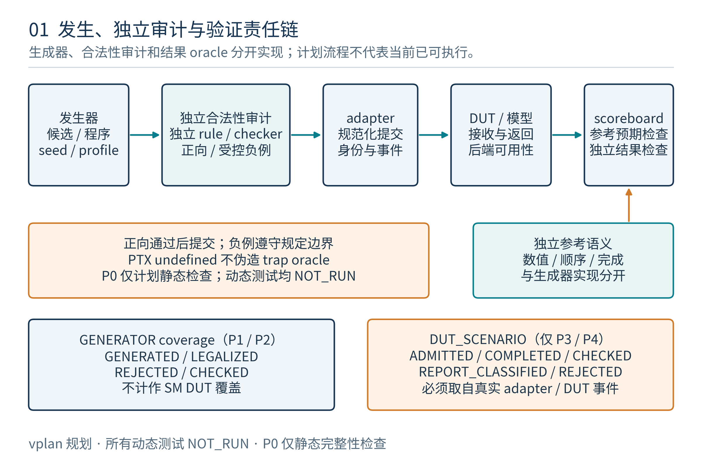
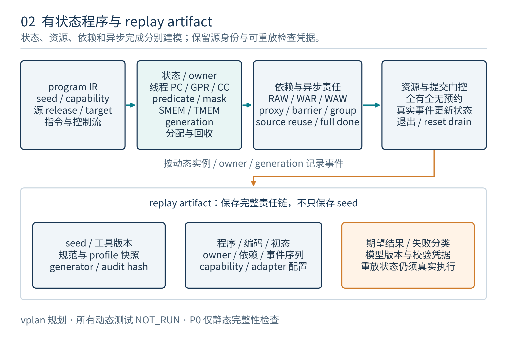

# SM 指令发生器验证计划

版本：v1.0；日期：2026-11-08（Asia/Shanghai）。计划编号：SM-INSTR-GEN-VPLAN。基线：[SM 架构 v1.0](../../../../docs/sm/SM_ARCHITECTURE.md)、固定上传 PTX ISA Release9.4（2026-07-17）。状态：**验证计划评审稿；发生器及完整SM验证环境尚未实现，全部功能测试为PLANNED / NOT_RUN**。

## 1. 目标、范围与交付状态

本文中的“指令发生器”指验证端的受约束指令／程序流生成器，目标是生成可复现、满足选定ISA和项目capability、具有明确检查判据的SM测试程序。它包含指令选择、操作数、寄存器依赖、控制流、访存对象、资源生命周期、异步协议与收尾；不是RTL instruction fetch，也不是设备CTA调度器。

验证分两条线：**发生器自身是否生成正确的激励**，以及**这些激励进入后续SM/SoC环境后是否被正确执行**。合法程序生成、实际发送、接收、完成、检查分别计数，不能用“随机生成过”代替DUT验证。

本次交付包含架构级vPlan、25个验证特性、106个计划测试点、75个计划覆盖点、217条指令／语法追踪、35条特殊寄存器追踪及计划静态检查工具。没有新增SM指令发生器、汇编器、UVM driver、SM RTL或参考执行模型。旧MALU回归结果不能作为本计划106个测试已通过的证据。

### 1.1 计划对象

| 对象 | 必须验证的内容 | 本版状态 |
|---|---|---|
| Generator | 约束、选择分布、程序合成、UNSAT处理、数据和manifest | 目标定义，未实现 |
| 独立审计器 | 不调用generator合法性函数的tuple/CFG/依赖/资源审计 | 目标定义；本次静态计划检查不代替它 |
| 编译/IR/native adapter | 语义保持、编码版本、握手和返回身份 | native编码未冻结，禁止伪装可执行二进制 |
| Oracle/scoreboard | 数值、允许结果集合、内存模型、协议和活性 | 目标定义，按执行阶段启用 |
| SM/SoC | 指令执行、资源、内存、同步、Tensor和系统协作 | 完整RTL及服务缺失，后续阶段blocked |
| Plan checker | 文档/JSON/CSV关联、源hash、计数和状态一致性 | 本次可运行的P0元数据检查 |

## 2. 规范基线、追踪全集与计数

PTX固定PDF SHA-256为`4be2905e240b70a8b176b4d6fb162714f2fc361a9503572d848ff723abf289c3`。机器指令源清单及SM架构源hash写入`vplan_features.json`和`testpoints.json`；来源发生变化必须重新审查映射和合法形式库，不能仅修改日期继续合并覆盖。

| 范围 | 规范说明节数量 | 本计划处理 |
|---|---:|---|
| 第9章21个指令大类 | 215实际指令说明节 | 逐节映射feature；同名不同类型保留 |
| 第9章控制语法 | 2，即`{}`与`@` | 编译scope/predication检查；不算opcode |
| 第10章特殊寄存器 | 35说明节 | 状态提供方、读取规则和稳定性独立追踪 |
| 第11章directive | 34说明叶子 | 编译/launch/ABI元数据；不计指令数 |
| 类型、ABI、内存模型、pragma | PTX第5、7、8、12章相关约束 | 纳入程序合法性与资源/数值/顺序合同 |

217不是独立opcode数，也不是所有type/modifier/shape合法tuple数量。完整指令Syntax/ISA/Target证据沿用[源清单](../../../../docs/sm/research/ptx94_instruction_inventory.json)。[指令追踪CSV](instruction_traceability.csv)与[特殊寄存器CSV](special_register_traceability.csv)便于vManager/表格工具后续导入；原生特定EDA vPlan格式尚未约定，不把本CSV宣称为任意EDA工具的即插即用格式。

## 3. 验证分层与当前门禁



| 阶段 | 目的和实际输入 | 进入条件 | 本次能证明什么 |
|---|---|---|---|
| P0_PLAN_STATIC | 校验vPlan/feature/test/trace/source元数据 | 仓库JSON/CSV/Markdown可读取 | 计划静态一致；动态测试执行数仍为0 |
| P1_GENERATOR_UNIT | 生成器、独立审计器、序列化、确定性、负例与分布 | 发生器和unit harness已实现 | 生成激励正确；没有DUT执行覆盖 |
| P2_REFERENCE_PROGRAM | IR解释、独立数值/内存/资源模型及可选编译验证 | 每种路线的独立模型/编译器存在且版本锁定 | 参考程序的语义和合规关系；没有SM RTL覆盖 |
| P3_SM_RTL | driver/SM接收、执行、检查、资源和进度 | 完整SM、适配接口与monitor就绪 | 只对本run实际启用、执行并检查的形式计覆盖 |
| P4_SOC | cluster/DSM/TMA/Fabric/运行时和可选采样服务 | 跨SM及SoC服务实现/模型和公平假设就绪 | 相应系统合同的端到端验证 |

106个测试点按主要执行阶段分为P1=50、P2=27、P3=23、P4=6；它们的状态全部NOT_RUN。源清单全覆盖和文档P0检查完成不自动开启P1–P4。

可先用typed IR开发P1/P2。后端缺失时native相关case必须BLOCKED，禁止将PTX文本的UTF-8字节送进fetch接口，也禁止把输出一个文本文件计为指令执行成功。

## 4. 输入、输出与可观察事件合同

### 4.1 发生器配置输入

配置至少包含：计划/schema版本、PTX release、target精确名称和family、项目capability快照、numerical profile、backend/IR版本、随机seed和子流、指令/CFG预算、各family权重、定向配额、线程/CTA/cluster形状、RF/SMEM/TMEM预算、地址对象、外部服务和错误schedule，以及期望测试模式。

`SM-ARCH-S0`采用1core=1SM、每SM1逻辑Tensor endpoint、≤64warp/≤8CTA、warp32、SMEM256KiB与TMEM最高288KiB；这些是项目资源预算，不是NVIDIA所有target的统一限制。`R_SM`、单CTA shared上限、实际目标feature与实现状态仍单独配置。Tensor微架构的bank/队列数只能作为压力配置，不能成为PTX合法性的隐含规则。

### 4.2 输出包

| 产物 | 必含内容 | 检查方式 |
|---|---|---|
| Semantic IR/可选PTX | section/form identity、typed operand、guard、动态实例、symbolic owner、完成义务 | 独立schema与IR roundtrip；语义身份不能只用mnemonic |
| 数据与对象初始化 | byte内容、padding、canary、descriptor、tensor map、barrier初始状态 | 独立对象/边界/初始化审计及hash |
| Launch/config | thread/warp/CTA/cluster、resource/capability、执行路线 | 联合admission和target检查 |
| Backend输出 | native/IR/text种类、编码/编译版本、lowering关系 | 后端可用性检查，禁止未知格式冒充机器码 |
| Manifest | 所有输入hash、seed子流、rbits、工具、服务schedule、生成尝试/拒绝日志 | 回放preflight逐项核对 |
| 检查/覆盖/失败包 | scope/phase、实际事件、判据、signature及原始/缩减程序 | 不以空日志或文本出现数作为PASS |

### 4.3 事件和身份

统一日志以run、kernel epoch、CTA owner/generation、warp/thread或collective instance、instruction/form ID、operation token和fragment标识关联。阶段事件至少区分candidate、legalized/rejected、driver accepted、DUT admitted、各类partial、full/目的提交、oracle checked及错误报告。

wide/vector结果按片段收集后才发布对应ready；warp active mask、predicate、collective membermask、Tensor输出mask独立记录。source捕获不完整以前不能释放保护；异步流不能由一个无类型done位统一结清。

## 5. 合法形式库、capability与负例分类

正向生成只从有版本和证据的合法形式库选择。检查键至少覆盖`release/target/opcode/type tuple/modifiers/shape/layout/address space/scope/proxy/participants`，再与项目implementation capability和backend路线求交。未知规则默认拒绝；不能从相邻形式、数字更大的sm target或类型存在推导自动支持。

普通指令native、lowering、系统service和关闭路线分别声明。合法化器或编译器存在不等于独立oracle：审计器须来自独立规则数据/实现，不能调用发生器同一predicate给自己盖章。共享规范身份和已审查常量允许，但共享有风险的约束函数应登记并另设差分/变异验证。

| 测试模式 | 期望行为 | 可以送到哪里 |
|---|---|---|
| LEGAL_POSITIVE | 整程序合法，检查规范/profile规定结果 | 对应可用阶段的模型或DUT |
| STATIC_NEGATIVE | 单项type/target/参与/生命周期约束被破坏 | preflight/合法化/已存在的编译入口；记录具体拒绝层 |
| PROJECT_PROTOCOL_ROBUSTNESS | 项目明确定义的非法命令/握手/错误响应保护 | 隔离的adapter/DUT保护测试；标NONISA |
| ISA_UB_QUARANTINE | 原文明示undefined behavior | 不进入正常数值pass/fail，不假定硬件trap |
| SPEC_UNDERSPECIFIED / ALLOWED_SET | unspecified、implementation-specific或允许多个结果 | 有独立profile/关系/允许集合即可检查；oracle未闭合为BLOCKED，不自动视为UB |
| DEFINED_SERVICE_FAULT | 合法Fabric失败、TMA报告等规定结果 | 有对应系统模型/实现时，按允许错误集合检查 |

负例从已审计的合法baseline作单因素mutation，保留原始case和破坏rule ID；拒绝原因必须对应期望，不能把缺工具、编译失败、任意非零exit或不相关约束失败都当命中。修复器的任何改写必须记录，修复后的正例不能继续冒充原负例。

## 6. 程序合成、状态账本与cleanup



发生器至少维护symbolic状态：per-thread定义/值域、predicate/CC、CFG与call frame、对象地址/初始化、RF quota、SMEM owner、TMEM allocation/permit、barrier layout/phase/arrivals/tx、各家族async group、peer生命周期，以及每项操作的源保护、目的和partial/full义务。

**生成时planned、执行时issued、观察到completed必须分账。** 正向程序应对所有允许的完成顺序安全，不能假定先发射就先完成，也不能生成到第N条指令时便在shadow里无条件释放先前异步资源。reuse/free由程序中的合法wait/HB保护，运行时ledger用真实事件推进。

### 6.1 Recipe 与前后置条件

每类recipe声明precondition、参与者、对象创建/消费、发射副作用、完成义务、可重用点、错误和cleanup。正文body以dependency DAG选择可用recipe；生成失败或UNSAT回滚尚未发布的候选reservation。禁止全局清空shadow来掩盖资源泄漏。

CFG merge必须对全部可到达路径保守合并资源与已定义值；loop有有界迭代和可证明的循环资源不变式。分支中只在一条路径alloc的对象不能在merge后无条件使用/释放；不同路径的barrier phase或group也不能仅按同一PC合并。

### 6.2 收尾预算

先保留有限cleanup预算和必要执行者/资源，再填body。cleanup至少包含相应family commit/wait、RF目的收齐、barrier phase必要观察、全部目的可见、TMEM匹配dealloc、source/peer引用关闭、可重用SMEM对象inval，以及CTA/kernel退出合同。

若预算不足，拒绝继续扩展body并输出可完成尾部；不能在最终截断instruction list后留下未完成义务。正常drain允许已接收工作的必要后续tile、load、commit、wait、free；abort是另一个有取消确认和外部副作用处理的协议。

## 7. 寄存器依赖、控制流与warp参与者

覆盖RAW、WAR、WAW、无关流、部分重叠、宽结果片段、predicate与隐式CC。每thread状态隔离，寄存器命名复用与lowering临时寄存器不能破坏live范围。独立def-use/byte alias分析须验证生成出的“相关场景”确实保留相关性，而不是被修复器或重命名全部消掉。保留source IR→lowered/native→DUT动态实例的provenance；编译优化删除、融合或重命名后，只有最终注入流中实际形成的hazard才计DUT依赖覆盖，源级命中另计。CC不要求跨call保存，helper与ABI按规定clobber。

控制流包括直线、diamond、嵌套分歧、有界loop、直接/间接call、divergent return、部分thread exit与尾warp。`.uni`仅在guard/target等满足对应一致条件时生成；SALU数据uniform需要独立证明，不能从`.uni`外推。predicated-off thread不得发出store/atomic/async副作用。

shfl/vote/match/redux/elect/activemask/bar.warp各按自己成员和退出规则。动态实例须区分同一PC的不同loop轮次；source lane、membermask、active/predicate不混。ITS进度测试只对其驻留与公平假设有效，不能承诺任意未驻留CTA自旋锁都会解除。

## 8. 整数、浮点、转换与数值oracle

| 功能 | 定向边界 | 判据 |
|---|---|---|
| 整数/CC | ±1、min/max、carry/borrow、hi/lo/wide、shift边界 | 任意精度整数及逐条截取/扩展；每thread CC独立 |
| clmad/bit/video | GF(2)高低积、LUT、extract/clamp/merge | 独立XOR/shift多项式或逐元素模型 |
| dp2a/dp4a | packed符号、element位置、S32溢出 | thread内packed dot，不与matrix MMA混同 |
| FP/FMA | tie、相消、subnormal、NaN/Inf/±0、overflow/underflow | 按精确形式的规定舍入、NaN允许集合与FTZ |
| mixed/alternate packed | x2/x4、carrier/padding、独立element、target差异 | 每元素语义；不能归约为单一dot |
| SFU/数学 | 精确/approx、范围边界、特殊输入 | 每形式独立误差/允许结果，禁止统一epsilon |
| cvt/cvt.pack | pzo/rz/scaled、范围、随机舍入rbits | 转换模型，bitcast不能替代；rbits显式回放 |
| spcompress/decompress | selection、NaN优先、±0、tie、metadata、num/寄存器重叠 | 验证允许选择集合与位置/补零，不猜唯一tie-break |

参考模型可选MPFR/SoftFloat/有理数/大整数，但版本、算法与适用范围必须锁定。不能复制DUT decoder/rounding函数作为唯一oracle，也不能用既有MALU的PROJECT_EXACT覆盖普通FP指令。无独立数值判据的形式保持blocked，不以“结果看起来合理”通过。

PTX以per-operation舍入/修饰符表达的行为与CC、predicate、只读sreg分开；本项目未定义通用浮点CSR，计划不虚构全局rounding/exception寄存器。machine-specific/unspecified项先定义项目profile或允许集合，不能直接采用host C行为作为规范唯一结果。

## 9. 地址空间、SMEM与内存模型激励

地址发生器维护typed object、owner、byte range、对齐、initialized set、lifetime和可见性。global/local/const/entry或func param/shared/generic/TMEM/multimem/CFT分别建模；local是thread可寻址device memory，不是私有片上shared。

正常流使用guard/canary检查越界与写mask。别名场景在对象层建立，不能只按地址整数相同判断。memory checker按允许结果集合判断：仅已证明集合为单例的确定子集逐值比对；race-free本身不保证唯一结果，并发atomic的返回/最终值也可能依赖合法线性化次序。其余race-free/atomic及专门litmus使用允许集合或可验证关系，不与任意顺序解释器强制逐值相同。

SMEM涵盖同offset不同CTA、边界fragment、byte/half RMW、scalar/packed atomic、未来b128能力门禁，以及LSU/TMA/Tensor/peer/barrier竞争。256KiB池、≤8CTA槽、target单CTA上限、RF与warp需联合admission；有槽不等于有shared容量。

bank/data commit、future collector失效实际生效、proxy publish分开。活动不可变snapshot允许保留，future reuse必须看新版本；可选ECC scrub在锁定后重读当前字，不能晚到写回旧corrected值。向量/packed atomic按规定逐元素，b128能力关闭时不能用四条无锁store模拟支持。

volatile、MMIO、readonly/nc、prefetch/cache hint、discard及completion-bearing priority分别验证。禁止把volatile当精确I/O次数，禁止给texture/surface/nc附加未定义的generic一致性。

## 10. 同步、mbarrier和proxy专项

warp/CTA/cluster到达、membar/fence、proxy和async wait各有独立判据。fence不代替线程会合，`.sync/.aligned`也不统一等于地址对齐或全部操作完成。alias规范化保留对应target/形式条件。

mbarrier是SMEM中8B对齐opaque b64，v0/v1布局、primary/conditional、arrivals与tx-count独立。v0 expected-arrivals上限2^20−1，v1为511，tx范围均±(2^20−1)。init/use/inval与phase复用在全部路径合法；有效对象不被普通store覆盖。

覆盖expect/complete/drop、token/parity、v1 primary前进而conditional不前进、report不被成功项清除、try_wait false时report未定义。登记事务期望时使用合法原子arrive.expect_tx，或先expect_tx并保留pending arrival再arrive；分别测试complete早/晚到，防止先独立释放最后arrival、后登记期望导致phase提前完成。conditional用规定`.parity`；True acquire观察才建立规定可见性。remote shared只使用规范允许更新，remote wait/init/inval作为preflight负例。

事件队列入队不等于对象更新完成；monitor要观察barrier agent→真实SMEM RMW commit→ack。group/phase计数单位使用typed obligation，不能让bytes、arrivals和Fabric16B units共用无类型计数器。

## 11. 异步复制、TMA与完成域

| 完成域 | 必须独立追踪的对象 | 不能代替的事件 |
|---|---|---|
| classic cp.async | 发射thread的经典group/规定barrier关系 | 普通barrier不自动等待所有group |
| bulk/TMA | mbarrier或bulk-group、所有片段/目的 | classic wait不能代等 |
| bulk.read | tensor-map/source读取结束 | 不证明目的最终提交/可见 |
| wgmma | warpgroup fence/commit_group/wait_group | tcgen05 commit不能代等 |
| tcgen05 MCS full | 本issuer对应mma/cp/shift责任 | 不以命令接收或A-read结束替代 |
| tcgen05 A-read | 相关MMA的原SMEM A读取 | 不覆盖B、D或整个allocation |
| tcgen05 ld/st | wait::ld/st、RF/存储片段 | 不等待MMA整体 |
| Fabric local read | 已提交操作对local shared源的读取 | 不证明try_get目的或远端full |
| Fabric full/counter | primary/report或规定目的counter | counter中间增量不证明全事务 |

TMA tensor map与tcgen05 SMEM matrix descriptor不同；TMA不直接等于Global→TMEM。覆盖tile/im2col/gather/scatter、reduce、descriptor override、multicast逐目的owner、prefetch和priority group完成。st.bulk只作shared置零；异步global store和shared形式分别合法化。

TMA report启用需要v1，按规定pattern采样，不是任意坏数据或通用ECC。ignore_oob只在规定方向且report disabled；Fabric report与TMA数据有效性报告不能混为同一错误码oracle。

## 12. TMEM独立验证章节

TMEM不仅作为matrix输入输出的一个地址标记；发生器必须能构造以下全部资源与数据路径。12个PTX说明节／14个标题名称在[指令追踪表](instruction_traceability.csv)中归属GEN-TMEM-01及相关GEN-MATRIX-01/GEN-SYNC-01。

| 功能 | 关键生成约束 | 检查与覆盖 |
|---|---|---|
| alloc/dealloc | non-exclusive power-of-two、连续申请顺序、exclusive32列倍数、target512/576列、group与匹配属性 | allocation不重叠/不越权，等待/失败不半发布 |
| relinquish_alloc_permit | 放弃后不可再alloc，已有allocation仍live | permit和allocation分账，不能用permit操作代替free |
| ld/st/wait | warp collective、统一base、warpgroup quarter lane、pack/unpack、完整返回 | wait::ld/st正确，首fragment不整体ready |
| ld.red/spcompress | 各目标shape/type/metadata/selection/NaN约束 | 独立读路径归约/压缩模型，不自动通用于所有mma.sp |
| cp | SMEM→TMEM与规定展开/multicast布局 | source/live/proxy与TMEM实际写入，不是TMA别名 |
| shift | 指定TMEM区域数据移动 | 重叠/顺序/完成按规定，不猜固定周期 |
| mma四类 | dense/sparse/ws/ws.sp及layout/resource | 计算详见第13章，D对象真实写回 |
| fence/commit | before/after_thread_sync、normal/full、restricted A-read | 不跨domain合并、不提前回收full责任 |
| dealloc/exit | 本地/peer全部并发访问排除，列数/group/exclusive匹配 | 无use-after-free；owner/generation与系统引用关闭 |

symbolic TMEM `(lane,column)`不能转成普通shared byte offset。基础分配成功后的地址发布给其他warp必须有规定顺序；对象在程序所有路径和loop迭代内有明确所有者。SMEM launch分配与TMEM运行中alloc两个池分别预算。

S0 group2由even/odd CTA分别处于两个可互通的不同SM/endpoint；双边资源与生命周期共同保证，不生成“任意两CTA即peer”或未定义的同SM适配。同kernel内带cta_group的相关tcgen05操作遵守group一致性，不能随随机选择跨1/2切换。dealloc前要排除两边访问，不依赖dealloc是否恰好阻塞来补漏同步。

## 13. Matrix/MALU格式、scale和资源复用

wmma、warp mma/mma.sp、wgmma和tcgen05前端各有自己的参与者、fragment/descriptor、target与完成。当前关闭路线只做合法化负例；不能因MALU能dot就声称这些前端已实现。

数值关系按选定profile表示为：

$$D=C\,2^{-s_C}+\sum_{k=0}^{K-1}\left(A_kB_k\,s_A(g_A(k))\,s_B(g_B(k))\right)$$

无AB缩放时对应scale=1。A/B fmt、C/D fmt、scale_A/scale_B fmt、BLOCK16/32、独立offset、Cshift及长度必须分开输入和交叉覆盖。native合法tuple限制仍联合检查；不能用这些独立字段生成任意交叉组合。

`enable-input-d=false`不读取或参与旧D，正式Cseed为零；true传未缩放D_old和独立Cshift。合法Cshift0..15在解码/指数/累加路径表达，不能预先量化再shift一次。C每dot只加入一次，不随operand beat重复加入。

Ti16规范类型`.s1z4m11`按整型类处理；raw能力保持关闭，decoded项目传输另列。稀疏logical K、压缩存储K与metadata、scale分组分开；结构零遇Inf/NaN仍按所选profile判断，不能一概跳过。

MALU请求beat在任一AB scale块边界前切分，BLOCK16/32和offset不随stall重新开始。block内重复scale payload保持一致；输入/输出backpressure不得改变源值、Cseed、K/last和profile。collector reuse为opportunistic，miss重读仍合法；A-read只允许释放已证明的原A读取义务。

复用压力包括高/低精度切换、scale backend、finalizer、RF/TMEM/SMEM返回冲突和满载收尾。Rubin dense0.5:1:4.375:8.75仅为Tensor产品目标背景，不能充当指令抽样权重、SM固定时延或本计划功能PASS判据。

## 14. Cluster、Fabric、texture与系统服务

cluster/DSM包含rank映射、joint admission、remote owner引用、barrier和退出。工作取消只针对未启动cluster，16B opaque response和mbarrier完成分开；观察失败后不再非法重试。griddepcontrol需runtime服务，launch_dependents不是当前grid完成。

Fabric分别记录CFT `(u32 leId,u64 offset)`、普通VA和multimem VA。get/pullred complete-tx为bytes，put/red为16B units；counted completion使用8B counter且256B对齐、按最终byte累计判断。submit先于phase完成，fabric.wait只local SMEM读取部分完成；错误也要完成结算并检查report，成功不清旧错误。CFT=fabric、local SMEM=async、barrier=generic按规范方向建立顺序。

texture/surface当前关闭；启用时需要独立对象、坐标、filter/LOD、channel conversion、gather、boundary/query/reduction模型，不能由普通global load替代。系统类含stack/ABI、动态RF、debug/trap、nanosleep与35节sreg；未定义PM值和可变化smid/warpid用关系/允许集合，不强制逐bit。

per-CTA global接口依赖.minperctamemory和driver，size可能为0、有效时为1024B倍数；不能译为SMEM。未定义全局FP CSR；指令舍入、CC、predicate、sreg环境保持独立。

## 15. 参考检查器、allowed outcome与活性

| 检查器 | 独立输入与方法 | 通过条件 |
|---|---|---|
| Form/target checker | 固定规范与独立合法形式表、能力和backend | 正常流只含已启用合法形式；负例层/理由精确 |
| CFG/def-use | 完整IR、每lane guard/path、对象图 | 源已定义、控制可达有界、参与者合法 |
| Resource/HB | recipe前后置、sync、typed obligation | 全允许顺序无过早复用/释放、结束账本闭合 |
| Numerical | 原始输入/format/profile/rbits与独立算法 | 精确bit或逐形式允许结果/误差界 |
| Memory | 对象/初始化/alias与内存模型 | 单例子集逐值，其余按允许结果/线性化关系；不出现禁止结果 |
| Protocol/completion | 实际admit/return/commit/ack/report事件 | exactly-once、全部片段和真正终点匹配 |
| Progress | wait-for图、服务公平假设、工作预算 | 区分合法长时延、外部starvation和DUT deadlock |

检查故障必须校验oracle本身：用已知可计算小例、变异injector、跨独立模型的relation检查发现“同错通过”。不得用DUT相同helper填全scoreboard。对于无足够数值公开保证的target，不冒充设备bitfit；选择可证明项目profile或保持blocked。

timeout根据recipe工作量、实际服务配置和公平假设制定，记录无进度事件链。timeout不是所有长延迟指令必错的判据，也不能把故意外部永久stall标成DUT死锁。全SM任意周期抢占尚未定义，当前仅按safe-drain或明确abort/reset合同测试。

## 16. 覆盖模型、采样和分母

每个CV有独立`scope`：GENERATOR用于候选、合法化/拒绝或审计结果；DUT_SCENARIO只由真实adapter/DUT事件触发。P1/P2不得填DUT覆盖。P0静态检查不采样任何动态CV。发生器侧合法性/状态判据CV在独立审计完成的CHECKED事件采样，并把接受和拒绝保留为不同decision/outcome；不能在仅LEGALIZED接受事件上采样reject bins。该CHECKED属于GENERATOR命名空间，不是DUT结果已检查。

| 计数/采样点 | 意义 | 禁止的替代 |
|---|---|---|
| generated | 实际产生的候选/程序 | 源清单存在该名称 |
| legalized/rejected | 独立审计后的合法/拒绝结果 | generator自身shadow直接认定 |
| driver accepted / admitted | 实际驱动/SM接收 | 文本输出或preflight通过 |
| partial / completed | 类型明确的局部或完整责任 | A-read、首fragment或queue接收代full |
| checked | oracle/协议检查实际完成且结果归类 | 结果返回但未比对 |
| report classified | 有效阶段/布局下的真实报告 | try_wait false的未定义report |

cover key至少保留run/实例、section/form ID、线程/collective粒度与阶段。静态条目覆盖、动态指令实例、active lane、element、fragment、term等数量分开；不以32lane把一条instruction随意膨胀成32条指令。重放同一证据不能在merge时重复计数。

### 16.1 交叉覆盖

重点cross为：form×target×capability；type×rounding×value class；RAW距离×执行域×stall；mask×divergence×collective；空间×size/alignment×alias×scope/proxy；barrier布局×phase/report×tx units；TMEM模式×列数×group×permit；AB fmt×scale fmt×BLOCK×offset×Cshift；partial/full×owner release×晚到response。

全交叉只对冻结后确认的合法且可达组合建立。每个run保存展开的eligible form/bin集合及hash，记录illegal、disabled、UNRESOLVED、proved unreachable和reviewed waiver；不能把未实现、未审查或UNSAT频繁项静默从分母删除。

75个CV是本版覆盖点数量，不代表具体bins已全部展开。`capability-resolved legal-form bins`必须在能力/recipe冻结后形成有限、可审查列表；解析未完成就阻止相应覆盖关闭。mandatory可达bin以100%为关闭目标；waiver需版本、理由、证据和评审记录，不能靠降低统一百分比阈值掩盖缺口。

## 17. 定向激励、随机分布与UNSAT

定向case先建立边界和稀有功能命中，再运行受约束随机混合。权重只在当前可行集合中归一化；关闭capability权重为0并保留拒绝/禁用证据，不默认为其已覆盖。对rare opcode/shape/错误报告使用配额和定向recipe，不要求纯随机偶然命中。

分布检查记录attempted、rejected、emitted、legalized和各条件可行集合，不能把高拒绝率导致的条件分布偏移误判为RNG错误。分布统计使用预先约定样本量/置信方法；固定单次histogram无需精确等于权重。

UNSAT有有限重试/时间预算、约束和资源解释。fallback必须在配置允许范围且记录；不静默删掉触发缺陷的相关性，也不无限重试导致发生器挂死。零权重、非法全关闭配置、cleanup不足和不可达cross都有明确诊断。

## 18. 回放、缩减与失败证据包

相同seed不是充分复现条件。manifest冻结program/data/launch/target/capability/profile、IR/backend/compiler、schema/source hash、RNG子流与计数、随机舍入rbits、服务延迟/乱序/fault schedule、driver与模型版本。worker数或调度顺序不改变指定case的刺激。

失败signature包含阶段、规则/scoreboard、指令身份、首个错误事件和规范化结果。缩减必须重新独立审计CFG、def-use、成员、owner、barrier、group与profile，并重放原failure predicate。删掉producer、wait或peer后得到新UB/新timeout，不能当原故障更小复现。

原始包与缩减包都保留；记录每次变换/拒绝原因、迭代与时间上限。“最小化”表示受约束缩减的局部结果，不宣称全局数学最小。故障不稳定时保留schedule并标NONDETERMINISTIC，不能反复改seed直到通过再关闭。

## 19. 回归层次、验收与退出标准

回归次序为计划P0→发生器P1→参考程序P2→SM P3→SoC P4。每阶段包含固定smoke、定向边界、seed sweep及压力场景；新增修改只重复受影响的规则/阶段，再按缺陷传播扩大范围。计划不填造执行命令或假定商业EDA/编译器已可用。

| Gate | 关闭条件 | 本次状态 |
|---|---|---|
| G0计划一致性 | 217+35源身份/hash、feature/test/CV双向关联、phase/scope、无空项/假PASS | 可由静态工具执行；报告单独归档 |
| G1发生器就绪 | 非空P1 case实际执行，独立合法性/变异/确定性检查通过 | NOT_RUN；发生器/harness缺失 |
| G2语义就绪 | 启用路线有独立oracle/lowering和允许结果检查 | NOT_RUN；模型/编译路线缺失 |
| G3SM就绪 | 真实admit/complete/checked证据，mandatory bins闭合、无未归类失败 | NOT_RUN；完整SM/adapter缺失 |
| G4系统就绪 | cluster/SoC服务和failure/progress合同端到端证据 | NOT_RUN；系统服务缺失 |

任何gate不能以零case、零checked、缺工具、全disabled、未审查waiver或历史MALU回归数字通过。capability关闭可以形成明确的负例拒绝证据，但不能算该功能正向DUT覆盖。实际验证后用独立campaign结果更新状态，保留本版计划与证据版本关联。

## 20. 计划文件、目录与使用

| 文件 | 用途 |
|---|---|
| SM_INSTR_GEN_VPLAN.md / SM_Instruction_Generator_Vplan_v1.0.docx、PDF | 完整评审计划和阅读版 |
| vplan_features.json | 25个特性及75个CV，字段/判据/phase/状态 |
| testpoints.json | 106个计划case的setup/stimulus/checker/expected/关联 |
| instruction_traceability.csv/.json | 全217说明节到feature的追踪 |
| special_register_traceability.csv/.json | 全35节状态/环境追踪 |
| check_vplan.py | 本版计划静态校验；不生成/执行SM指令 |
| reports/vplan_static_check.json | 本次真实P0检查结果及源/产物hash |
| research/*review.md | 指令、方法和资源的独立审查 |
| figures/、build_doc.py、BUILDING.md | 图源与可复现阅读版构建 |

从仓库根执行：

```bash
python3 verif/core/vplan/sm_instr_gen/check_vplan.py
```

该命令检查计划完整性和关联。它不是发生器单元测试，不调用SM RTL，也不把106个计划测试改为PASS。后续UVM/IR model/driver可位于`verif/core/src/`对应模块、flow/filelist保持项目组织；本次不创建空壳发生器或假回归入口。

## 21. 数据模型与变更规则

每feature有稳定ID、requirement、stimulus/checks、CV、pass criteria、phase、priority、source refs和test IDs；每test有独立setup/stimulus/checker/expected_result与coverage IDs。每trace有规范section、原名称/页号、domain、feature关联和PLANNED/NOT_RUN。章节编号可以调整，稳定ID不因排序变化而重用。

规则或规范变化时，重新核验受影响合法形式、negative mutation、cross分母和证据兼容性。generator、validator、oracle和lowering的版本分别锁定；不能只升级其中一个后把旧覆盖无条件合并。功能删除需要显式deferred/waiver处理，不靠删行让计数变小。

## 22. 风险、依赖与阶段推进

| 依赖/风险 | 当前处理 | 推进条件 |
|---|---|---|
| native编码/IR接口未冻结 | 仅定义typed semantic合同，native blocked | 有版本化编码/assembler/adapter与roundtrip证据 |
| 全tuple合法库不完整 | 217节追踪不代替tuple库；未知规则fail-closed | 每启用form有语法/target/recipe证据和独立审计 |
| oracle与发生器同错 | 独立实现/变异/known-answer/关系检查 | 明确共享常量与独立算法边界 |
| weak memory与设备数值差异 | allowed outcomes/profile专用判据 | 有模型且对应target/profile能力启用 |
| 异步状态空间/死锁 | DAG/HB、全路径merge、typed义务和cleanup预算 | 独立prefix/多顺序检查与公平假设下的进度证据 |
| rare事件/UNSAT偏移 | 定向配额与尝试/拒绝/条件分布统计 | 可解释分布和有限重试诊断 |
| 缺SM/SoC实现 | P1–P4全部NOT_RUN | 按G1–G4实际实施，不借旧测试充数 |

## 23. 来源与独立审查范围

本计划依据[SM架构](../../../../docs/sm/SM_ARCHITECTURE.md)、[Tensor架构](../../../../docs/tcgen05/TCGEN05_TENSOR_ARCHITECTURE.md)、[Tensor/SMEM微架构v1.1](../../../../docs/tcgen05/microarchitecture/TCGEN05_TENSOR_MICROARCHITECTURE.md)、[现有MALU数值/接口合同](../../../../docs/malu/RTL_IMPLEMENTATION.md)以及固定PTX机器清单。微架构物理参数作为压力配置背景，不能反推ISA限制。

指令追踪由agent1核对；发生器方法由agent2独立审查；有状态资源/异步/TMEM由agent3审查；agent4负责计划checker、图和阅读版；主agent统筹并撰写主文及结构化test catalogue。独立记录见[ISA审查](research/isa_review.md)、[方法审查](research/generator_method_review.md)、[资源审查](research/stateful_resource_review.md)。本轮不要求新外网内容，固定源证据和仓库设计足以制定计划。

三轮文档检查分别关注追踪完整性、技术/状态一致性和产物排版；这些P0检查不冒充generator/RTL数值、协议或性能回归。

## 24. 全部验证特性与计划测试点

以下按稳定feature ID列出全部106项，每项展开激励、独立检查及预期。完整setup、source refs、phase/coverage与NOT_RUN状态以配套JSON为准。表中P1/P2/P3/P4对应第3章，均是计划阶段，不是已执行记录；未实现功能保留dependency gate。


### 24.1 GEN-ISA-01：规范、target与项目capability合法性

要求：每个候选按release/target/opcode/type/modifier/shape/space/scope/participant联合检查；规范合法和项目已实现分开。

准备：固定PTX9.4源hash；构建至少两个互不继承的target capability快照；当前SM实现能力关闭。

| 计划测试点／阶段 | 激励 | 独立检查 | 通过条件 |
|---|---|---|---|
| `SIG-ISA-001`<br>全部目录及别名身份（P1） | 遍历217说明节，保留同名不同类型与同节多名称；另读35特殊寄存器。 | 对独立源索引比对section集合/名称/页号，语法和directive不计opcode。 | 217唯一说明身份、215实际指令节和2语法项；不称217个opcode。 |
| `SIG-ISA-002`<br>target与capability单因素变异（P1） | 从已知合法tuple每次只改target、family、类型或一个modifier；覆盖sm90a WGMMA与sm107相关门限。 | 独立规则表判断与拒绝理由；规则缺失fail-closed，禁止调用generator legality函数。 | 仅被变异约束相关的拒绝原因出现，未改变的基线仍可接受。 |
| `SIG-ISA-003`<br>关闭能力与lowering证据（P2） | 在规范合法但project关闭的形式上尝试native、lowering与service路线。 | 检查lowering证书/规则版本，禁止无证据fallback或静默no-op。 | 未实现路线明确拒绝；有证明的路线只在另启用profile下产生。 |
| `SIG-ISA-004`<br>入口一致性（P3） | 把合法化通过与明确项目非法命令分别送真实SM adapter；非法不属于普通PTX UB测试。 | 独立入口monitor比对动态实例/route及项目定义错误合同。 | 正确接收与项目合同拒绝均有真实事件；preflight拒绝不算DUT执行。 |

- `CV-ISA-001`（发生器，GENERATED）：候选来源与门限分布。计划bins：215_instruction_topics、2_syntax_topics、same_family、architecture_specific、deprecated、disabled_project_capability。
- `CV-ISA-002`（发生器，CHECKED）：独立合法化结果。计划bins：accept_enabled_legal、reject_target、reject_tuple、reject_project_disabled、reject_missing_rule。
- `CV-ISA-003`（真实DUT场景，CHECKED）：实际适配入口只接收合法形式。计划bins：correct_accept、correct_reject、no_dropped_instruction。

本特性及以上测试均为PLANNED / NOT_RUN；不以本表行数表示已执行覆盖。


### 24.2 GEN-IR-01：语义IR、序列化与adapter边界

要求：冻结semantic IR与recipe以后再编码；PTX文本、项目IR与native字节不得互相冒充。

准备：IR记录opcode身份、typed operand、mask、symbolic owner、数值profile、source与completion obligation。

| 计划测试点／阶段 | 激励 | 独立检查 | 通过条件 |
|---|---|---|---|
| `SIG-IR-001`<br>IR完整往返（P1） | 序列化/反序列化寄存器、立即数、packed载体、symbolic地址、descriptor与metadata。 | 使用独立schema解码器比较语义AST，不比较无意义JSON字段顺序。 | 位宽/符号/字节序/mask/owner及语义不丢失。 |
| `SIG-IR-002`<br>编码后端门禁（P1） | native编码未冻结时请求native输出，并尝试unknown schema/保留位。 | 检查拒绝记录与backend version，不使用PTX字节作为fetch指令。 | 可输出semantic IR；native请求明确blocked，不能生成伪二进制。 |
| `SIG-IR-003`<br>降低保持（P2） | 对选定可证明序列比较原语义和lowered trace，含helper临时寄存器及CC。 | 独立解释器做relation检查，保留predication/rounding/side effects。 | 观测等价或明确报告缺少该lowering证明。 |
| `SIG-IR-004`<br>总线stall与采样（P3） | 同一IR实例在随机ready下提交所有分片，覆盖同tag不同generation。 | driver monitor逐拍检查valid阻塞稳定、唯一accept及payload hash。 | 无提前变值、重发副作用或错route；适配成功不等于指令完成。 |

- `CV-IR-001`（发生器，GENERATED）：IR载体。计划bins：ptx_semantic、project_ir、lowered_sequence、native_backend_disabled。
- `CV-IR-002`（发生器，CHECKED）：往返与拒绝。计划bins：roundtrip_equal、unknown_field_reject、width_sign_preserved、layout_version_mismatch。
- `CV-IR-003`（真实DUT场景，CHECKED）：adapter责任。计划bins：exact_payload、stable_under_backpressure、correct_instance_route。

本特性及以上测试均为PLANNED / NOT_RUN；不以本表行数表示已执行覆盖。


### 24.3 GEN-DEP-01：寄存器、谓词、CC与访存依赖

要求：生成器用独立数据流和别名账本构造RAW/WAR/WAW及隐式状态依赖，不预设固定执行时延。

准备：不同thread/warp RF命名空间；含宽寄存器片段、谓词、CC及共享别名。

| 计划测试点／阶段 | 激励 | 独立检查 | 通过条件 |
|---|---|---|---|
| `SIG-DEP-001`<br>依赖链与无关流混合（P1） | 构造短/长RAW链，交错WAR/WAW与独立算术，包含packed和64/128bit载体。 | 独立SSA/def-use分析器核对源定义、live范围和副作用。 | 全部普通读有确定定义；期望相关性真实存在而非被修复器消掉。 |
| `SIG-DEP-002`<br>隐式状态与分歧定义（P1） | CC链/双谓词/masked定义后跨分支使用；helper故意申请冲突临时寄存器。 | 检查per-thread path-sensitive definition及CC clobber规则。 | 合法链保留；未定义读/不合法路径明确拒绝或补支配定义并记录。 |
| `SIG-DEP-003`<br>别名相关性（P2） | 为global/shared/local别名与narrow/wide重叠建立必须顺序，另生成合法无冲突对。 | 独立byte-range与happens-before分析，不仅比较寄存器索引。 | 相关边与真实字节对象一致；不依赖偶然cache行为。 |
| `SIG-DEP-004`<br>乱序/分片结果（P3） | 对依赖流注入长延迟和多片返回，与短算术及CC链并发。 | scoreboard按动态实例/lane/fragment检查值与ready点。 | 第一片不得发布整体ready，迟到旧generation不得唤醒新producer。 |

- `CV-DEP-001`（发生器，GENERATED）：依赖形状。计划bins：RAW、WAR、WAW、independent、partial_overlap、predicate、CC。
- `CV-DEP-002`（发生器，CHECKED）：依赖合法性。计划bins：defined_before_use、guarded_definition、helper_clobber_free、alias_edge_present。
- `CV-DEP-003`（真实DUT场景，CHECKED）：动态依赖完成。计划bins：partial_return_not_ready、all_fragments_ready、cross_warp_isolation、correct_forwarding。

本特性及以上测试均为PLANNED / NOT_RUN；不以本表行数表示已执行覆盖。


### 24.4 GEN-ALU-01：整数、位操作、packed dot与video

要求：覆盖整数符号/宽度、hi/lo/wide、CC、carryless、video选择与merge；不把dp4a当矩阵MMA。

准备：冻结整数边界profile；每thread独立输入和CC；为machine-specific行为声明允许集合。

| 计划测试点／阶段 | 激励 | 独立检查 | 通过条件 |
|---|---|---|---|
| `SIG-ALU-001`<br>乘加与进位边界（P1） | 生成0/±1/min/max、跨32/64边界carry/borrow、mul.hi/wide及mad链。 | 独立任意精度整数oracle截取/扩展并单独检查CC。 | 结果与规定宽度/符号一致；不从截断低积伪造高积。 |
| `SIG-ALU-002`<br>位处理与carryless（P1） | 覆盖shift 0/width−1/width/>width、bitfield边界和clmad高低多项式。 | XOR/shift多项式oracle独立于普通乘法；逐条mask/shift规则。 | 已定义及机器相关项按逐形式profile或允许集合检查；明示UB只在preflight隔离，不套host C唯一答案。 |
| `SIG-ALU-003`<br>packed与video语义（P2） | 按element抽取、扩展、clamp、secondary op、merge生成video及dp2a/dp4a。 | 标量化的独立逐元素模型，不调用DUT decoder或MALU oracle作全部ALU模型。 | 元素位置、饱和、merge与S32累加语义保持。 |
| `SIG-ALU-004`<br>算术与CC压力（P3） | 在多warp中交错整数/乘法/CC/packed流并注入返回stall。 | 独立值scoreboard+隐式CC monitor。 | 各thread结果无串扰，资源复用不改变结果或丢指令。 |

- `CV-ALU-001`（发生器，GENERATED）：算术边界。计划bins：zero、signed_min_max、carry_borrow、hi_lo_wide、shift_edge、clmad、dp2a_dp4a、video_merge。
- `CV-ALU-002`（发生器，CHECKED）：操作数规则。计划bins：signed_unsigned、packed_element_independent、legal_16bit_profile、no_undefined_read。
- `CV-ALU-003`（真实DUT场景，CHECKED）：数值和状态结果。计划bins：exact_integer、correct_CC、correct_selected_bits、per_thread_isolation。

本特性及以上测试均为PLANNED / NOT_RUN；不以本表行数表示已执行覆盖。


### 24.5 GEN-FP-01：普通浮点、混合/packed与SFU

要求：区分普通FMA、packed独立结果、精确/近似数学与Matrix PROJECT_EXACT，逐形式固定舍入/误差。

准备：数值profile声明NaN允许结果、FTZ、rounding和approx误差公式；没有规则则关闭形式。

| 计划测试点／阶段 | 激励 | 独立检查 | 通过条件 |
|---|---|---|---|
| `SIG-FP-001`<br>舍入与特殊值分桶（P1） | 生成半ULP、相消、subnormal、±0、Inf/NaN及溢出/下溢组合。 | 独立MPFR/SoftFloat或有理数+逐形式舍入模型；固定工具/version。 | 精确形式按规定比对；NaN payload仅在规范/profile要求时逐bit检查。 |
| `SIG-FP-002`<br>packed/mixed target联合约束（P1） | 覆盖FP8/6/4 x4与F16/BF16/F32x2形式，单独变异carrier/target。 | 独立tuple表与每元素运算模型；验证不是四元素dot。 | 合法组合生成，非法target/packing拒绝，各元素结果独立。 |
| `SIG-FP-003`<br>SFU误差与FMA对照（P2） | 构造FMA与先乘后加会不同的值，另测sin/cos/lg2/ex2/div/rcp/rsqrt边界。 | 精确形式与approx采用不同判据；误差/范围和特殊值规则独立记录。 | 不能以全局epsilon替代所有指令误差，也不能把dot模型用于普通FMA。 |
| `SIG-FP-004`<br>混合执行域（P3） | 多warp交错FP32/FP64/packed/SFU及dependent consumers。 | 值/误差scoreboard与per-op profile检查。 | 共享资源、stall和模式切换不混profile，不以吞吐峰值判断功能通过。 |

- `CV-FP-001`（发生器，GENERATED）：数值类别。计划bins：normal、subnormal、signed_zero、infinity、qNaN_sNaN_as_defined、cancellation、overflow_underflow、tie。
- `CV-FP-002`（发生器，CHECKED）：形式与profile。计划bins：f16_bf16_f32_f64、mixed_x2、alternate_x4、fma_vs_mad、approx_vs_rounded、target_tuple。
- `CV-FP-003`（真实DUT场景，CHECKED）：数值验收。计划bins：exact_bits_when_required、allowed_NaN_set、bounded_error、no_cross_element_reduction。

本特性及以上测试均为PLANNED / NOT_RUN；不以本表行数表示已执行覆盖。


### 24.6 GEN-CVT-01：转换、packing及寄存器稀疏变换

要求：转换与位搬运分开，保留随机舍入rbits、padding、稀疏选取/补零及多寄存器限制。

准备：使用合法format/packing/descriptor表；明确implementation-specific选择的允许集合。

| 计划测试点／阶段 | 激励 | 独立检查 | 通过条件 |
|---|---|---|---|
| `SIG-CVT-001`<br>数值转换边界（P1） | 为整数↔FP、FP↔FP、pzo/rz/sat与随机舍入构造边界并固定rbits。 | 独立转换模型与序列化检查，rbits写入manifest不使用隐藏RNG状态。 | bitcast不代替cvt；同rbits可复现随机舍入结果。 |
| `SIG-CVT-002`<br>稀疏载体约束（P1） | spcompress/spdecompress覆盖所有启用spfactor/idxsize/num，触及253寄存器总量与重叠边界。 | 独立源/目的集合及descriptor/shape判定，非法仅送legalizer。 | 约束通过后不含禁止重叠；padding及长度符合规范。 |
| `SIG-CVT-003`<br>选择与补零允许集合（P2） | 含NaN、±0、重复最大值/最小值及metadata边界。 | 独立集合判据验证允许的tie-break，逐位置检查解压补零。 | 不把实现相关tie-break或out-of-range索引猜为唯一设备值。 |
| `SIG-CVT-004`<br>多寄存器返回（P3） | 对大.num变换和宽转换施加RF返回反压。 | 按全部目的片段检查结果、就绪和源保持。 | 不因首片返回提前ready，不破坏未捕获源。 |

- `CV-CVT-001`（发生器，GENERATED）：数据变换。计划bins：cvt、cvt_pack、mov_prmt、pzo_rz_scaled、rs_rbits、spcompress、spdecompress。
- `CV-CVT-002`（发生器，CHECKED）：载体与限制。计划bins：padding_valid_invalid、vector_length_edge、overlap_forbidden、descriptor_type、NaN_priority。
- `CV-CVT-003`（真实DUT场景，CHECKED）：变换结果。计划bins：rounding_result、rbits_replay、sparse_allowed_selection、decompress_zero_fill。

本特性及以上测试均为PLANNED / NOT_RUN；不以本表行数表示已执行覆盖。


### 24.7 GEN-CTRL-01：CFG、predication、ITS与调用

要求：生成有界可达CFG并证明lane级定义/参与/终止条件，避免把branch.uni当所有数据uniform。

准备：有界loop/call深度；每thread PC/return与live集合；尾warp和分歧mask。

| 计划测试点／阶段 | 激励 | 独立检查 | 通过条件 |
|---|---|---|---|
| `SIG-CTRL-001`<br>有界控制图（P1） | 生成diamond/嵌套分歧/循环和间接目标集合，覆盖0/1/边界迭代。 | 独立CFG分析检查目标、可达性、终止ranking与path-sensitive def-use。 | 正向随机程序可终止且不出现无定义路径；循环预算不靠超时当正确。 |
| `SIG-CTRL-002`<br>谓词与uniform证明（P1） | 生成全true/allfalse/mixed guard，并为.uni给出guard/target一致证明。 | 独立lane symbolic执行；禁止仅检查某次随机值恰好相同。 | predicated-off的store/atomic/async均无副作用；uni证据不外推数据uniform。 |
| `SIG-CTRL-003`<br>call/ret和thread exit（P2） | 分歧调用/返回、多个return site、部分lane exit与stack lifetime。 | 独立每thread控制解释器与ABI/栈对象生命周期模型。 | return PC隔离，已退出成员按各collective原文处理。 |
| `SIG-CTRL-004`<br>ITS解锁场景（P3） | 同warp部分thread等待，其他thread执行解除依赖；含动态相同PC多轮collective。 | 基于允许调度公平假设的进度monitor，不保证未驻留任意CTA锁前进。 | 能解除已接收合法等待者的thread可执行，动态实例不串轮。 |

- `CV-CTRL-001`（发生器，GENERATED）：CFG结构。计划bins：straight、diamond、nested_divergence、bounded_loop、direct_indirect_call、return_exit、partial_warp。
- `CV-CTRL-002`（发生器，CHECKED）：静态控制审计。计划bins：reachable、bounded_termination、path_defined、uni_proven、predicated_off_no_effect。
- `CV-CTRL-003`（真实DUT场景，CHECKED）：动态控制语义。计划bins：per_thread_PC_return、ITS_progress、correct_side_effect_mask、no_instance_merge。

本特性及以上测试均为PLANNED / NOT_RUN；不以本表行数表示已执行覆盖。


### 24.8 GEN-COLL-01：Warp通信与collective参与者

要求：各条独立检查membermask/active/exited/guard/实例与同参条件，不共用一个过宽sync规则。

准备：32lane warp及partial warp；按具体target启用legacy shfl/vote；可追踪动态实例。

| 计划测试点／阶段 | 激励 | 独立检查 | 通过条件 |
|---|---|---|---|
| `SIG-COLL-001`<br>成员与source lane（P1） | 组合mask、width、source clamp、非连续subset和partial warp。 | 独立每条参与规则与逐lane交换模型。 | 只生成合法参与集合；无效source按具体原文处理。 |
| `SIG-COLL-002`<br>guard/退出单因素负例（P1） | 只破坏一项member/guard/target条件，含legacy指令移除target。 | preflight合法化拒绝，UB不进入普通DUT值比较。 | 拒绝理由对应破坏项，普通正例不被错误过滤。 |
| `SIG-COLL-003`<br>会合与归约模型（P2） | 多轮同PC交错shfl/vote/match/redux/elect/activemask。 | 独立dynamic instance模型及允许结果/NaN/signed-zero规则。 | elect对相同membermask确定性；activemask不是未来成员预测。 |
| `SIG-COLL-004`<br>真实warp会合（P3） | 对合法collective交错lane等待与执行域stall。 | rendezvous monitor按warp+dynamic_instance+generation检查。 | 不漏参与者、不跨轮配对、不把sync误当全部async完成。 |

- `CV-COLL-001`（发生器，GENERATED）：通信形式。计划bins：shfl、vote、match、redux、elect、activemask、warp_barrier。
- `CV-COLL-002`（发生器，CHECKED）：参与条件。计划bins：full_mask、legal_subset、exited_rule、predicated_member、aligned_instance、legacy_target。
- `CV-COLL-003`（真实DUT场景，CHECKED）：结果与会合。计划bins：selected_source、matching_set、reduction、deterministic_election、rendezvous。

本特性及以上测试均为PLANNED / NOT_RUN；不以本表行数表示已执行覆盖。


### 24.9 GEN-MEM-01：地址空间、别名、普通LDST与缓存

要求：生成typed地址对象与有效初始化，保留scope/proxy/MMIO属性，不把local/readonly等同shared。

准备：声明global/local/param/const/shared地址窗口、guard region、memory domain及SoC能力。

| 计划测试点／阶段 | 激励 | 独立检查 | 通过条件 |
|---|---|---|---|
| `SIG-MEM-001`<br>空间与地址边界（P1） | 在各启用空间生成size/align/boundary/stride和合法别名；填充canary区。 | 独立对象/byte-range oracle检查转换、权限、初始化和visible范围。 | 正常流无越界/未初始化读；narrow load扩展与store mask正确。 |
| `SIG-MEM-002`<br>属性与cache指令（P1） | 覆盖volatile/MMIO/readonly/nc/prefetch/discard/createpolicy及优先级。 | 独立语义分类：hint、破坏性操作、完成承载指令和强访问分别检查。 | 不把volatile当精确MMIO，不给nc/texture虚构generic一致性。 |
| `SIG-MEM-003`<br>memory litmus（P2） | 生成有HB的确定子集、并发atomic返回/最终值次序和专门weak-memory litmus；允许集合独立标注。 | 独立内存模型allowed-outcome或可验证线性化关系；仅允许集合已证明为单例时逐值比对。 | race-free不等于唯一结果；并发atomic和litmus只拒绝模型禁止结果，确定子集严格比对。 |
| `SIG-MEM-004`<br>合并与返回（P3） | 随机地址分布、多个fragment和长延迟SoC返回，穿插MMIO。 | lane/byte响应scoreboard、MMIO访问次数/顺序monitor。 | coalescing不丢lane身份或合并不允许的I/O副作用。 |

- `CV-MEM-001`（发生器，GENERATED）：访存对象。计划bins：global、local、param、const、shared、generic_cvta、readonly_nc、mmio、cache_policy。
- `CV-MEM-002`（发生器，CHECKED）：合法性与别名。计划bins：aligned、in_range、initialized、same_object_alias、MMIO_nonmerge、readonly_kernel_lifetime。
- `CV-MEM-003`（真实DUT场景，CHECKED）：访存结果与事件。计划bins：load_extension、store_mask、lane_coalescing_identity、atomic_side_effect、scope_visibility。

本特性及以上测试均为PLANNED / NOT_RUN；不以本表行数表示已执行覆盖。


### 24.10 GEN-SMEM-01：SMEM owner、共享服务与RMW

要求：所有客户端共享同一256KiB池，owner/base/range先于物理访问；正向流不依赖确定bank时延。

准备：S0≤8CTA/≤64warp、单CTA target限与R_SM联合预算；实际bank参数独立配置。

| 计划测试点／阶段 | 激励 | 独立检查 | 通过条件 |
|---|---|---|---|
| `SIG-SMEM-001`<br>多CTA与联合预算（P1） | 同offset不同owner、多size和reserved；有8槽但总shared超256KiB的请求。 | 独立interval allocator模型核对target单CTA限/RF/warp/shared预算。 | 超预算launch不进入运行；程序shared不覆盖reserved。 |
| `SIG-SMEM-002`<br>RMW与原子能力（P1） | narrow write、标量/packed atomic，关闭b128时尝试对应形式。 | 独立原子宽度/逐元素规则；不把b128拆普通store当合法实现。 | 关闭形式拒绝，合法RMW生成完整资源/完成义务。 |
| `SIG-SMEM-003`<br>可见性与collector版本（P2） | generic store后建立规定proxy发布，保留活动不可变snapshot、使future reuse失效。 | HB与版本模型分开bankcommit、invalidation生效和publish。 | 不以失效入队当生效，不无意修改仍在使用的source。 |
| `SIG-SMEM-004`<br>共享竞争及scrub（P3） | LSU/TMA/Tensor/peer/barrier饱和竞争；启用ECC模型时注入迟到scrub与新store。 | 真实owner/RMW/响应monitor；scrub锁后重读当前字；控制公平假设明确。 | 无旧correction覆盖新值、owner别名或完成事件环等。 |

- `CV-SMEM-001`（发生器，GENERATED）：资源模式。计划bins：same_offset_different_owner、boundary_fragment、narrow_RMW、scalar_atomic、packed_atomic、multiple_clients。
- `CV-SMEM-002`（发生器，CHECKED）：静态资源审计。计划bins：joint_budget、target_CTA_limit、owner_alive、byte_range_valid、atomic_width_capability。
- `CV-SMEM-003`（真实DUT场景，CHECKED）：对象与进度。计划bins：no_owner_alias、atomicity、invalidation_effective、barrier_progress、late_return_isolation。

本特性及以上测试均为PLANNED / NOT_RUN；不以本表行数表示已执行覆盖。


### 24.11 GEN-SYNC-01：Barrier、mbarrier布局/phase与内存顺序

要求：线程会合、fence、proxy和各async完成分开；mbarrier作为真实SMEM b64对象维护。

准备：按target声明CTA/cluster barrier和mbarrier v0/v1；初始对象及phase账本。

| 计划测试点／阶段 | 激励 | 独立检查 | 通过条件 |
|---|---|---|---|
| `SIG-SYNC-001`<br>mbarrier生命周期（P1） | init/use/wait/inval，分别覆盖v0/v1、到达边界、expect/complete和arrive_drop。 | 独立layout计数/生命周期模型，v1上限511；禁止已init对象普通写。 | 合法对象按phase使用；越界/重复init仅在对应负例层拒绝。 |
| `SIG-SYNC-002`<br>phase与报告（P1） | 生成primary前进但conditional不前进、parity轮换及try_wait false。 | 检查conditional.parity约束，false时report不作有效值比较。 | 报告不被成功项清除；下一phase复用符合观察和原文条件。 |
| `SIG-SYNC-003`<br>fence与HB模板（P2） | 分别构造generic→async、tensormap与fabric方向，组合相应线程同步。 | 独立memory/proxy模型核对方向/范围/scope，不将所有fence合并为drain。 | consumer只在取得对应可见性后访问；scope不扩大对象权限。 |
| `SIG-SYNC-004`<br>对象更新与等待（P3） | 让event队列接收早于SMEM对象更新，并延迟barrier RMW。 | monitor以实际对象commit/ack和True acquire观察建立完成。 | 不以FIFO enqueue作为barrier完成，wait false不提前消费数据。 |
| `SIG-SYNC-005`<br>remote规则与release进度（P4） | 通过DSM注入合法arrive/expect/complete，remote wait/init/inval作为preflight负例。 | SoC/barrier模型及远端owner引用；控制与数据返回分离。 | 正向remote更新与本地wait闭合；禁用远端形式不进入DUT值检查。 |

- `CV-SYNC-001`（发生器，GENERATED）：同步形式。计划bins：warp、CTA、cluster、mbarrier_v0、mbarrier_v1、acquire_release_sc、proxy_direction。
- `CV-SYNC-002`（发生器，CHECKED）：计数与phase。计划bins：v0_arrival_boundary、v1_511、tx_signed_boundary、primary_conditional、parity_token、local_remote_rules。
- `CV-SYNC-003`（真实DUT场景，CHECKED）：可见性与完成。计划bins：true_wait_acquire、false_report_undefined、exactly_once_update、object_commit_before_ack、phase_reuse。

本特性及以上测试均为PLANNED / NOT_RUN；不以本表行数表示已执行覆盖。


### 24.12 GEN-ASYNC-01：cp.async、TMA与bulk/priority完成

要求：每类流保留独立commit/wait与源可重用/最终完成；completion units和report语义显式化。

准备：classic/bulk/TMA/descriptor capability分开，tensor map与matrix descriptor不是同对象。

| 计划测试点／阶段 | 激励 | 独立检查 | 通过条件 |
|---|---|---|---|
| `SIG-ASYNC-001`<br>group与方向约束（P1） | 遍历启用copy/reduce/store/priority形式和合法source/destination，含空group。 | 独立方向/target/完成机制表；st.bulk只shared置零、size为8B倍数。 | 不把classic/bulk/WGMMA/tcgen05等待互换，不生成未知方向。 |
| `SIG-ASYNC-002`<br>TMA descriptor与report（P1） | 变异tensor rank/layout/override、report_mechanism、ignore_oob与multicast mask。 | 独立tensor-map校验；enabled report需v1，ignore_oob只在规定形式且report disabled。 | 合法tensor布局与barrier配置匹配；数据pattern报告不当通用ECC。 |
| `SIG-ASYNC-003`<br>partial/full边界（P2） | 多片copy乱序，read完成早于目的提交；priority也带bulk completion。 | 独立obligation/HB模型，每片只结算一次规定count。 | read-only wait只释放source，目的消费仍等待相应full/visibility。 |
| `SIG-ASYNC-004`<br>真实TMA竞争与报告（P3） | 随机L2/SMEM延迟，变换tile/im2col数据并注入规定pattern。 | TMA/SMEM/barrier monitor与独立布局/报告oracle。 | 所有目的片段与报告正确，partial不误作full，multicast逐目的owner闭合。 |
| `SIG-ASYNC-005`<br>多目的bulk系统（P4） | 跨SM multicast/DSM/multimem，观察其中一目的早完成和远端长尾。 | 系统多目的事务ledger与completion units检查。 | 单目的完成不释放全事务；远端owner在所有责任结束前有效。 |

- `CV-ASYNC-001`（发生器，GENERATED）：入口与方向。计划bins：classic_cp_async、bulk_copy_reduce、tensor_tile_im2col、prefetch_priority、st_bulk、st_red_async、multicast。
- `CV-ASYNC-002`（发生器，CHECKED）：完成与descriptor。计划bins：classic_group、bulk_group、mbarrier_bytes、read_partial、override、report_disabled_enabled、ignore_oob。
- `CV-ASYNC-003`（真实DUT场景，CHECKED）：异步事件。计划bins：all_fragments、source_reusable_only、destination_visible、correct_report、no_cross_family_wait。

本特性及以上测试均为PLANNED / NOT_RUN；不以本表行数表示已执行覆盖。


### 24.13 GEN-TMEM-01：TMEM分配、访问、搬移和释放全生命周期

要求：TMEM独立地址/owner/permit；发生器生成完整alloc→publish→use→wait→dealloc→exit闭合程序。

准备：logical lane/column与byte地址类型区分；target512/576列、group1/2及exclusive分别声明。

| 计划测试点／阶段 | 激励 | 独立检查 | 通过条件 |
|---|---|---|---|
| `SIG-TMEM-001`<br>分配规则与permit（P1） | 生成合法递减连续allocation、exclusive列数、容量边界、relinquish后禁止alloc。 | 独立allocator/target表、owner和permit状态机；不把permit放弃当释放。 | 目标512/576特例分开；无doublefree/越权/未分配访问。 |
| `SIG-TMEM-002`<br>参与与地址类型（P1） | ld/st warpgroup quarter视图、相同base与aligned；CTA2两warp join；错误TMEM→byte cast。 | 独立participation/layout类型审计，不从tile shape推物理lane。 | 每操作参与粒度准确，非法地址/同参形式仅legalizer拒绝。 |
| `SIG-TMEM-003`<br>LD/ST布局与扩展（P2） | 构造ld/st pack/unpack、ld.red、ld{.red}.spcompress的source与期望片段。 | 独立lane/column→寄存器映射、允许NaN/selection规则。 | 归约/压缩归读路径；不把spcompress当所有sparse metadata通用编码。 |
| `SIG-TMEM-004`<br>CP/shift与多片wait（P3） | 并发SMEM→TMEM cp、TMEM shift、ld/st，独立wait::ld/st和normal commit。 | 真实move/RF/TMEM monitor分别观察source capture、writeack、fragment ready。 | wait不跨family，首片不整体ready；D/数据写到真实TMEM后完成。 |
| `SIG-TMEM-005`<br>释放与退出竞争（P3） | 主动制造已发起但未full完成的操作，再由合法程序显式wait后dealloc。 | owner引用monitor与端到端completion ledger；提前释放仅项目robustness测试。 | 正向释放前排除并发访问，旧generation返回不写新allocation。 |
| `SIG-TMEM-006`<br>CTA-pair双端资源（P4） | even/odd映射到两个不同可互通SM/endpoint，交错双端alloc、访问、dealloc。 | 系统parent/child obligation与双边资源/生命周期checker。 | 不得半边发布/释放，peer延迟不丢事件或把CTA1 exclusive扩大成全pair锁。 |

- `CV-TMEM-001`（发生器，GENERATED）：TMEM指令。计划bins：alloc_dealloc_permit、ld_st_wait、cp_shift、ld_red、ld_spcompress、pack_unpack。
- `CV-TMEM-002`（发生器，CHECKED）：资源与参与。计划bins：nonexclusive_power2、exclusive_multiple32、allocation_order、permit_alive、warp_collective、quarter_lane、group_pair。
- `CV-TMEM-003`（真实DUT场景，CHECKED）：TMEM可见结果。计划bins：layout_correct、RF_fragments_ready、write_ack、no_use_after_free、full_before_dealloc。

本特性及以上测试均为PLANNED / NOT_RUN；不以本表行数表示已执行覆盖。


### 24.14 GEN-MATRIX-01：各代矩阵、scale/BLOCK与dot接口

要求：wmma/mma/wgmma/tcgen05前端分开；MALU仅dot，AB格式、scale格式、block与Cshift独立。

准备：按native合法tuple和项目numerical profile建矩阵对象；raw Ti16关闭、decoded传输另列。

| 计划测试点／阶段 | 激励 | 独立检查 | 通过条件 |
|---|---|---|---|
| `SIG-MATRIX-001`<br>格式/scale/block独立约束（P1） | 跨A/B fmt、scale fmt、BLOCK16/32、offset与shape只取合法组合。 | 独立native tuple表和项目interface合法性；禁止全笛卡尔积。 | scale字段不和AB fmt或Cshift合并；raw Ti16拒绝，decoded明确项目扩展。 |
| `SIG-MATRIX-002`<br>Cseed和数学K（P1） | enable-input-d=false旧D设NaN，true用Cshift0/15；区分logical K、packed K与compressed K。 | 独立精确/target profile oracle及source义务检查。 | false不读/参与旧D；C指数缩放不预量化，不双缩放；不按beat累加C。 |
| `SIG-MATRIX-003`<br>数值与稀疏变换（P2） | 生成scale边界、相消、Inf/NaN/±0、稀疏被省略项与metadata/LUT布局。 | project exact用独立整数/Fraction模型；native精度单列，不复用DUT decode。 | 结构零仍处理规定0×Inf/NaN语义；metadata按kind目标解释。 |
| `SIG-MATRIX-004`<br>同MALU后端多前端（P3） | 启用的matrix frontends交错，验证参与者、fragment与完成机制。 | 独立每代前端monitor+数值relation；关闭WGMMA兼容时只preflight拒绝。 | wgmma group、warp mma和tcgen05 commit不互换，MALU不承担scalarFMA。 |
| `SIG-MATRIX-005`<br>Aread/full和collector（P3） | 同thread先MMA再restricted/normal commit，Aread后只覆写获准的原A，保留B和D责任。 | 真实Aread/full事件与future collector版本检查。 | Aread不证明B/D/whole op完成，opportunistic reuse miss仍合法。 |
| `SIG-MATRIX-006`<br>BLOCK边界与dot beat压力（P3） | 独立AB offset，以最早到达scale边界切beat，施加input/output随机stall。 | MALU adapter monitor检查scale稳定、长度/last、Cseed只一次和最终结果。 | beat不跨任一scale边界，K不随stall重起，资源复用不丢精度。 |

- `CV-MATRIX-001`（发生器，GENERATED）：矩阵形式。计划bins：wmma、mma_sparse、wgmma、tcgen05_dense_sparse_ws、Ti16_decoded_raw_gate、enable_input_d。
- `CV-MATRIX-002`（发生器，CHECKED）：格式与缩放。计划bins：AB_fmt、scale_fmt、BLOCK16、BLOCK32、independent_offsets、C_shift_0_15、sparse_metadata、collector_LUT。
- `CV-MATRIX-003`（真实DUT场景，CHECKED）：数值与完成。计划bins：project_exact、target_profile、Aread_not_full、D_write_ack、no_partial_sum_per_beat。

本特性及以上测试均为PLANNED / NOT_RUN；不以本表行数表示已执行覆盖。


### 24.15 GEN-CLUSTER-01：Cluster/DSM/CTA-pair与grid控制

要求：生成器保留真实同驻留/peer生命周期与系统工作合同，不以任意CTA自旋代替合法cluster。

准备：设备调度profile声明cluster维度、rank映射、资源保证及grid依赖服务。

| 计划测试点／阶段 | 激励 | 独立检查 | 通过条件 |
|---|---|---|---|
| `SIG-CLUSTER-001`<br>cluster资源映射（P1） | 变化cluster维度/rank、owner/shared片段与S0不同endpoint pair约束。 | 独立launch/cluster表，先校验联合admission和peer仍活。 | 非法放置或不足资源不启动部分cluster，DSM只访问目标有效范围。 |
| `SIG-CLUSTER-002`<br>cancel与grid模板（P1） | 生成取消未启动工作、解析16B opaque response；失败被观察后不再次try_cancel。 | 独立runtime状态模型与source-issued/response-complete分离。 | 不把try_cancel当kill正在运行CTA；grid launch_dependents不是完成。 |
| `SIG-CLUSTER-003`<br>DSM与可见性（P2） | 生成本地/远端shared通信、明确cluster barrier与目标退出先后。 | 独立对象/HB模型和远端引用ledger。 | remote只在owner存活且同步完成后消费，不能裸异或SM号猜地址。 |
| `SIG-CLUSTER-004`<br>真实cluster与工作服务（P4） | 多SM延迟/返回扰动、取消成功/失败、dependent grid早启动。 | SoC runtime/DSM monitors与可见性checker。 | 取消ID唯一、ack完整；wait满足前置grid完成，退出等远端责任关闭。 |

- `CV-CLUSTER-001`（发生器，GENERATED）：系统控制。计划bins：cluster_barrier、mapa_getctarank、DSM、pair_even_odd、griddepcontrol、try_cancel_query。
- `CV-CLUSTER-002`（发生器，CHECKED）：合法性与工作对象。计划bins：cluster_membership、joint_admission、peer_alive、cancel_not_started、opaque_response、failed_cancel_no_retry。
- `CV-CLUSTER-003`（真实DUT场景，CHECKED）：系统结果。计划bins：remote_owner_pinned、barrier_progress、unique_cancel_id、prerequisite_visibility。

本特性及以上测试均为PLANNED / NOT_RUN；不以本表行数表示已执行覆盖。


### 24.16 GEN-FABRIC-01：Fabric/CFT与multimem

要求：CFT handle、multimem VA和普通pointer独立；report、partial/full与counted completion按单位和范围处理。

准备：SoC服务能力关闭默认；CFT endpoint metadata、layoutv1 barrier、fault/retry合同显式声明。

| 计划测试点／阶段 | 激励 | 独立检查 | 通过条件 |
|---|---|---|---|
| `SIG-FABRIC-001`<br>句柄和单位约束（P1） | 单因素变异CFT类型、endpoint、counter对齐/重叠、barrier布局与tx单位。 | 独立handle/schema与具体指令约束；普通ld/st不得访问multimem VA。 | 关闭cap形式拒绝；get/pullred bytes和put/red16B units不混。 |
| `SIG-FABRIC-002`<br>提交/等待程序模板（P1） | issue→submit→原子arrive.expect_tx（或先expect_tx且保留pending arrival，再arrive）→primary wait→report；覆盖complete早/晚到，另生成fabric.wait局部读完成。 | 独立生命周期和obligation checker，fetching submit只覆盖get/pullred。 | submit先于barrier phase完成；fabric.wait不证明try_get目的或remote full。 |
| `SIG-FABRIC-003`<br>报告和counter模型（P2） | 同phase多成功/失败项、counter分段增长和multimem多个目的。 | 独立report/allowed-error模型与counter最终值判据。 | 成功不清已有错误，partial counter不当最终完成；无盲重试副作用。 |
| `SIG-FABRIC-004`<br>系统传输失败与退出（P4） | 注入可报告NVLink/服务错误和远端延迟；观察CFT=fabric/SMEM=async/barrier=generic。 | 真实Fabric/barrier/transport monitor与端到端数据/错误checker。 | 失败也结算完成责任、grid退出前按合同drain，不伪造正常零数据。 |

- `CV-FABRIC-001`（发生器，GENERATED）：系统通信。计划bins：try_get、try_put、try_red、try_pullred、submit_wait、multimem_VA、counted_completion。
- `CV-FABRIC-002`（发生器，CHECKED）：类型与计数。计划bins：handle_leId_offset、v1_report、bytes_get_pull、units16_put_red、counter_alignment256、allwarp_pullred。
- `CV-FABRIC-003`（真实DUT场景，CHECKED）：系统观测。计划bins：primary_report、source_read_partial、remote_full、counter_final、error_no_duplicate_side_effect。

本特性及以上测试均为PLANNED / NOT_RUN；不以本表行数表示已执行覆盖。


### 24.17 GEN-TEX-01：Texture/surface关闭与可选服务

要求：计算优先profile明确关闭texture/surface；启用时必须有完整对象/取样/边界语义模型。

准备：opaque sampler/texture/surface对象，维度/通道/address/filter/LOD/boundary模型；默认disabled。

| 计划测试点／阶段 | 激励 | 独立检查 | 通过条件 |
|---|---|---|---|
| `SIG-TEX-001`<br>默认关闭门禁（P1） | 从合法texture/surface形式生成候选但profile保持disabled。 | 独立capability checker与reject原因。 | 拒绝在生成/合法化边界记录，不伪造DUT支持或no-op。 |
| `SIG-TEX-002`<br>可选对象合法化（P1） | 在隔离未来profile覆盖维数、通道、pixel/byte坐标、LOD/边界组合。 | 独立对象registry与逐指令target规则。 | 句柄不当pointer，surface boundary和texture address mode不混。 |
| `SIG-TEX-003`<br>独立采样模型（P2） | 以可解析图像pattern测试nearest/filter/gather/query与surface读写归约。 | 独立sampler/format/boundary模型，不用普通global load直接替代。 | 仅规范允许的结果，texture/surface不附加generic memory model保证。 |
| `SIG-TEX-004`<br>实际可选服务（P4） | 服务实现后并发取样/访存，注入返回stall与允许的边界行为。 | SoC sampler/surface monitors及独立结果oracle。 | 对象元数据/返回数据/边界副作用完整；关闭profile永不走此测试。 |

- `CV-TEX-001`（发生器，GENERATED）：图形相关语义。计划bins：tex、tld4、txq_istypep、suld_sust_sured_suq。
- `CV-TEX-002`（发生器，CHECKED）：能力与对象。计划bins：disabled_reject、valid_handle、coordinate_units、filter_LOD、channel_conversion、boundary_mode。
- `CV-TEX-003`（真实DUT场景，CHECKED）：服务结果。计划bins：sample_value、gather_layout、query_metadata、boundary_effect、surface_reduction。

本特性及以上测试均为PLANNED / NOT_RUN；不以本表行数表示已执行覆盖。


### 24.18 GEN-SYS-01：Stack/ABI、特殊寄存器与系统指令

要求：35节sreg与directive不计opcode，按稳定性/只读/ABI/target条件检查；不发明FP全局CSR。

准备：每thread stack、launch/driver环境、dynamic RF配额与debug能力。

| 计划测试点／阶段 | 激励 | 独立检查 | 通过条件 |
|---|---|---|---|
| `SIG-SYS-001`<br>sreg和元数据清单（P1） | 逐节生成合法mov/cvt读取；处理version/target/entry/cluster/ABI/debug directives。 | 对35源节与34第11章directive清单比对，按定义稳定性分类。 | 只读sreg无普通写；源码元数据不当独立硬件指令。 |
| `SIG-SYS-002`<br>栈与配额约束（P1） | alloca/save/restore、分歧call/return、setmaxnreg inc/dec和warpgroup同步。 | 独立栈对象/ABI及CTA RF池模型，inc可阻塞但要合法供给策略。 | 过期stack地址不再使用，新增寄存器初始化，配额不是hint。 |
| `SIG-SYS-003`<br>驱动和不确定值（P2） | perctamemorysize为0/合法1024B倍数，smid/warpid重调度变化，PM undefined。 | 环境模型做关系/范围比对，未定义值不逐bit预言。 | perCTA global不译为shared；nanosleep不假定精确时间或fence。 |
| `SIG-SYS-004`<br>系统事件与调度（P3） | 真实debug/trap/nanosleep/RF配额服务，观察特殊寄存器与driver环境。 | 事件分类monitor与ABI/relation checker。 | trap/debug预期终止单列，不作为普通算术失败或丢失指令。 |

- `CV-SYS-001`（发生器，GENERATED）：系统对象。计划bins：35_sreg_topics、stack_call、setmaxnreg、nanosleep、trap_brkpt、pmevent、directives。
- `CV-SYS-002`（发生器，CHECKED）：环境与限制。计划bins：per_thread_frame、sreg_readonly、warpid_smid_may_change、pm_undefined、perctaglobal_driver、RF_quota。
- `CV-SYS-003`（真实DUT场景，CHECKED）：系统观测。计划bins：ABI_values、stack_lifetime、quota_progress、trap_classification、time_allowed_range。

本特性及以上测试均为PLANNED / NOT_RUN；不以本表行数表示已执行覆盖。


### 24.19 GEN-NEG-01：负例、UB与错误分类隔离

要求：合法正向、静态非法、项目协议robustness和ISA UB分开，禁止拿UB规定硬件结果。

准备：从经过独立审计的合法baseline进行单因素mutation；每例声明expected rejection layer/rule。

| 计划测试点／阶段 | 激励 | 独立检查 | 通过条件 |
|---|---|---|---|
| `SIG-NEG-001`<br>单因素变异（P1） | 每次只改合法tuple一个字段/参与关系/生命周期点并保留原case。 | 独立规则判定破坏项和预期拒绝层，禁止多个无关约束同时失败掩盖。 | baseline合法，变异失败可解释；无静默修复后声称负例命中。 |
| `SIG-NEG-002`<br>UB隔离（P1） | 故意构造out-of-range/不一致collective/过期owner等UB候选。 | 检查quarantine标记和functional stream拒入；不期望硬件trap。 | UB从正常数值/覆盖分母隔离，除项目明确合同外不执行。 |
| `SIG-NEG-003`<br>错误层relation（P2） | 对preflight reject、编译不可用、backend不支持、项目协议错误构造不同结果。 | 独立错误taxonomy与artifact比对，不把所有非零exit当预期pass。 | 实际层/规则匹配期望，缺工具是BLOCKED而不是PASS。 |
| `SIG-NEG-004`<br>项目robustness注入（P3） | 只在项目合同定义的adapter非法命令/valid协议/错误响应路径注入。 | 真实protocol/error monitor，严格标记NONISA_ROBUSTNESS。 | 项目保护合同被检查；结果不宣传为PTX UB一致性。 |

- `CV-NEG-001`（发生器，GENERATED）：负例来源。计划bins：static_target_type、resource_participation、project_bad_encoding、protocol_fault、ISA_UB_quarantine。
- `CV-NEG-002`（发生器，CHECKED）：拒绝分类。计划bins：preflight、assembler_if_available、adapter_defined_error、nonISA_robustness、unsupported_vs_invalid。
- `CV-NEG-003`（发生器，CHECKED）：错误证据。计划bins：specific_rule、no_silent_repair、baseline_preserved、no_UB_numeric_oracle。

本特性及以上测试均为PLANNED / NOT_RUN；不以本表行数表示已执行覆盖。


### 24.20 GEN-ENV-01：Launch环境、服务延迟与fault控制

要求：代码、数据、launch、capability、服务/调度schedule共同定义一次可复现实验。

准备：参数化R_SM、CTA/warp/shared/TMEM资源及外部公平假设；无默认Rubin固定周期。

| 计划测试点／阶段 | 激励 | 独立检查 | 通过条件 |
|---|---|---|---|
| `SIG-ENV-001`<br>launch组合边界（P1） | 生成1/多warp、多CTA、尾warp和资源恰好/超限；R_SM显式参数。 | 独立launch预算和地址初始化检查。 | 无部分launch占资源后等待基本配额；未配置参数不猜产品值。 |
| `SIG-ENV-002`<br>服务schedule记录（P1） | 对每条独立随机流生成延迟/backpressure/乱序/fault schedule并固定stream ID。 | 配置与schedule validator，不靠wall clock或并行worker顺序播种。 | 相同manifest可回放同一输入和允许的服务事件。 |
| `SIG-ENV-003`<br>公平与deadlock模板（P2） | 选择公平/受控长期stall/真正环等待三种场景。 | 独立wait-for graph与timeout分类，不以固定N周期判断所有指令。 | 外部starvation、DUT无进度和合法长延迟分别诊断。 |
| `SIG-ENV-004`<br>reset与迟到返回（P3） | 运行中reset/abort/safe-drain切换，故意延迟旧响应到新epoch。 | 真实epoch/owner/return monitor与SoC取消/副作用账本。 | 旧包不污染新context，过滤旧包不冒充撤销外部store。 |

- `CV-ENV-001`（发生器，GENERATED）：环境组合。计划bins：single_multiwarp、multiple_CTA、partial_warp、resource_boundary、service_backpressure、fault_schedule。
- `CV-ENV-002`（发生器，CHECKED）：环境审计。计划bins：joint_admission、initialized_memory、schedule_consistency、explicit_fairness、fixed_versions。
- `CV-ENV-003`（真实DUT场景，CHECKED）：时序与隔离。计划bins：no_missing_return、correct_fault_class、no_old_epoch_write、progress_under_assumptions。

本特性及以上测试均为PLANNED / NOT_RUN；不以本表行数表示已执行覆盖。


### 24.21 GEN-LIFE-01：有状态资源、cleanup与活性

要求：程序在所有允许异步顺序下合法；planned/issued/observed-complete分账，尾部闭合所有义务。

准备：typed obligation：register fragments、SMEM owner、TMEM alloc/permit、barrier phase、各家族group/full/partial、peer/SoC引用。

| 计划测试点／阶段 | 激励 | 独立检查 | 通过条件 |
|---|---|---|---|
| `SIG-LIFE-001`<br>符号资源程序合成（P1） | 按dependency DAG选择recipe，预留cleanup指令和必要资源/执行者。 | 独立prefix-state与all-schedules合法性审计；不在生成时预测完成周期。 | 所有use被合法创建/发布支配，所有free受相应完成/HB保护。 |
| `SIG-LIFE-002`<br>尾部预算与失败回滚（P1） | 在预算接近耗尽、随机拒绝重试、block切换处终止body生成。 | 独立cleanup构造核验；回滚候选不得残留资源reservation或改变已提交trace。 | 总预算有保证的cleanup尾部；UNSAT有解释且不落入死循环。 |
| `SIG-LIFE-003`<br>多顺序prefix验证（P2） | 同一合法程序探索多个允许completion顺序，覆盖partial先于full。 | 独立obligation模型与HB关系，而非generator内部shadow直接自证。 | 所有可达prefix无use-after-free或错误复用，结束所有义务清零。 |
| `SIG-LIFE-004`<br>真实满载drain（P3） | 饱和Tensor/SMEM返回后停止新外部body，保留已接受工作的wait/commit/load/free。 | 真实wait-for/return/owner ledger并检查escape进度假设。 | 不一刀切阻断必要收尾，最终资源归还或有正式abort确认。 |

- `CV-LIFE-001`（发生器，GENERATED）：责任种类。计划bins：RF_result、SMEM_owner、TMEM_alloc_permit、barrier_phase、async_group、Aread_full、peer_reference。
- `CV-LIFE-002`（发生器，CHECKED）：静态闭合。计划bins：dominates_use、HB_before_reuse、cleanup_reservation、matched_wait_free、no_dependency_cycle。
- `CV-LIFE-003`（真实DUT场景，CHECKED）：实际结清。计划bins：no_orphan_obligation、drain_progress、exactly_once、cancel_confirmed、owner_generation_safe。

本特性及以上测试均为PLANNED / NOT_RUN；不以本表行数表示已执行覆盖。


### 24.22 GEN-COV-01：覆盖模型、采样点与分母治理

要求：候选覆盖与合法生成、DUT接收/完成/检查覆盖分账，去除或屏蔽bin必须有证据而非静默缩分母。

准备：每run冻结eligible tuple/bin集合hash，定义static unreachable与disabled及waiver状态。

| 计划测试点／阶段 | 激励 | 独立检查 | 通过条件 |
|---|---|---|---|
| `SIG-COV-001`<br>采样阶段分账（P1） | 在标记SYNTHETIC的unit-harness日志中制造候选被拒、合法未发送、admit未complete、complete未checked四类。 | 独立event-log重算unit counters；SYNTHETIC日志只测聚合器，不写真实DUT覆盖或真实run执行计数。 | 每阶段只由相应实际事件采样，不以程序文本出现即算执行。 |
| `SIG-COV-002`<br>分母和交叉bin（P1） | 冻结合法tuple及定向cross，执行disabled/unsupported/unreachable与waiver变更。 | 独立bin registry及rule/capability hash比对，UNRESOLVED不能自动排除。 | mandatory可达bin有目标，非法combination不进入正向分母。 |
| `SIG-COV-003`<br>覆盖合并与零用例（P2） | 合并相同/不同schema、profile、source hash的run并注入重复事件或空日志。 | 独立聚合器检查兼容键和唯一实例；拒绝非兼容合并。 | 空实际测试不能PASS，重复回放不把同一证据重复增量计数。 |
| `SIG-COV-004`<br>SM事件采样一致（P3） | 对同一真实run比对driver/admit/complete/check日志和coverage。 | 独立log correlator与typed completion规则。 | coverage checked数不超过匹配且已验证的动态实例，不把Aread当full。 |

- `CV-COV-001`（发生器，GENERATED）：采样来源。计划bins：generated、legalized、rejected、admitted、completed、checked、report_classified。
- `CV-COV-002`（发生器，CHECKED）：覆盖账本。计划bins：unique_dynamic_instance、lane_fragment_policy、capability_denominator、unreachable_waiver、merge_compatible。
- `CV-COV-003`（发生器，CHECKED）：闭合与反作弊。计划bins：no_preflight_as_DUT、no_empty_pass、no_duplicate_inflation、bin_identity_stable。

本特性及以上测试均为PLANNED / NOT_RUN；不以本表行数表示已执行覆盖。


### 24.23 GEN-REPLAY-01：Seed、manifest与确定性回放

要求：seed不是全部输入；代码/data/config/版本/服务schedule及每阶段hash共同锁定run。

准备：独立RNG子流用于opcode/operand/control/resource/timing/fault；显式记录外部工具及rbits。

| 计划测试点／阶段 | 激励 | 独立检查 | 通过条件 |
|---|---|---|---|
| `SIG-REPLAY-001`<br>相同manifest重放（P1） | 同manifest两次生成并比较semantic IR/data/layout/launch/schedule字节hash。 | 独立artifact digest，不要求DOCX等无关工具二进制确定。 | 受声明确定性合同约束的刺激完全一致。 |
| `SIG-REPLAY-002`<br>并发顺序扰动（P1） | 改变worker数、随机case分配与opcode权重，保留指定子流。 | 检查子流派生规范、拒绝重试次数日志与不相关stream独立性。 | 并行执行顺序不改变同case刺激；权重变化影响范围可解释。 |
| `SIG-REPLAY-003`<br>缺项与污染检测（P2） | 删manifest配置、修改binary/data/target/工具hash或rbits。 | 独立replay preflight逐项hash/版本/seed schedule检查。 | 不完整或不匹配run拒绝/标blocked，不能仅凭同seed声称复现。 |
| `SIG-REPLAY-004`<br>失败signature回放（P2） | 在固定backend/model下重放指定签名，多次确认事件及判据。 | 独立failure signature归一化，不将新错误、timeout或UB当原故障。 | 原判据稳定复现；不稳定保留schedule及NONDETERMINISTIC状态。 |

- `CV-REPLAY-001`（发生器，GENERATED）：复现对象。计划bins：program、memory_init、launch、capability、RNG_substreams、environment_schedule、tool_versions。
- `CV-REPLAY-002`（发生器，CHECKED）：复现校验。计划bins：same_manifest_same_artifact、worker_order_independent、hash_mismatch_reject、rbits_preserved。
- `CV-REPLAY-003`（发生器，CHECKED）：回放判据。计划bins：same_signature、stable_semantic_trace、blocked_missing_backend、no_hidden_input。

本特性及以上测试均为PLANNED / NOT_RUN；不以本表行数表示已执行覆盖。


### 24.24 GEN-REDUCE-01：保持语义与资源关系的失败缩减

要求：shrinker删除/替换指令必须保持合法性、HB/参与者和原失败判据，不能仅保留同一timeout。

准备：从可复现失败run开始；对象/定义/collective/async obligation图作为不可破坏依赖。

| 计划测试点／阶段 | 激励 | 独立检查 | 通过条件 |
|---|---|---|---|
| `SIG-REDUCE-001`<br>定义与CFG缩减（P1） | 删除producer/branch/call候选并测试合法性修复边界。 | 独立audit在每次候选后重跑，不能使用仅原始程序合法标记。 | 无定义源、跳转或participation破坏的候选被拒绝。 |
| `SIG-REDUCE-002`<br>异步资源缩减（P1） | 尝试删除alloc/expect_tx/commit/wait/dealloc或peer一侧。 | 独立resource/HB/typed obligation checker。 | 不能以新死锁/UB替换原故障，不跨family修补wait。 |
| `SIG-REDUCE-003`<br>数值与调度缩减（P2） | 缩小FP/scale/metadata/rbits以及环境schedule，保持profile与报告规则。 | 原failure predicate与独立数值/allowed-outcome oracle双验。 | 新case仍触发原signature，不把允许NaN差异改成新mismatch。 |
| `SIG-REDUCE-004`<br>最小化可复现包（P2） | 在上限轮次/时间内产出原始/缩减trace、变换日志和全部manifest。 | 独立重放缩减包，并记录未能缩减的依赖原因。 | 有界终止且可复现；最小不声明数学全局最小。 |

- `CV-REDUCE-001`（发生器，GENERATED）：缩减动作。计划bins：instruction_delete、CFG_simplify、operand_shrink、lane_CTA_reduce、schedule_reduce。
- `CV-REDUCE-002`（发生器，CHECKED）：合法性约束。计划bins：def_use_preserved、collective_complete、owner_lifetime、matching_commit_wait、same_profile。
- `CV-REDUCE-003`（发生器，CHECKED）：故障保持。计划bins：same_failure_signature、reproducible、not_new_UB、bounded_shrink_time。

本特性及以上测试均为PLANNED / NOT_RUN；不以本表行数表示已执行覆盖。


### 24.25 GEN-REGRESS-01：分层回归、分布质量与退出标准

要求：按门槛逐层启用验证，不把计划静态完整、MALU旧回归或分布命中当全SM功能通过。

准备：CI分P0/P1/P2/P3/P4；固定必测case、seed列表、bin registry和失败预算，所有门槛为计划。

| 计划测试点／阶段 | 激励 | 独立检查 | 通过条件 |
|---|---|---|---|
| `SIG-REGRESS-001`<br>计划/状态完整性（P1） | 检查25feature、实际catalogue全部test及217+35trace关联和source hash。 | 独立check_vplan.py静态审计，结果与动态测试报告分文件。 | 只允许plan_static_complete；dynamic_tests_executed仍0。 |
| `SIG-REGRESS-002`<br>随机分布与稀有事件（P1） | 固定seed集合测试权重归一化、零权重、配额和不可达组合；记录尝试/拒绝/输出。 | 按条件可行集合比较分布；对启用稀有功能用定向配额，不以单次histogram断言精确比例。 | 无稀有合法形式永久饥饿或UNSAT无限重试；Rubin峰值不作为抽样权重。 |
| `SIG-REGRESS-003`<br>分层失败与退出（P2） | 故意缺工具、缺model、零case、覆盖未收敛、未经审查waiver及历史证据混入。 | 独立campaign state machine与evidence manifest检查。 | BLOCKED/NOT_RUN不能改PASS，旧MALU数字不能替代generator/SM执行证据。 |
| `SIG-REGRESS-004`<br>未来SM回归关闭（P3） | 实际backend实现后运行smoke→directed→random→stress，并输出完整证据包。 | 真实checker/coverage与缺陷triage，按冻结能力/分母判定。 | 所有启用mandatory项有已检查证据；无未归类失败与空用例假通过。 |

- `CV-REGRESS-001`（发生器，GENERATED）：回归层次。计划bins：plan_static、generator_unit、reference_program、SM_RTL、SoC_integration、directed_random。
- `CV-REGRESS-002`（发生器，CHECKED）：分布与状态。计划bins：weighted_choice、rare_form_quota、UNSAT_budget、blocked_vs_pass、waiver_version。
- `CV-REGRESS-003`（发生器，CHECKED）：交付检查。计划bins：nonempty_checked_tests、mandatory_bins_closed、replay_bundle、no_untriaged_failure、honest_status。

本特性及以上测试均为PLANNED / NOT_RUN；不以本表行数表示已执行覆盖。
